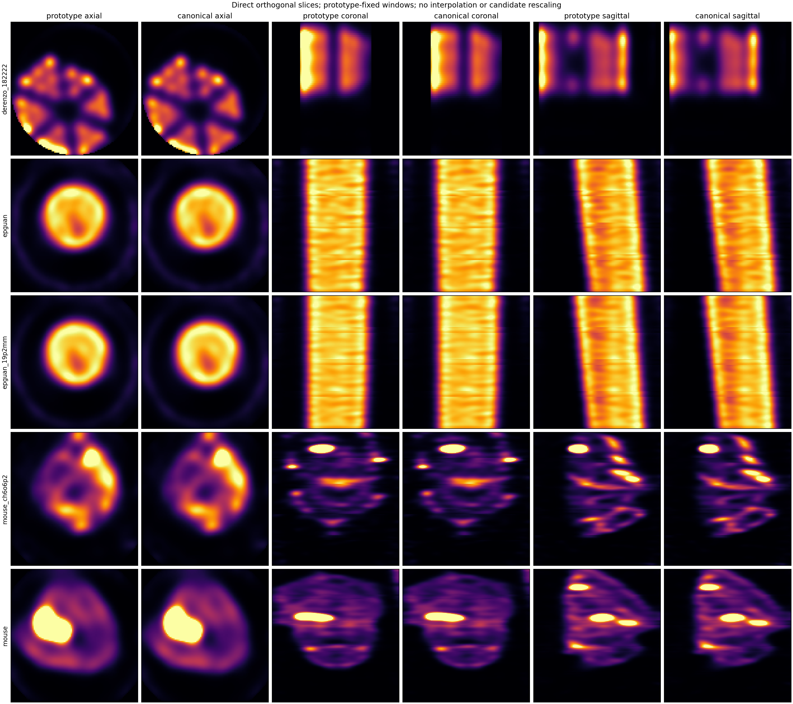

# SPECT 重构与受保护原型 `sieve_castor_fwhm1p3` 收敛审查

**执行区间：** 2026-08-10 至 2026-08-11

**最终状态：** 通过冻结五数据集合同；当前重构路线可判定为与受保护原型输出一致。最终优化后，单床 50 次中位数为 94.998 秒，四床为 141.372 秒；前者通过 2 分钟目标，后者作为当前 16 GB/float32 CSR 路线的测量边界保留。补充 `norm_factor.bin` 的 Derenzo 50 次 relL2 为 `2.9892e-7`；默认关闭的多时间段同床位内存合并入口亦通过 `2.8531e-8` 线性等价门。
**数值权威：** `6module_bak_src/spect_recon_PSC_6module_24pin_YSO_bedmerge.cu` 中的 `sieve + CASToR + FWHM 1.3 mm + 3σ` 路线。

## 1. 执行结论与判定合同

本轮不是以旧发布二进制或“看起来相似”为裁决，而是以用户指定的受保护原型为唯一数值基线。重构后的单 GPU compact-v4 路径在修复共享根因后，完成正式 Release 重编译，并对五个冻结数据集逐一执行完整数据、50 次 MLEM。随后又恢复原型在 canonical 输出后的独立 Smooth/Butterworth 派生：五组同输入滤波门、可选钳制门和一迭代真实入口 smoke 全部通过。

| 合同项 | 冻结口径 | 本轮结果 |
|---|---|---|
| 输入 | 指定五数据集、同一 compact 90z 系统矩阵、同一配置与 detector 68 屏蔽 | 42 个文件以路径、大小和 SHA-256 预检，合计 26,342,787,420 字节 |
| 重建 | 单 GPU、完整数据、MLEM 50 次 | 五次正式进程退出码均为 0 |
| PSF | sieve、CASToR erf 体素积分核、FWHM 1.3 mm、3σ | manifest 与命令逐项一致 |
| 多床 | `Bed1=max physical z`、`z_bed_flip=1`、center66/cosine10、原型增益链 | 四/五床增益、方向与对象门通过 |
| 数值门 | 支撑区 NCC ≥ 0.99；缩放匹配 relL2 ≤ 0.10 | 五组全部通过；最弱项为 Derenzo 0.995661 / 0.068587 |
| 对象门 | Derenzo、EP、mouse 各自冻结指标 | 五组全部通过 |
| 输出 | 始终保留 `recon_it<N>`；Smooth 0.30 mm/3σ 与 Butterworth 5 cpcm/order 8 从同一主输出独立派生 | 五组同输入线性/钳制门通过；生产 clamp-on 一迭代入口写出六个体文件且 manifest 一致 |

结论的量词仅覆盖这五个冻结输入和上述合同。它证明当前实现复现指定原型输出；不把原型提升为独立物理真值，也不外推到未验证的矩阵、采集或参数组合。

## 2. 最近重构审查与根因修复

审查先恢复完整构建和可复现入口，再以一迭代结构证书定位数值差异，最后才运行昂贵的 50 次终点。所有最终改动都位于共享数据流，不含按 Derenzo、EP 或 mouse 分支的对象调参。

| 审查项 | 发现 | 最终处置与证据 |
|---|---|---|
| 构建/接口收敛 | 重构后存在 include、命名空间和测试目标残留；输出阶段曾被误删，导致主线不再生成原型 Smooth/Butterworth 派生 | 恢复 `SPECT_recon`/`spect_tests` Release 构建；生产只保留 compact-v4 与一个保存数据流，阶段为 `none|in_recon|output` |
| 输出滤波缓存 | 输出 Butterworth 在相同参数下切换体积尺寸时，plan 重建后 response 指针已释放但参数缓存仍命中 | response/mask 缓存把空 device 指针纳入重建条件；尺寸切换回归和五组连续运行通过 |
| 失败纪律 | PSF CUDA 不可用时存在不可接受的降级风险；复现目录可混入旧产物 | PSF 路径改为 fail-closed；正式运行使用全新输出根并以 manifest/证书闭合 |
| CUDA 投影缓存 | 原实现把 host 指针和数量误当成内容身份，复用/修改缓冲区时可能沿用陈旧投影 | 每个 numerator pass 对每床刷新一次，同时保持分支/块内复用；突变缓存回归测试通过 |
| 多床反向存储 | `z_bed_flip=1` 后，增益拟合读取了错误物理重叠端，且 cosine 融合极性仍按未反向存储解释 | 交换增益读窗并反转 blend 极性；独立修复虽能救 CH mouse 但使 EP 对象门失败，组合修复后五组通过 |
| detector 68 | 通用 ENG identity 映射把 global 68 映射到 `angle 120..179, z 36..47, x 0..11`，而原型明确使用固定块 | 仅对 `link-4/FPGA-2/detector-4` 使用原型固定 `angle 0..59, z 24..35, x 24..35`；其他 detector 仍走通用映射；缓存 schema 升级防止误用旧分母 |
| 首次 PSF 状态 | 当前实现以全体素 1.0 启动，直到首轮末才施加 ROI；CASToR PSF 会把 ROI 外初值扩散入内 | 使用已有 mask 在第一次 PSF forward 之前就约束初始图像，和原型 `k_fill` 后立即施加 local cylinder ROI 的顺序一致 |
| 数值策略候选 | 低预测比值返回中性比、0.01 更新下限、直接 `A^T w` 均曾被怀疑 | 均按预注册门在无改善时拒绝并回退；没有保留第二算法或永久开关 |

### 2.1 一迭代定位证书

结构门固定为尺度匹配 relL2 ≤ `1e-7`；比较的是同一输入、矩阵、屏蔽、ROI 和中心 66 层，方向为 `rot0`。该门用于区分迭代阶段结构，而不是代替最终 50 次对象门。

| 阶段 | 支撑区 NCC | 尺度匹配 relL2 | 判定 |
|---|---:|---:|---|
| 原 detector 68 映射，masked no-PSF | 0.99917756 | 1.2651e-2 | 失败；直接 `A^T w` 候选无改善 |
| 修正 detector 68，no-PSF | 0.99999999999997 | 7.2998e-8 | 通过；屏蔽映射根因闭合 |
| 仅修正 detector 68，sieve | 0.99999545 | 1.1210e-3 | 失败；差异缩小为 PSF 首态问题 |
| 再修正初始 ROI，sieve | 0.99999999999996 | 8.9537e-8 | 通过；首次迭代结构门闭合 |

这条证据链否定了此前“剩余问题一定在加权灵敏度”的临时判断：直接 `A^T w` 实验没有改变失败指标；真正的两个根因分别是 detector 68 坐标合同和 PSF 前初始 ROI 状态。

## 3. 验证方法

### 3.1 输入与可执行文件冻结

`input_preflight.json` 记录 42 个输入文件，包括正式可执行文件、配置、算法配置、坏探测器列表、受保护原型源码、6 个矩阵块及 metadata、18 个床位投影、5 组原型 Analyze 输出及 sidecar。五组 50 次基础重建证据所用二进制 SHA-256 为：

```text
98F4771023E2C9A40C7045CE8F2EB95DDA6E7BD1617EBDDC7F899E857AE03019
```

受保护原型源码 SHA-256 为：

```text
6B332DAD80310B2F0E4F8723B45B2AEB6C1B5DC24A153A6F720A467D45573B0E
```

GPU 连续驻留与资源生命周期重构位于提交 `cbd3a27bdbf8459736bd474a71316397cb5cb757`；normfactor 的原型 ROI/PSF 支持域修复与时间段合并分别收敛于 `ece3454`、`0c1a06e`。最终从包含完整验证记录的干净提交 `949f766` 重编译并重置部署包。最新 Release 版本为 `20260811+949f766`，构建树与部署包可执行文件 SHA-256 均为：

```text
814E01C10894950B009B05BEC5CB136A797B099610036F3852EC28BE0C5CBF7B
```

权威配置为 `config/spect_config.ini`，部署副本为 `staging/SPECT_recon_rc_dev/bin/config/spect_config.ini`；两者 SHA-256 均为 `AC2564D005109AEA11B823A3642F2993573E068CD45C96243972CE3F6AF78806`。部署 `-dumpConf` 确认 `smooth_apply_stage=output`、`butter_apply_stage=output`、Smooth `0.30 mm/3σ`、Butterworth `5 cpcm/order 8`、`output_nonnegative_clamp=true`，以及新入口 `merge_time_segments=false`。随后只有本报告元数据更新，不改变该 Release 包。

### 3.2 比较规则

原型 Analyze 输出与当前 MHD 输出按冻结方向比较：Derenzo 为 `rot0`，所有多床数据为 `zflip+rot0`。数值比较报告原始全体积 NCC、原型 1%–P99.9 支撑域 NCC，以及最小二乘尺度匹配后的 relL2。尺度匹配只用于既定数值门，不修改候选输出或 QA 图。

对象门分别为：

- Derenzo：中心保留率 ≥ 95%，rod separability 相对变化绝对值 ≤ 5%，覆盖下降不超过 2 个百分点，最长 gap 增量不超过 1 层。
- EP：轴向 CV 相对变化绝对值 ≤ 5%，覆盖下降不超过 2 个百分点，seam 中位变化 ≥ -0.02。
- Mouse：支撑区 NCC ≥ 0.99，逐切片 NCC 中位数 ≥ 0.95。
- 主输出：体素有限、无负值、间距误差 ≤ `1e-6 mm`。输出滤波先以 clamp-off 对齐原型线性体，再以 clamp-on 对齐 `max(prototype,0)`；manifest 必须声明主、Smooth、Butterworth 共六个体文件。

### 3.3 直接图像质量检查

下图的切片索引只由原型最大平面和确定；每一对原型/当前图使用同一原型正体素 P99.5 窗宽，不插值、不对候选重标度、不逐图归一化。该图用于发现方向、裁剪、接缝或局部结构异常，数值门仍由 JSON 证书裁决。



## 4. 五数据集 50 次正式结果

### 4.1 主数值门

| 数据集 | 旧主线支撑 NCC | 当前支撑 NCC | 旧主线 relL2 | 当前 relL2 | 方向 | 对象/数值门 |
|---|---:|---:|---:|---:|---|---|
| `derenzo_182222` | 0.99416676 | **0.99566121** | 0.07935099 | **0.06858701** | `rot0` | 通过 / 通过 |
| `epguan` | 0.98811926 | **0.9999999999990** | 0.12512118 | **1.2421e-6** | `zflip+rot0` | 通过 / 通过 |
| `epguan_19p2mm` | 0.98978362 | **0.9999999999999** | 0.11587385 | **3.2937e-7** | `zflip+rot0` | 通过 / 通过 |
| `mouse_ch6o6p2` | 0.99810844 | **0.9999999870383** | 0.05630161 | **1.6905e-4** | `zflip+rot0` | 通过 / 通过 |
| `mouse` | 0.99840547 | **0.9999999999764** | 0.05201265 | **5.1246e-5** | `zflip+rot0` | 通过 / 通过 |

Derenzo 是最终最弱项，因此也是残余数值风险的上界：支撑 NCC 仍高于门 0.00566，relL2 低于门 0.03141。其余四组已接近数值重合。这里不声称 bitwise 一致；正式结论是全部通过预先冻结的等价门。

### 4.2 对象端点与多床增益

- Derenzo 13/13 中心保留；separability 相对变化 `+0.0007349`；轴向 CV 相对变化 `-0.0100253`；覆盖变化 0 个百分点；最长 gap 变化 0 层。
- EPguan 轴向 CV 相对变化 `+2.65e-6`，覆盖变化 0，seam 中位变化 `-3.86e-8`；19.2 mm EP 亦通过相同门。
- CH mouse 支撑 NCC `0.9999999870`、逐切片 NCC 中位数 `0.9999999997`；普通 mouse 分别为 `0.99999999998` 和 `0.9999999999998`。

| 数据集 | 正式拟合床增益（Bed1 锚定） |
|---|---|
| EPguan | `[1, 0.99541156, 1.00488482, 1.00712702]` |
| EPguan 19.2 mm | `[1, 1.00559497, 1.01155317, 1.01504480]` |
| CH mouse | `[1, 0.98772624, 1.05752771, 1.06324157, 1.83994881]` |
| Mouse | `[1, 0.93013597, 0.99892396, 1.06802328, 1.44608513]` |

### 4.3 优化前正式运行耗时

| 数据集 | 耗时（秒） | 退出码 |
|---|---:|---:|
| Derenzo | 594.79 | 0 |
| EPguan | 696.66 | 0 |
| EPguan 19.2 mm | 707.68 | 0 |
| CH mouse | 805.77 | 0 |
| Mouse | 741.88 | 0 |

这些是优化前的单次历史记录，只用于量级背景，不作为后续性能采纳统计量。四/五床的同几何分母缓存被复用，但每组投影、50 次 numerator/update 和最终输出均独立执行。

### 4.4 输出级 Smooth / Butterworth 与非负钳制门

输出滤波合同固定为：主输出不滤波；Smooth 和 Butterworth 都从同一份 canonical stitch + mask 体独立派生，不能串联。线性验证关闭 `output_nonnegative_clamp`，生产验证开启并逐体比较 `max(prototype, 0)`。五组冻结同输入采用 `2e-7` relative-L2 门；主输入与 Butterworth 为数值零差异，Smooth 的最大 relL2 为 `1.1563017424662106e-7`，钳制后保持同一误差并通过门。

| 数据集 | 同输入主体 relL2 | Smooth relL2 | Butterworth relL2 | clamp-on 对应门 |
|---|---:|---:|---:|---|
| `derenzo_182222` | 0 | 1.1392794e-7 | 0 | 通过 |
| `epguan` | 0 | 1.1563017e-7 | 0 | 通过 |
| `epguan_19p2mm` | 0 | 1.0843560e-7 | 0 | 通过 |
| `mouse_ch6o6p2` | 0 | 1.1321093e-7 | 0 | 通过 |
| `mouse` | 0 | 1.1213429e-7 | 0 | 通过 |

端到端 smoke 使用正式 Derenzo 投影、已认证 denominator cache、`sieve + CASToR 1.3 mm/3σ` 和一次 MLEM。进程退出码为 0；`recon_it1`、`recon_it1_smooth`、`recon_it1_butter` 均为 `100×100×72`、有限且负体素数为 0，manifest 记录独立派生、生产钳制及六文件清单。该 smoke 只验证真实保存入口，不替代上面的五组同输入数值门，也没有重跑五组 50 次 MLEM。


### 4.5 GPU 连续驻留与 50 次迭代性能收敛

最终采纳项均在同一个 compact CUDA 数据流内：完整图像/分子统计只在 `vb>=2` 时计算；冻结投影每次重建只上传一次，分支元数据仅在变化时上传；全局图像、每床反投影累加器、分母、mask 与 MLEM 更新保持 GPU 驻留；bed gather、double→float、CASToR 前后向、bed→global 累加和更新不再往返 CPU。矩阵启动只同步装载 resident 前缀，其余 host chunk 与 device warmup 重叠；迭代结束后先释放矩阵/重建缓冲，再执行最终 sieve 保存和 cuFFT 输出滤波。

共享设备上的短 A/B 使用同一 EP 四床输入、同一 SHA-256 矩阵副本、同一 denominator cache，按 `A1,B1,B2,A2,A3,B3` 交错运行，各取三次中位数。A 是上一 Release `7ed8259`，B 是最终驻留实现；两者均显式启用 branch batch，故本表只测量本轮 GPU 驻留、启动和资源生命周期增益。

| EP 四床 3 次 A/B | 三次耗时（秒） | 中位数（秒） | 相对上一 Release |
|---|---|---:|---:|
| 上一 Release | 36.4538、35.4514、35.7105 | 35.7105 | — |
| GPU 驻留候选 | 31.1907、30.3804、31.7334 | **31.1907** | **-12.66%（1.145×）** |

三组配对的主/Smooth/Butterworth 最大 relL2 分别为 `3.7841e-8`、`4.0849e-8`、`9.3060e-8`，低于主输出 `1e-5` 与派生体 `2e-7` 门；全部输出有限且生产钳制后非负。`SPECT_COMPACT_BRANCH_BATCH=0` 仍是可调用的逐分支正确性基线，背景、CTAC、BSREM、in-recon 滤波与调试统计继续走明确的通用路径，没有静默 GPU→CPU 降级。

最终 50 次运行使用正式配置、NVMe 冻结矩阵副本和命中 denominator cache，各重复三次并取中位数：

| 数据集 | 床数 | 三次耗时（秒） | 中位数（秒） | 相对上一 Release 中位数 | 120 秒目标 |
|---|---:|---|---:|---:|---|
| Derenzo | 1 | 94.9981、94.8386、96.5928 | **94.9981** | **-9.17%**（104.5868→94.9981） | 三次均通过 |
| EPguan | 4 | 142.5726、141.2369、141.3719 | **141.3719** | **-25.46%**（189.6690→141.3719） | 未通过 |

Derenzo 相对上一 Release 的三输出最大 relL2 为 `9.8653e-8`；EPguan 为 `1.0930e-7`。EP 三次重复间主/Smooth/Butterworth最大 relL2 为 `7.8445e-8`、`8.3835e-8`、`1.2482e-7`。因此性能增益没有通过改变原型、滤波或钳制结果获得。

按 250 ms 采样，EP 50 次三轮合计 1,241 个样本，包含其他任务的总显存峰值为 15,333 MiB，最少剩余 729 MiB；Derenzo 峰值为 14,478 MiB，最少剩余 1,584 MiB。由此签收的低时延部署是 64 GB 主存 + SSD/NVMe 矩阵；32 GB 可降低 host cache 运行，但本轮不承诺同一吞吐。

### 4.6 性能边界实验

最终 profile 显示，16 GB 上两个 resident CSR 块加一个 transient 块已经接近容量上限；每块约 4.04–4.07 GiB，无法再加入第三个完整 resident 块。进一步尝试均按相同数值与显存合同裁决：

| 候选 | 定量结果 | 判定 |
|---|---|---|
| 删除逐块 CUDA timing/sync | EP 20 次 69.2361 秒，对照 69.3976 秒，仅 -0.23% | 噪声级，回退 |
| 非驻留 CSR 连续行片 + 双传输槽 | 3 次 42.0948 秒；20 次 127.0378 秒，对照 68.9701 秒，退化 84.2%；显存峰值降至 14,581 MiB | 数值最终通过，但性能失败，完整回退 |
| FP16 matrix value | 1,800 万点抽样 value relL2 `3.6770e-4`，2,803,544 个非零权重下溢为零 | 在进入重建前已越过 `1e-5`，不实现 |
| pinning/mmap/并行床/SpMM alg2/3/256 MiB staging/三 resident | 既有实验分别出现显存风险、不支持或持续吞吐下降 | 不重复、无残留生产分支 |

因此 `141.372 s` 是现有 float32 CSR + cuSPARSE + 16 GB 路线经小范围优化后的测量边界，不是抽象硬件极限。若重新开启，唯一仍有量级潜力的方向是单独立项的 packed-index 或近无损压缩矩阵格式、GPU 解压和自定义 sparse kernel；它会改变矩阵合同，必须把当前路线保留为控制组，不能作为本轮“顺手优化”。

### 4.7 日志位置回归

最终 Release 一迭代真实 smoke 的 `recon_20260811_200119_286.log` 位于目标目录 `recon_out/final_release_949f766_smoke/`；仓库根目录及 staging 树的 `recon_*.log` 数量均为 0。该运行使用正式 Derenzo、normfactor、命中的 v3 denominator cache 和最终部署 EXE，写出主/Smooth/Butterworth 三体积及 manifest；相对同提交已验证构建的三输出 relL2 为 `2.9054e-8`、`2.8662e-8`、`8.8310e-8`，全部有限且无负值。130.065 秒墙钟包含共享 F: 上的矩阵预载和首次 NVRTC，不纳入 50 次性能基线。正常路径下旧的本地误写问题不存在；若目标目录无法创建，logger 仍会明确提示并回退 CWD，该行为只作为可观察失败兜底。

### 4.8 normfactor 原型对齐

新增验证冻结 `test_data/norm_factor/matrix/norm_factor.bin`（6,635,528 bytes，SHA-256 `57FDBCFA…F8F77F`）为 `360×2304` angle-major float64 投影修正因子 `c`，当前与原型均只把倒数效率 `1/c` 用于 sensitivity denominator。直接改变归一化权重没有修复 Derenzo 的初始 `3.57e-2` 偏差，候选已完整回退；源码追踪确认根因是原型在 PSF 前先按圆柱 ROI 裁剪 CSR 列，而当前实现此前只在 MLEM 更新后应用 ROI。

当前实现把同一局部支持域应用于 sensitivity 的 PSF 前输入、forward PSF 后图像和 backward PSF 前分子，并把 denominator cache schema 升为 `compact_global_denom_v3_roi_pruned_psf_support`。该修复没有改变 full-FOV 快速路径。

| normfactor 原型门 | relL2 | NCC | 判定 |
|---|---:|---:|---|
| EPguan，1 次 | `2.2895e-7` | 约 `1.0` | 通过 `1e-5` |
| Derenzo，1 次 | `2.1143e-7` | 约 `1.0` | 通过 `1e-5` |
| Derenzo，50 次 | `2.9892e-7` | `0.9999999999999515` | 通过 `1e-5` |

Derenzo 50 次主体有限、负体素为 0，故生产 `output_nonnegative_clamp=true` 对该结果幂等；无需用关闭钳制换取表面一致性。原型耗时 `646.294 s`，当前首次验证耗时 `126.979 s`，但该单次 F: 结果不替代 4.5 节冻结的 64 GB + NVMe 三次中位数。

### 4.9 多时间段同床位合并与受扰性能复核

配置新增 `[InputOutput] merge_time_segments`，发布默认 `false`。启用时，`-df` 可指向 `案例/YYYYMMDD_HHMMSS/SPECT`；程序按时间名排序扫描同案例的直接子目录，要求每段具有完全相同的 `BedN.bin` 集合及 BIN 大小、头和几何，然后逐床在内存中做 angle-major 逐元素求和，不写中间投影。缺床、几何差异、非有限输入或求和溢出均直接失败；manifest 记录每床所有源路径。

真实 Derenzo `Bed1.bin` 的两个同字节副本分别置于 `20260810_210556/SPECT` 与 `20260810_211500/SPECT`。合并输出相对“单段输出 ×2”的 relL2 为 `2.8531e-8`，NCC `0.9999999999999981`，sum ratio `0.9999999996763583`，manifest 记录 2 段/2 来源。首轮 smoke 暴露单床目录被误识别为 `dfList` 后产生 Z 翻转，修复后单床目录保持 `-df` 方向语义；该失败结果只作诊断，不进入发布。

加入 normfactor 后在共享设备/F: 上重复三次 50 迭代，耗时为 `144.046`、`144.886`、`164.235 s`，中位数 `144.886 s`；三次对原型 relL2 为 `2.996e-7` 至 `3.001e-7`，重复间最大 relL2 `5.5585e-8`。该测量明确受其余任务与矩阵盘吞吐影响，不能推翻 4.5 节相同算法在 64 GB + NVMe 的冻结 Derenzo 中位数 `94.9981 s`。

持久 PTX 缓存候选虽连续命中三个 NVRTC 模块，但首次迭代仍为 46–54 秒：26.1 GB CSR 预载与运行时编译重叠，墙钟没有可签收下降。候选代码完整回退。现有 float32 CSR + cuSPARSE + 16 GB 路线的量级瓶颈仍是矩阵 I/O/PCIe 流送；不重新开启 4.6 节已拒绝的 mmap、三 resident、FP16 或行片双缓冲路线。


## 5. 决策、限制与停止条件

### 5.1 最终采纳

生产路线固定为单 GPU compact-v4、MLEM/BSREM、`sieve + CASToR + FWHM 1.3 mm + 3σ`，输出保存一个未滤波主体与两个从同一 prepared volume 独立派生的 Smooth/Butterworth 副本。生产 `output_nonnegative_clamp=true`；线性原型门用 `false`，通过后恢复生产值。

性能端只采纳经中位数证明的共享改动：无效统计门控、冻结投影/元数据最小上传、两块矩阵驻留、主 MLEM 图像/累加器/更新全程 GPU 驻留、启动预载重叠和最终资源提前释放。所有失败候选的结论保留在 `recon_out/perf_120s_20260811/experiment.json`，代码均已回退。

normfactor 路线采纳原型等价的 ROI 裁列/PSF 支持域语义；多时间段路线只增加一个默认关闭的配置键并复用同一投影加载和重建实现。时间段合并只改变进入重建前的投影值，不派生第二条算法管线。

### 5.2 已知限制

- MSVC 链接仍报告既有 `LNK4098`；Release、235 项测试（234 通过、1 项外部数据门按设计跳过）、随后显式通过的五数据集滤波门和真实运行均成功，未把警告误报为已修复。
- 五组 50 次原型等价门来自冻结正式结果；本轮 GPU 驻留改动以真实 EP/Derenzo、单元/集成测试和同输入上一 Release 对比复核，没有再次耗时重跑另外三组 50 次。
- 原型是用户指定的实现权威，不是独立临床或物理真值；未验证新矩阵、新核素、新采集、DICOM 临床阅片或跨 GPU 性能。
- 16 GB EP 峰值只余 729 MiB；其他任务在 resident warmup 后继续显著增长仍可能触发 OOM。
- 单床 50 次通过 2 分钟不外推到多床；四床 EP 的三轮中位数为 141.372 秒。
- 32 GB 主存不是同吞吐认证配置；正式低时延证据来自 64 GB + NVMe。
- 用户给出的 `D:\data\predata\260810_dedenzo_mdp_6\20260810_210556\SPECT` 在本机不存在；时间段功能使用真实冻结 Derenzo 投影的两时间段副本完成入口验证，尚未在该设备端案例目录复测。
- 当前 F: + 共享设备的 normfactor 三次中位数为 144.886 秒；它是受扰部署观测，不与 64 GB + NVMe 的 94.9981 秒混合成同一基线。

### 5.3 停止条件

本轮在两侧触发边界后停止：无损行片传输重叠使 20 次运行退化 84.2%，而能显著降低矩阵显存的 FP16 表示在矩阵值层已达 `3.68e-4`。在不更改矩阵格式与 sparse kernel 的条件下，没有新的数据支持继续叠加开关或并行。只有单独冻结新的压缩矩阵合同、控制基线、显存门和五数据集数值门后，才重新开启该架构级路线。


## 6. 复现与验证清单

### 6.1 精确复现命令

```powershell
.\build_release.bat
cmake --build build\Release --config Release --target spect_tests --parallel 8
ctest --test-dir build\Release -C Release --output-on-failure

$env:SPECT_FILTER_PARITY_BASE_ROOT = (Resolve-Path recon_out\canonical_stitch_20260807\runs).Path
$env:SPECT_FILTER_PARITY_REFERENCE_ROOT = (Resolve-Path recon_out\canonical_stitch_20260807\prototype_filter_parity).Path
build\Release\bin\Release\spect_tests.exe `
  --gtest_filter=OutputFilterParityTest.FrozenFiveDatasetsWhenRequested

# 清理后按 input_preflight.json 的 SHA-256 从 F: 重建临时 NVMe 矩阵副本。
recon_out\perf_120s_20260811\run_variant.ps1 `
  -Label resident_final_candidate_B1 -Dataset epguan -Iterations 3 -BranchBatch `
  -HostCacheBytes 25g -MatrixDir tmp\matrix_perf_nvme_20260811 `
  -DenomCache recon_out\perf_120s_20260811\nvme_denom\epguan.mhd `
  -Executable staging\SPECT_recon_rc_dev\bin\SPECT_recon.exe -Verbosity 0

python scripts\compare_recon_metrics.py `
  --reference <previous.mhd> --candidate <current.mhd> --out-json <metrics.json>

# normfactor 50 次：沿用上面的正式 Derenzo 参数，并增加
# -normFactorFile test_data\norm_factor\matrix\norm_factor.bin
# -compactDenomCache <validated-v3-denom.mhd> -it 50:50 -cyl 30,21.6

# 多时间段入口：发布配置默认 false；验证时临时设 true
# [InputOutput] merge_time_segments = true
.\SPECT_recon.exe -df "D:\data\predata\<case>\20260810_210556\SPECT" `
  -chunkCSRDir <matrix> -fout <output>\recon <其余冻结重建参数>
```

完整 A/B 顺序、50 次命令、环境、耗时、GPU 样本和输出路径保存在各 `record.json`；采纳/拒绝总表见 `recon_out/perf_120s_20260811/experiment.json`。清理后临时矩阵和独立旧 Release 副本不保留，可从冻结源与哈希重建。

### 6.2 验证状态

| 检查 | 证据 | 状态 |
|---|---|---|
| 最终 Release | `20260811+949f766`；build/staging SHA-256 `814E01C1…CBF7B`；`sm_86/89/120` | 通过；保留 LNK4098 标记 |
| 部署配置 | 源码/部署 SHA-256 `AC2564D0…78806`；output Smooth 0.30 mm/3σ、Butterworth 5 cpcm/order 8、clamp on、时间段合并默认 off | 通过 |
| 正式测试 | 235 项：234 通过、外部五集门默认 skip 1；显式冻结根 1/1 | 通过 |
| 五数据集原型主门 | 五个完整 50 次正式端点、对象/方向/有限非负门 | 通过 |
| 输出滤波门 | 五组 Smooth 最大 `1.1563e-7`；Butterworth 同输入零差；clamp-on 门 | 通过 |
| 短 A/B | 上一 Release/驻留候选中位数 35.7105/31.1907 秒；最大三输出 relL2 `9.3060e-8` | 通过，-12.66% |
| Derenzo 50 | 三轮中位数 `94.9981 s`；三输出对旧版最大 `9.8653e-8` | 通过 120 s |
| EP 四床 50 | 三轮中位数 `141.3719 s`；对旧版 -25.46%；重复最大 `1.2482e-7` | 数值/性能增益通过，120 s 未达 |
| 显存 | EP 峰值 15,333 MiB、最低空闲 729 MiB；Derenzo峰值 14,478 MiB | 通过但接近边界 |
| 边界实验 | 行片双缓冲 20 次 127.0378 s；FP16 value relL2 `3.677e-4` | 均拒绝并回退 |
| 最终真实 smoke | 部署 EXE + normfactor + v3 cache；三输出相对已验证构建最大 `8.8310e-8`，均有限非负 | 通过 |
| 日志目录 | smoke 日志在目标目录；仓库/staging 根数量 0 | 正常路径通过 |
| normfactor 原型门 | EP 1 次 `2.2895e-7`；Derenzo 1/50 次 `2.1143e-7`/`2.9892e-7` | 通过 `1e-5` |
| 时间段合并 | 2 段同 Bed1；相对单段×2 relL2 `2.8531e-8`；manifest 2 来源 | 通过 |
| 受扰 50 次复核 | 144.046/144.886/164.235 s，中位数 144.886 s；对原型约 `3.00e-7` | 数值通过；当前环境未达 120 s |
| PTX 缓存候选 | 模块命中但首迭代仍 46–54 s | 无墙钟收益，拒绝并回退 |
| 未验证 | 其余三集在驻留实现下二次 50 次、32 GB 同吞吐、新格式/新矩阵、临床正确性、跨架构性能 | 明确未验证 |


## References

本报告使用的完整本地证据路径见 `reports/2026-08-10-prototype-sieve-castor-fwhm1p3-convergence_sources.md`。
