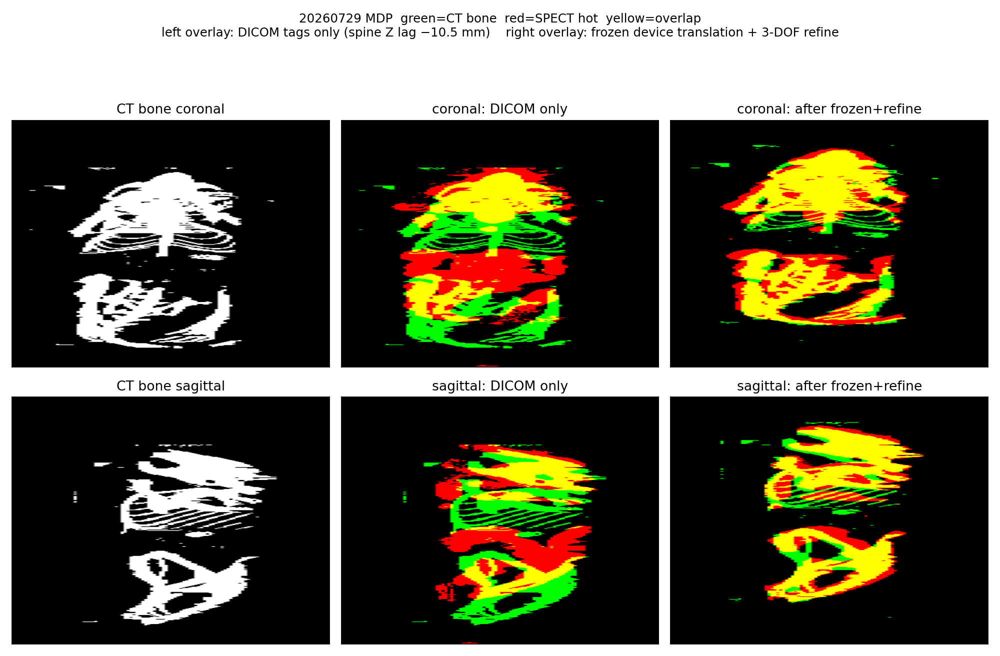
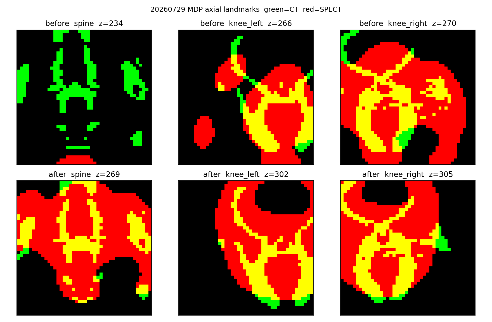
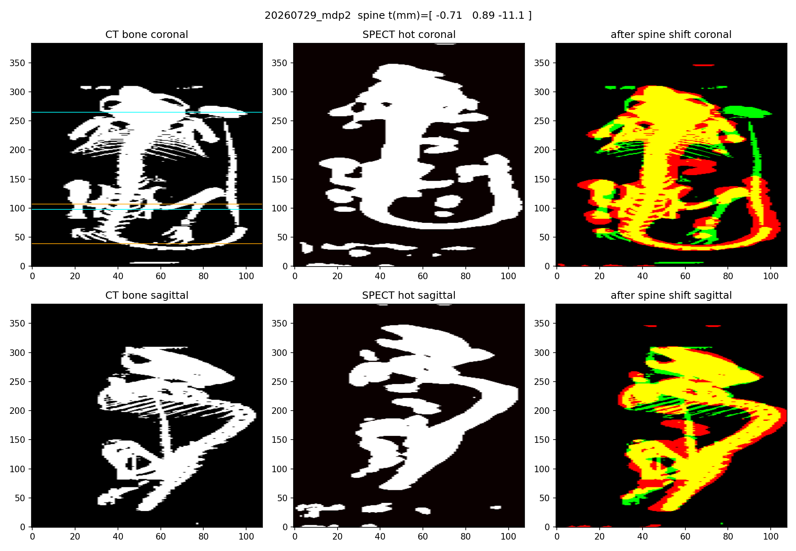
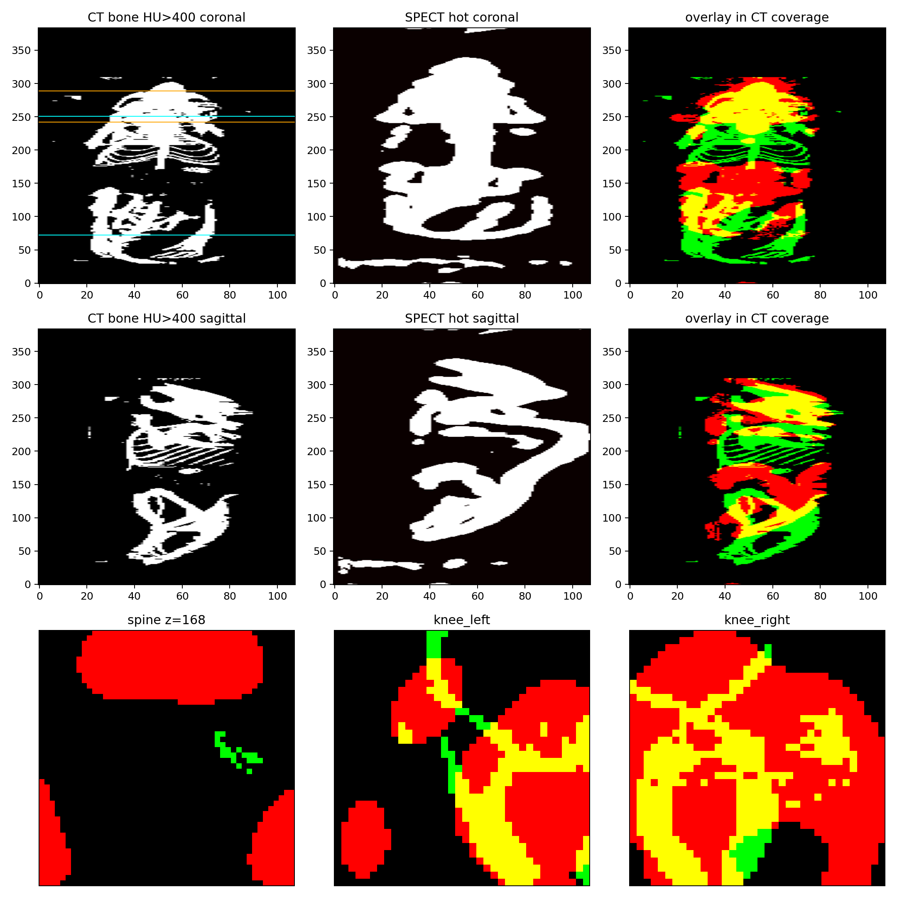
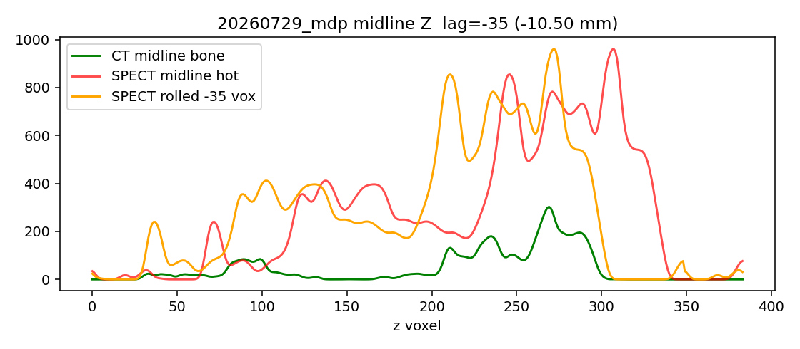
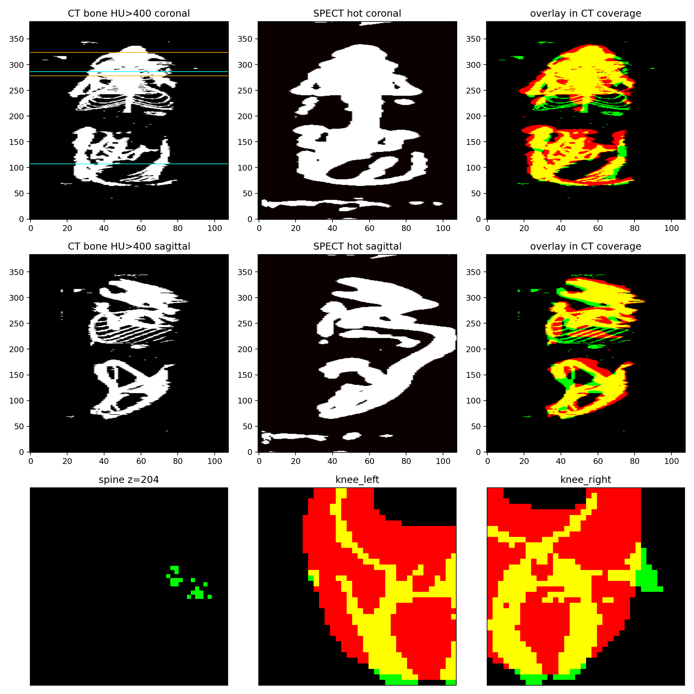
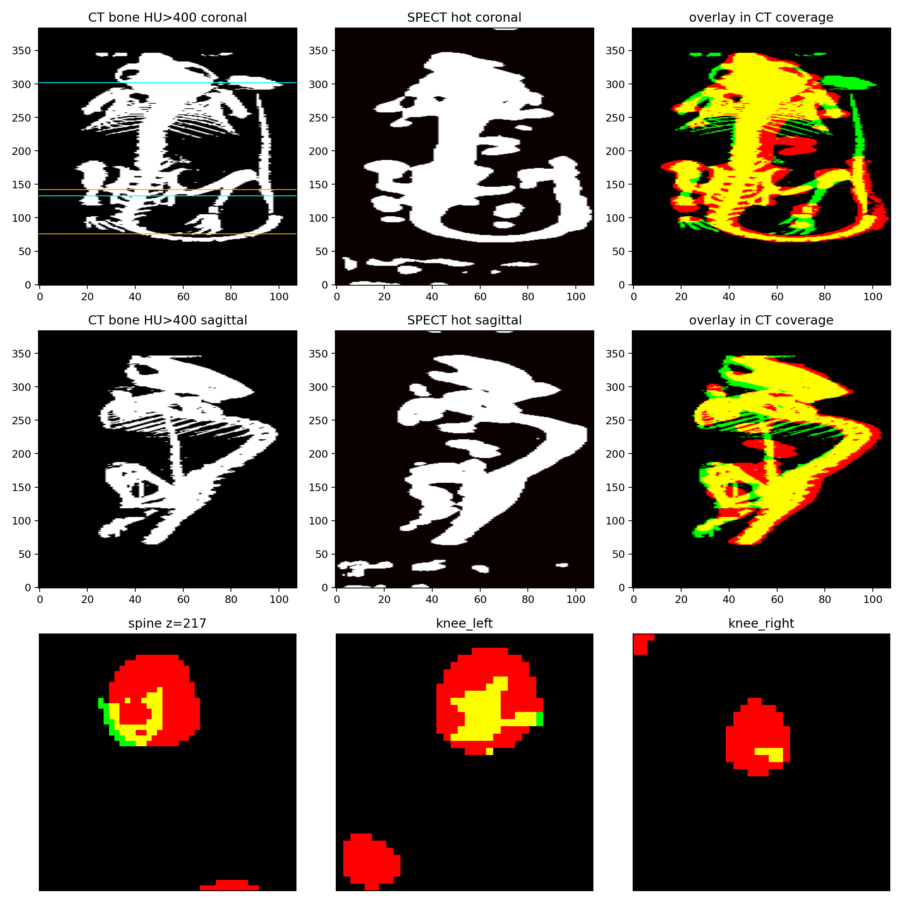
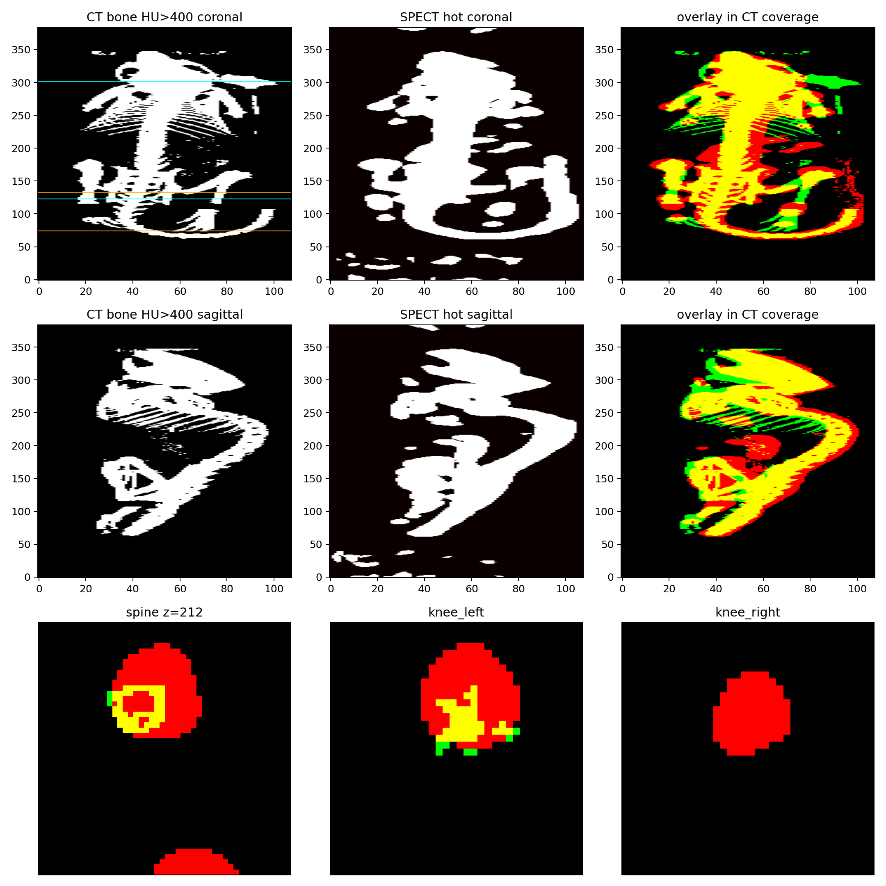

# CT→SPECT: frozen device translation + spine/knee refine

Date: 2026-08-13. Data: three MDP mice under `F:\DATA\SUPER_PSC_1_0\NORMAL\SPECT\dcmdata\mouse_samples`.

## What changed

DICOM FrameOfReference resampling is kept. The residual is no longer whole-body bone/hot occupancy.

Production path:

1. Resample CT onto the SPECT grid from DICOM tags.
2. Apply a **frozen** device translation (median spine ridge of the three 20260729 MDP mice).
3. Measure a **3-DOF** residual on the spine midline ridge plus left/right knees.
4. If that residual is already ≤ 0.3 mm, skip refine. Otherwise apply it, clamped to **±2 mm** per axis.

Z of the combined vector is the spine midline xcorr (integer voxel lag × 0.3 mm). XY is the median of the spine ridge and knees that agree with the spine within 2 mm. Knees that disagree are recorded but not used for the transform.

Frozen vector (`multipinhole/config/ct_spect_registration.ini`, `[Registration] translation_xyz_mm`):

`(-0.225, 1.600, -11.100) mm`

## Registration example (20260729 MDP)

Green = CT bone (HU>400). Red = SPECT MDP hot. Yellow = overlap. Overlay MIPs are clipped to CT coverage.

SPECT 5-bed DICOM on this mouse spans patient Z **37.05–151.95 mm** (114.9 mm). CT spans **27.7–129.9 mm** (102.2 mm). SPECT **starts 9.35 mm after CT**, so the head vertex is on CT only; SPECT also extends 22 mm past CT at high Z (air-padded). Green without red at the head, or red without green past CT, is FOV coverage. It is not a remaining Z translation.

**Left overlay: DICOM tags only** (spine Z lag −10.5 mm, combined |t| = 10.6 mm).  
**Right overlay: frozen device translation + 3-DOF refine** (combined |t| = 0.03 mm).



Same mouse, axial landmarks. Top row is DICOM-only; bottom row is after frozen+refine. Knee and spine panels go from separated green/red to yellow overlap. Slice index changes because CT is resampled onto the SPECT grid.



MDP_2 after the same frozen Z shift (spine translation −11.1 mm):



## Why occupancy was rejected

On 20260729 MDP, occupancy after apply reported 0.024 mm while the spine ridge still needed about **−10.5 mm** in Z. Occupancy matches the whole-body mask, including bladder and FOV endpoints. That number is not spine/knee TRE.

SPECT 5-bed coverage is not the same box as CT: this mouse has **9.35 mm of CT-only head** before the SPECT start, and SPECT continues past CT at the other end. A MIP that includes those unmatched ends looks like a Z shift even when the spine lag in the overlap is 0. Overlay QA clips SPECT hot to sampled CT (`HU > -900`) so the past-CT SPECT tail is not read as pose error; the CT-only head vertex still shows as green without red.

## DICOM-only spine residual (no frozen transform)

| Case | Spine xyz mm | Combined \|t\| mm | Midline Z lag |
|---|---|---|---|
| 20260729 MDP | (−0.49, 1.60, −10.50) | 10.58 | −35 vox |
| MDP_2 | (−0.23, 1.60, −11.10) | 11.10 | −37 vox |
| MDP_2 4H | (0.00, 1.52, −11.40) | 11.33 | −38 vox |

Z is a device-looking offset (same SPECT IPP `(46.06, 39.51, 37.05)` on these mice). XY after switching the ridge from blob COM to midline profile peaks is consistent to ~0.1 mm in Y across the three scans.





## Frozen + clamped refine

| Case | After frozen \|t\| mm | Refine | After refine \|t\| mm | Decision |
|---|---|---|---|---|
| 20260729 MDP | 0.724 | applied, not clipped | **0.033** | within 0.3 mm |
| MDP_2 | **0.189** | skipped (already in gate) | 0.189 | within 0.3 mm |
| MDP_2 4H | 0.389 | applied, not clipped | **0.103** | within 0.3 mm |

Independent remeasure on MDP1 spect-grid HU vs activity: midline Z lag **0 voxels** after the scheme (was −35).







MIP overlays still show red/green fringes. SPECT hot masks are thicker than CT bone; that is PSF/threshold, not a 10 mm pose error. The gate is the spine/knee vector, not MIP overlap area.

## Holdout (freeze MDP1 spine only)

Frozen `(-0.49, 1.60, −10.50) mm`, then the same ±2 mm refine:

| Holdout | After frozen \|t\| mm | After refine \|t\| mm |
|---|---|---|
| MDP_2 | 0.728 | **0.207** |
| MDP_2 4H | 1.036 | **0.068** |

Neither refine hit the ±2 mm clamp. The 0.3 mm figure remains **diagnostic**.

## CTAC / anatomy-guided status

`attmap_recon220.mhd` (120×120×1100, `recon_bed1_max_z`, z-bed-flip) and `regct_hu_recon220.mhd` were written for the three MDP cases under `recon_out/ct_spect_reg_20260813/*_fixedrefine/`. SPECT_recon `-attMap` / `-regCT` was **not** run. Tc99 was not used to freeze the device vector (knees/spine are not hot).

## Reproduction

```powershell
python scripts\prepare_ct_mu_map.py --help

python scripts\prepare_ct_mu_map.py `
  --ct-dir <case>\CT --spect-dicom-dir <case>\SPECT `
  --output recon_out\...\ct_mu_recon220.mhd `
  --profile recon220 --beds 1,2,3,4,5 --allow-ct-padding `
  --fixed-translation-xyz mdp_device `
  --measure-residual --apply-residual `
  --refine-translation-limit-mm 2.0 `
  --residual-method spine_knee `
  --attenuation-mu-output recon_out\...\attmap_recon220.mhd `
  --attmap-bed-order recon_bed1_max_z --z-bed-flip `
  --regct-hu-output recon_out\...\regct_hu_recon220.mhd
```

`--profile device160` is unchanged.

## Verification

| Check | Result |
|---|---|
| `python scripts/prepare_ct_mu_map.py --help` (self_check, including synthetic spine/knee shift) | pass |
| Three MDP DICOM-only spine Z | −10.5 / −11.1 / −11.4 mm |
| MDP1 midline lag after scheme | 0 vox (direct spect-grid HU vs activity) |
| Three MDP combined TRE after scheme | 0.033 / 0.189 / 0.103 mm |
| Holdout MDP1-frozen on MDP_2 / 4H | 0.207 / 0.068 mm |
| Occupancy-as-gate | rejected |
| SPECT_recon CTAC / `-regCT` | not run |
| Tc99 landmark refine | not run |

## Imaging-validation-gate

```
Decision: scoped optimization (MDP bone-tracer mice)
Execution status: continue (registration done; CTAC recon not started)
Scope: CT→SPECT pose for mouse_samples MDP; CTAC maps written, not reconstructed
Evidence regime: relative baseline (DICOM-only vs frozen+refine); no landmark ground truth
Protected outcome and gate maturity: spine/knee translation magnitude; 0.3 mm diagnostic
Evidence: paired before/after TRE on three MDP; holdout with MDP1-only freeze; occupancy rejected
Verification: self_check; independent midline xcorr; manifests under recon_out/ct_spect_reg_20260813/
Remaining gap: CTAC/anatomy-guided recon; Tc99 should use frozen translation without bone-hot refine
```
