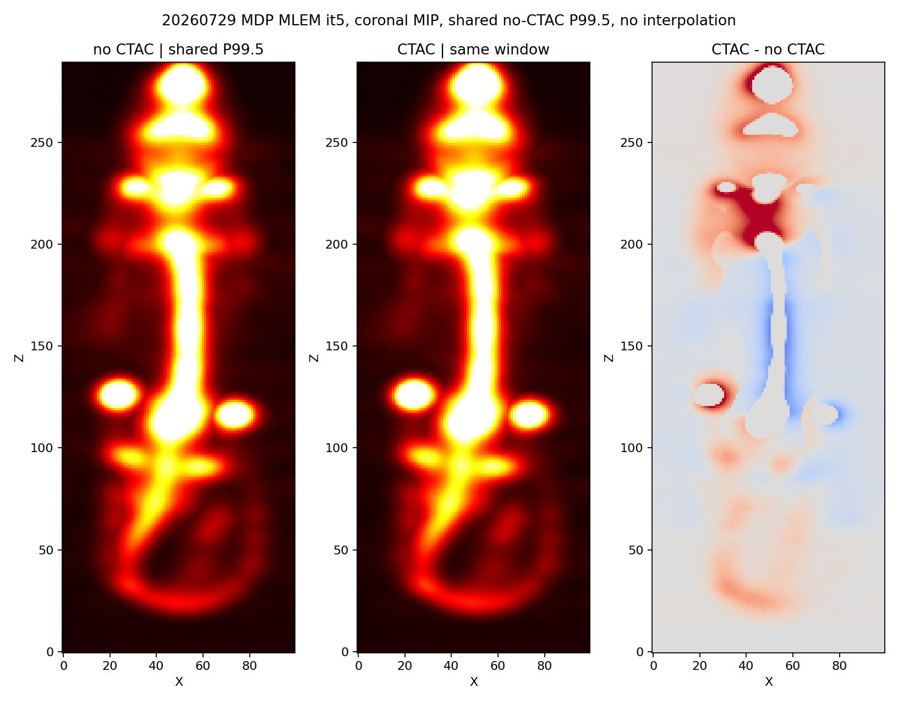
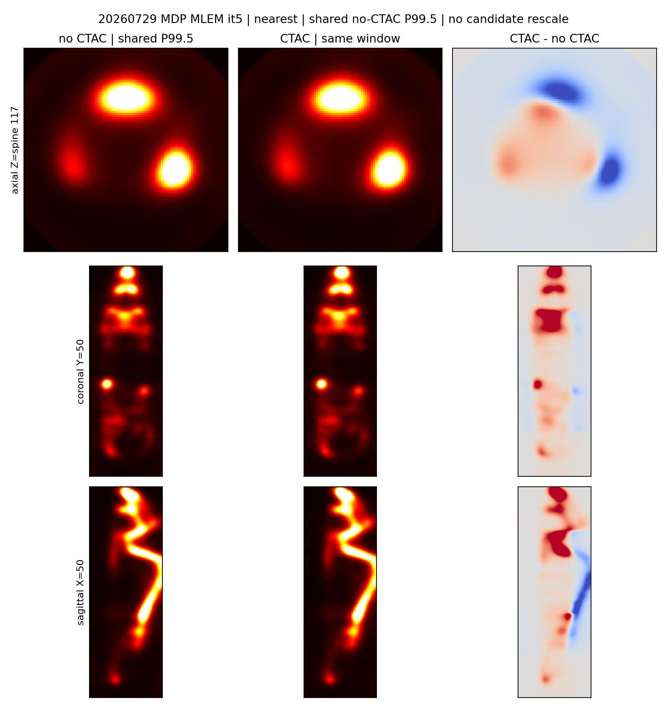
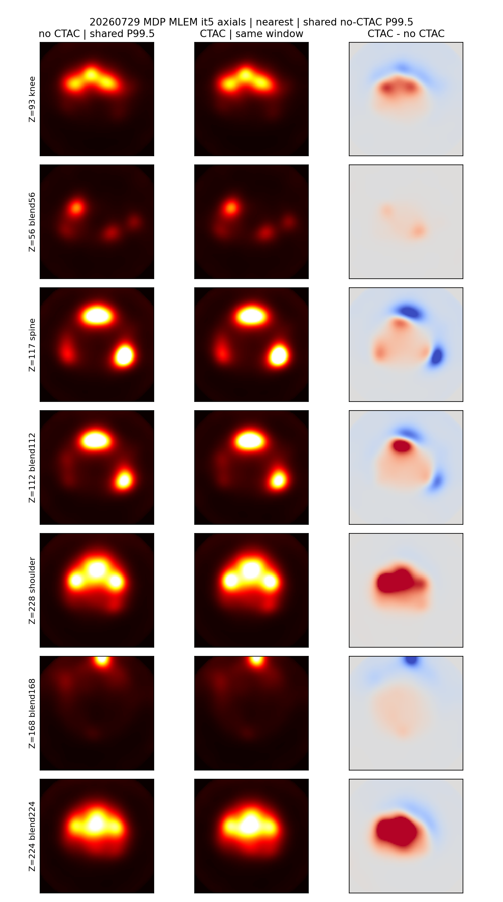

# 20260729 MDP：identity 预处理 + CTAC 冒烟

**日期：** 2026-08-13

**候选：** 配准后的 `attmap_recon220.mhd` + `-ctac`（MLEM）

**基线：** 同一组 identity `BedN.bin`、同一 120×120×220 矩阵、无 CTAC
**判定：** 运行时冒烟通过；质量 **undetermined**，**不 promote**。解剖引导（`-regCT`）本轮未跑。

## 配对（按 Bed1 Angle0 采集时刻，不按文件夹名）

| 例 | ENG | 采集开始 | DICOM | attmap |
|---|---|---|---|---|
| MDP | `mouse_2h` | 16:23:40 | `20260729_162015` | `20260729_mdp_fixedrefine` |
| MDP_2 | `mouse_4h`（文件夹名易误导） | 19:20:56 | `20260729_191822` | `20260729_mdp2_fixedrefine` |
| MDP_2 4H | **本机无 ENG zip**（同目录只有 `…MDP.zip`=`162015` 与 `…MDP_2.zip`=`191822`） | 20:45 | `20260729_204522`（仅 DICOM） | 不能从 `mouse_4h` 配 |

本轮重建只跑了 **MDP**。MDP_2 的 identity BIN 已写出，尚未重建。

## 预处理

Spect_preprocess `SPECT_6Module_260720` + `run_6module_preprocess.py`：`--projection-variant identity --merge-eng-per-angle --intermediate-format sp6proj --isotope Tc99m --jobs auto --max-jobs 8`。

两例各 5 床、每床 60 角 × 10 包。`Bed1.bin`…`Bed5.bin` 均为 **360×2304 float64**、6 635 528 字节，`preprocess_summary.json` 全部 `status=ok` / `projection_variant=identity`。

输出：`recon_out/ctac_mdp_smoke_20260813/preproc/{20260729_mdp,20260729_mdp2}/SPECT/`

## 重建合同

- 可执行文件：`SPECT_recon 20260813+a696994`
- 测试 INI：`multipinhole/config/spect_config.ct_guided.ini`（生产 `spect_config.ini` 未改）
- 矩阵：**`F:\matrix_PSC_PIN26x28x25_SCALE2_141keV_120x120x220`**（120×120×220）。`build/.../matrix/260601` 是 **108×108×80**，不能配 recon220 attmap。
- `-dim 120,120,220 -vox 0.3 -ang 360 -detN 48,48 -opti mlem -psf 1.3,3 -psfMode sieve -psfKernel castor -zbedflip 1 -cyl 36,66`
- 内部体：120×120×1100；stitch 输出：100×100×290。attmap 与输出 MHD **不要求同形**。
- 独立 denom：`denom/20260729_mdp_noctac.mhd` 与 `denom/20260729_mdp_ctac.mhd`

无 CTAC 20 次约 4 分钟（denom miss）。CTAC 因 `compactHasAttenuation` 关掉 resident branch-batch：it1 ≈ 80 min，其后约 7–36 min/次。it5 已写出；it20 在写本报告时仍在跑。

## it5 对照（输出对输出，denom 对 denom）

门：有限 / 非负 / 非零，全部通过。Denom 确实变了。

| 量 | 无 CTAC | CTAC | CTAC / 无 CTAC |
|---|---:|---:|---:|
| 输出 sum | 1.480×10⁶ | 1.508×10⁶ | 1.019 |
| 输出 max | 14.84 | 15.90 | — |
| 输出 relL2 | — | — | 0.065 |
| 输出 P99.5 归一 relL2 | — | — | 0.053 |
| denom sum（1100 层） | 3.888×10⁶ | 3.735×10⁶ | 0.961 |
| denom relL2 | — | — | 0.048 |

窗：无 CTAC 正值体素 P99.5；最近邻；不对 CTAC 单独归一化。



正交切片（轴向脊柱 Z=117、冠状 Y=50、矢状 X=50）：



轴向 landmark / 融合入口（膝 Z=93、脊柱 117、肩 228；blend 56/112/168/224）：



共享 P99.5 窗（0–6.56）下左两列几乎看不出形态差：NCC **0.998**，热点体素（>0.1×P99.5）均值比 **1.029**，典型 |Δ| 只占窗宽 **1.1%**，只有 5.6% 热点体素超过窗宽的 5%。差分图色标是 ±0.327（约窗宽 5%），所以第三列比左两列更“有颜色”，不是结构变了。

按切片热点均值，CTAC/无 CTAC：

| 切片 | Z | 均值比 | 峰值比 |
|---|---:|---:|---:|
| 膝 | 93 | 1.012 | 1.008 |
| 脊柱 | 117 | 0.984 | 0.972 |
| 肩 | 228 | 1.049 | 1.033 |
| blend224 | 224 | 1.060 | 1.101 |
| blend168 | 168 | 0.943 | 0.944 |

肩/头端略升、脊柱略降、blend168 略降，是分区数值，不是配准错位。

迭代口径不要混用：设备端无 CTAC Derenzo 目视接近收敛约 **500–600 次**；本仓库对原型的 Derenzo 数值门是 **50 次**；这次 MDP CTAC 冒烟是 **it5**（正在跑的是 20）。it5 共享窗下几乎同形，符合“还远未到目视收敛”。灵敏度已经变了（denom relL2 0.048），图像还没把那点差表现成形态。这不是标定 TRE，也不是 AC 定量增益门。五床 220 CTAC 约 9 min/次，500 次不是本轮冒烟的可执行终点。

原始指标：`recon_out/ctac_mdp_smoke_20260813/qa_it5/ctac_pair_metrics.json`

## 未做

- MDP_2 重建（BIN 已就绪）
- MDP_2 4H（本机无 `*4H*.zip` / `*204522*.zip`；dcmdata 仅有 DICOM）
- `-opti bsrem -regCT`（GPU 仍被 CTAC it6–20 占用；CTAC 路径约 9 min/次，BSREM 20 次会再数小时）
- 未改生产 stitch / 生产 INI / 配准冻结向量

## 复现

预处理（cwd = `E:\Xiang_Project\SPECT\6Module\tools`）：

```text
python run_6module_preprocess.py --input-root <ENG>\SPECT --output-root <OUT>\SPECT --exe <6M>\bin\preprocess\Spect_preprocess.exe --lut <6M>\bin\preprocess\resources --scanner-name SPECT_6MODULE --projection-variant identity --intermediate-format sp6proj --isotope Tc99m --merge-eng-per-angle --jobs auto --max-jobs 8
```

重建：命令行见 `recon_out/ctac_mdp_smoke_20260813/recon/20260729_mdp_{noctac,ctac}/*.log`。比较：

```text
python recon_out/ctac_mdp_smoke_20260813/eval_ctac_pair.py --no-ctac .../noctac/recon_it5.mhd --ctac .../ctac/recon_it5.mhd --no-ctac-denom .../denom/20260729_mdp_noctac.mhd --ctac-denom .../denom/20260729_mdp_ctac.mhd --output-dir .../qa_it5
python recon_out/ctac_mdp_smoke_20260813/render_ctac_slices.py
```

不要用未改的 `scripts/eval_ctac_smoke.py`（它要求 attmap 与输出同形，且缝是旧 80 层的 75/145/215）。

## 验证

| 检查 | 结果 |
|---|---|
| identity BIN 头 360×2304、6 635 528 字节，两例各 5 床 | 通过 |
| attmap 载入 120×120×1100，无维数报错 | 通过 |
| 无 CTAC 20 次退出 0，输出 100×100×290 | 通过 |
| CTAC it5 有限/非负/非零 | 通过 |
| denom 路径分离且 relL2 0.048 | 通过 |
| 输出 vs 输出，不要求 attmap 形状 | 通过 |
| CTAC it20 / MDP_2 / `-regCT` | **未完成** |
| TRE / 定量 AC 增益 | **未做**（也不作为本轮门） |
