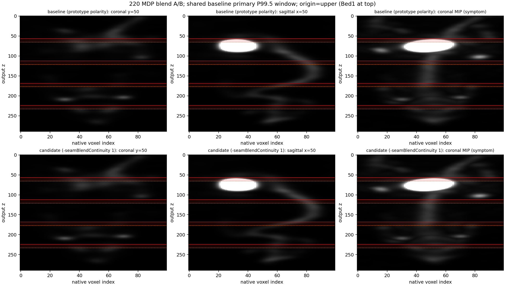

# 220 MDP：反向存储下取消融合极性倒放

**日期：** 2026-08-13  
**候选：** `-seamBlendContinuity 1`（默认仍为 0）  
**基线：** `recon_out/20260813_mdp_nude_220z_xflip1/recon_it20.mhd`  
**体：** `recon_out/20260813_mdp_nude_220z_blendcont/recon_it20.mhd`  
**图：** `reports/assets/2026-08-13-mdp-nude-220z/blendcont_vs_baseline_shared_window.png`

## 判定

在 **120×120×220** 的 8/12 MDP 五床上，反向存储时不再反 cosine 极性，把四个融合入口的相邻层 relL2 均值从 **0.367 降到 0.105（−71%）**。非融合层 relL2 **8.45e-8**，增益链与基线相同。默认保持原型倒放；本开关为 opt-in，不是生产合同。

膀胱接缝入口从 0.413 降到 0.122，倒放成分被压掉；Bed1 FOV 边仍可能缺覆盖，不能当成器官切断已根治。0–2 体素 XY 错位也不是这一刀的对象。

## 数值（相对基线，未校准为门）

| 项 | 基线（原型极性） | `-seamBlendContinuity 1` |
|---|---:|---:|
| 入口 relL2 Z=56 / 112 / 168 / 224 | 0.413 / 0.373 / 0.427 / 0.254 | 0.122 / 0.099 / 0.113 / 0.085 |
| 入口均值 | 0.367 | 0.105 |
| 融合层 relL2 vs 基线 | — | 0.142 |
| 非融合层 relL2 vs 基线 | — | 8.45e-8 |
| it20 增益 | `[1, 0.739, 0.760, 0.727, 0.731]` | 同左 |

先前 108×108×80 的 2h/4h 入口均值 0.83→0.12（Sol 目录 `recon_out/mdp_staircase_20260812/`）。220 上同样方向、幅度更小，符合「短 FOV 放大倒放」。



窗：基线正值体素 P99.5；最近邻；不对候选单独归一化。MIP 只用于定位症状。

## 复现

基线命令见 `recon_out/20260813_mdp_nude_220z_xflip1` 日志。候选在同一命令上加 `-seamBlendContinuity 1`，输出目录改为 `recon_out/20260813_mdp_nude_220z_blendcont`，denom cache 复用基线。比较：

```
python recon_out/20260813_mdp_nude_220z_blendcont/compare_blend_continuity.py
```

## 未做

- 七月小鼠 50 次、EP 轴向 CV（改极性会打破旧原型门；采用前必须重新冻结）
- 设备 160 网格成对体积
- 与 `-seamXyAlign` 组合

## 验证

| 检查 | 结果 |
|---|---|
| `VolumeOutputTest` 18/18，含新测试 `ContinuityBlendDoesNotInvertReversedStorageFade` | 通过 |
| 候选 20 次退出码 0，denom cache hit，manifest `seam_blend_continuity: true` | 是 |
| 增益与基线 it20 一致 | 是 |
| 入口 relL2 / 融合-非融合 relL2 / 固定窗切片 | 见上 |
| EP / 七月小鼠 / 160 网格 | **未做** |
