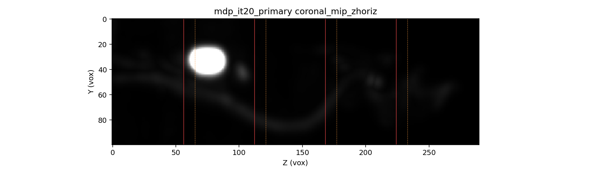
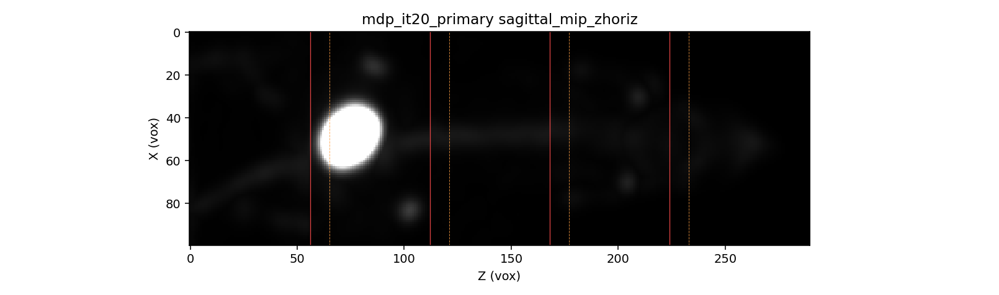
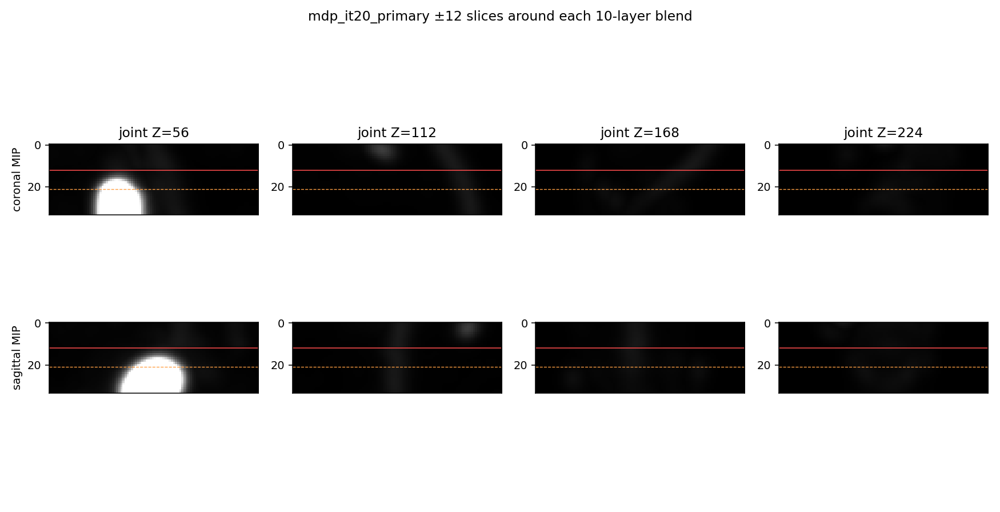
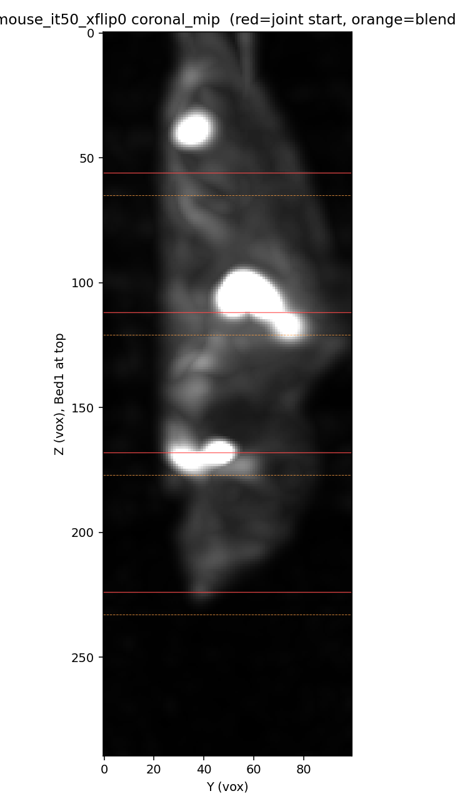
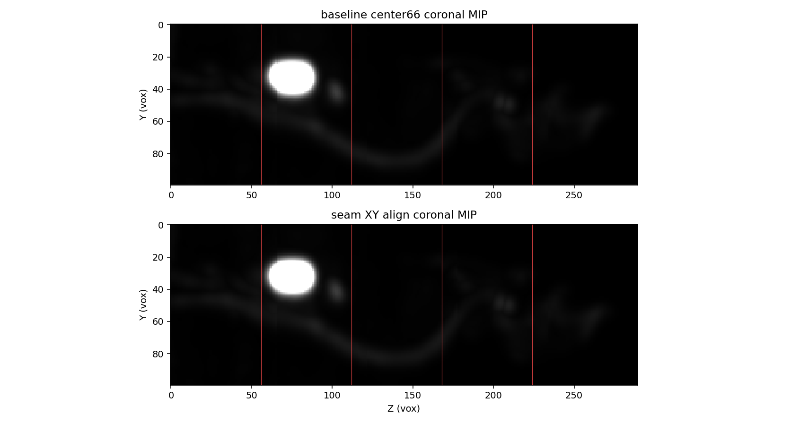
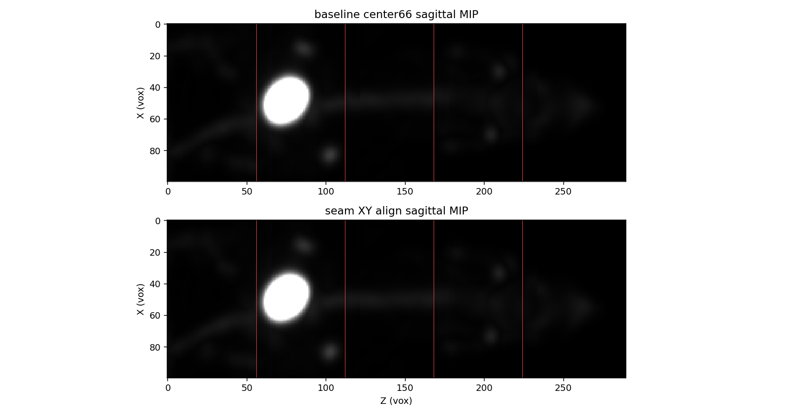

# MDP 裸鼠 220 层主线重跑：锯齿接缝仍在

**日期：** 2026-08-13  
**数据：** `F:\DATA\predata\SUPER_PSC_1_0\SPECT\20260812_nude_MDP_spect\20260812_170822\SPECT\Bed{1–5}.bin`  
**体数据：** `recon_out/20260813_mdp_nude_220z_xflip1/recon_it20.mhd`  
**图：** `reports/assets/2026-08-13-mdp-nude-220z/`

## 判定

把设备这次的 Sampling **108×108×160** 换成受保护 **120×120×220**，**不能**消掉 coronal/sagittal 上的床间接缝锯齿。

同一套 BIN、同一套 `center66_cosine10`、`z_bed_flip=1`、`x_out_flip=1`、MLEM 20 次，本机 220 层结果在 Z=56/112/168/224 仍有横向错位。20260811 已与原型 NCC≈1 的七月小鼠（同一拼接算法）同样有接缝。因此锯齿是 **10 层强度融合、不做 XY 配准** 的主线行为，不是「设备忘了开翻转」或「只换矩阵就能修好」。

设备仍应换掉名为 `260601`、实为 Nz=160 的矩阵（FOV/overlap 合同），但不要把它当成这条锯齿的修复。

**膀胱接缝补充（切片，非 MIP）：** 膀胱在 z=62–87，Bed1/Bed2 融合带为 z=56–65。Bed1 独有区（z&lt;56）几乎没有膀胱；z=56 仍空，z=61 才突然出现完整高亮。这是 **Z 向覆盖/强度断层**，不是把同一椭圆平移几个体素。`-seamXyAlign` 修不掉这一处。脊柱其它白线仍以 0–2 体素 XY 为主。见图 `baseline_bladder_axial_strip.png`、`baseline_bladder_coronal_sagittal_slices.png`。

**修复（本轮已实现、默认关闭）：** `-seamXyAlign 1`。重叠层 NCC 证明两床对同一物理 Z 只差 **0–2 个体素**的刚性平移（NCC ≥ 0.98）；拼接前按此平移再 cosine 融合。默认 0 以保持原型 `center66` 等价。体：`recon_out/20260813_mdp_nude_220z_xyalign/recon_it20.mhd`。

| 项 | 设备 2026-08-12 | 本机本次 |
|---|---|---|
| 矩阵 | `108×108×160`（目录名 260601） | `120×120×220` |
| 拼接 | center66，融 10 层 | 同左 |
| `z_bed_flip` / `x_out_flip` / `z_out_flip` | 1 / 1 / 0 | 1 / 1 / 0 |
| 步进 | 56 层 / 16.8 mm | 同左 |
| 迭代 | 20:5 | 20:5 |
| 输出 | 100×100×290 | 100×100×290 |
| it20 床增益 | `[1, 0.732, 0.756, 0.723, 0.726]` | `[1, 0.739, 0.760, 0.727, 0.731]` |

增益几乎一样：强度台阶不是这次 XY 跳变的主因。

## 图像（窗：正值体素 P1–P99.7，无逐图归一化）

红线 = 接缝起点（Z=56,112,168,224）；橙虚线 = 10 层融合终点。







对照：受保护 220 路径上的另一只小鼠（`x_out_flip=0`，50 次）在 Z=112/168 同样错层。该体相对原型支撑区 NCC ≈ 1，故原型拼接也带这条缝。



## 接缝度量（探索性，未校准为门）

全切片热体素质心会被膀胱等换层结构带跑，**不作为门**。脊柱附近 33×33 窗相位相关（相对融合前 5 层 vs 融合后 5 层）：

| 接缝 Z | MDP it20 ΔX,ΔY（体素） | 合位移 mm | 七月小鼠合位移 mm |
|---|---|---|---|
| 56 | +10, −14 | 5.16（膀胱区，不可靠） | 0.90 |
| 112 | +2, −7 | 2.18 | 4.37 |
| 168 | +4, +12 | 3.79 | 4.95 |
| 224 | −8, +6 | 3.00 | 2.83 |

目视锯齿大约是几个体素的台阶；上表量级与 MIP 一致的是 Z=112 的约 2 mm。设备 MHD 本地不存在，没有与 160 网格的成对数值差。

## 机制（假设 vs 已观测）

**已观测：** `center66` 只在 10 层里做 cosine 强度混合，相邻床的 XY 相对平移会变成台阶。MDP 脊柱细而亮，几个体素就很刺眼。`x_out_flip` 是整幅 X 镜像，不会单独错开某一床。

**假设（未单独实验）：** 每床取中心 66 层后，物理重叠的 10 层分别来自两床 FOV 中心的对侧（约 +23 vs −33 层，与 Nz 无关）。若单床重建存在随局部 Z 的 XY 残差，160 与 220 都会留下同类台阶。这与「只换矩阵无效」相容，仍需一次 160 网格对照才能定量说设备是否更差。

## 如何解决

根因不是 `x_out_flip`，也不是 160 vs 220。`center66` 把每床中心 66 层放进全局 Z，重叠 10 层只做强度 cosine。那 10 层是**同一物理平面的两次独立重建**。对本组 MDP，重叠平面 NCC 在整数平移后为 0.98–0.996，平移量为：

| 接缝 | dx, dy（体素） | NCC | 样本 |
|---|---|---|---|
| Bed2 / Bed1 | 0, −1 | 0.996 | 7860 |
| Bed3 / Bed2 | 2, −1 | 0.987 | 7860 |
| Bed4 / Bed3 | 1, 2 | 0.982 | 7860 |
| Bed5 / Bed4 | 0, 0 | 0.988 | 7860 |

用融合区前后 5 层（相距 3 mm）测脊线会得到 7–19 体素，那是解剖换层，不是拼接误差。真正该修的是上表这 0–2 体素。

已加入可选整数 XY 对齐（搜索 ±8 体素，NCC 门 0.25，失败则不移）：

```
-seamXyAlign 1
```

或 `[MultiBed] seam_xy_align = 1`。默认 0。输出仍是 100×100×290。合成平移斑点单元测试（含 `z_bed_flip` 反向存储）通过。





设备侧：换 220 矩阵，需要看脊柱连续时再开 `-seamXyAlign 1`。不要关 `x_out_flip`。不要为了加宽融合而改输出 Nz。

残余：10 层融合处仍可能有噪声/强度纹理缝；亚像素平移未做；未在七月小鼠/EP 上回归此开关（故不设为默认）。

## 复现

```
D:\Projects\SPECT-recon\build\Release\bin\Release\SPECT_recon.exe
  -config D:\Projects\SPECT-recon\config\spect_config.ini
  -algoConf D:\Projects\SPECT-recon\config\algo_mlem.conf
  -dfList F:\DATA\predata\SUPER_PSC_1_0\SPECT\20260812_nude_MDP_spect\20260812_170822\SPECT\Bed1.bin;...Bed5.bin
  -chunkCSRDir F:\matrix_PSC_PIN26x28x25_SCALE2_141keV_120x120x220
  -badDetectorFile D:\Projects\SPECT-recon\recon_out\canonical_stitch_20260807\bad_detector_68.txt
  -fout D:\Projects\SPECT-recon\recon_out\20260813_mdp_nude_220z_xflip1\recon
  -dim 120,120,220 -vox 0.3,0.3,0.3 -ang 360 -detN 48,48
  -opti mlem -it 20:5 -cyl 36,66
  -psf 1.3,3 -psfMode sieve -psfKernel castor -reg none
  -zbedflip 1 -zoutflip 0 -xoutflip 1
  -bedOverlap 164,164,164,164,0
  -compactDenomCache D:\Projects\SPECT-recon\recon_out\20260813_mdp_nude_220z_xflip1\denom_cache.mhd
```

对齐候选在上述命令上加 `-seamXyAlign 1`，输出目录改为 `recon_out/20260813_mdp_nude_220z_xyalign`。

分析脚本：`recon_out/20260813_mdp_nude_220z_xflip1/analyze_seams.py`、`analyze_spine_local.py`；对比图脚本 `recon_out/20260813_mdp_nude_220z_xyalign/compare_align_mips.py`。

## 验证

| 检查 | 结果 |
|---|---|
| 五 BIN 存在且各 6,635,528 字节 | 是 |
| 基线 `SPECT_recon.exe` 退出码 0，`recon_it20.mhd` 100×100×290 | 是 |
| `-seamXyAlign 1` 20 次退出码 0，denom cache hit | 是 |
| `VolumeOutputTest.*` 17/17，含反向存储平移斑点 | 是 |
| 重叠层 NCC / 整数平移 | 见上表，NCC ≥ 0.98 |
| coronal/sagittal 基线 MIP | 接缝可见 |
| 与设备 160 网格体成对减影 | **未做** |
| `-seamXyAlign` 在七月小鼠/EP 上回归 | **未做**（故默认关闭） |
| 质心/xcorr 毫米数作为正式门 | **未校准** |

## Imaging gate

```
Decision: scoped optimization
Execution status: completed
Scope: 20260812 nude MDP 五床。候选=`-seamXyAlign 1`；基线=同输入 center66（默认关）。220 网格本身不是锯齿修复。
Evidence regime: relative baseline / exploratory
Protected outcome: 床界几何连续（同一物理重叠层 XY）；gate maturity=diagnostic
Evidence: 重叠 NCC≥0.98，平移 0–2 体素且跨迭代稳定；合成斑点测试通过；默认路径未改
Verification: VolumeOutputTest 17/17；对齐 20 次退出 0
Remaining gap: 未在七月小鼠/EP 上开此开关；亚像素未做；10 层纹理缝仍可能可见
Mixed-outcome handoff: 默认保持原型拼接。MDP 脊柱观感需要时用 -seamXyAlign 1。设备仍换 220 矩阵。失败则 NCC<0.25 不平移（fail closed）。
```
