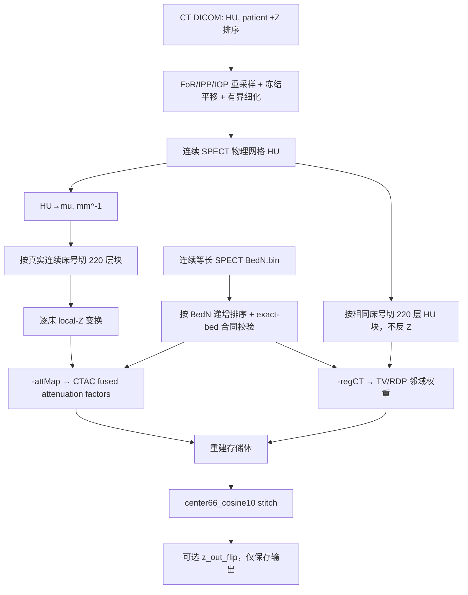

# CTAC / CT 解剖引导多床 Z 布局主线修复

日期：2026-08-14

## 结论

原五床 `regct_hu_recon220` 不是渲染上下颠倒，而是地图生成器先反床序、再逐床反 Z，组合成整幅 Z 翻转。旧图与修正图 `[::-1]` 的最大 HU 差为 `0`，旧 CT 引导候选因此保持 `orientation-invalid`，必须用修正地图重跑。

主线现在只保留三个独立坐标变换：

| 层 | 数据布局 | 允许的 Z 变换 |
|---|---|---|
| `-regCT` | 递增床号；reconstruction-storage Z | 不应用 `z_bed_flip`，不应用 `z_out_flip` |
| `-attMap` | 递增床号；每床 local system-matrix Z | `z_bed_flip=1` 时只逐床反 Z |
| 保存输出 | canonical stitch 后的 SPECT | `z_out_flip=1` 时整幅反 Z；不反向修改输入地图 |

MHD `DimSize` 为 XYZ；Python/NumPy shape 为 ZYX。因此五床地图是 MHD `120×120×1100` / NumPy `(1100,120,120)`，生产 stitch 输出是 MHD `100×100×290` / NumPy `(290,100,100)`。

## 主流程与原理



### CT → mu-map → CTAC

当前标定采用

`mu = water_mu × clip(1 + HU/1000, 0, 3)`，默认 `water_mu=0.0152 mm^-1`。

空气/低于 −1000 HU 被截为 0，水约为 `0.0152 mm^-1`，高密度组织上限为三倍水。CTAC 沿每个角度/体素到探测器的路径积分 `mu`，形成 `exp(-∫mu dl)` 型衰减因子；fused 投影/反投影及 sensitivity denominator 使用同一因子。这里的单位和绝对数值具有物理意义，不能归一化到 `[0,1]`。

### CT HU → 解剖引导 TV/RDP

`-regCT` 不进入系统矩阵，也不产生衰减因子，只调节相邻体素间的正则耦合：

`w = floor + (1-floor) × exp[-0.5 × (ΔHU/sigma_HU)^2]`。

HU 可为负值，也无需归一化；权重只依赖 HU 差值与同单位的 `regCtSigma`。本次 MDP 冒烟使用 `sigma=100 HU`。跨骨/软组织等强 HU 边界时权重降低，正则化更少跨边界抹平；区域内部仍保持平滑。`-attMap` 不再隐式充当 `-regCT`，避免 mu 标度与 local-Z 布局被误用于解剖权重。

## 少于五床的最小处理

不重配准、不补零床、不复制床。`-dfList` 和 `--beds` 必须是 Bed1..Bed5 中同一个连续子集，例如 `2,3,4`；每床长度仍为 220 层，床步进仍为 56 层 / 16.8 mm：

- 连续 CT 物理网格 Z：`220 + (N-1)×56`；三床为 332 层。
- 输入地图堆栈 Z：`N×220`；三床为 660 层。
- canonical 输出 Z：`66 + (N-1)×56`；三床为 178 层。
- MHD `SPECTBeds` 必须与排序后的 `-dfList` 床号逐项相同；不一致、缺标签或非连续床号均在多床运行中失败退出。

生成器以子集第一床的固定物理 origin 建网格，因此 `Bed2,3,4` 直接覆盖五床物理网格中的对应区间，不把 Bed2 伪装成 Bed1。

## 实现记录

- `scripts/prepare_ct_mu_map.py`：删除 `--attmap-bed-order`；分别生成 local-Z `attMap` 与 storage-Z `regCT`；写入 map role/layout/exact beds/intensity units 标签；支持独立生成 `regCT`。
- `multipinhole/include/io/VolumeLoader.h`：解析并校验 MHD 的 `SPECTMapRole / SPECTZLayout / SPECTBedOrder / SPECTBeds / SPECTIntensityUnits`。
- `multipinhole/src/pipeline/ReconSetup.cpp`：床路径排序后要求连续子集；带标签堆栈的 `Nz` 自动换算为单床 `Nz`。
- `multipinhole/src/pipeline/MainProgram.cpp`：显式分离两类地图；AutoMu 在进入 CTAC 前转换到 local-Z；attenuation mask 转回 storage-Z；多床无标签地图失败退出。
- `multipinhole/src/pipeline/RunManifest.cpp`：物理方向更正为 Bed1=min-Z、床号递增=+Z；`z_out_flip` 后输出方向标记相应反转。

## 实际数组证书

数据：20260729 MDP；修正输出位于 `recon_out/ct_map_layout_fix_20260814/`，旧错误地图保留在原目录作为反例。

| 检查 | 结果 |
|---|---:|
| 新 `regCT` vs 连续 HU 的 storage-Z 床堆栈，max abs | `0 HU` |
| 新 `attMap` vs 连续 mu 的逐床 local-Z 堆栈，max abs | `0 mm^-1` |
| 旧 `regCT` vs 新 `regCT[::-1]`，max abs | `0 HU` |
| 三床 `Bed2–4 regCT` vs 五床对应块，max abs | `1.52587890625e-05 HU` |
| 三床 `Bed2–4 attMap` vs 五床对应块，max abs | `0 mm^-1` |
| 五床标签 | roles 正确，`SPECTBeds=1,2,3,4,5`，单位 `HU / mm^-1` |
| 三床标签 | `SPECTBeds=2,3,4` |

三床 HU 差为同一物理网格分别重采样后的 float32 舍入量级；mu 输出逐体素相同。

## 复现

```powershell
python scripts\prepare_ct_mu_map.py `
  --ct-dir <case>\CT --spect-dicom-dir <case>\SPECT `
  --output recon_out\...\ct_mu_recon220.mhd `
  --hu-output recon_out\...\ct_hu_recon220.mhd `
  --profile recon220 --beds 1,2,3,4,5 --allow-ct-padding `
  --fixed-translation-xyz mdp_device `
  --measure-residual --apply-residual `
  --refine-translation-limit-mm 2.0 --residual-method spine_knee `
  --attenuation-mu-output recon_out\...\attmap_recon220.mhd `
  --z-bed-flip `
  --regct-hu-output recon_out\...\regct_hu_recon220.mhd
```

少床只把 `--beds` 和 `-dfList` 同时改为同一连续子集；其余几何和算法不变。

## 验证状态

- PASS：Python 语法、自检与 CLI help。
- PASS：Release `SPECT_recon` / `spect_tests` 增量编译。
- PASS：Release CTest `251/251`（另有 1 项外部五数据 parity gate 按设计 skip）。
- PASS：map role/layout/units、exact-bed、连续/非连续床号、manifest 方向、whole-output Z flip 聚焦测试。
- PASS：主程序 fail-closed 冒烟：`Bed2–4` 图配 `Bed1–3 -dfList` 在读取投影前以 exit 2 拒绝；匹配 `Bed2–4` 合同后才进入投影读取阶段。
- PASS：五床与 Bed2–4 实际 DICOM 地图数组等价性检查。
- 待运行：用修正 `regCT` 重跑 BSREM 配对；旧候选不得用于解剖效果判断。
- 未运行：五床 CTAC 重建。布局和数组合同已验证，但已知 CUDA attenuation 多床调度慢路径不在本修复范围内。
