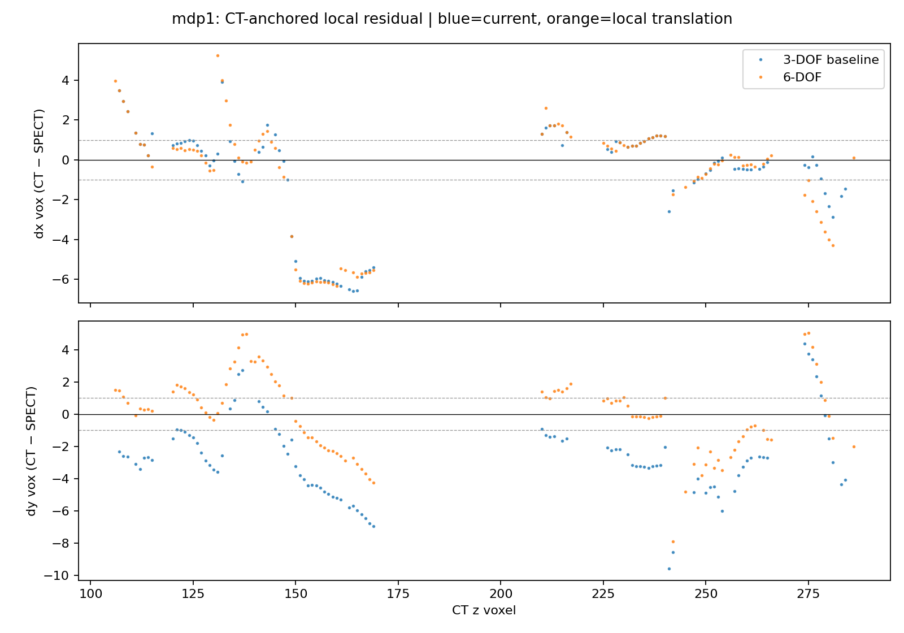
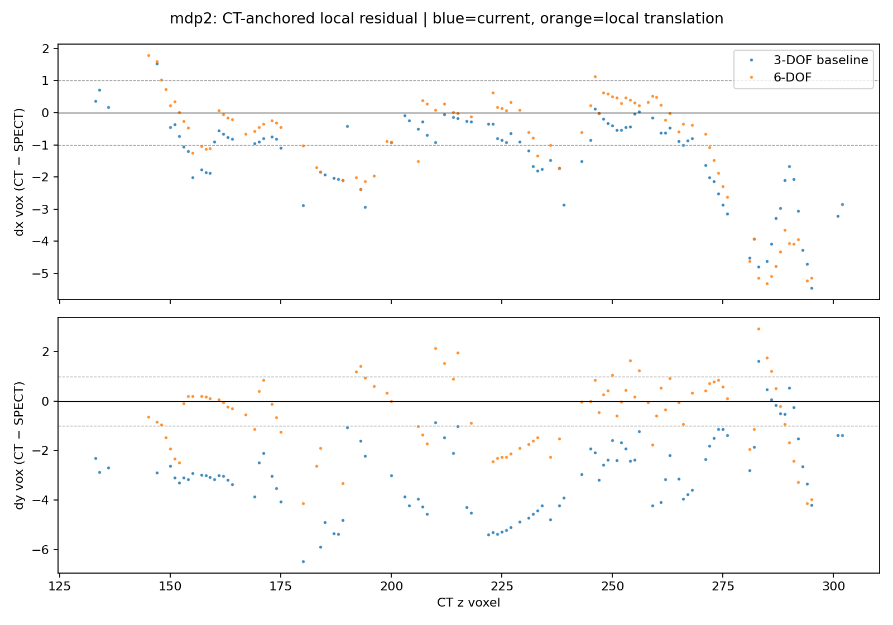
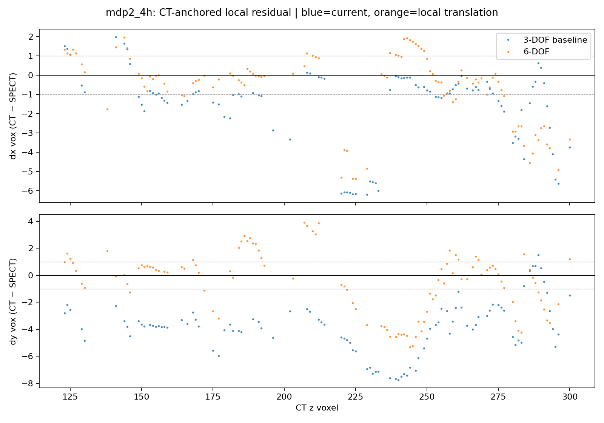
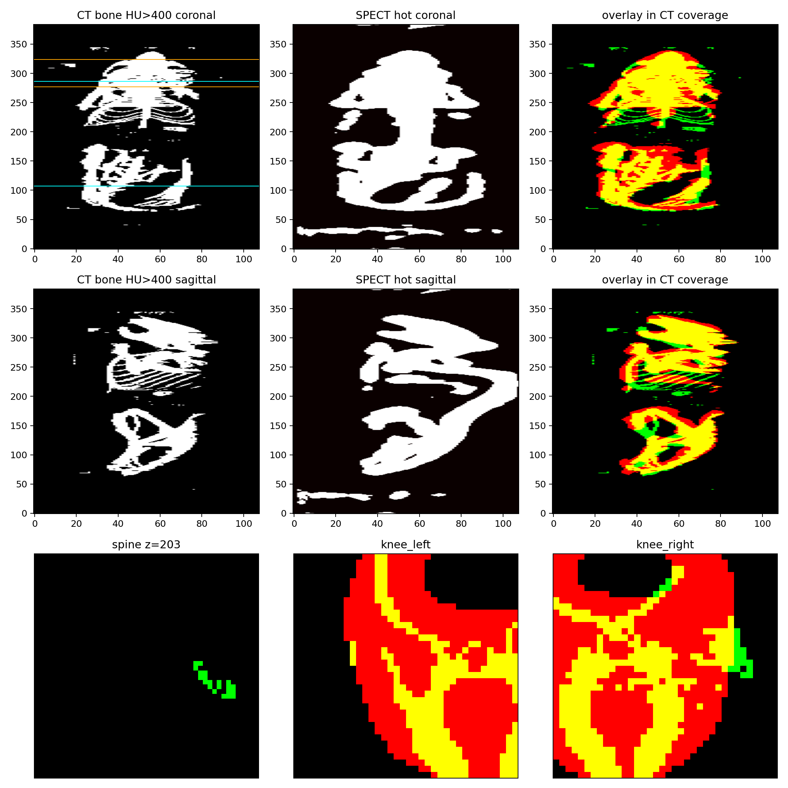
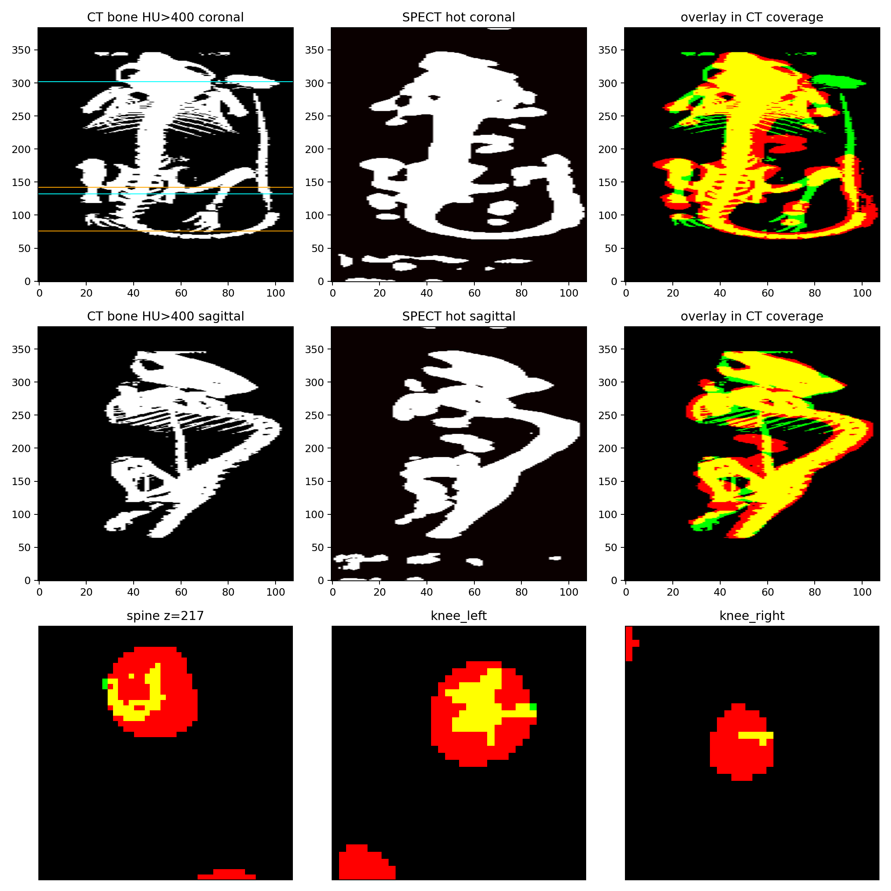
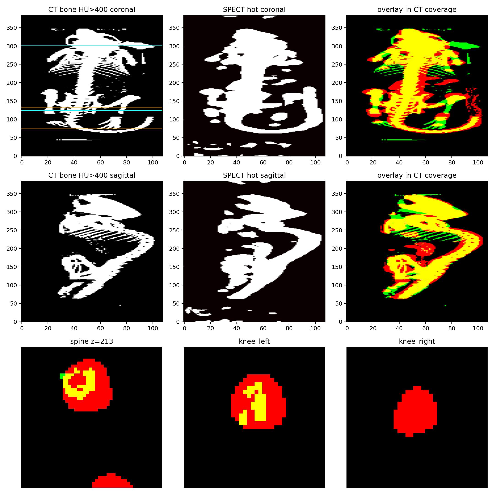

# CT–SPECT：CT 锚定局部脊柱 COM，拒绝 6-DOF

日期：2026-08-14。数据：三例已有 20260729 MDP。

配准和残差都在 **SPECT DICOM 网格** 上：`PixelSpacing = SliceThickness = 0.3 mm`，`108×108`，各向同性。CT 原生是 0.2 mm，先重采样到这个 0.3 mm 网格再量残差。下文 1 体素 = **0.3 mm**，不是 CT 的 0.2 mm。

## 结论

上一轮把“脊柱 MAD 4–5 体素”当成未消掉的刚体残差。在同一套 `*_fixedrefine` MHD 上把对应点拆开后，那不是 6-DOF 能修的姿态：独立中线峰值把膀胱/肋骨热点当成了脊柱，MDP1 中段 `dy` 中位数到过 **−62 体素**。膝部 COM 本来就已经在 1 体素内。

改成 **CT 骨脊 + 其周围 ±12 体素窗内的 SPECT 活度质心** 之后：

- 三例都还剩约 **−0.85 到 −1.13 mm** 的 Y 向系统偏差（旧提取器没看见，符号还可能反）。
- 加上这次局部 3-DOF 平移后，脊柱中位数回到 **<1 体素**。
- 逐层 MAD 的地板大约就是 1 体素：MDP2 两轴都 ≤1；MDP1 / 4H 的 Y MAD 仍是 1.35 / 1.58。
- **6-DOF 拒绝**：yaw 顶到 ±1.5° 边界，MAD 不降，局部 Z 段残差仍在。

1 体素是诊断目标，不是已校准的采用门。Occupancy 仍与脊柱/膝冲突，不能放行。

## 实验合同

| 项 | 冻结值 |
|---|---|
| 候选 | 冻结设备平移 + 每扫描 3-DOF；脊柱 XY = CT 锚定局部 COM |
| 基线 | 同一冻结平移 + 独立中线峰值 3-DOF（`*_fixedrefine`） |
| 数据 | 20260729 MDP / MDP_2 / MDP_2 4H SPECT DICOM；体素 0.3 mm |
| 允许 | 一个全局平移；无旋转、无形变、无逐床 |
| Occupancy | 只诊断，不能通过 |
| 理想目标 | 脊柱逐层 \|dx\|、\|dy\| MAD ≤ 1 SPECT 体素 = **0.3 mm** |
| 门成熟度 | diagnostic |

## 为什么旧 MAD 不能当 TRE

独立中线带（约 X=41–66）里 SPECT 最亮的不是椎体。MDP1 胸腹段 `dy` 中位数 −62.4 体素 = **−18.7 mm**，P90 约 65 体素 = 19.5 mm：那是膀胱/腹侧热点，不是姿态。6-DOF 拟合这种点只会把 yaw 顶到边界。

膝部（独立 3D COM）在旧图上已经是 1 体素量级，说明粗配准之后真正的骨对应并没有差 5 体素。

## 局部对应之后的 3-DOF vs 6-DOF

在旧 `*_fixedrefine` 网格上（CT 已按冻结+旧 refine 放到 SPECT 索引上）：

| 例 | 局部 dy 中位 体素 (mm) | 建议 ΔY mm | 6-DOF yaw ° | 平移后 dy 中位 体素 (mm) | 平移后 MAD dx/dy 体素 (mm) |
|---|---:|---:|---:|---:|---:|
| MDP1 | −2.84 (−0.85) | −0.85 | +1.50（边界） | +0.15 (+0.05) | 1.00 / 1.54（0.30 / 0.46） |
| MDP2 | −3.00 (−0.90) | −0.90 | −1.50（边界） | −0.16 (−0.05) | 0.71 / 0.97（0.21 / 0.29） |
| 4H | −3.77 (−1.13) | −1.13 | −0.44 | +0.06 (+0.02) | 0.85 / 1.22（0.26 / 0.37） |

6-DOF 与 3-DOF 的逐层曲线几乎重合，Y 向系统偏差是平移，不是可稳定估计的转角。与 `refine_ct_spect_bone_centers.py` 先前“保留平移、拒绝旋转”一致。

下图三例都在旧 `*_fixedrefine` 网格上：蓝 = 当前 3-DOF 图上的 CT 锚定局部残差，橙 = 再加一次局部平移。虚线是 ±1 体素 = **±0.3 mm**。橙点把 Y 中位拉回 0，但局部尖峰两边共用。

**MDP1。** 蓝点 `dy` 系统性偏负约 −3 体素。橙点中位近 0。Z=150–170 仍有约 −6 体素 = **−1.8 mm** 的局部 `dx`，刚体消不掉。



**MDP2。** `dy` 同样先偏负约 −3 体素，平移后中位近 0、MAD 两轴都进 1 体素。Z 尾段 `dx` 仍可掉到约 −6 体素（−1.8 mm）。



**4H。** 蓝点 `dy` 偏负约 −3.8 体素（−1.13 mm）。平移后中位近 0；Z≈220–235 仍有约 −6 体素的局部 `dx`。



## 生产路径重跑（从 DICOM）

`prepare_ct_mu_map.py` 的脊柱 XY 已改为 CT 锚定局部 COM。冻结向量未改。三例写入 `recon_out/ct_spect_reg_20260814_localxy/`。

| 例 | 施加 refine mm | 之后合成 \|t\| mm | 脊柱中位 dx, dy 体素 (mm) | MAD dx, dy 体素 (mm) | 欧氏 ≤0.3 mm 比例 | 膝部最大 \|Δ\| 体素 (mm) |
|---|---|---:|---:|---:|---:|---:|
| MDP1 | (−0.13, −0.98, +0.60) | 0.124 | −0.35, −0.31（−0.10, −0.09） | 0.98, 1.35（0.29, 0.41） | 0.19 | 左膝 Z 1.96（0.59） |
| MDP2 | (−0.15, −0.90, 0) | 0.188 | −0.86, −0.50（−0.26, −0.15） | **0.55, 0.95（0.17, 0.29）** | 0.31 | 右膝 ~3（0.90） |
| 4H | (+0.13, −1.03, −0.30) | 0.181 | −0.57, −0.59（−0.17, −0.18） | 1.08, 1.58（0.32, 0.47） | 0.15 | 右膝 Z 2.67（0.80） |

合成中位数都进了 0.3 mm 诊断门；这只说明中位向量，不说明每层都在 1 体素内。Occupancy 仍是 0.58 / 2.18 / 0.80 mm，与脊柱/膝不一致，继续拒绝它当 TRE。

下面三例都是生产路径写出的 `ct_mu_recon220_registration_qa.png`：绿 = CT 骨（HU>400），红 = SPECT 热点，黄 = 重叠。冠状/矢状是 MIP；底行是脊柱一层和左右膝。MIP 红绿镶边主要是 SPECT 热点比 CT 骨厚（PSF），不能再读成厘米级平移。

**MDP1**（中位 dx, dy = −0.10, −0.09 mm；Y MAD 1.35 体素 = 0.41 mm）。骨架黄核清楚；膝部特写仍可能有 2–3 体素红晕。



**MDP2**（三例里 MAD 最好：0.55 / 0.95 体素 = 0.17 / 0.29 mm）。冠状/矢状几乎通体黄核；脊柱 z=217 和双膝都是黄心+PSF 红边，没有整段错开。



**4H**（中位已进 0.3 mm；Y MAD 1.58 体素 = 0.47 mm，未过诊断目标）。脊柱 z=213 黄核仍在；右膝该层几乎全红——SPECT 热点宽于 CT 骨掩膜，或该切片骨掩膜偏薄，不是全局平移没消掉。



## 决策记录

```
Execution: completed
Quality: scoped optimization (extractor + residual Y translation); 1-voxel MAD undetermined as a hard gate
Adoption: keep baseline frozen vector; use new local-COM 3-DOF for subsequent map generation
Scope: three 20260729 MDP mice on SPECT DICOM 0.3 mm grid (not CT 0.2 mm)
Protected outcome: CT bone vs SPECT bone-uptake alignment for anatomy-guided maps
Gate maturity: diagnostic
Evidence: paired old vs local extractor; 6-DOF vs 3-DOF; production re-run after_apply; occupancy conflict retained
```

- **采用：** 冻结 `(-0.225, 1.6, -11.1) mm` 不变。后续 `regCT` / attmap 用 `recon_out/ct_spect_reg_20260814_localxy/`，不要再用 `*_fixedrefine` 做解剖引导。
- **拒绝：** 6-DOF 残差刚体；独立中线峰值当 TRE；occupancy 当门。
- **未做：** 用新 map 重跑 BSREM+RDP±`-regCT`；形变或逐床；Tc99。

## 1 体素目标的可用边界

- 可以用：脊柱/膝 **中位数** 是否 ≤1 体素；局部 COM 是否还在追膀胱。
- 不可以：要求 80%+ 层欧氏残差 ≤1 体素（当前 15–31%）；把 MAD>1 的层解释成全局姿态；用 occupancy 近零放行。
- SPECT 骨示踪热点相对 CT 骨脊有 PSF 宽度，COM 地板大约就是 1 SPECT 体素 = 0.3 mm。再往下需要更好的脊线/骨架，不是更大的变换自由度。

## 复现

```powershell
python scripts\refine_ct_spect_spine_rigid.py --self-test
python scripts\refine_ct_spect_spine_rigid.py

python scripts\prepare_ct_mu_map.py --help

python scripts\prepare_ct_mu_map.py `
  --ct-dir <case>\CT\cleaned_dicom --spect-dicom-dir <case>\SPECT `
  --output recon_out\ct_spect_reg_20260814_localxy\<id>\ct_mu_recon220.mhd `
  --hu-output recon_out\ct_spect_reg_20260814_localxy\<id>\ct_hu_recon220.mhd `
  --spect-activity-output recon_out\ct_spect_reg_20260814_localxy\<id>\spect_activity.mhd `
  --profile recon220 --beds 1,2,3,4,5 --allow-ct-padding `
  --fixed-translation-xyz mdp_device `
  --measure-residual --apply-residual `
  --refine-translation-limit-mm 2.0 --residual-method spine_knee `
  --attenuation-mu-output recon_out\ct_spect_reg_20260814_localxy\<id>\attmap_recon220.mhd `
  --z-bed-flip `
  --regct-hu-output recon_out\ct_spect_reg_20260814_localxy\<id>\regct_hu_recon220.mhd
```

三例 `<id>`：`20260729_mdp`、`20260729_mdp2`、`20260729_mdp2_4h`。

## 验证清单

- [x] `python scripts/refine_ct_spect_spine_rigid.py --self-test`
- [x] `python scripts/prepare_ct_mu_map.py --help`（含合成脊柱/膝移位）
- [x] `py_compile` 两个脚本
- [x] 三例 DICOM 地图重跑 exit 0；`pairing=ct_anchored_local_com`
- [x] after_apply 合成 \|t\| 0.12–0.19 mm；脊柱中位 \|dx\|、\|dy\| 均 <1 体素
- [x] 6-DOF 在三例上顶边界或无 MAD 收益，记录为拒绝
- [ ] 未用新 `regCT` 重跑解剖引导重建
- [ ] 未把 1 体素 MAD 校准成硬门（仅 MDP2 两轴达标）
