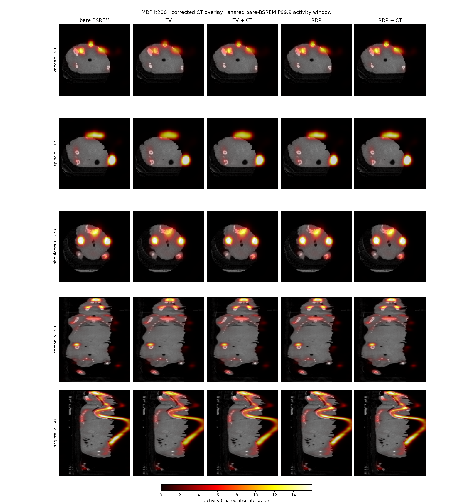
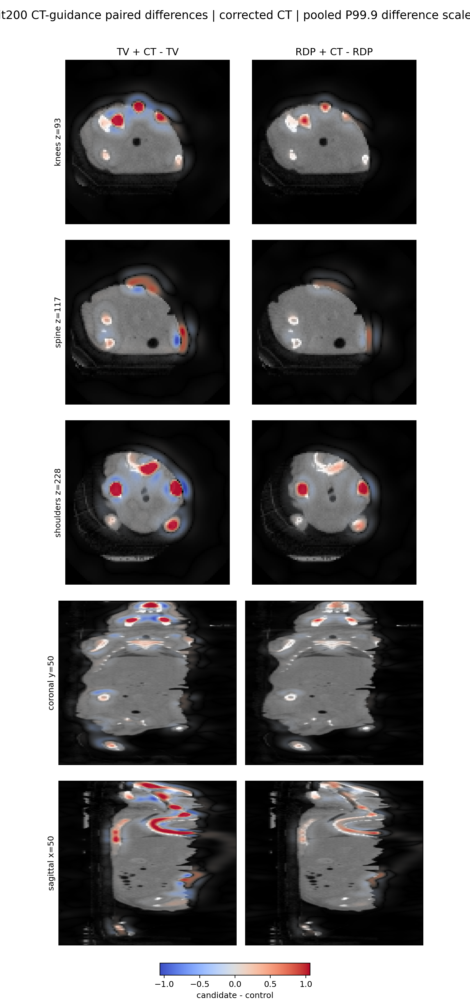
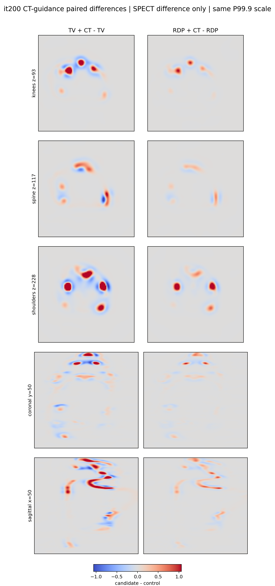
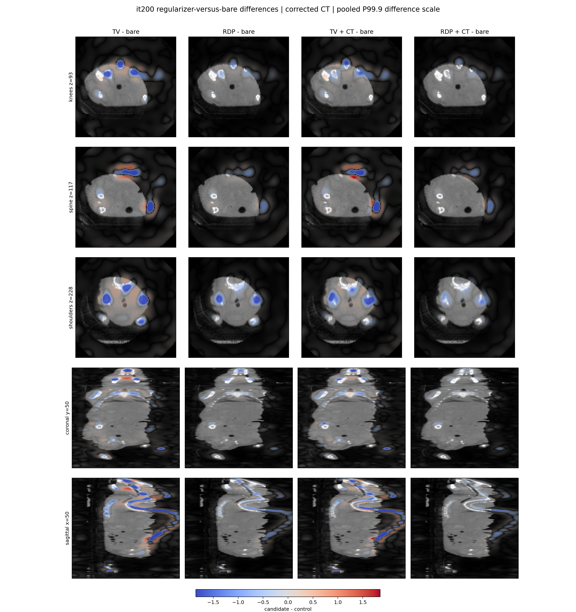
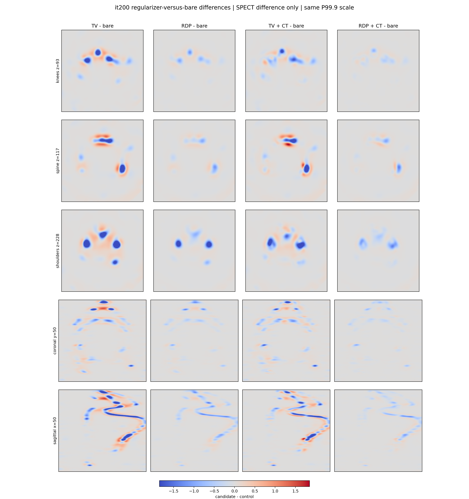
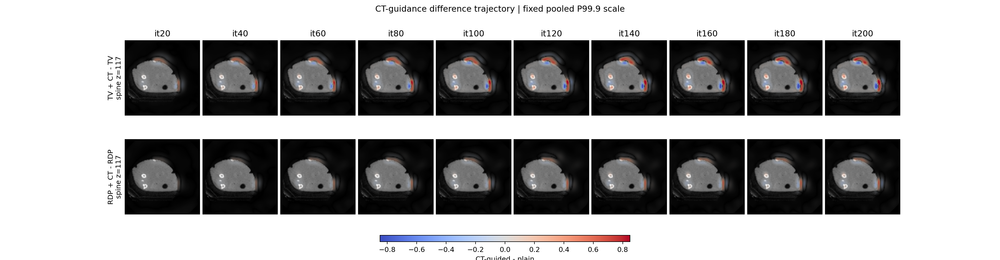
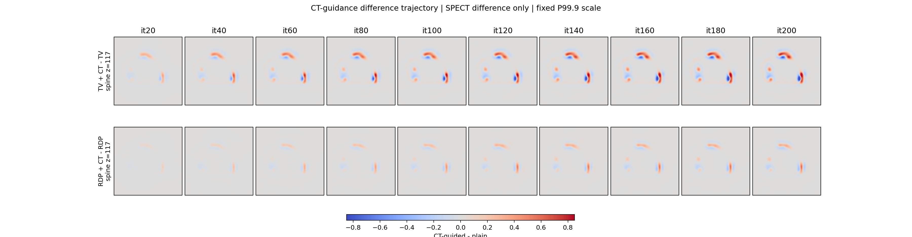
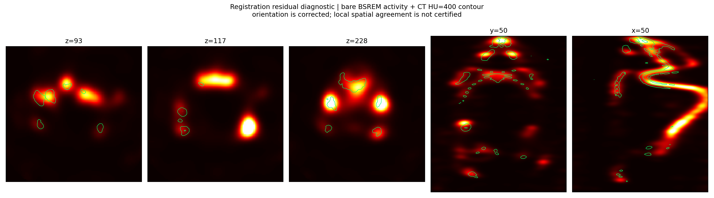
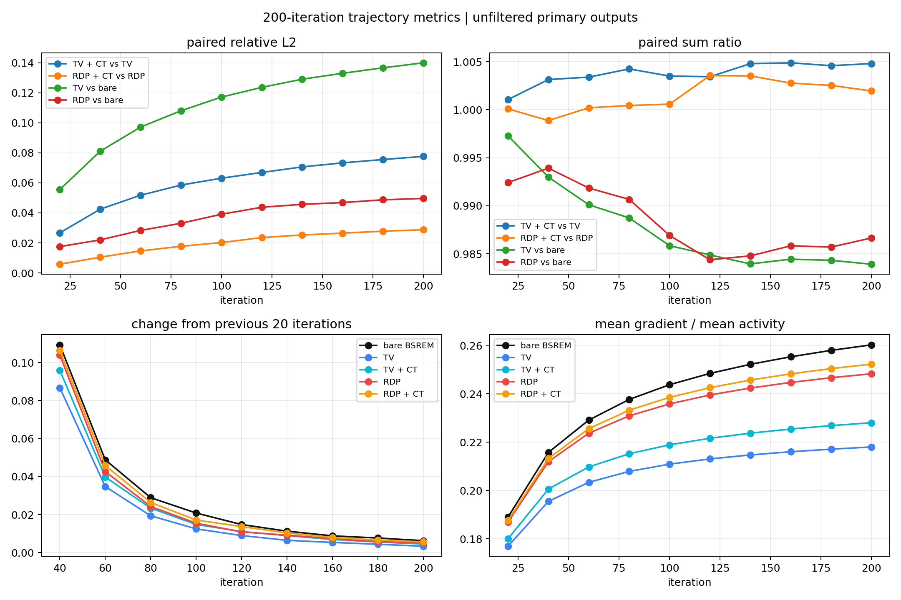

# MDP 修正 CT 解剖引导 BSREM：200 次五臂长程对比

## 结论

本次五臂均完成 200 次迭代。`bare_bsrem` / `tv_plain` / `rdp_plain` 复用
`recon_out/mdp_regct_long_20260814`（exe SHA `4BF643B9…B1A3` 一致）；
`tv_ct` / `rdp_ct` 使用 CT-anchored local-COM `regCT`
（`recon_out/ct_spect_reg_20260814_localxy/20260729_mdp/regct_hu_recon220`）。
所有运行均为无 CTAC，CT 只参与 TV/RDP 邻域权重。体素边长 **0.3 mm**。

- CT 引导差异随迭代持续增大：TV 的 `CT vs plain` relative L2 从 it20 的 2.67% 增至 it200 的 7.77%；RDP 从 0.58% 增至 2.88%。增长在后期放缓，但 it180→it200 仍未归零。
- 相对上一版 layout-fix map，local-COM map 把 it200 成对差异从 6.79%/2.59% 抬到 7.77%/2.88%；TV+CT 与旧 TV+CT 的 relative L2 为 4.15%，RDP+CT 为 1.37%。两版 stitched CT 本身 relative L2 为 23.7%，因此这是 map 换了，不是数值噪声。
- CT 引导主要改变边缘而非总量。it200 时 TV+CT/TV 总和比为 1.00481，RDP+CT/RDP 为 1.00196；CT 边缘/平坦区梯度变化比为 1.199（TV）和 1.067（RDP）。
- 同一数值 `beta=0.3` 下，TV 明显强于 RDP：plain TV 对裸 BSREM relative L2 为 14.00%，plain RDP 为 4.96%。该结果不能解释为 TV 优于 RDP，因为两种 penalty 的 beta 标度并不等价。对照三臂与上一版相同。
- 修正 CT 与 SPECT 的全轴 Z 方向一致。local-COM 配对下，重建网格脊柱逐层 MAD 为 X 0.95 vox = 0.28 mm、Y 1.18 vox = 0.35 mm；Y 仍超过 1 voxel 诊断线。occupancy 模长 2.13 mm，与 landmark 合成 0.43 mm 仍然冲突。
- 当前证据只支持“重建算法对当前 CT map 的边缘权重有响应”。真实解剖选择性保持 undetermined；1-voxel MAD 只作诊断，不是硬门。

### 2026-08-14 配准审计（local-COM 生产 map）

冻结设备平移 `(-0.225, 1.6, -11.1) mm` 不变。生产 map 改为 CT 锚定、窗口 ±12 voxel 的逐层 SPECT COM，而不是独立中线峰；6-DOF 已拒绝。不要用 `*_fixedrefine` 做解剖引导。

在本次 `100×100×290` 输出上，以裸 BSREM it200 避免 CT-guided circularity（配对规则 `ct_anchored_local_com`）：

- 脊柱 Z∈[61,240]，105 层：`dx MAD=0.95 vox=0.28 mm`，`dy MAD=1.18 vox=0.35 mm`，XY 落在 1 voxel 内的层占 18.1%。
- landmark 合成平移 `(-0.18, -0.25, -0.30) mm`，模长 0.43 mm；左右膝残差约 `(-0.09,-0.55,-0.01)` / `(-0.21,-0.25,-0.22) mm`。
- occupancy 仍为 `(-1.38, -1.60, -0.30) mm`，模长 2.13 mm。
- 上一版独立中线峰诊断（X MAD 4 vox、Y MAD 2 vox）与本次 local-COM MAD **不可直接相减**；occupancy 方法未改，模长从 2.64 mm 降到 2.13 mm，仍与 landmark 冲突。

这些量是 CT bone 与骨示踪 SPECT 的代理诊断，不是 landmark TRE；不能据此再做一个新的平移修正。

## 实验合同

| 项目 | 冻结值 |
|---|---|
| 数据 | 20260729 MDP，连续 Bed1–Bed5 |
| 矩阵 | `F:\matrix_PSC_PIN26x28x25_SCALE2_141keV_120x120x220` |
| 重建 | BSREM，`alpha0=1.0`，`gamma=0.05`，curvature off，kappa on |
| PSF | sieve / castor / 1.3 mm / 3 sigma |
| 几何 | reconstruction `120×120×1100`；center66_cosine10 输出 `100×100×290`；voxel 0.3 mm |
| 迭代 | 200，每 20 次保存；分析未滤波主输出 |
| 正则化 | bare、TV、TV+CT、RDP、RDP+CT；TV/RDP 均 `beta=0.3` |
| CT 权重 | local-COM HU CT；`sigma=100 HU`，floor `0.05` |
| CTAC | 关闭；五臂共享同一无衰减 denom cache |
| 对照 | 无 CT 三臂 junction 自 `recon_out/mdp_regct_long_20260814` |

完整输入 SHA-256、矩阵文件大小/mtime、逐臂命令和耗时在
`recon_out/mdp_regct_long_20260814_localxy/experiment.json` 与各臂 `recon_manifest.json` 中。
上一版图与 `metrics.json` 保存在 `reports/assets/2026-08-14-mdp-regct-long-200/previous_map/`。

## it200 定量结果

### 相对裸 BSREM

| 方法 | relative L2 | NCC | 总和比 | mean gradient / mean activity | it180→200 relative L2 |
|---|---:|---:|---:|---:|---:|
| bare BSREM | 0 | 1.000000 | 1.000000 | 0.260351 | 0.006323 |
| TV | 0.139959 | 0.991629 | 0.983922 | 0.218034 | 0.003408 |
| TV + CT | 0.107465 | 0.994778 | 0.988652 | 0.228085 | 0.004579 |
| RDP | 0.049640 | 0.999261 | 0.986660 | 0.248372 | 0.005161 |
| RDP + CT | 0.037655 | 0.999510 | 0.988590 | 0.252358 | 0.005716 |

CT 引导版本比各自 plain 版本更接近裸 BSREM，是因为 CT 边缘降低了跨组织边界的正则化耦合，而不是 CT 引导等价于“增加平滑”。

### CT 引导成对效应

| 成对比较 | relative L2 | NCC | 总和比 | CT-flat 梯度比 | CT-edge 梯度比 | edge/flat |
|---|---:|---:|---:|---:|---:|---:|
| TV+CT vs TV | 0.077665 | 0.997013 | 1.004807 | 0.995487 | 1.193922 | 1.199335 |
| RDP+CT vs RDP | 0.028833 | 0.999604 | 1.001955 | 0.998194 | 1.064575 | 1.066501 |

CT-flat/edge 由当前 CT map 的梯度分布定义：重建非零支持内，正 CT 梯度不高于 P25 为 flat、不低于 P75 为 edge。由于配准残差，该指标证明的是 map-selective response，不是严格的真实解剖选择性；该规则也不是生产验收阈值。

### 随迭代增长

| iteration | TV+CT vs TV relL2 | RDP+CT vs RDP relL2 | TV vs bare relL2 | RDP vs bare relL2 |
|---:|---:|---:|---:|---:|
| 20 | 0.026718 | 0.005829 | 0.055551 | 0.017566 |
| 40 | 0.042503 | 0.010547 | 0.081109 | 0.022047 |
| 80 | 0.058545 | 0.017777 | 0.108043 | 0.033099 |
| 120 | 0.066947 | 0.023586 | 0.123624 | 0.043773 |
| 160 | 0.073342 | 0.026538 | 0.132984 | 0.046893 |
| 200 | 0.077665 | 0.028833 | 0.139959 | 0.049640 |

### 相对上一版 layout-fix map（it200）

| 比较 | relative L2 | NCC | 总和比 |
|---|---:|---:|---:|
| 新 vs 旧 stitched CT | 0.237270 | — | — |
| 新 vs 旧 TV+CT | 0.041519 | 0.999035 | 1.001452 |
| 新 vs 旧 RDP+CT | 0.013741 | 0.999897 | 1.001390 |
| 新 vs 旧 TV+CT vs TV | 0.077665 vs 0.067941 | — | — |
| 新 vs 旧 RDP+CT vs RDP | 0.028833 vs 0.025860 | — | — |

## 图像证据

活动窗统一使用裸 BSREM it200 的 P99.9（15.9694）；CT 固定 `[-1000,1500] HU`。差值图按各比较家族的 pooled absolute P99.9 设置对称上下限，仅裁剪 0.1% 体素。

### it200 五臂 CT 叠加，多平面



### it200 CT 引导成对差值

红色为 CT-guided 增加、蓝色为减少。TV 的 map-edge 重分配显著强于 RDP；因配准残差，不能把所有靠近 CT 边缘的变化解释为真实解剖信号。



下面使用完全相同的 P99.9 差值窗，但移除 CT 底图，避免灰度解剖覆盖 SPECT 正负变化：



### TV/RDP 相对裸 BSREM





### it20→it200 CT 引导差值轨迹

所有列使用同一 pooled P99.9 差值窗，因此可直接观察差异随迭代逐步增强；TV 的增强明显，RDP 较温和。



同一轨迹的无 CT 底图版本：



### 配准残余诊断

以下使用裸 BSREM it200 作为底图，绿色仅绘制当前 local-COM CT 的 `HU=400` 轮廓。全轴方向正确，局部轮廓仍有可见错位。



### 数值轨迹



## 数据拟合与运行

投影残差为五床 CSV 汇总；relative bias 定义为
`(sum(measured)-sum(expected))/sum(measured)`，Poisson deviance 按 ray count 加权。

| 方法 | aggregate relative bias | Poisson deviance / bin | wall clock |
|---|---:|---:|---:|
| bare BSREM | -0.01699 | 0.77511 | 34.5 min（复用对照） |
| TV | -0.00437 | 0.78003 | 55.0 min（复用对照） |
| TV + CT | -0.00653 | 0.77936 | 101.8 min |
| RDP | -0.01411 | 0.77699 | 14.8 min（复用对照） |
| RDP + CT | -0.01484 | 0.77669 | 30.2 min |

CT 引导没有造成明显的数据拟合退化；同一家族内 deviance 差异小于 0.001。TV+CT / RDP+CT 墙钟含首次 NVRTC、矩阵 host cache，以及与 `super_cuda.exe` 争用同一块 GPU；这组时间不能用于 TV/RDP 或 CT 引导性能排名。

## 决策记录

- **Execution:** PASS。对照三臂 `reused_control`；`tv_ct`/`rdp_ct` 退出码 0，`experiment.json status=complete`。每臂 10 个未滤波主检查点及 smooth/butter 副本。
- **Method quality:** UNDETERMINED FOR ANATOMICAL VALIDITY。local-COM map 仍产生可重复、随迭代增长的 map-edge selective 变化，且成对效应略强于旧 map；Y MAD 1.18 vox 与 occupancy/landmark 冲突使真实解剖有效性不可判定。
- **Adoption:** KEEP BASELINE。单对象、无独立真值、无预注册质量阈值，不提升为生产默认。
- **Protected outcome:** 生产无 CT 引导基线保持可调用且未改配置。本轮写出 `recon_out/mdp_regct_long_20260814_localxy`；旧结果仍在 `recon_out/mdp_regct_long_20260814`。
- **Gate maturity:** map-response 行为门通过；registration/anatomical-quality gate 仍为 diagnostic（1 voxel MAD 不是硬门）。

### 当前结果的可用边界

- 可以使用：比较裸 BSREM、TV、RDP 的数值行为；确认 TV/RDP 对当前 local-COM CT map 权重的响应；对比 layout-fix map 与 local-COM map 的成对效应。
- 不可使用：把 CT-guided 差异解释为经过严格配准的真实解剖信号；据此选择生产正则器；据此评价病灶恢复、边界真实性或定量准确性。
- `TV+CT`、`RDP+CT` 输出保留为 orientation-correct / registration-not-validated diagnostic。

### 最小后续路径

1. 在原始 SPECT DICOM 网格上建立包含 XYZ 平移与旋转的单一全局刚体变换；先不引入形变或逐床自由变换。6-DOF 已在当前证据下拒绝，重开需要新的独立验收 landmark。
2. 将配准拟合 landmark 与验收 landmark 分开，按 axial Z 段报告脊柱、左右膝等独立结构的残差分布。
3. 同时保留 landmark residual 与 whole-occupancy residual；两者明显冲突时停止生成可用于解剖引导的 map。
4. 配准通过后，用同一变换重新生成 `regct_hu_recon220` 与 CTAC attenuation map，并重新检查床序与 Z flip 布局合同。
5. 只重跑 `TV+CT`、`RDP+CT` 两臂；现有对照三臂可继续复用。

## 复现

```powershell
& .\scripts\run_mdp_regct_long_200.ps1

python .\scripts\eval_mdp_regct_long_200.py `
  --root .\recon_out\mdp_regct_long_20260814_localxy `
  --regct .\recon_out\ct_spect_reg_20260814_localxy\20260729_mdp\regct_hu_recon220.mhd `
  --compare-root .\recon_out\mdp_regct_long_20260814 `
  --compare-regct .\recon_out\ct_map_layout_fix_20260814\20260729_mdp\regct_hu_recon220.mhd `
  --output-dir .\reports\assets\2026-08-14-mdp-regct-long-200
```

## 验证清单

- [x] runner PowerShell AST parse passed。
- [x] analysis `--self-test` passed。
- [x] `experiment.json status=complete`；对照三臂 `reused_control`；`tv_ct`/`rdp_ct` 退出码 0。
- [x] 每臂 10 个 primary/smooth/butter MHD 检查点，均有 it200。
- [x] run manifests：CTAC 均 false；仅 TV+CT/RDP+CT 有 `regularizer_ct_guidance=true` 和 local-COM map path。
- [x] 所有输出有限、非负，shape `ZYX=(290,100,100)`。
- [x] 日志无 fatal/error-like 行；denom cache 命中。
- [x] 与上一版 map 的 it200 成对/体积 relative L2 已写入 `metrics.json` 的 `previous_map_compare`。
- [x] 人工检查轴向/冠状/矢状方向：全轴 Z 方向一致，局部 CT/SPECT 配准不严格。
- [x] 配准残差：local-COM 脊柱 Y MAD 1.18 vox；occupancy 2.13 mm 与 landmark 0.43 mm 冲突。
- [ ] 未做独立病理/标注真值、重复对象、跨采集复现或盲评。
- [ ] 本 200-iter 仍由 NVRTC JIT 可执行文件完成；fatbin 重建是部署约束，不改变本表数值。
