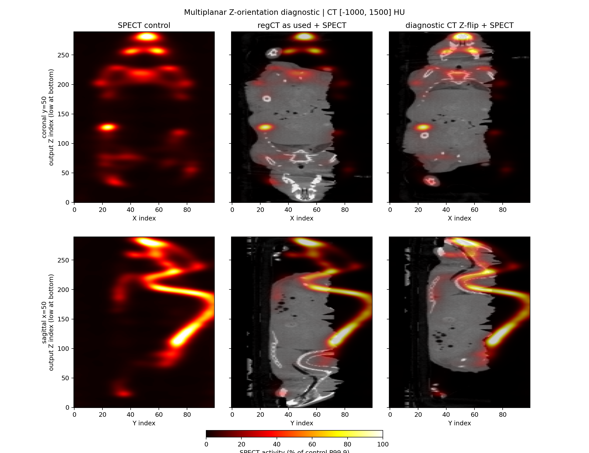
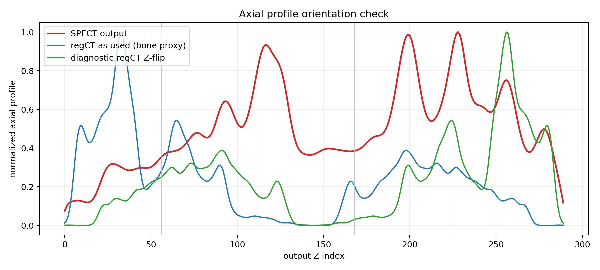
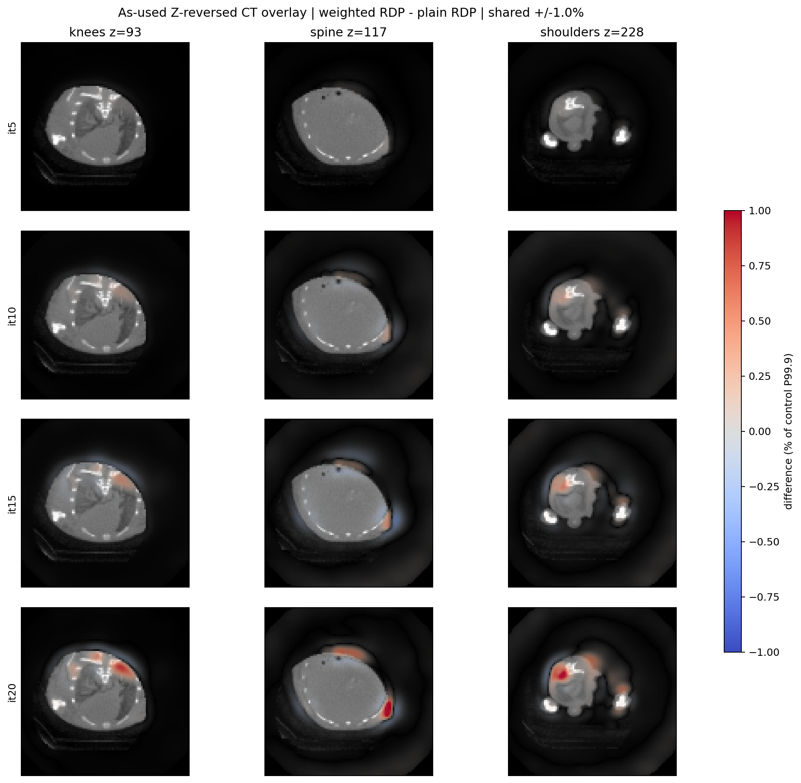
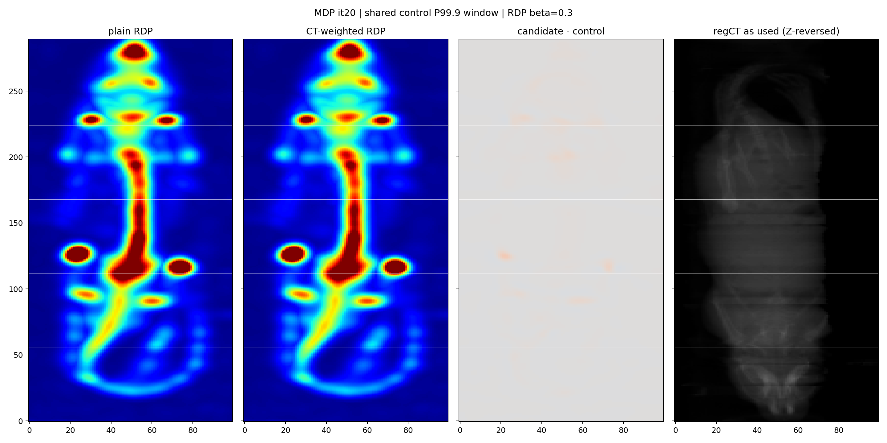
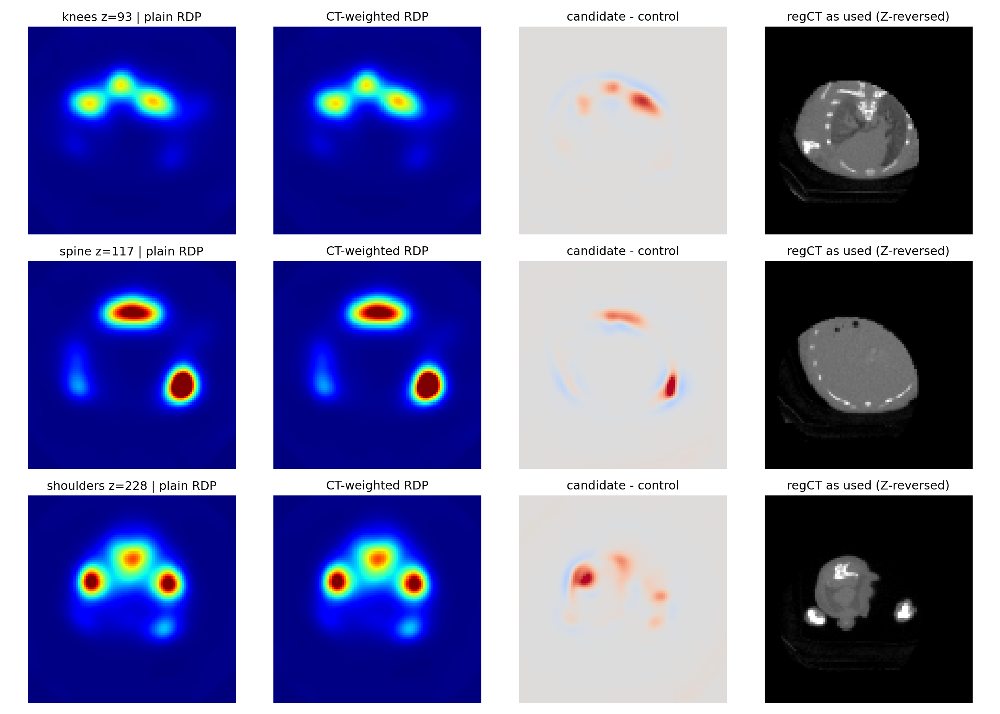
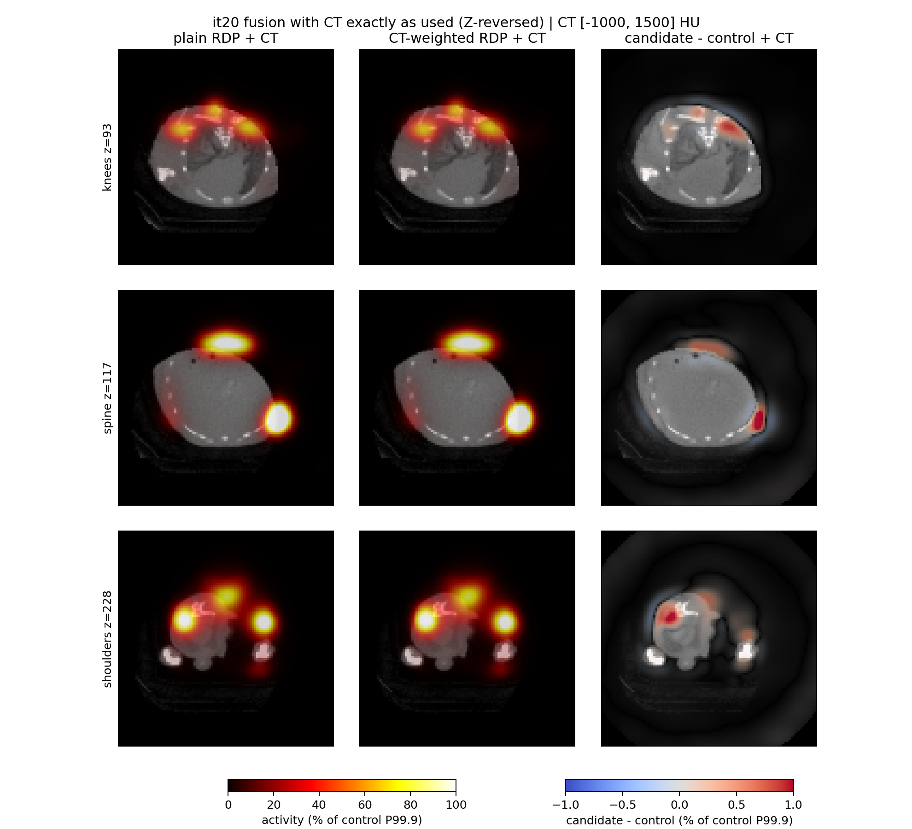

# 20260729 MDP：CT 解剖引导 RDP 冒烟

**日期：** 2026-08-14

**执行：** `completed`

**质量：** `orientation-invalid`（当前候选拒绝作为解剖引导证据；方法质量待更正 HU 布局后重跑）

**采用：** `keep baseline`（不采用当前 `regCT`/同源 attmap，不修改生产 INI）

## 结论

本轮完成了当前 5 床、120×120×220 系统上的纯 `-regCT` 配对运行，但随后方向
审计发现：候选实际加载的 `regct_hu_recon220` 相对重建 SPECT 是**整轴 Z 反向**。
因此本报告撤回最初的“真实解剖边缘选择性已验证”解释。现有 relL2、NCC 和
edge/flat 数值仍证明 `-regCT` 代码路径生效，但它们只描述算法对一个反向 HU 场
的响应，不能证明真实 CT 解剖改善了重建。

控制臂本身仍可保留。当前 CT-weighted 候选标记为 `orientation-invalid`，不能用于
方法采用、解剖真实性或迭代收益判断。此次只新增方向诊断与可视化；没有在绘图时
偷偷翻转旧候选，也没有重跑重建或修改生产输入。

## Z 方向审计：不是渲染错觉

`origin="lower"` 只决定二维数组第 0 行显示在画面下方；对 CT 和 SPECT 同时使用时，
不会改变两者的相对顺序。轴向 `volume[z]` 中它更不会改变所选 Z 层。本次是输入
数组布局本身反向，证据如下：

| 独立检查 | 同向 | Z 反向 | 判定 |
|---|---:|---:|---|
| it20 SPECT vs 同扫描 DICOM SPECT，中心裁剪 3D NCC | **0.977365** | 0.151051 | 重建 SPECT 保持 DICOM Z 方向 |
| stitched regCT vs patient-Z 递增 CT，最大绝对 HU 差 | 5745.96 HU | **4.55×10⁻¹³ HU** | 当前 regCT 精确等于物理 CT 的整轴反转 |

两项同模态/逐体素方向锚点已经足以承担结论，不依赖跨模态阈值、肉眼观感或
配准 TRE。



上排为冠状位 `y=50`，下排为矢状位 `x=50`。中列是候选**实际使用**的反向 CT；
右列仅把 CT 做诊断性 `[::-1]` 后叠加。右列明显恢复同向结构，但它没有进入旧候选
重建，不能用来“修好”旧结果。



轴向 profile 作支持性显示：蓝线是实际输入的反向 CT，绿线是仅用于诊断的 Z-flip。
该图使用全平面 SPECT 活度和 `max(HU-300,0)` 骨代理；profile NCC 从 0.0125 提高到
0.6196，但它不承担方向判定或采用门。
根因位于 map 布局：物理 Z 递增床块先按 `recon_bed1_max_z` 反床序，又按
`z_bed_flip=1` 逐床反 Z，两步合成为全体积 `[::-1]`；`SPECT_recon` 加载
`-regCT` 后没有第二次坐标变换。

这与 `.agent/CONSTRAINTS.md` 中“Bed1=max physical Z”的既有冻结声明发生冲突。
本报告保留该声明和本次数组证据，不静默改写项目合同；在修复生产生成器前，应先
以当前病例的同扫描 DICOM SPECT/CT 方向门验证实际 bed 文件语义。

## XYZ/ZYX 维度与物理 Z 顺序

这里**没有 XYZ/ZYX 维数互换错误**，但存在独立的物理 Z 顺序错误：

- MHD `DimSize` 按 **X, Y, Z**。输入 `regct_hu_recon220.mhd` 是
  **120×120×1100**，主输出是 **100×100×290**。
- Python/NumPy 数组按 **[Z, Y, X]** 索引，所以同一输入的 `shape` 是
  **(1100, 120, 120)**，同一输出的 `shape_zyx` 是 **(290, 100, 100)**。
- QA 先按生产 `center66_cosine10` 的 66 层中心裁剪、56 层床步长和 10 层
  cosine overlap，把五个 220 层 HU block 变成 290 层，再把 XY 中心裁成
  100×100；HU 不做活动增益拟合。
- 当前 MHD 只写 `DimSize/Spacing`，没有 origin/direction，所以下游不能仅从 header
  自动判定数组 Z 对应 `+patient-Z` 还是 `-patient-Z`。

## 冻结合同

| 项目 | 普通 RDP 控制 | CT-weighted RDP 候选 |
|---|---|---|
| 数据 | 20260729 MDP identity `Bed1.bin`…`Bed5.bin` | 相同 |
| 内部网格（MHD XYZ） | 120×120×1100，0.3 mm | 相同 |
| 输出（MHD XYZ） | 100×100×290，0.3 mm | 相同 |
| 算法 | BSREM，20:5 | 相同 |
| 正则 | RDP β=0.3, γ=0, δ=0.01 | 相同 |
| CT 权重 | 无，activity-only | HU，σ=100，floor=0.05 |
| CTAC | 关闭 | 关闭 |
| PSF | sieve / CASToR，FWHM 1.3 mm，3σ | 相同 |
| 多床运行声明 | manifest 写 Bed1=max physical Z、`z_bed_flip=1`、`center66_cosine10`；方向审计已反驳其与本数据实际数组顺序等价 | 相同声明；候选 HU 布局失败 |
| denom | `mdp_noctac_rdp_v4.mhd`，两臂均 hit | 相同文件 |
| 测试配置 | `multipinhole/config/spect_config.ct_guided.ini` | 相同 |

生产 `multipinhole/config/spect_config.ini` 未修改。候选日志明确记录
`ctac=off`、`regularizer_ct_guidance=true`；控制记录
`TV/RDP uses activity-only neighborhood weights`。

## 配对结果

### 迭代轨迹

下面的 edge/flat 规则在所有 checkpoint 固定，但 CT 是候选**实际使用的反向 CT**：
在配对非零活动支持内，CT
正梯度的 P25（34.05 HU/voxel）以下为 flat，P75（134.91 HU/voxel）以上为
edge。该分位规则只用于诊断，没有校准为采用门。

| it | relL2 | NCC | sum ratio | CT-flat 梯度比 | CT-edge 梯度比 | edge/flat |
|---:|---:|---:|---:|---:|---:|---:|
| 5 | 0.000369 | 0.99999991 | 0.999972 | 0.999880 | 1.001832 | 1.001952 |
| 10 | 0.001637 | 0.99999873 | 1.000548 | 1.000415 | 1.004855 | 1.004439 |
| 15 | 0.002355 | 0.99999681 | 0.999816 | 0.999734 | 1.006951 | 1.007219 |
| 20 | 0.003720 | 0.99999465 | 1.001154 | 1.000970 | 1.011150 | 1.010170 |

数值差异随 checkpoint 增长，回答了“迭代越多，旧候选与控制是否分开得更明显”：
**是**。但它是反向 CT 正则权重的累积效应，不是正确解剖引导随迭代增强的证据，
也不能外推到 500–600 次设备端 Derenzo 目视收敛口径。



时序差分图以**实际使用的反向 CT**为灰度底图，四行共用
`±1.0% of control P99.9` 的差分窗，
没有按 checkpoint 或切片单独拉伸。红色表示 CT-weighted RDP 高于控制，蓝色
表示低于控制。红蓝差异从 it5 到 it20 逐步增强，但由于底图方向无效，不对其
解剖位置作正向解释。

### it20 代表性层

| 层 | Z（输出索引） | relL2 | NCC | sum ratio |
|---|---:|---:|---:|---:|
| 膝 | 93 | 0.006210 | 0.99998519 | 1.001586 |
| 脊柱 | 117 | 0.004421 | 0.99999300 | 1.000959 |
| 肩 | 228 | 0.005012 | 0.99999198 | 1.002300 |

### σ=100 HU 实际耦合强度

代码与 QA 使用相同公式：

`w = floor + (1-floor) * exp(-0.5 * (ΔHU / sigma)^2)`

在配对非零活动支持内的三轴相邻体素上，8200976 对邻接的权重
P1/P5/P25/P50/P75/P95/P99 分别为
`0.0500 / 0.4867 / 0.9923 / 1 / 1 / 1 / 1`；**88.30%** 的邻接权重
≥0.9，**5.07%** ≤0.5，**3.10%** ≤0.1。也就是说 σ=100 对大多数邻接近似
普通 RDP，只在最强 HU 边缘明显减弱跨边缘耦合。这解释了旧候选相对控制只有小幅
变化；这些 HU 边缘在本次运行中不是同一 Z 位置的真实解剖边缘。

## 固定窗图像

为减少热点饱和，活动窗从控制 P99.5=`8.391879` 提高到共享控制
P99.9=`12.739591`（上限提高 51.8%，只截断 0.1% 的正值体素）；候选不单独
归一化。差分窗固定为 `±1.0% of control P99.9`（绝对值 `±0.127396`），相对最初
按 |差| P99.5 的 `±0.024760` 放宽 5.15 倍。新口径下 |差| P99.95 仅为活动窗的
`0.679%`，超过显示窗的体素占全体 `0.0161%`。CT 窗固定 `[-1000, 1500] HU`，
数组索引直接匹配，不插值。



固定窗下两臂肉眼几乎同形，未见数值崩溃；差分主要沿高摄取结构边界出现。差分
色标相对活动窗仍放大 100 倍，不能把红蓝面积当作大形态或正确解剖变化。



三个预选输出层均未见数值 gross failure。旧候选的轻微边缘变化只与反向 CT 的
edge/flat 指标一致，不再解释为该层真实骨结构引导。



融合图忠实使用候选运行中的**反向 CT**作为灰度底图：前两列分别叠加控制/候选
活动，第三列叠加候选减控制。叠加透明度随幅度连续变化，零差值完全透明，差值
色窗固定为 ±1.0%。它现在用于展示输入错位及差分动态范围，不再用于判断信号的
解剖真实性；正确方向的诊断叠加见本报告开头的冠状/矢状图。

原始指标副本：`reports/assets/2026-08-14-mdp-regct-smoke/metrics.json`。

## 运行时间与调度边界

最终控制臂 `full_command=870.948 s`、`iteration_core=730.133 s`；候选臂
`full_command=456.370 s`、`iteration_core=399.690 s`。**不能把候选更快解释成
`-regCT` 加速**：运行期间存在 CPU-only CASToR 与不同的主存/cache 热状态；两臂
自动 host-cache budget 分别约 22246/23921 MiB，均小于 24915 MiB 矩阵，记录为
持久 prefix 5/6、每矩阵 pass 最多重读约 4134 MiB。

去掉 it1→2 的预载阶段后，控制 it3–20 为 17–54 秒/次（中位 24 秒），候选为
15–19 秒/次（中位 17 秒）；二者都明显慢于 resident MLEM 的 3–4 秒/次，但也
远快于当前五床 CTAC 的 7–36 分钟/次。原因是 BSREM 会关闭 resident MLEM
update；本轮没有 `compactHasAttenuation`，因此不是 CTAC 衰减调度问题。本报告不做
性能采用判断。

首次控制尝试使用了过短的外部运行上限，在 it5 后主动停止并保留为
`plain_rdp_attempt1_aborted_runner_timeout`；它不进入任何配对指标。最终两臂都是
独立完整进程、退出 0、写出 it20 manifest。

## 复现

工作目录：`D:\Projects\SPECT-recon`。

```powershell
$exe = 'build\Release\bin\Release\SPECT_recon.exe'
$config = 'multipinhole\config\spect_config.ct_guided.ini'
$algo = 'multipinhole\config\algo_bsrem.conf'
$matrix = 'F:\matrix_PSC_PIN26x28x25_SCALE2_141keV_120x120x220'
$input = 'recon_out\ctac_mdp_smoke_20260813\preproc\20260729_mdp\SPECT'
$regct = 'recon_out\ct_spect_reg_20260813\20260729_mdp_fixedrefine\regct_hu_recon220.mhd'
$spectReference = 'recon_out\ct_spect_reg_20260813\20260729_mdp_fixedrefine\spect_activity.mhd'
$physicalCt = 'recon_out\ct_spect_reg_20260813\20260729_mdp_fixedrefine\ct_hu_recon220.mhd'
$root = 'recon_out\mdp_regct_smoke_20260814'
$beds = (1..5 | ForEach-Object { Join-Path $input "Bed$_.bin" }) -join ';'
$common = @(
  '-config',$config,'-algoConf',$algo,'-chunkCSRDir',$matrix,'-dfList',$beds,
  '-opti','bsrem','-reg','RDP,0.3,0,0.01','-dim','120,120,220',
  '-vox','0.3,0.3,0.3','-ang','360','-detN','48,48','-it','20:5',
  '-psf','1.3,3','-psfMode','sieve','-psfKernel','castor','-zbedflip','1',
  '-cyl','36,66','-compactDenomCache',(Join-Path $root 'denom\mdp_noctac_rdp_v4.mhd')
)
& $exe @common '-fout' (Join-Path $root 'plain_rdp\recon')
& $exe @common '-regCT' $regct '-regCtSigma' '100' '-regCtFloor' '0.05' `
  '-fout' (Join-Path $root 'ct_weighted_rdp\recon')
python scripts\eval_mdp_regct_smoke.py `
  --control (Join-Path $root 'plain_rdp\recon_it20.mhd') `
  --candidate (Join-Path $root 'ct_weighted_rdp\recon_it20.mhd') `
  --regct $regct --spect-reference $spectReference --physical-ct $physicalCt `
  --output-dir (Join-Path $root 'qa_it20')
```

前两个 `SPECT_recon` 命令用于逐字复现已判无效的旧配对，不是推荐的新候选命令；
更正 map 通过下述方向门之前不得重跑或采用。

### 输入与程序身份

| 文件 | SHA-256 |
|---|---|
| `SPECT_recon.exe` (`20260813+7d5e813`) | `E5D1042EDDF9B610D800271C6618888B4947DA92C3F0BC23DACAE7D393963D5B` |
| `spect_config.ct_guided.ini` | `210963E6B7525A16AAC312AE724FDE8AF922862D52EFC6904A3ADE272990A971` |
| `algo_bsrem.conf` | `BC234D1A8624837E18F9C3260AA6E0764E6AA7FDE59778C3C36263CA725FFCC9` |
| matrix `metadata.bin` | `86108B0C97B48981B7476A4A9FA85B9BF643B9A50691801F28BC2C7CAA8C9C81` |
| `regct_hu_recon220.mhd` | `9DF026AAB83263F0FA5491318FBDCD832DB7A273D771BA96970BA5AE8163B454` |
| `regct_hu_recon220.raw` | `8957AEDEC352B0BDC50D290B4F03CA3E6217C455D66FC1C9A837918DC4868EDC` |
| `spect_activity.mhd`（方向锚点） | `552285770FFCD625FDCB5F0220EB8E2C507F762B9BD1B9522C18F4D36C3028F7` |
| `ct_hu_recon220.mhd`（patient-Z CT） | `FF63BD85E91C9768434B610BB11C304CEDF53AD7DA26B9D4CF0A1E5B26176A4A` |
| QA 脚本 | `EC3D15213B551E67FBA78CE1085693E4E5ED4D8566693D895E2DD1BDDB10F6F9` |

五个 BIN 均为 6635528 bytes；Bed1..Bed5 SHA-256 依次为：

```text
5CC6392F6E18DCC962B83C6277094E5A9989EE76E843FA1177944E16087CE7BB
02507C8AB46FD72CE1644285B6BEB175B94A0F9F3E50CB89A69BA0F0AEC5BB29
09D29F3BEE97BDDE3E6FC493108605BB6602F56DB21FCE412B3BCAD73C4CE2FF
F89C8047DBFD35C8747435BCA915036DBD7754D657BB190C898E9BA9241924D8
569E97EC0C69B71E8CB80EFEBF4BB91CABA7F23031F1BE5EA8AF20CCC20DF0CD
```

主输出 RAW：普通 RDP
`047FA9310F40FA3FDA1A33DE06B4FD2612E2DF8626769FEBE76A6717D8CF0639`；
CT-weighted RDP
`65661812C169D4B2DF7E6C573FCFE7DD2E2F2ECE96719506B0209ED4A6E3CE7A`。

## 验证清单

| 检查 | 证据 | 状态 |
|---|---|---|
| QA 语法与最小自检 | `py_compile`; constant-HU stitch 1100 ZYX→290 ZYX；恒等 relL2=0 | pass |
| 现有 C++ 合同测试 | `RegisteredCtRegularizationOptionsParse`、`CtGuidedTestIniKeepsRegCtAndCtac` | 2/2 pass |
| 两臂运行 | 两个日志均 `Reconstruction finished successfully` | pass |
| 运行合同 | manifest：BSREM/RDP β=0.3、CTAC=false、it20、同一矩阵/输出几何 | pass |
| CT 差异隔离 | 控制 `ct_guidance=false`；候选 `true`, σ=100, floor=0.05 | pass |
| denom | 两臂同一路径且均 `compact denom cache hit` | pass |
| 输出完整性 | MHD XYZ 100×100×290；有限、非负、非零 | pass |
| 同模态 SPECT 方向锚点 | 输出 vs DICOM SPECT：同向 3D NCC 0.977365，反向 0.151051 | pass |
| HU 逐体素方向门 | `stitched_regCT == centered_physical_CT[::-1]`，max |ΔHU|=4.55e-13 | **fail：当前输入反向** |
| 冠状/矢状融合图 | 同时展示 actual-as-used CT 与 diagnostic Z-flip | pass（诊断） |
| 迭代轨迹 | it5/10/15/20 配对指标、共享 P99.9 活动窗和 ±1.0% 差分窗 | pass（只描述反向先验响应） |
| 更正 HU map + candidate 重跑 | 未做 | pending |
| CTAC attmap 方向审计 | 同源 map 构建路径存在风险，尚未单独验证 | pending |
| 收敛/任务指标/采用门 | 方向修正前不评估 | blocked by orientation |

## 下一步

最小动作不是换第二只动物，而是先修正当前病例的 HU map 布局，并冻结两个方向门：

1. 更正 map 必须满足
   `stitch_regct(corrected_HU) == ct_hu_recon220[77:367,10:110,10:110]`
   （在 float 写回容差内），且输出 SPECT vs DICOM SPECT 仍保持同向。
2. 复用现有 plain-RDP 控制和 denom，只重跑 CT-weighted candidate 20 次，再重新生成
   轴向/冠状/矢状融合图和 it5/10/15/20 固定窗轨迹。
3. 通过方向门后，才恢复“是否随迭代增强真实解剖选择性”的质量判断；之后才轮到
   独立动物、晚迭代或 σ/β 小范围校准。
4. 同源 `attmap_recon220` 也经过相同 bed/Z 布局逻辑，恢复慢 CTAC 续跑前必须单独
   核验其与系统矩阵期望的方向；不能仅凭本次 `regCT` 诊断直接假设同一修法。
