# BSREM α=1.5 vs MLEM it500 slice comparison

**Date:** 2026-08-19  
**Question:** how does BSREM α=1.5 look against a **fixed** MLEM it500 baseline as iteration increases?  
**View:** derenzo 100/500-iter groups use central **axial**; epguan/mouse 500-iter groups use central **coronal** (`vol[:, y, :]`) and **sagittal** (`vol[:, :, x]`), `origin=lower`, `aspect=equal`. Shared display window from the full MLEM it500 volume (p99.8). Left panel never changes.

Reproduce:

```text
python recon_out/bsrem_rdp_convergence_20260817/compare_a15_vs_mlem500.py
python recon_out/bsrem_rdp_convergence_20260817/compare_a15_vs_mlem500_cor_sag.py
```

Outputs: `reports/assets/bsrem-a15-vs-mlem500/` (copy also under `recon_out/bsrem_rdp_convergence_20260817/compare_a15_vs_mlem500/`).

Axial GIFs are two panels. Coronal/sagittal GIFs are 2×2 (top coronal, bottom sagittal; left MLEM it500, right α=1.5). Static stacks are key iters 50/100/200/350/500.

## derenzo_182222 — α=1.5 it50–500

Closest volume-distance to MLEM it500 at **it350** (relL2 0.0063), then walks away while looking sharper.

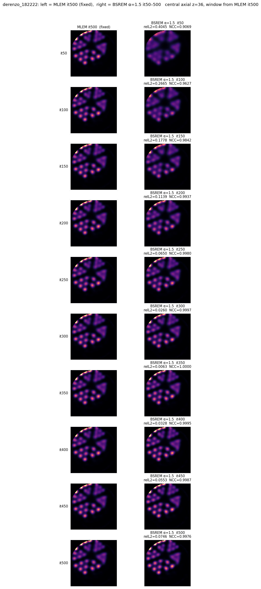

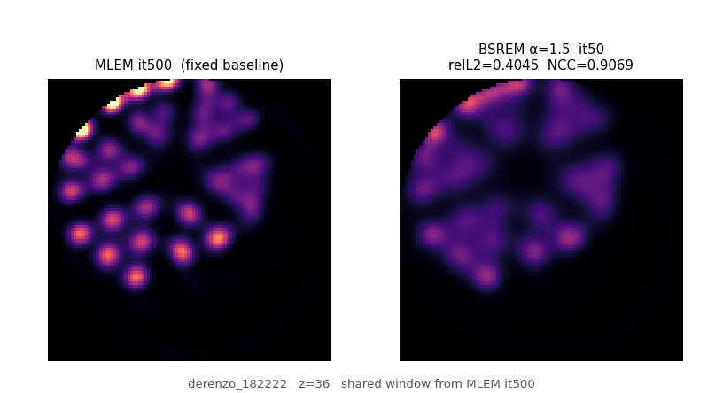

MP4 (same frames, H.264): [derenzo_182222_it500.mp4](assets/bsrem-a15-vs-mlem500/derenzo_182222_it500.mp4)

## derenzo_182222 — α=1.5 it10–100

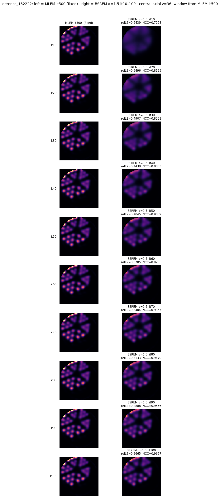

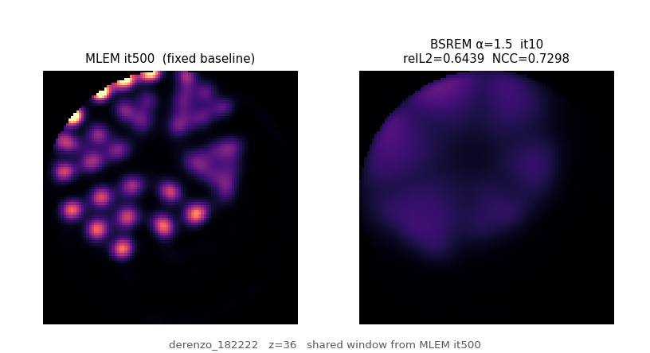

## epguan — α=1.5 it10–100

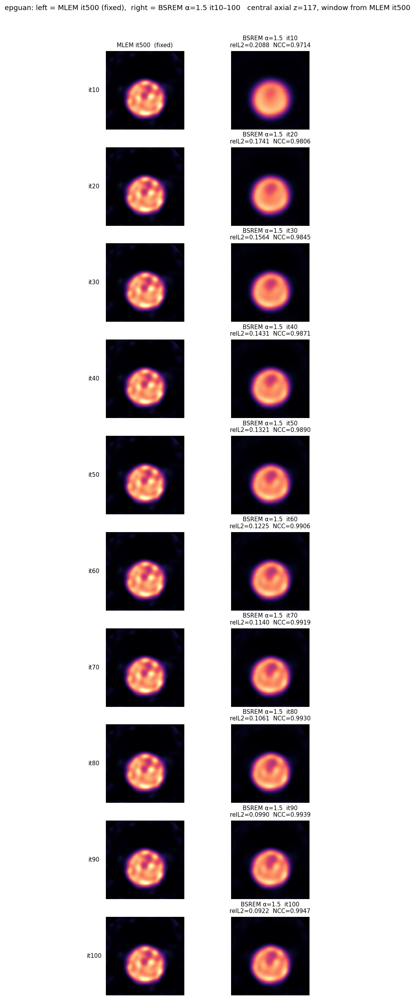

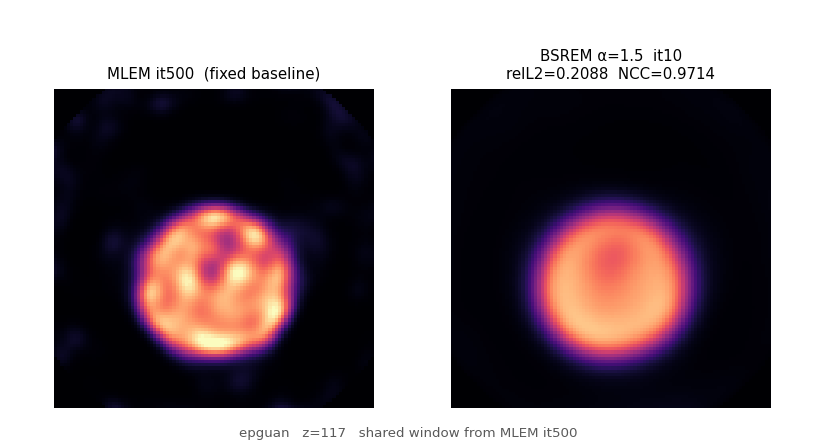

## epguan_19p2mm — α=1.5 it10–100

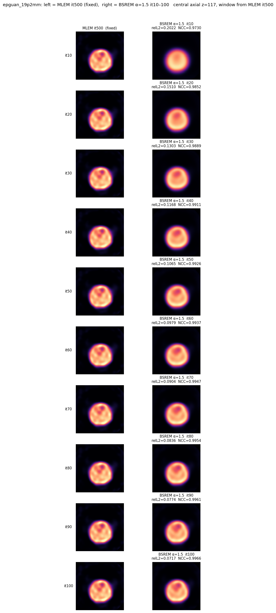

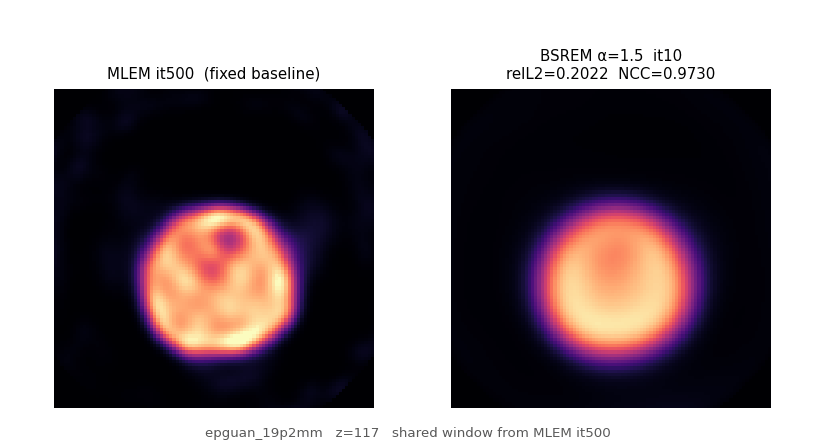

## mouse_ch6o6p2 — α=1.5 it10–100

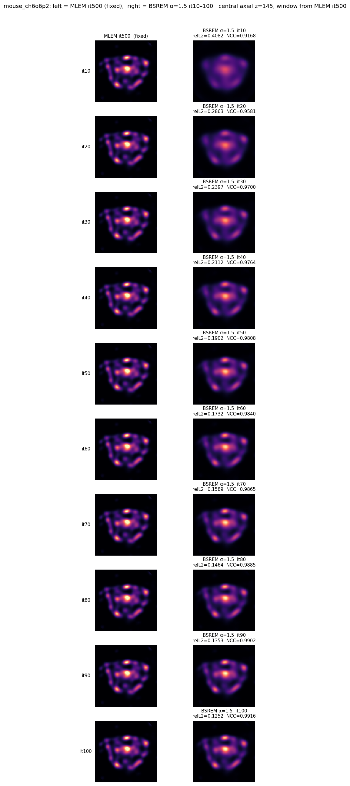

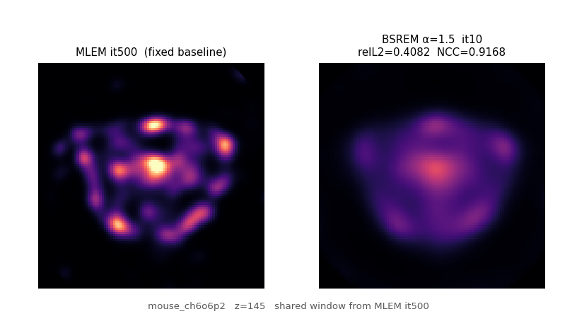

## mouse — α=1.5 it10–100

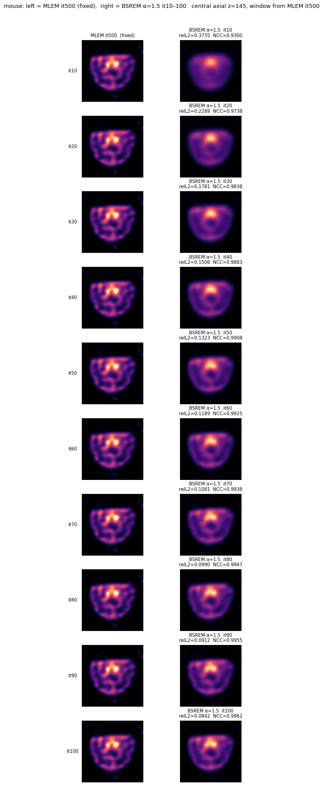

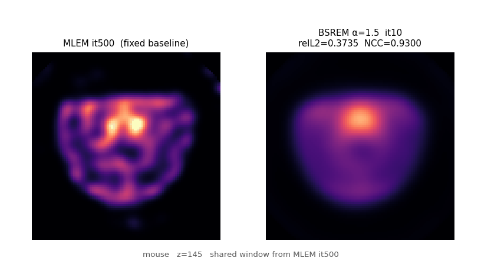

## epguan / mouse — α=1.5 it50–500 (coronal + sagittal)

All four 500-iter arms finished. Distance is always to that dataset’s **own MLEM it500**. Closest volume match is **it350** on every set; it500 recedes (same overshoot as derenzo). Geometric mid-planes: `y=ny//2`, `x=nx//2`.

| dataset | shape (z,y,x) | it100 relL2 / NCC | closest (it350) relL2 / NCC | it500 relL2 / NCC |
|---|---|---|---|---|
| epguan | 234×100×100 | 0.0922 / 0.9947 | 0.0041 / 0.99999 | 0.0372 / 0.99917 |
| epguan_19p2mm | 234×100×100 | 0.0717 / 0.9966 | 0.0028 / 0.999995 | 0.0270 / 0.99953 |
| mouse_ch6o6p2 | 290×100×100 | 0.1252 / 0.9916 | 0.0056 / 0.999983 | 0.0459 / 0.99893 |
| mouse | 290×100×100 | 0.0842 / 0.9962 | 0.0041 / 0.999991 | 0.0313 / 0.99948 |

### epguan

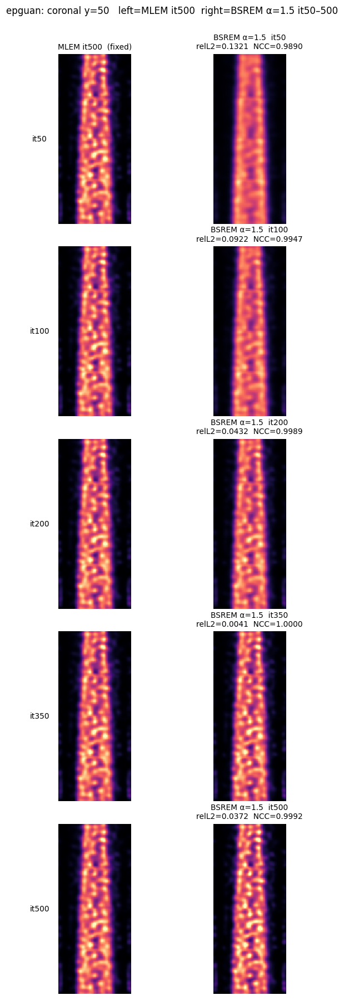

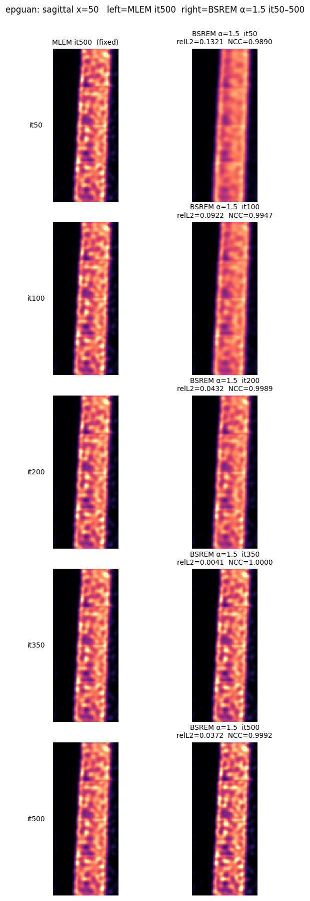

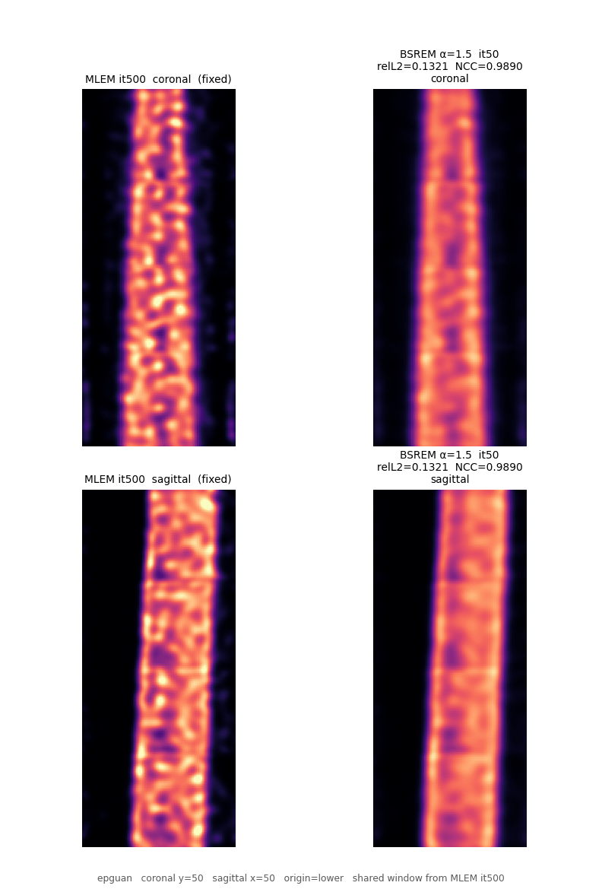

MP4: [epguan_it500_cor_sag.mp4](assets/bsrem-a15-vs-mlem500/epguan_it500_cor_sag.mp4)

### epguan_19p2mm

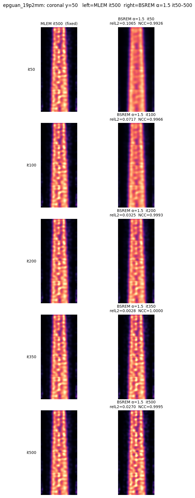

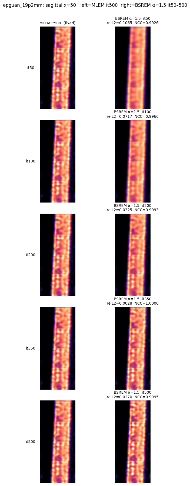

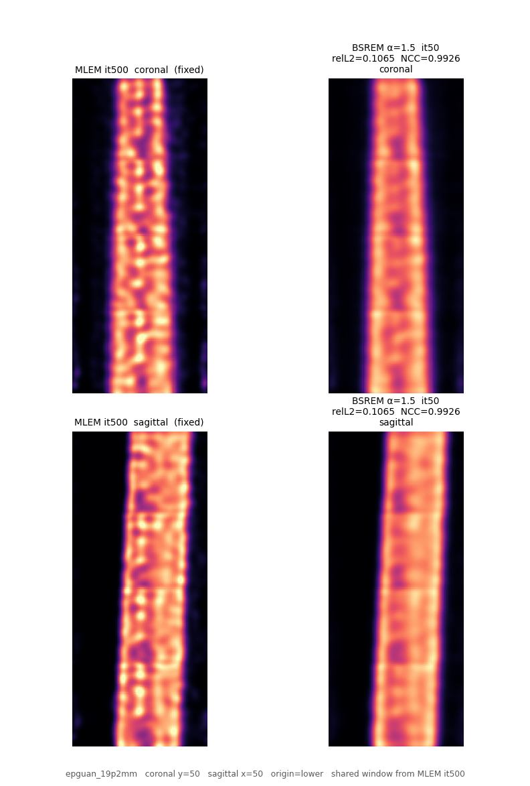

MP4: [epguan_19p2mm_it500_cor_sag.mp4](assets/bsrem-a15-vs-mlem500/epguan_19p2mm_it500_cor_sag.mp4)

### mouse_ch6o6p2

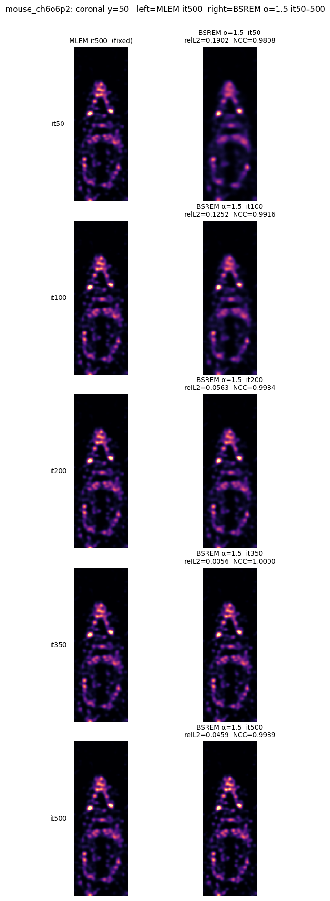

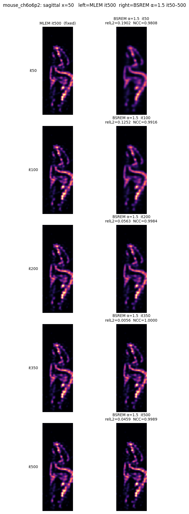

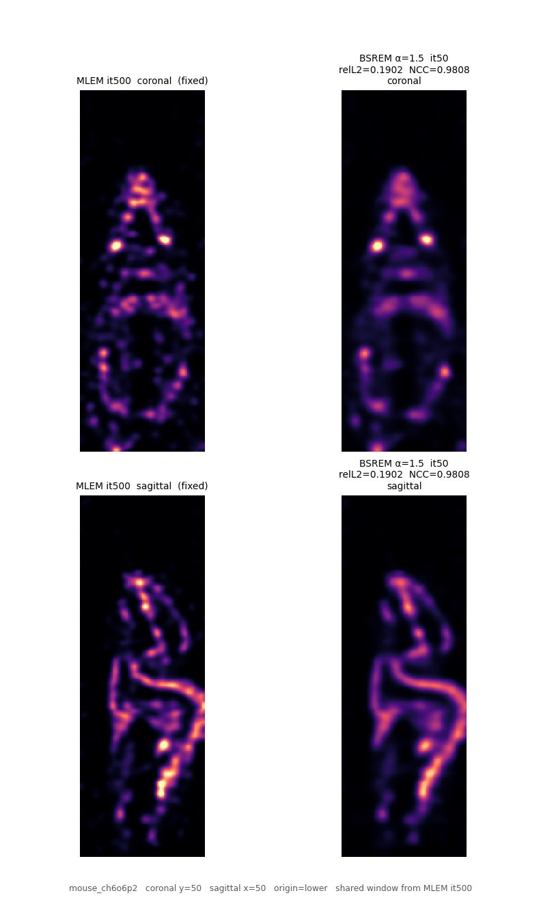

MP4: [mouse_ch6o6p2_it500_cor_sag.mp4](assets/bsrem-a15-vs-mlem500/mouse_ch6o6p2_it500_cor_sag.mp4)

### mouse

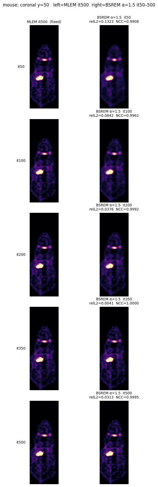

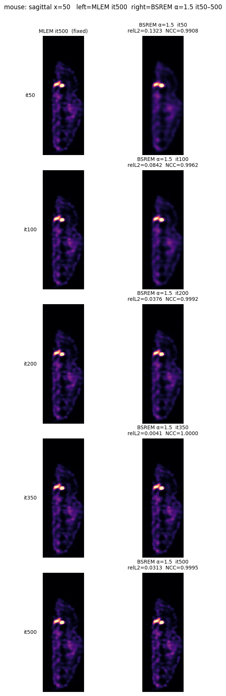

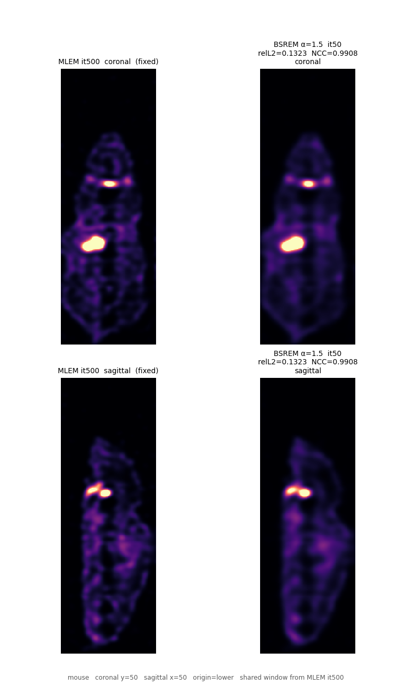

MP4: [mouse_it500_cor_sag.mp4](assets/bsrem-a15-vs-mlem500/mouse_it500_cor_sag.mp4)

## Verification

| Check | Evidence |
|---|---|
| Six axial groups written | `compare_a15_vs_mlem500.py` printed `groups: 6`; 6 PNG + 6 GIF |
| Four 500-iter cor/sag groups | `compare_a15_vs_mlem500_cor_sag.py` printed `[ok]` for epguan, epguan_19p2mm, mouse_ch6o6p2, mouse |
| Left panel is MLEM it500 | titles; window = p99.8 of that MLEM volume |
| Right panel is α=1.5 ckpts | `bsrem_a15g0` it10–100 axial; `bsrem_a15g0_500` it50–500 axial (derenzo) and coronal/sagittal (epguan/mouse) |
| Butter/smooth MHD excluded | `recon_it(\d+)\.mhd$` only |
| Orientation | coronal `vol[:, ny//2, :]`, sagittal `vol[:, :, nx//2]`, `origin=lower`, `aspect=equal` |
