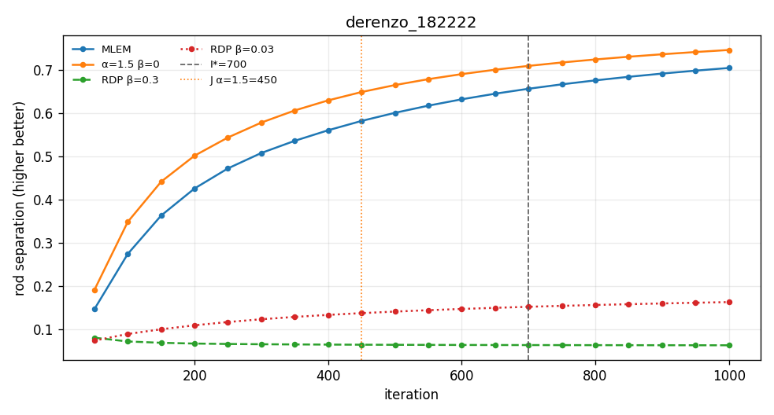
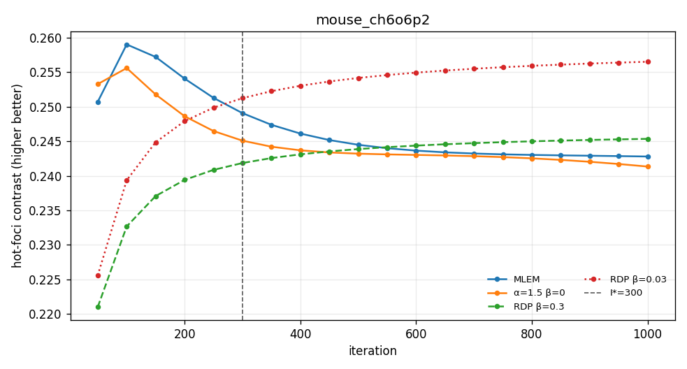
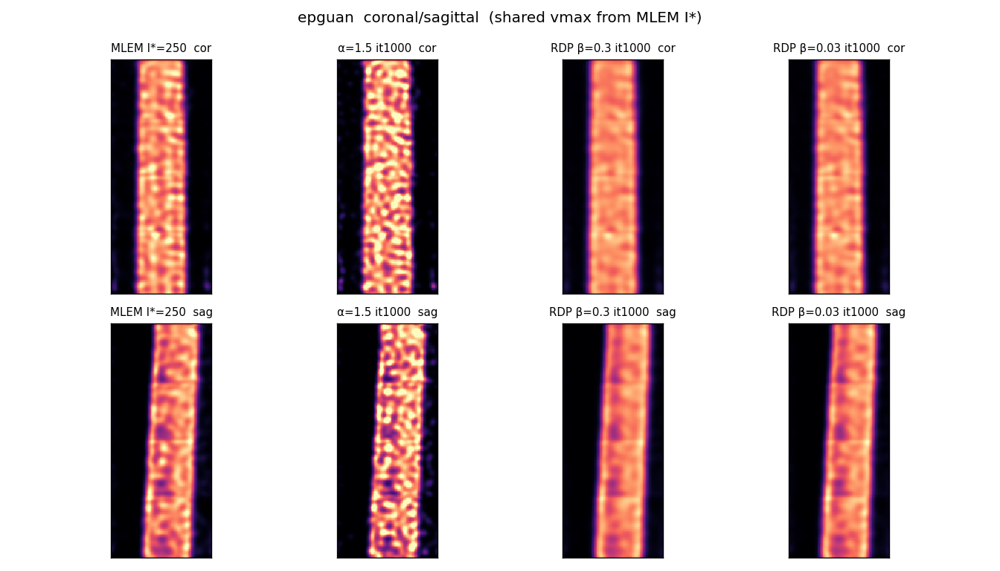
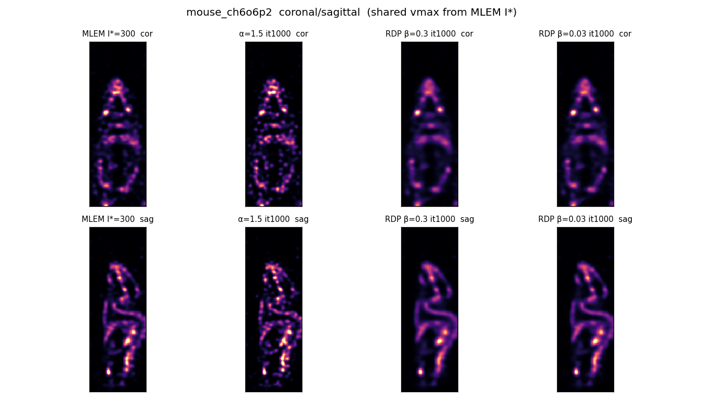
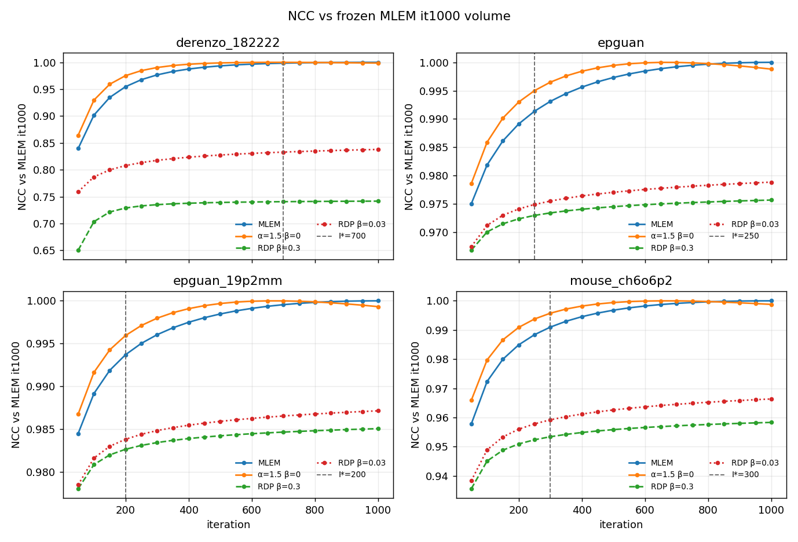
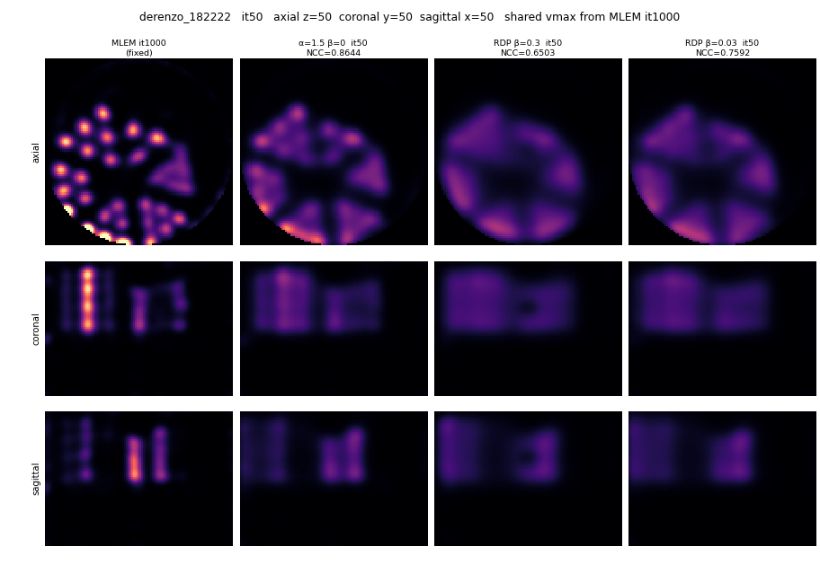
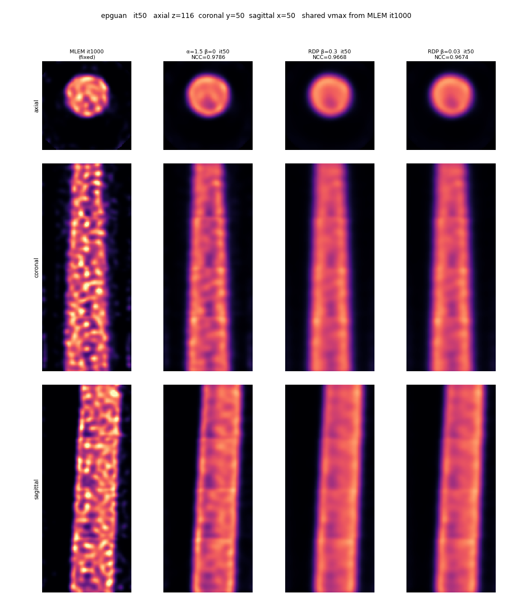
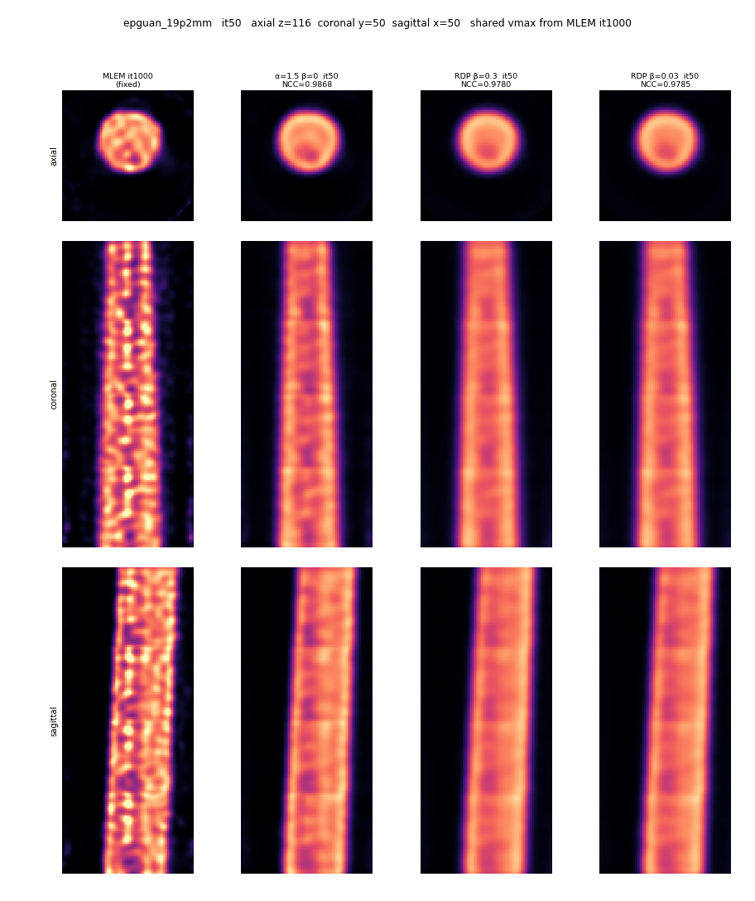
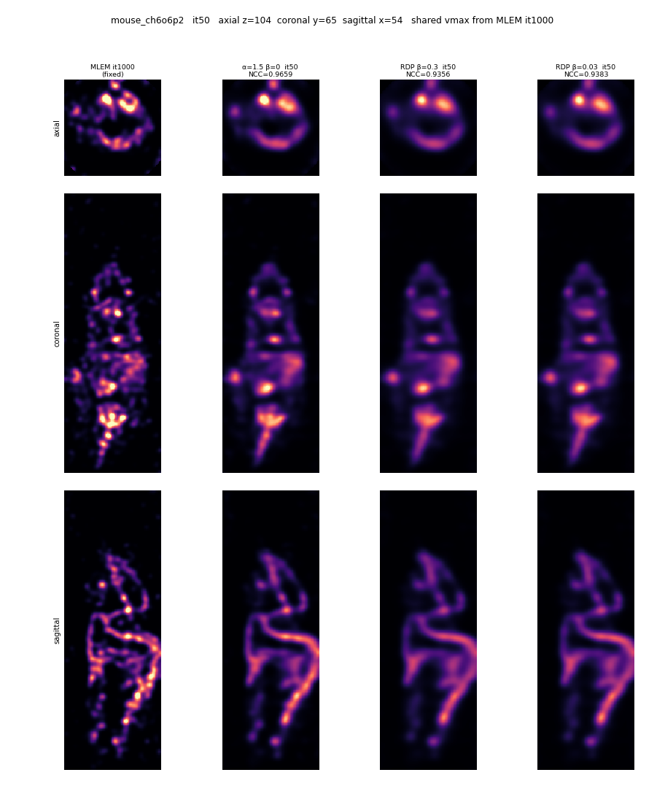

# MLEM 1000 baseline and three BSREM recipes

**Date:** 2026-08-20  
**Contract:** per-dataset MLEM I* from a 1000-iter ladder (volume self-delta ∧ task plateau); three BSREM arms to 1000 vs that I*; three recommended recipes.

**中文摘要**  
在现有磁盘结果上评估（`mouse` 的三组 BSREM 1000 未跑，mouse 轴用 `mouse_ch6o6p2`；`epguan_19p2mm` 只作床间距确认）。预注册 fallback（β=0.1 / 0.05）**未触发、未开跑**。

| 配方 | 采用 | 推荐迭代 | J（相对 I* / 自身冻结） | 结论 |
|---|---|---|---|---|
| 最佳分辨率 | α=1.5, γ=0, β=0 | 1000 | derenzo **450**（匹配 I*=700） | 杆分离 0.746，高于 MLEM it1000 的 0.705 |
| 最佳 mouse | RDP β=0.03（α₀=1, γ=0.05） | 1000（任务约 200 已近平台） | 正式 J 空（钳位未冷）；relChange J=25 | 热点对比 0.257；Dice vs I* 0.89 是惩罚差，不是没收敛 |
| 分辨率+轴向均匀 | **未达到** | — | — | 没有任何 (臂, it) 同时满足 sep≥80% 分辨率赢家 **且** CV 在均匀赢家 +10% 内 |

α=1.5+RDP 仍拒绝。没有单一生产默认；三条是 **scoped use**。

Reproduce:

```text
python -u tools/run_bsrem_rdp_convergence.py --arms mlem1000
python recon_out/bsrem_rdp_convergence_20260817/task_metrics.py --freeze --score
python recon_out/bsrem_rdp_convergence_20260817/pick_istar.py
python recon_out/bsrem_rdp_convergence_20260817/plot_mlem1000_curves.py
python -u tools/run_bsrem_rdp_convergence.py --arms a15g0_1000 rdp_b03_1000 rdp_b003_1000
python recon_out/bsrem_rdp_convergence_20260817/task_metrics.py --score --i-star-json recon_out/bsrem_rdp_convergence_20260817/istar.json
python recon_out/bsrem_rdp_convergence_20260817/pick_recipes.py
python recon_out/bsrem_rdp_convergence_20260817/plot_bsrem_task_curves.py
python recon_out/bsrem_rdp_convergence_20260817/plot_recipe_slices.py
python recon_out/bsrem_rdp_convergence_20260817/plot_ncc_and_compare_gif.py
# or, GIFs already on disk:
python recon_out/bsrem_rdp_convergence_20260817/plot_ncc_and_compare_gif.py --mp4-only
```

Gates (provisional): A `relL2(it, it-50) ≤ 0.02` on two consecutive 50-iter steps; B primary-task 50-step change ≤ 0.02 (CV uses absolute difference). I* = max(I_A, I_B), else 1000 truncated. α=1.5+RDP remains rejected.

**Dataset axis (2026-08-20):** `epguan` and `epguan_19p2mm` differ only in bed step. Recipes and fallback use **`epguan`**. The 19.2 mm run is a spacing confirmation (I* 200 vs epguan 250), not a second uniformity task. **Mouse recipe axis is `mouse_ch6o6p2`** (user: do not fill `mouse` BSREM 1000).

## Phase 1 — MLEM 1000 I*

All five `mlem1000` runs finished (exit 0). it500 vs old `mlem500` relL2 is 6.7e-8–8.9e-8 (no cross-session drift). Geometry frozen on MLEM it1000; derenzo freeze is 16 rods / z 37–63, matching C.2.

Wall-clock: derenzo 2600 s, epguan 4740 s, epguan_19p2mm 5837 s, mouse_ch6o6p2 10672 s, mouse 4106 s.

| dataset | I_A (vol) | I_B (task) | **I\*** | truncated | primary at I* |
|---|---|---|---|---|---|
| derenzo_182222 | 550 | 700 | **700** | no | rod sep 0.656 |
| epguan | 250 | 100 | **250** | no | axial CV 0.154 |
| epguan_19p2mm (spacing check only) | 200 | 100 | 200 | no | not a recipe axis |
| mouse_ch6o6p2 | 300 | 150 | **300** | no | hot contrast 0.249 |
| mouse | 250 | 450 | 450 | no | MLEM only; no BSREM 1000 |

Curves: `reports/assets/mlem1000-bsrem-recipes/<dataset>_mlem1000_curves.png`. Derenzo rod sep is still climbing slowly at I*=700 (0.656 → 0.705 at it1000); the 0.02 relative-change gate is what the contract asked for.

## Phase 2 — BSREM J vs I*

Evaluated on disk: `a15g0_1000`, `rdp_b03_1000`, `rdp_b003_1000` × {derenzo, epguan, epguan_19p2mm, mouse_ch6o6p2}. Manifests: α=1.5 / reg off on a15; RDP type/beta 0.3 and 0.03 with α₀=1.

**α=1.5 J** = first persistent checkpoint with `relL2(BSREM, MLEM_I*) ≤ relL2(MLEM_{I*-50}, MLEM_I*)` **and** task in gray (sep/contrast ≥ 0.98× I*; CV ≤ I* + 0.02).

**RDP formal J** = `relative_image_change ≤ 0.02` on two consecutive logged iters **and** ROI clamps cold. On multi-bed data the clamp-cold AND never fires (3e5–5e5 ROI clamp voxels remain at it1000 while relChange is already ~1e-3). That is an **adoption stop** on declaring “RDP converged by the written AND”, not a scientific rejection of the penalized image. Report relChange-only J as the bulk-image freeze.

| dataset | J α=1.5 β=0 | J RDP β=0.3 formal / relChange | J RDP β=0.03 formal / relChange |
|---|---|---|---|
| derenzo_182222 | **450** (I*=700; sep 0.649 vs 0.656) | 250 / 65 | 20 / 20 |
| epguan | **150** (I*=250; CV 0.151 vs 0.154) | none / 35 | none / 25 |
| epguan_19p2mm | touches I* at 150 only (not two ckpts) | none / 35 | none / 25 |
| mouse_ch6o6p2 | touches I* at **200** only (relL2 0.0039; it250 0.024 > gray 0.019) | none / 35 | none / 25 |
| mouse | not run | — | — |

α=1.5 vs MLEM I* iteration ratio (where J exists): derenzo 700/450 = **1.56×**, epguan 250/150 = **1.67×**. After J, α=1.5 **keeps going** — derenzo rods keep separating; epguan axial CV keeps rising (noise). Matching I* is not the same as running to 1000.

### Task values at I*, α=1.5 J, and it1000

Decision rule: derenzo `separation_overall` higher-better; epguan `axial_cv_mean` lower-better; mouse `hot_contrast` higher-better. Dice is vs the MLEM I* support mask (unpenalized), so RDP Dice < 1 is expected.

| dataset / metric | MLEM I* | α=1.5 at J | α=1.5 it1000 | RDP β=0.3 it1000 | RDP β=0.03 it1000 |
|---|---|---|---|---|---|
| derenzo sep | 0.656 | 0.649 | **0.746** | 0.063 | 0.163 |
| epguan axial CV | 0.154 | 0.151 | 0.234 | **0.129** | 0.132 |
| mouse_ch6o6p2 contrast | 0.249 | 0.249 (it200) | 0.241 | 0.245 | **0.257** |
| mouse_ch6o6p2 Dice vs I* | 1.000 | 0.998 (it200) | 0.846 | 0.866 | 0.892 |

Fallback bars (it1000, preregistered; **both false**):

- β=0.3 hurts mouse if contrast < 80% of α=1.5: 0.245 vs 0.241 → **no**
- β=0.03 no uniformity gain if CV drop vs α=1.5 < 5%: (0.234 − 0.132) / 0.234 = **43%** → **no**

β=0.1 / 0.05 1000-iter arms were not started. They would not close the derenzo gap: β=0.03 at 1000 still has sep 0.163 vs α=1.5 0.746 (22%).

Task curves (shared I* line):






Fixed-window slices (vmax from MLEM I*, not per-panel):






Visuals match the table: α=1.5 sharpens rods and grains the EP cylinder; β=0.3 melts Derenzo and flattens EP; β=0.03 is the mouse-structure compromise (foci kept, less speckle than α=1.5, less blur than β=0.3).

### NCC vs MLEM it1000

Baseline is the frozen **MLEM `recon_it1000` volume** (not matched-iteration MLEM, not I*). NCC is Pearson correlation of the flattened volumes, same voxels as relL2. The MLEM ladder is drawn as a reference: it must end at 1 by construction. RDP plateaus below 1 because the penalized image is a different estimator, not because the iterate failed to freeze.



Per-dataset copies: `assets/mlem1000-bsrem-recipes/<dataset>_ncc_to_mlem1000.png`. JSON: `recon_out/bsrem_rdp_convergence_20260817/ncc_to_mlem1000.json`.

| dataset | it50 MLEM / α=1.5 / β=0.3 / β=0.03 | I* same four | it1000 α=1.5 / β=0.3 / β=0.03 |
|---|---|---|---|
| derenzo_182222 (I*=700) | 0.840 / **0.864** / 0.650 / 0.759 | 0.9985 / **1.000** / 0.741 / 0.833 | 0.9987 / 0.742 / 0.838 |
| epguan (I*=250) | 0.975 / **0.979** / 0.967 / 0.967 | 0.991 / **0.995** / 0.973 / 0.975 | 0.9988 / 0.976 / 0.979 |
| epguan_19p2mm (I*=200) | 0.985 / **0.987** / 0.978 / 0.978 | 0.994 / **0.996** / 0.983 / 0.984 | 0.9993 / 0.985 / 0.987 |
| mouse_ch6o6p2 (I*=300) | 0.958 / **0.966** / 0.936 / 0.938 | 0.991 / **0.996** / 0.953 / 0.959 | 0.9988 / 0.958 / 0.966 |

α=1.5 is ahead of MLEM on this NCC at every logged iter until it overshoots the reference (NCC peaks at 1.0 around it700, then 0.9987–0.9988 at it1000). That overshoot is the same “keeps going past I*” already seen on rod sep and EP CV. RDP β=0.03 stays closer to MLEM it1000 than β=0.3; on Derenzo both remain far below 1 (0.84 / 0.74), matching the melted rods.

### 3×4 compare GIFs

Each dataset: **3 rows × 4 columns**. Rows are axial / coronal / sagittal (frozen on MLEM it1000: activity mid-z for phantoms, largest-focus COM for mouse; coronal/sagittal through FOV center except mouse COM). Columns are MLEM it1000 **fixed**, then α=1.5, RDP β=0.3, RDP β=0.03 updating it50…1000 (20 frames, 50-iter stride). Shared vmax = MLEM it1000 p99.8. Panel titles on the BSREM columns show that frame’s NCC vs MLEM it1000.



<video controls loop muted src="assets/mlem1000-bsrem-recipes/derenzo_182222_mlem1000_vs_bsrem_3x4.mp4"></video>



<video controls loop muted src="assets/mlem1000-bsrem-recipes/epguan_mlem1000_vs_bsrem_3x4.mp4"></video>



<video controls loop muted src="assets/mlem1000-bsrem-recipes/epguan_19p2mm_mlem1000_vs_bsrem_3x4.mp4"></video>



<video controls loop muted src="assets/mlem1000-bsrem-recipes/mouse_ch6o6p2_mlem1000_vs_bsrem_3x4.mp4"></video>

H.264 MP4 next to each GIF (`*_3x4.mp4`, even dimensions, yuv420p, `+faststart`). Endpoint stills (same window): `*_3x4_it50.png` and `*_3x4_it1000.png` in the same folder.

## Three recipes

| recipe | arm | recommended iter | BSREM J | note |
|---|---|---|---|---|
| best resolution | `a15g0_1000` (α=1.5, γ=0, β=0) | **1000** | derenzo **450** | it1000 sep 0.746 > MLEM it1000 0.705. mouse_ch6o6p2 contrast at 1000 is 96.9% of I* (just outside the 98% a15-J gray; not a collapse). Stop at 450 if the goal is I*-equivalent, not max sep. |
| best mouse | `rdp_b003_1000` (RDP β=0.03, α₀=1, γ=0.05) | **1000** (practical plateau ~200) | formal **none**; relChange 25 | Max `hot_contrast` 0.257. Dice vs I* 0.89 is penalty vs unpenalized support, not failed convergence. β=0.3 is smoother and slightly lower contrast. |
| balance resolution + axial uniformity | **unattained** | — | — | Need sep ≥ 0.597 (80% of 0.746) **and** epguan CV ≤ 0.140 (+10% of β=0.3 min 0.128). α=1.5 reaches the sep bar only after it350, where CV is already 0.179. Both RDP arms stay at sep ≤ 0.163. |

Scoped substitutes (not the AND-gate balance):

- Uniformity-only: RDP β=0.3, stop ~50–100 (CV already at the floor).
- One penalized default for non-rod work: RDP β=0.03 (CV within ~3% of β=0.3 on epguan, mouse structure kept). Still not a Derenzo recipe.

JSON: `recon_out/bsrem_rdp_convergence_20260817/recipes.json`.

## Imaging-validation-gate

```text
Execution: completed on available data (mouse BSREM 1000 skipped by user; fallback not authorized by its own bars)
Quality: scoped optimization (resolution and uniformity move in opposite directions; mouse contrast is a weak discriminator on mouse_ch6o6p2)
Adoption: scoped use — three named recipes, no single production default; balance recipe not promoted
Scope and evidence regime: four datasets with 1000-iter MLEM + three BSREM arms; epguan_19p2mm spacing confirmation; mouse MLEM-only
Protected outcome and gate maturity: rod sep / EP axial CV / mouse foci contrast, all provisional (0.02 I* gate; clamp-cold AND uncalibrated on multi-bed)
Evidence: paired MLEM-vs-BSREM ladders, frozen-geometry task scores, NCC vs MLEM it1000, shared-vmax 3×4 GIFs, preregistered fallback bars (both false)
Mixed-outcome repair: winners α=1.5 (rods) and RDP β=0.3 (CV); failure is the joint 80%/10% AND; no mid-β 1000-iter on disk; selector = task class, fail-closed = keep MLEM I* / do not invent a blended β
Verification: see table below
Remaining gap: mouse (non-ch6o6p2) BSREM 1000; calibrated RDP-J without clamp-cold on bed-edge; PNCG still blocked (α=1.5 still needs 450 derenzo scans to match I*)
```

## Verification

| Check | Evidence |
|---|---|
| New 1000-iter dirs | `mlem1000` all five; `a15g0_1000` / `rdp_b03_1000` / `rdp_b003_1000` on four (not `mouse`) |
| Old dirs untouched | `mlem500`, `bsrem_a15g0_500` still present |
| Geometry frozen on MLEM it1000 | `task_geometry_mlem1000.json` |
| I* rule | `istar.json` |
| Task scores include BSREM | `task_metrics.py --score --i-star-json istar.json` → `task_metrics.json` |
| Manifest RDP asserted | a15 `regularization_enabled=false` α₀=1.5; RDP type/beta 0.3 and 0.03 |
| Fallback | both bars false; β=0.1/0.05 **not run** |
| Recipes | `recipes.json`; balance `unattained=true` |
| NCC vs MLEM it1000 | `ncc_to_mlem1000.json`; curves `assets/mlem1000-bsrem-recipes/ncc_to_mlem1000.png` |
| 3×4 GIFs / MP4 | `*_mlem1000_vs_bsrem_3x4.gif` and `.mp4` (20 frames, MLEM column fixed) |
| Not verified | `mouse` BSREM 1000; α=1.5+RDP; PNCG; mid-β 1000-iter; full `convergence_summary.json` re-analyze of historical arms |
