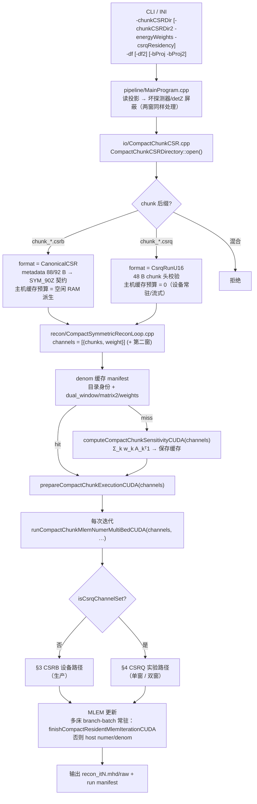
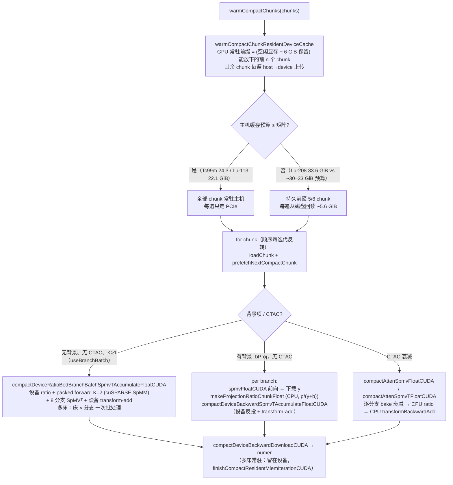
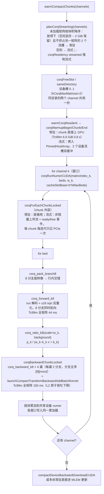

# 系统矩阵调用流程与分支耗时（2026-09-04 现状）

适用范围：`test_data/6module` 三组生产矩阵（Tc99m 141 keV、Lu-177 208 keV ZFOLD、Lu-177 113 keV）及其 CSRQ 转换副本。
状态约定：**CSRB = 生产路径、受保护基线；CSRQ = 实验路径**（用户决定，2026-09-03）。

所有耗时均为 RTX 4070 Ti SUPER（16 GB，WDDM）、单床 `-vb 1` 的 `[PERF]` 输出；`s/iter = iteration_core_s / 迭代数`。

## 1. 三组矩阵的静态属性

| 矩阵 | 目录 | CSRB 体积 | metadata | CSRQ 体积（设备端） | 备注 |
|---|---|---|---|---|---|
| Tc99m 141 keV | `Tc99m_sysmat/matrix_PSC_PIN26x28x25_SCALE2_141keV_120x120x220` | 24.3 GiB | 88 B | 6.9 GiB（`..._csrq`，D:） | 回归基线 |
| Lu-177 208 keV | `Lu177_sysmat/matrix_PSC_PIN26x28x20_208keV_120x120x220_ZFOLD` | 33.6 GiB | 92 B（兼容提示） | 9.2 GiB（F:） | 超过 ~30 GiB 主机缓存 |
| Lu-177 113 keV | `Lu177_sysmat/matrix_PSC_PIN26x28x20_113keV_120x120x220/<同名子目录>` | 22.1 GiB | 92 B（兼容提示） | 6.3 GiB（F:） | 嵌套目录，需指到内层 |

三者共享 v7.9 compact chunk 布局、103680 × 3 168 000 几何、6 个 chunk、K = 8 对称分支（sym90 + z 镜像）。格式差异只有 metadata 长度（88/92 B，自 4f6e569 起都接受）与 chunk 文件后缀（`.csrb` / `.csrq`）。

## 2. 总体调用链（三组矩阵共用）

分叉点只有两处：`CompactChunkCSRDirectory::open()` 决定 `format()`，`CompactSymmetricProjectorCUDA.cpp` 在 sensitivity / numer / forward 三个入口按 `isCsrqDirectory()` 分派。CSRB 调用方仍使用单目录签名（薄包装成单 channel），因此本轮改动没有触碰 CSRB 设备路径。

## 3. CSRB 设备路径（生产，`runCompactChunkMlemNumerCUDA` / `…MultiBedCUDA`）

实测（同一 exe `build/metadata-compat`，单床 MLEM）：

| 矩阵 | 分支 | denom 准备（miss / hit） | s/iter | 记录 |
|---|---|---|---|---|
| Tc99m 141 | branch-batch（无背景） | — / — | **1.48**（it50，PCIe 上传瓶颈） | `csrb_regression_it50`，vs 09-02 fp32 参考 relL2 5.0e-8 |
| Tc99m 141，5 床 | branch-batch 常驻 | — | 2.87 | 09-03 诊断 143.3 s / 50 it |
| Lu-177 113 | branch-batch（无背景） | 44.3 s / 22.7 s | **1.90** | `csrb_lu113_smoke_it5` |
| Lu-177 113 | host-ratio（`-bProj`） | — / 22.7 s | **1.90** | `csrb_lu113_bg_it5`；背景路径在单床下无可测差异 |
| Lu-177 208 | branch-batch（无背景） | — / 7.6 s | **14.4** | `csrb_lu208_nobg_it5`；主机缓存溢出，每遍磁盘回读 |
| Lu-177 208 | host-ratio（`-bProj`） | 145.0 s / — | **15.2** | `csrb_lu208_smoke_it5` |

结论：CSRB 三组矩阵都正常重建；208 keV 的 ~15 s/iter 完全来自 33.6 GiB 矩阵超出主机缓存预算（当时空闲 RAM 37 GB → 预算 29.5–33.4 GiB，持久前缀 5/6 chunk），与背景项路径无关。空闲 RAM ≥ ~40 GB 时预期回到 ~2 s/iter 量级。

## 4. CSRQ 实验路径（`runCsrqMlemNumerMultiBed` → `CudaSparseOpsState::csrqRunNumer`）

分母走同一 chunk 循环：`csrqRunSensitivityCUDA(matrixIndex_k, w_k)` 用 `csrq_unit_ratio_k8` 代替 ratio 核，得到 Σ_k w_k A_kᵀ1。

双窗 MLEM 形式（MB-JR，Phys. Med. Biol. 2025，MILabs VECTor）：
`x ← x · [Σ_k w_k A_kᵀ(p_k / (w_k A_k x + b_k))] / [Σ_k w_k A_kᵀ1]`。
无背景时权重在分子分母抵消；有背景时权重决定各窗计数尺度。

实测（同一 exe，单床 MLEM，`[PERF]`）：

| 配置 | 常驻状态 | 预热 | s/iter | 记录 |
|---|---|---|---|---|
| Tc99m CSRQ 单窗 | 常驻 6.9 GiB | 0.8 s（D:） | **0.25**（it200，CSRB 1.48 的 1/6） | `derenzo_csrq_bm_it20`；vs fp32 CSRB it50 relL2 5.2e-7 |
| Tc99m CSRQ，5 床 | 常驻 | 0.8 s | 1.13（CSRB 2.87） | `mouse5bed_csrq_it50`；vs CSRB relL2 6.2e-7 |
| Lu-177 208 + 113 双窗 | 208 常驻 9.2 GiB + 113 流式 6.3 GiB（auto） | 142 s（F: 读 15 GiB） | **0.64**（核 fwd 0.115 + bwd 0.333） | `lu177_dual_auto_it10`，Tc99m Derenzo 投影作替身数据 |
| Lu-177 208 + 113 双窗 | 两者都流式（GPU 被其他进程占 6 GB） | 75 s | 0.91（PCIe 15.5 GB/iter，~17 GB/s） | `lu177_dual_smoke_it10` |
| Lu-177 208 + 113 双窗，**50 迭代** | 两者都流式（`-csrqResidency streamed`，其他进程占 3.2 GB） | 64.5 s | **0.83**（迭代核心 41.5 s，整条命令 111 s）；本进程显存峰值 **5.87 GB**（2×1557 + 2×1072 MiB 流槽 + ~0.6 GB 暂存），主机 pinned 15.5 GiB | `lu177_dual_streamed_it50`，真实 Lu-177 Derenzo 投影同时喂两窗；`*_gpumem.csv` 为 2 s 采样 |
| Lu-177 208 或 113 单窗 CSRQ | — | — | 未单独测量 | 由双窗核时间推算约 0.3–0.4 s/iter |

## 5. 待办与限制

- ~~CSRQ 不支持 CTAC 衰减~~ 2026-09-04 P2 起支持：因子在 pack / 收口阶段按 compact 角度施加（`csrq_pack_branch8_atten` / `compact_transform_backward_add_batch_atten`），SpMV 核不变；每 (chunk, 床) 同步上传该 chunk 触及的 60 个全角度切片（0.38 GB），表每床每迭代过一次 PCIe。MDP 小鼠两床真实 μ：vs CSRB CTAC it20 relL2 1.4e-7，1.02 s/iter（CSRB CTAC 44 s/iter，因为逐床 2.3 GB 表全部驻留 + 逐分支 fused 核；5 床时显存 15.8 GB 触发 WDDM 分页，5 min/iter）。CSRB 保留 bake/fused 路径作为参考实现。双窗 + CTAC 仍拒绝（需逐光电峰 μ 表）。
- CSRQ 双窗需要预处理产出两套窗投影 + 113 keV 的 TEW 散射估计作 `-bProj2`；`spect_preprocess_YJ` 目前只输出一个光电峰窗。窗权重（分支比 0.0617/0.1036 × 相对窗效率或标定）待用户决定。
- 反投核 150 ms/遍的下限是 L2 原子吞吐；(angle, z-slice) shared-memory tile 两种形式实测 2× 更慢，已移除（`reports/2026-09-04-csrq-slice-backward-experiment.md`）。唯一未试的线索是 sm_120 的 `red.global.v4.f32` 向量原子（现场 RTX 5060 Ti）。
- 常驻规划在 WDDM 下偏乐观：另一进程占 3.2 GB 时 `cudaMemGetInfo` 仍报 15.1 GB 空闲（nvidia-smi 12.8 GB），`planCsrqStreaming` 于是让 208 keV 常驻，上传完 9.2 GB 后 113 keV 的两个流槽 + 2 GiB 保留放不下（`lu177_dual_auto_it50` 当时 FATAL）。**2026-09-04 P3 起**：放不下抛 `CsrqDeviceMemoryError`，`warmCompactChunks` 把本次调用已常驻的矩阵降级为流式并重试；用 4 GiB 的 torch 进程复现：208 常驻 → 113 放不下（空闲 1197 MiB）→ 208 降级流式 → 113 常驻 → 跑完 0.77 s/iter（`p2_ctac_20260904/lu177_dual_auto_hog4g_it3`）。估计本身仍乐观（降级后仍报 14.9 GB 空闲），共享 GPU 时 `-csrqResidency streamed` 可省掉一次重读。
- 208 keV CSRB 的主机缓存溢出是既有行为；若需要在生产上更快，选项是释放主机内存、或把该矩阵改用 CSRQ 副本（体积 9.2 GiB，可 GPU 常驻）。
