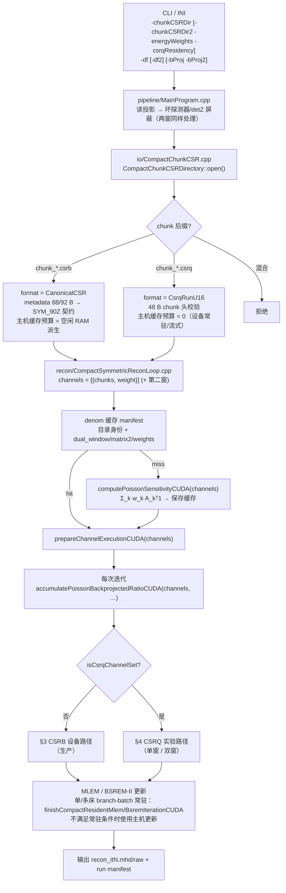
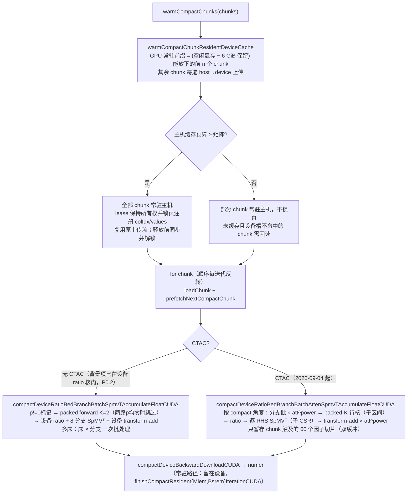
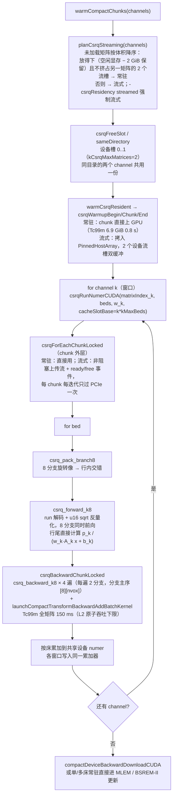

# 系统矩阵调用流程与分支耗时（2026-09-05 收敛现状）

适用范围：`test_data/6module` 三组生产矩阵（Tc99m 141 keV、Lu-177 208 keV ZFOLD、Lu-177 113 keV）及其 CSRQ 转换副本。
状态约定：**CSRB = 生产路径、受保护基线；CSRQ = 实验路径**（用户决定，2026-09-03）。

下文历史耗时来自 RTX 4070 Ti SUPER（16 GB，WDDM），床数按各行标注；`s/iter = iteration_core_s / 迭代数`。2026-09-05 起正式门改为 Lu-177 208 keV CSRB + 正常小鼠五床，当前结果以最终设计报告 §7.6–7.8 为准，不能和旧矩阵／单床时间直接比较。

## 1. 三组矩阵的静态属性

| 矩阵 | 目录 | CSRB 体积 | metadata | CSRQ 体积（设备端） | 备注 |
|---|---|---|---|---|---|
| Tc99m 141 keV | `Tc99m_sysmat/matrix_PSC_PIN26x28x25_SCALE2_141keV_120x120x220` | 24.3 GiB | 88 B | 6.9 GiB（`..._csrq`，D:） | 回归基线 |
| Lu-177 208 keV | `Lu177_sysmat/matrix_PSC_PIN26x28x20_208keV_120x120x220_ZFOLD` | 32.782222 GiB（2026-09-05 文件核对） | 92 B（兼容提示） | 9.2 GiB（F:，历史记录） | nnz 4,399,851,643；缓存能否覆盖取决于当次空闲 RAM |
| Lu-177 113 keV | `Lu177_sysmat/matrix_PSC_PIN26x28x20_113keV_120x120x220/<同名子目录>` | 22.1 GiB | 92 B（兼容提示） | 6.3 GiB（F:） | 嵌套目录，需指到内层 |

三者共享 v7.9 compact chunk 布局、103680 × 3 168 000 几何、6 个 chunk、K = 8 对称分支（sym90 + z 镜像）。格式差异只有 metadata 长度（88/92 B，自 4f6e569 起都接受）与 chunk 文件后缀（`.csrb` / `.csrq`）。

## 2. 总体调用链（三组矩阵共用）

分叉点只有两处：`CompactChunkCSRDirectory::open()` 决定 `format()`，`CompactSymmetricProjectorCUDA.cpp` 在 sensitivity / numer / forward 三个入口按 `isCsrqDirectory()` 分派。CSRB 调用方仍使用单目录签名（薄包装成单 channel），两种格式共享 Poisson 数据项接口；CSRB 设备路径已完成 P0 ratio 与 CTAC 因子分解收敛。

2026-09-05 第二轮收敛：删除全矩阵／subset 入口留下的无调用转换器、行区间缓存、瞬态上传队列及其自引用 helper；生产 compact 预取仍使用独立上传流和原有缓存。投影／背景的 `[channel * bedCount + bed]` 指针表在预上传时一次建立；主机更新的分子容量跨迭代复用，后端负责写满各床分子；主机正则梯度仅在实际计算时分配，关闭 κ 图时不构造占位体积。数学核与计算顺序不变，见最终设计 §7.3 的回归记录。

## 3. CSRB 设备路径（生产，`runCompactChunkMlemNumerCUDA` / `…MultiBedCUDA`）

（2026-09-04 之前的"有背景走 host ratio"和"CTAC 走逐分支 fused 核 + CPU ratio + CPU transformBackwardAdd"两条分支已删除，见 CHANGELOG。）

2026-09-05 获准保留的 host pin 只扩展既有 `CompactChunkResidentCacheLease`，不复制矩阵、不增加槽。自动缓存预算是 `min(矩阵大小, 总内存−max(8 GiB, 总内存/4), 空闲内存−8 GiB)`；本机 Lu-208 完整缓存因此至少需要打开矩阵时约 **40.78 GiB** 空闲，正式测量预检取 42 GiB 留出准备余量。五床与八分支组成 40 RHS，当前该尺寸选 packed-K=2 正向及逐 RHS CSR_ALG2 反投；单／多床共用一个分子入口。

新门锁页配对核心中位数 **284.278 → 191.092 s / 50 次**，三组减少27.47%–33.43%。随后定位到 `6a3e59b` 的五床默认输入／更新走host：1e-6 mm容差小于float32 spacing对36/66 mm extent的舍入误差；完整列支持检查确认实际mask外引用为0。

**`0ddc6ab` 已修复该资格误判**，在既有判断处将extent对齐到ROI参数float精度，实际mask保持不变。默认五床和真实两床CTAC现在均为device input/update，实际缩小／偏心ROI仍为host；日志明确给出所选路径。此次独立配对核心中位数 **193.601 → 181.209 s**，整命令245.582→215.926 s，最大primary relL2 1.3645e-7；120/180 s仍未通过。GPU稀疏核成本基本不变，主要省去迭代间主机往返。两阶段结果不能跨轮相除作为严格配对收益；详见最终设计§7.6–7.7。

**`cfffea5` 已通过零计数pair分子优化门**：复用ratio核的既有投影行映射在原输出缓冲准备p!=0标记，packed-2仅在两路都为0时省去Ax，随后ratio覆盖；独立forward、CTAC、灵敏度S不做此裁剪。三组核心中位数 **181.016 → 144.843 s**，配对中位收益19.94%，最大primary relL2 6.9892e-8；整命令215.666→179.964 s。**核心180 s门槛已过，120 s目标未过**。主机峰值约33.46849 GiB、专用显存12.733677 GiB，基本不变。5次Nsight正向6.20344→2.40070 s，标记准备0.000628 s；当前主反投核约占分子GPU核活跃时间82.05%，小核合计约0.84%。CTAC20最大relL2 6.1629e-8通过；完整证据与后续边界见最终设计§7.8。

**2026-09-09 分子反投改为零行 pair 散射转置**（最终设计 §7.9）：`executeColMajorBatchSpMVLocked(..., zeroRowScatterTranspose)` 在 op=T 时 memset 输出后按 (b, b+1) 启动 `compact_csr_spmvt_pair`——每行一个 block，两路 ratio 均为 0 的行不读矩阵，仅一路非零时只做该路原子累加——奇数余量仍 cuSPARSE。只有 `executeCompactBedBranchBatchDeviceRatioSpmvTAccumulateFloat` 的分子反投传入该标志，且仅当本 pass 各床投影的精确零 bin 均值 ≥0.40（`cuda::compactScatterBackwardPreferred`，在 `ensureCompactFullProjectionUploaded` 统计一次；`SPECT_CSRB_SCATTER_BACKWARD=0/1` 可强制）；否则仍是逐 RHS CSR_ALG2。灵敏度、独立 forward、CTAC（`csrbAngleSpMVLocked` 按角度 cuSPARSE 转置）不变。真实 chunk 基准：稠密 0.71×、零率 0.30 持平、0.80 3.18×。五床 MLEM50 三组配对核心 **144.606 → 73.565 s（−49.1%）**，整命令 190.310 → 117.423 s，最大 primary relL2 1.4366e-7；同一 exe 强制 cuSPARSE 143.162 s。**核心 120 s 目标首次通过。** CTAC it5 A/B relL2 3.1327e-8。

历史实测（P0 之前的同一 exe `build/metadata-compat`，单床 MLEM；表中 host-ratio 路径已删除，数值不代表当前构建的配对性能）：

| 矩阵 | 分支 | denom 准备（miss / hit） | s/iter | 记录 |
|---|---|---|---|---|
| Tc99m 141 | branch-batch（无背景） | — / — | **1.48**（it50，PCIe 上传瓶颈） | `csrb_regression_it50`，vs 09-02 fp32 参考 relL2 5.0e-8 |
| Tc99m 141，5 床 | branch-batch 常驻 | — | 2.87 | 09-03 诊断 143.3 s / 50 it |
| Lu-177 113 | branch-batch（无背景） | 44.3 s / 22.7 s | **1.90** | `csrb_lu113_smoke_it5` |
| Lu-177 113 | host-ratio（`-bProj`） | — / 22.7 s | **1.90** | `csrb_lu113_bg_it5`；背景路径在单床下无可测差异 |
| Lu-177 208 | branch-batch（无背景） | — / 7.6 s | **14.4** | `csrb_lu208_nobg_it5`；主机缓存溢出，每遍磁盘回读 |
| Lu-177 208 | host-ratio（`-bProj`） | 145.0 s / — | **15.2** | `csrb_lu208_smoke_it5` |

历史诊断：三组 CSRB 均完成重建，Lu-208 日志曾显示部分主机缓存及逐遍回读。上述 ~15 s/iter 不是完整缓存的当前五床性能，也没有用受控配对证明全部时间差均由磁盘回读造成。旧记录的 33.6 GiB 大小和 ~2 s/iter 预估不再作为当前判断依据；以本节实测文件大小、当次缓存覆盖日志及新门重复测量为准。

## 4. CSRQ 实验路径（`runCsrqMlemNumerMultiBed` → `CudaSparseOpsState::csrqRunNumer`）

分母走同一 chunk 循环：`csrqRunSensitivityCUDA(matrixIndex_k, w_k)` 用 `csrq_unit_ratio_k8` 写入行权重，得到 Σ_k w_k H_kᵀW_k1（CTAC 由同一因子分解处理）。

双窗 MLEM 形式（MB-JR，Phys. Med. Biol. 2025，MILabs VECTor）：
`x ← x · [Σ_k w_k A_kᵀ(p_k / (w_k A_k x + b_k))] / [Σ_k w_k A_kᵀ1]`。
无背景时权重在分子分母抵消；有背景时权重决定各窗计数尺度。

实测（同一 exe，单床 MLEM，`[PERF]`）：

| 配置 | 常驻状态 | 预热 | s/iter | 记录 |
|---|---|---|---|---|
| Tc99m CSRQ 单窗 | 常驻 6.9 GiB | 0.8 s（D:） | **0.25**（it200，CSRB 1.48 的 1/6） | `derenzo_csrq_bm_it20`；vs fp32 CSRB it50 relL2 5.2e-7 |
| Tc99m CSRQ，5 床 | 常驻 | 0.8 s | 1.13（CSRB 2.87） | `mouse5bed_csrq_it50`；vs CSRB relL2 6.2e-7 |
| Lu-177 208 + 113 双窗 | 208 常驻 9.2 GiB + 113 流式 6.3 GiB（auto） | 142 s（F: 读 15 GiB） | **0.64**（核 fwd 0.115 + bwd 0.333） | `lu177_dual_auto_it10`，Tc99m Derenzo 投影作替身数据 |
| Lu-177 208 + 113 双窗 | 两者都流式（GPU 被其他进程占 6 GB） | 75 s | 0.91（PCIe 15.5 GB/iter，~17 GB/s） | `lu177_dual_smoke_it10` |
| Lu-177 208 + 113 双窗，**50 迭代** | 两者都流式（`-csrqResidency streamed`，其他进程占 3.2 GB） | 64.5 s | **0.83**（迭代核心 41.5 s，整条命令 111 s）；本进程显存峰值 **5.87 GB**（2×1557 + 2×1072 MiB 流槽 + ~0.6 GB 暂存），主机 pinned 15.5 GiB | `lu177_dual_streamed_it50`，真实 Lu-177 Derenzo 投影同时喂两窗；`*_gpumem.csv` 为 2 s 采样 |
| Lu-177 208 或 113 单窗 CSRQ | — | — | 未单独测量 | 由双窗核时间推算约 0.3–0.4 s/iter |

## 5. 待办与限制

- ~~CSRQ 不支持 CTAC 衰减~~ 2026-09-04 P2 起支持：因子在 pack / 收口阶段按 compact 角度施加（`csrq_pack_branch8_atten` / `compact_transform_backward_add_batch_atten`），SpMV 核不变；每 (chunk, 床) 在上传流上双缓冲传输该 chunk 触及的 60 个全角度切片（0.38 GB），表每床每迭代过一次 PCIe。MDP 小鼠两床真实 μ：vs CSRB CTAC it20 relL2 1.4e-7，1.02 s/iter（CSRB CTAC 44 s/iter，因为逐床 2.3 GB 表全部驻留 + 逐分支 fused 核；5 床时显存 15.8 GB 触发 WDDM 分页，5 min/iter）。**同日稍后**：CSRB 也改为同一因子分解形式（两床 44 → 2.35 s/iter，vs 旧 fused 路径 it20 relL2 1.2e-7），fused/baked 核与逐床驻留表删除；双窗 + CTAC 通过 `-ctacWindowEnergies` 的逐窗指数 `att^(μ_w(E_k)/μ_w(E_map))` 支持，一张表服务所有能窗。
- CSRQ 双窗需要预处理产出两套窗投影 + 113 keV 的 TEW 散射估计作 `-bProj2`；`spect_preprocess_YJ` 目前只输出一个光电峰窗。窗权重（分支比 0.0617/0.1036 × 相对窗效率或标定）待用户决定。
- 反投核 150 ms/遍的下限是 L2 原子吞吐；(angle, z-slice) shared-memory tile 两种形式实测 2× 更慢，已移除（`reports/2026-09-04-csrq-slice-backward-experiment.md`）。sm_120 向量原子代码已就位（`SPECT_CSRQ_BACKWARD_PACKED=1`，默认关），现场 RTX 5060 Ti 性能仍待测；本机 sm_89 标量退化路径约慢 4.2 倍。
- 常驻规划在 WDDM 下偏乐观：另一进程占 3.2 GB 时 `cudaMemGetInfo` 仍报 15.1 GB 空闲（nvidia-smi 12.8 GB），`planCsrqStreaming` 于是让 208 keV 常驻，上传完 9.2 GB 后 113 keV 的两个流槽 + 2 GiB 保留放不下（`lu177_dual_auto_it50` 当时 FATAL）。**2026-09-04 P3 起**：放不下抛 `CsrqDeviceMemoryError`，`warmCompactChunks` 把本次调用已常驻的矩阵降级为流式并重试；用 4 GiB 的 torch 进程复现：208 常驻 → 113 放不下（空闲 1197 MiB）→ 208 降级流式 → 113 常驻 → 跑完 0.77 s/iter（`p2_ctac_20260904/lu177_dual_auto_hog4g_it3`）。估计本身仍乐观（降级后仍报 14.9 GB 空闲），共享 GPU 时 `-csrqResidency streamed` 可省掉一次重读。
- 208 keV CSRB 的部分主机缓存仍是资源限制下的既有行为。正式门必须记录其覆盖情况；CSRQ 继续是独立实验路径，不能代替新门的 CSRB 结果。
