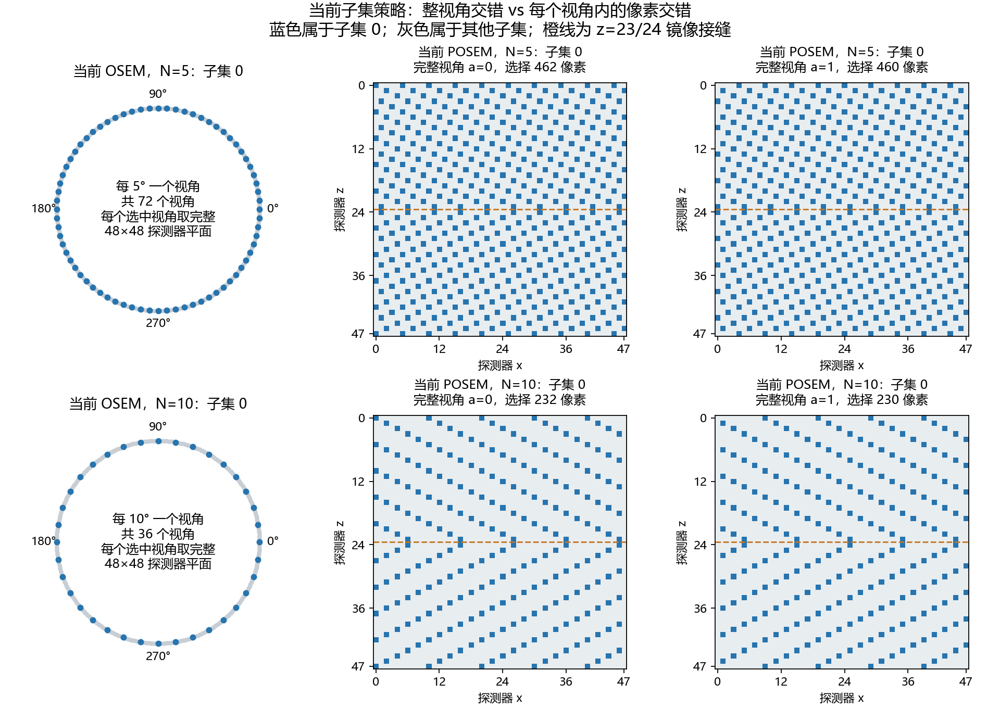
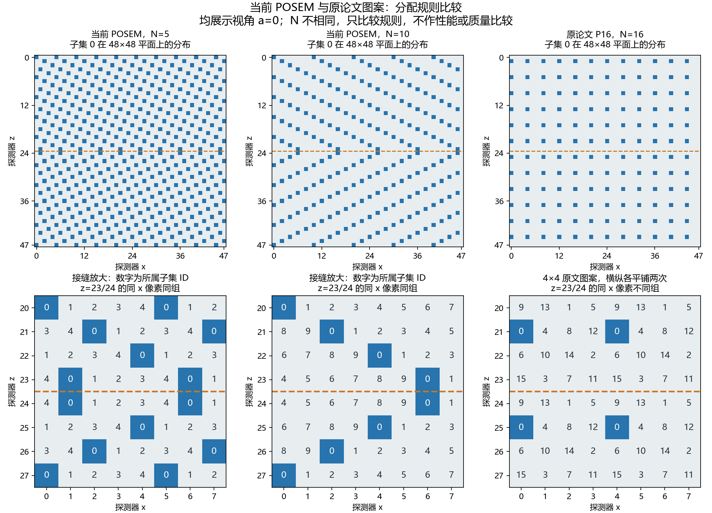
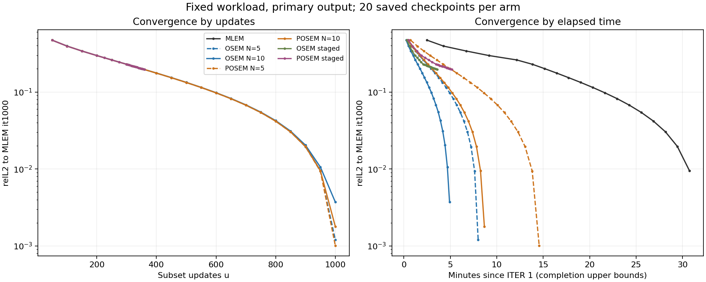
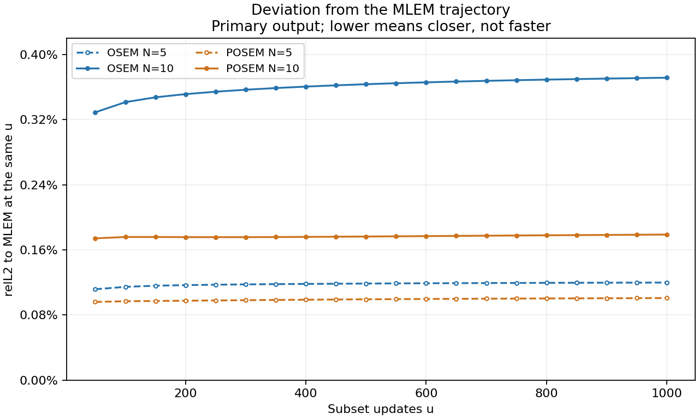
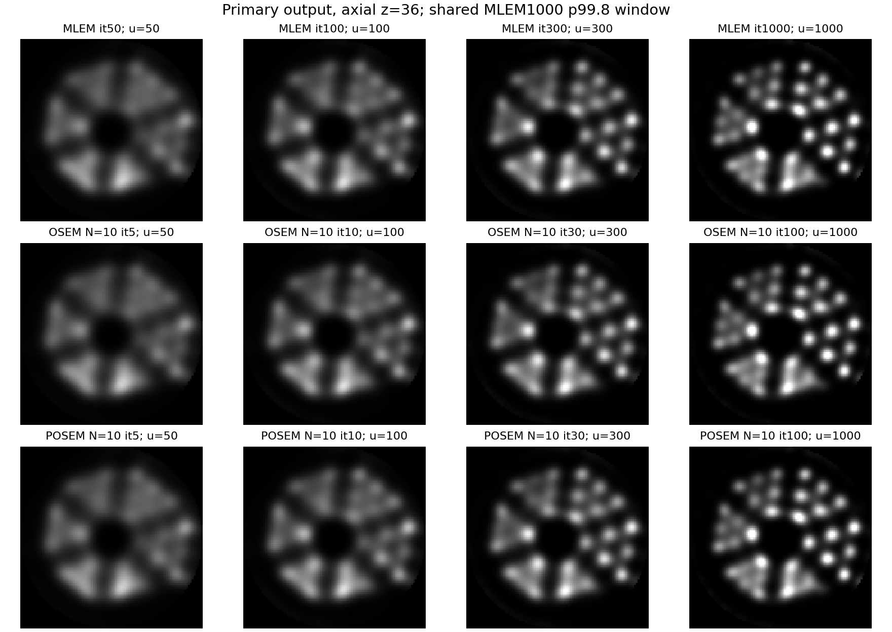
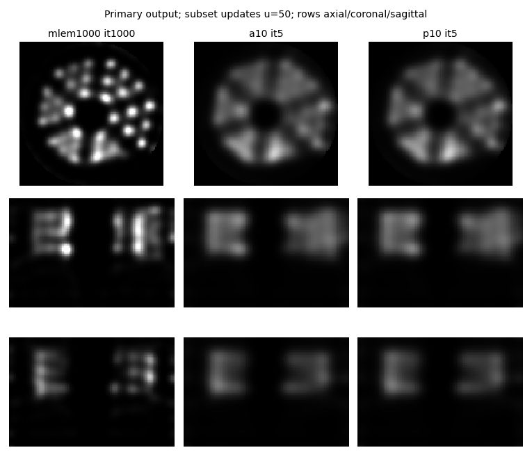
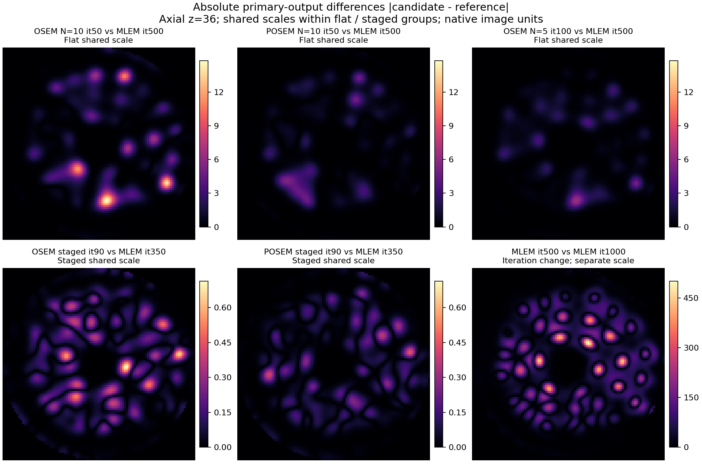
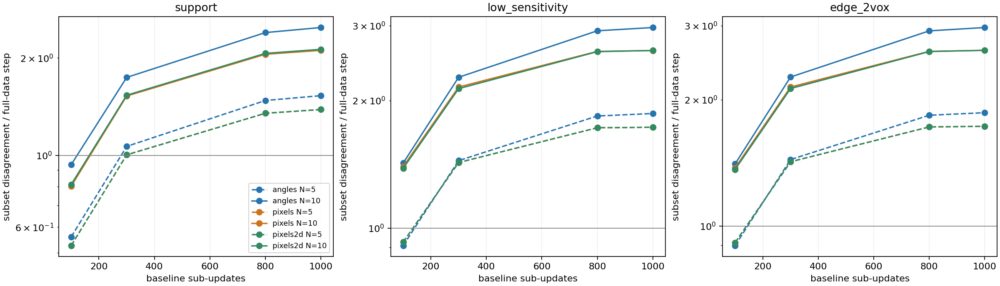

# OSEM / POSEM 收敛速度与 MLEM1000 参照比较

**日期：2026-09-10。** 本实验只比较同一固定工作负载上的算法收敛速度与MLEM轨迹接近程度。全部图像和距离指标使用 `recon_itN` primary 输出；它包含默认 sieve 的PSF保存卷积，不等同于内部迭代状态。MLEM it1000是有限迭代参照，不是质量真值。

## 1. 主要结果

- **实际耗时：angle-OSEM更快。** N=10达到同一已保存距离阈值时，angle约148秒、pixel约260秒，MLEM约1142秒（均从第1次迭代开始，取秒级日志可确认完成的上界）。
- **轨迹接近程度：POSEM更接近MLEM。** N=10、1000子更新终点的relL2分别为angle 0.00371457、pixel 0.00178826。
- **图像质量：本实验不提供质量排名。** 更接近MLEM不自动代表杆分辨、对比度或噪声更好；本报告没有独立任务质量指标支持“OSEM质量差于POSEM”。
- 当前像素模式是**适配本系统对称矩阵的POSEM变体**，不是原论文像素图案的一比一复刻。划分正确性和灵敏度平衡已核验。
- **后续配对计时已完成（第8.4节，2026-09-11归档）**：递减调度 `10:80,5:30,1:50` 是本负载全面最优——终点距参照 0.000306（a10 的 1/12），到 0.135/0.05/0.005/0.002 各阈值的墙钟均最短；pixels2d 候选无终点收益，不保留。
- **多床位与其余数据验证通过（第10节，2026-09-11）**：3床小鼠（-dfList）与新单床 Derenzo 扫描上，parity 三联（默认/-subsets 1/pixels -subsets 1）均在运行噪声级（≤1.1e-7）；子集偏差排序与 Derenzo 一致（p10 < a10 < sched）。

## 2. 固定条件与实验臂

七臂manifest逐字段核对后，仅迭代数、保存间隔、子集数/模式、输出标识与时间戳不同。其余记录参数一致，实际路径均为 `input=host, update=host, roi_prunes_matrix=yes`。

| 条件 | 本次统一设置 |
|---|---|
| 投影 | `E:/Xiang_Project/SPECT/6Module/experiments/recon_param_study/pre/derenzo_lu_6s/Bed1.bin`，单床829440 bins |
| 系统矩阵 | `test_data/6module/Lu177_sysmat/matrix_PSC_PIN26x28x20_208keV_120x120x220_ZFOLD`，6个CSRB块、Sym90Z |
| 重建几何 | 120×120×220，0.3 mm；单床步长16.8 mm；primary输出100×100×66 |
| PSF | sieve / CASToR / 1.3 mm / XYZ / min_sigmas=3 |
| 其余处理 | bad detector 68；无CTAC、背景、归一化文件、正则或迭代内滤波 |
| 硬件与缓存 | RTX 4070 Ti SUPER；六个完整矩阵块缓存在host pinned内存，日志33568 MiB |
| 配置 | `multipinhole/config/spect_config.ini` + `algo_mlem.conf`，同一默认输出策略 |

矩阵块当前大小和mtime与实际使用的全局灵敏度缓存manifest全部匹配；未发现臂间矩阵错配。固定输入的能窗组成是各臂共同条件，按本实验范围不作为速度比较的排除条件。

| 臂 | 子集调度 | 完整迭代/全数据遍历数 | 子更新数 | iteration_core_s |
|---|---|---:|---:|---:|
| MLEM | 1 | 1000 | 1000 | 1823.090 |
| OSEM N=5 | angle 5 | 200 | 1000 | 398.244 |
| OSEM N=10 | angle 10 | 100 | 1000 | 224.767 |
| POSEM N=5 | pixel 5 | 200 | 1000 | 803.296 |
| POSEM N=10 | pixel 10 | 100 | 1000 | 449.262 |
| OSEM staged | 10:20,5:20,1:60 | 100 | 360 | 183.814 |
| POSEM staged | 10:20,5:20,1:60 | 100 | 360 | 270.059 |

子更新数相同不等于工作量相同。N=10的一次子更新只处理约1/10矩阵行；一个完整迭代依次处理全部10个子集。

## 3. 子集划分与POSEM适配

本矩阵有90个compact angles，每角1152条canonical rays（48×24）。每行经4个XY对称分支和2个Z分支映射到完整投影空间。

- **angle：** `subset = compact_angle % N`。N=5/10时每个子集分别含72/36个完整视角，按5°/10°间隔交错分布；每个子集分别为165888/82944 bins。
- **pixel：** `subset = (compact_angle + ray) % N`，`ray=x+48*z_compact`。各角内交错选择探测器像素，同一canonical row的全部对称分支留在同一子集。全角范围内各子集bins总数相等。
- **访问顺序：** N=5为 `0,2,4,1,3`，N=10为 `0,5,2,7,1,6,3,8,4,9`。
- **递减调度：** 粗子集及其灵敏度由细子集按模数严格合并，最后N=1使用全数据。

像素划分需要结合探测器布局、投影索引、对称压缩、mask和校正权重适配。当前版本为保持矩阵对称轨道完整，将Z镜像分支绑定；例如z=23、24的同x相邻像素会属于同一子集。因此不能宣称它的像素空间间隔最优，但这不是漏行、重复计数或算法更新公式错误。原论文强调像素在投影中规则分散并尽量空间分离；其具体图案不能不经适配就视为本系统的唯一标准。[Branderhorst et al., 2010](https://repository.tudelft.nl/file/File_5e6ecc12-f10c-4061-a814-d78f8980fe87?preview=1)

实际更新采用对应的精确子集灵敏度 `S_m`。对现有缓存核验如下，平衡RMS定义为 `sqrt(sum_m ||N*S_m-S||²/N) / ||S||`，越小表示越均衡：

| 划分 | `||sum S_m-S||/||S||` | 灵敏度平衡RMS |
|---|---:|---:|
| angle N=5 | 1.323e-7 | 0.05585% |
| pixel N=5 | 1.324e-7 | 0.006657% |
| angle N=10 | 1.360e-7 | 0.11608% |
| pixel N=10 | 1.366e-7 | 0.07013% |

873936个全局支持体素中，四种划分均未出现某个子集灵敏度为零。这些数据支持“本系统/配置下pixel更均衡”，不构成质量优越性的独立证据。当前源码重建后，子集覆盖、嵌套、受限矩阵oracle、灵敏度/分子、host/device更新等12项测试全部通过。

### 当前策略展示



蓝色固定表示子集0。OSEM在选中的视角使用全部探测器像素；POSEM在每个视角使用部分像素，随角度改变像素相位。图中展示实际使用的N=5/10；所有子集的完整投影bins总数分别相等，为165888/82944。

### 与原论文POSEM的具体差异

这里将“标准POSEM”明确限定为Branderhorst等2010年原论文第2.4节的像素划分方案。原文第2027页给出的16子集图案为：

```text
P16 = [ 9 13  1  5
        0  4  8 12
        6 10 14  2
       15  3  7 11 ]
```

这一4×4单元在完整探测器表面平铺，单元内每个子集编号恰好出现一次；原文还给出由P16构造P32、P64、P128的规则。原文没有给出本次N=5/10的同款图案，因此图示保留论文N=16，不用取模合并冒充原文N=10。[原论文第2.4节](https://repository.tudelft.nl/file/File_5e6ecc12-f10c-4061-a814-d78f8980fe87?preview=1)



下排放大z=20…27、x=0…7，数字为子集ID。原文P16按其矩阵行顺序显示；放置到本系统48×48平面上仅为规则示意，没有运行N=16重建。不同N之间不能直接据此比较均衡程度、图像质量或耗时。

| 维度 | 当前POSEM | 原论文P16方案 |
|---|---|---|
| 基本规则 | `(a%90+x+48*min(z,47-z))%N` | `P16[z%4,x%4]`，此处选定图案原点 |
| 子集数 | 本次5/10，当前解析器上限10 | 明确给出16及扩展32/64/128 |
| 像素单元 | compact行/对称轨道 | 完整探测器上的二维像素图案 |
| 角度相位 | a增加1，子集编号整体加1再取模 | P16空间规则本身不含a移相项 |
| Z镜像 | z和47-z的同x像素绑定 | P16不施加该轨道绑定；示例接缝两侧编号不同 |
| 访问安排 | 子集ID之外另用最大间隔顺序 | 空间图案编号用于安排子集，原文强调相继子集分隔 |
| 在当前程序中采用 | 已运行并通过本报告范围内核验 | 需调整分支级选行/比值映射及S_m计算，不能仅将一个取模公式替换掉 |

因此，当前方案是POSEM的一种系统适配实现。若以后要求严格实现原文P16，应独立验证完整投影bin分区、对称分支映射和灵敏度，并重新做同配置对比。上图仅为原方案与论文的策略示意；后续二维候选见第8节，子集数上限仍为10。

## 4. 收敛轨迹与实际耗时



左图横轴是子更新次数u，右图横轴是从ITER 1开始的实际分钟数。时间点取下一迭代开始作为当前检查点完成的上界，末点使用PERF日志时刻；时间包含已有检查点输出开销。MLEM1000对自身的精确零距离不在对数纵轴上绘制。

到 `relL2≤0.135` 的首次已保存检查点：

| 臂 | 检查点 | 完成时间区间 | 相对MLEM的本次加速 |
|---|---|---:|---:|
| MLEM | it500 | 1140–1142 s | 1× |
| OSEM N=5 | it100 | 247–249 s | 约4.6× |
| OSEM N=10 | it50 | 145–148 s | 约7.7–7.9× |
| POSEM N=5 | it100 | 426–430 s | 约2.7× |
| POSEM N=10 | it50 | 255–260 s | 约4.38–4.48× |

阈值只表示距冻结参照的距离，不是图像质量门槛。每臂一次长程运行，没有重复配对计时，因此倍数仅描述本次记录。



此图纵轴是**距同u的MLEM输出的相对偏差**，越低表示越接近，不能直接读作收敛速度。N10终点angle约0.3715%，pixel约0.1788%；N5则分别约0.1199%、0.1009%。各自距离参照的变化与“需要多少秒达到参照附近”是不同指标。

POSEM看起来略早接近最终参照，数值上确有一个小差别：u=500时距MLEM1000的relL2为OSEM-N10 0.133518、POSEM-N10 0.132987，差约0.000531；但两者首次落入0.135阈值的已保存检查点都是u=500，无法从目前检查点分辨率确认它少用了多少更新。灵敏度更均衡是与这一观察相符的解释，不是已被单独隔离验证的因果结论。实际耗时仍然是OSEM更短。

## 5. 为什么拆分子集能够加速

子集更新使用 `x <- x * q_m/S_m`，其中 `q_m=A_m^T[y_m/(A_m x)]`（本实验无背景；PSF、mask等算子按固定流程纳入）。当子集平衡且充分代表整体投影时，`q_m`和`S_m`都大致缩小到全数据的1/N，它们的比值仍可给出接近全数据更新方向的修正。因此，一次约1/N数据的子更新可能取得接近一次MLEM全数据更新的进展；它不是把更新幅度也机械缩小成1/N。

以N=10为例：

| 操作 | 处理的矩阵行负载 | 图像更新次数 |
|---|---:|---:|
| MLEM一个完整迭代 | 约一份全矩阵 | 1 |
| OSEM/POSEM一个子更新 | 约1/10矩阵 | 1 |
| OSEM/POSEM一个完整迭代 | 10份不同的1/10，合计约一份全矩阵 | 10 |

这是以近似子集更新换取更频繁修正的算法加速。并非严格等价：子集分布不均衡、噪声或顺序偏差都会影响轨迹。精确 `S_m` 修正了子集灵敏度，不能单独保证它与MLEM一致。[POSEM/OSEM更新公式与迭代定义](https://repository.tudelft.nl/file/File_5e6ecc12-f10c-4061-a814-d78f8980fe87?preview=1)

当前实现的I/O链路是：

1. 六块完整矩阵读入host缓存；`CompactChunkCSRDirectory::loadChunk`命中后直接返回缓存对象。本次日志证实六块均host pinned，约32.8 GiB。
2. 每个子集从这些块中构造所选行的CSR切片；不是把全矩阵参与每次子更新的乘法。
3. 所选切片上传GPU，并预取下一切片；GPU按切片完成前向、比值和反投影。完整host缓存不等于完整矩阵常驻GPU。
4. 一个完整子集周期选中的行并集是全矩阵。理想矩阵行负载相当于一份全矩阵，而不是N份；但还会增加N次图像更新、PSF、切片调度等成本。

因此，同样只比较“一个完整迭代”，OSEM有可能因为额外更新开销更慢；但它在这一个周期内完成了N次修正，达到同一参照附近通常需要远少于MLEM的完整遍历数。本次u=500时，MLEM需要500次完整遍历，N10仅50次。

用户担心的重复读矩阵，在host缓存不足、每个子集都重新从磁盘读取完整chunk，或传输/切片开销占主导的实现里确实可能抵消加速。本次完整host缓存避免了这种磁盘重复读取。不能将这里的倍数直接外推到内存不足的机器。

POSEM当前耗时更长也与布局适配有关：angle切片按角度段直接从锁页矩阵数组DMA；pixel切片包含大量单行片段，需要CPU gather到交替的锁页暂存缓冲再上传。两者不是同样的上传路径。N10的实测核心时间分别为224.767/449.262秒。日志中 `cuda.compact_matrix_upload` 对异步预取测的是host发起/准备调用耗时，不能将其小数值解释为GPU几乎没传矩阵，更不能据此精确分解PCIe传输总时间。

相关实现：`multipinhole/src/io/CompactChunkCSR.cpp`的`loadChunk`，`multipinhole/src/sparse/cuda/CompactSymmetricProjectorCUDA.cpp`的`compactChunkSlice`/`prefetchNextCompactSlice`，以及`CudaSparseOpsState.h`的`uploadIoCsrSubsetViewAsync`/`stageFragmentedSegmentsAsync`/`prefetchCompactFloatMatrix`。

## 6. Primary图像与差分



轴向z=36；各图共用MLEM1000的p99.8作为灰度上限。下方GIF的三行分别为轴向z=36、冠状y=50、矢状x=50；左列固定MLEM1000，其余两列按u更新。





差分为原生图像数值的绝对差。上排flat三图共用同一色标；下排staged两图共用另一色标，以显示更小的剩余偏差；右下MLEM500与MLEM1000的迭代变化使用独立色标。**跨色标组不能用亮度比较差值大小，应读数值刻度。** 上排同u=500配对；staged使用实际存在的u=350（it90）与MLEM350配对。右下是迭代变化，不作为重复运行噪声底。

staged的u350体积relL2为angle 0.00021613、pixel 0.00015245。两臂终点u360距MLEM1000分别为0.195939、0.195932；没有MLEM360保存点，因此不计算终点的同u轨迹偏差。这些结果不足以确认staged相对其他调度的通用优劣。

## 7. 证据与复现

- 运行记录与140个primary检查点：`recon_out/subset_convergence_20260910/`下七个臂目录；原运行脚本`run.ps1`记录共同命令及各臂参数。
- 图表和核验：`python tools/audit_subset_convergence_20260910.py`。它读取已有结果，更新报告PNG/GIF与[audit.json](assets/osem-posem-convergence-20260910/audit/audit.json)，不启动重建，不生成MP4。
- 图像读取按MHD的x-fastest索引，以NumPy `[z,y,x]`访问。脚本包含非立方坐标自检、曲线数值类型/有限性检查和六个差分非零检查。
- 子集源码验证：当前`00d5edb`重建，`spect_tests.exe --gtest_filter=CompactSubsets.*:CompactSubsetCudaTest.*`，12/12通过。实际七臂启动日志均标记`20260910+3dd0942`，原build生成的版本头也保留该标记；pixel模式确实被执行，但缺少运行前EXE SHA，不能仅凭版本字符串严格追认原二进制源码身份。当前身份哈希另存于audit.json。
- 结论范围：本次固定输入、配置和硬件；有限迭代参照距离与一次运行耗时。报告不将轨迹接近程度替代图像质量、不将单次倍数视为重复测量结论。

## 8. 后续优化实验（2026-09-10 执行完毕，结果见 8.4）

用户批准在当前固定工作负载上执行共同诊断、一个OSEM调度候选、一个POSEM划分候选和重复配对计时。原始七臂及MLEM1000参照保持只读。本轮不重建系统矩阵，不改PSF、投影、mask、图像更新公式或子集数上限；不作图像质量或其他硬件系统的优越性结论。

- 接口变更：`-it A:B`表示A次完整迭代、B个子集；`-it A`只改迭代数。分阶段继续用`-it A -subsets N1:i1,N2:i2,...`，不能同时指定`-it A:B`和`-subsets`。保存频率独立为`-save-every N` / `save_interval`，默认0只保存最后一次；默认输出Gaussian关闭，Butterworth保留。旧报告和旧运行脚本中的`-it A:save`属于历史命令，不能直接用于新二进制。
- 共同诊断：重跑angle N10，在完整迭代0、10、30、80、100的同一个内部图像状态上分别计算全数据及angle/pixels/pixels2d的N10分子和灵敏度；N5由编号模5严格合并。内部状态不经过primary保存卷积或裁剪。诊断运行不进入计时排名。
- POSEM候选预先固定为`(a+x+3*z_compact)%N`，称`pixels2d`，保留对称轨道和访问顺序。N10在均匀像素索引平面上的最近同子集距离由sqrt(5)变为sqrt(10)；N5与当前48列规则相同。它是待验证的系统适配格点，不是原文P16复刻，Z镜像接缝仍保留。
- 数值检查：独立受限稠密矩阵验证S_m/q_m，真实数据验证sum(S_m)对S、sum(q_m)对全数据q的相对L2不超过1e-5；该阈值只用于浮点实现闭合，不是图像质量门槛。原N10重跑primary与旧终点相对L2不超过1e-5，确认接口和诊断未改变算法。
- 描述性指标：灵敏度平衡、固定图像下相对子集更新分歧、低灵敏度区域及空间边缘的分歧。按实际图像支持域（`S>0`且初始内部图像非零）、该域内S最低十分位、支持域内侧两体素边缘分别统计；均不作为单独拒绝算法的门槛。OSEM切换点在诊断后确定，明确为同数据探索选择。
- 计时终点预先固定：primary距冻结MLEM1000的relL2首次达到0.135、0.05、0.005、0.002的保存检查点；未达到则原样记为未达到。候选最多1000子更新，与固定N10基线配对，两个顺序相反的重复；单次超时1200秒。记录命令墙钟、迭代核心时间、检查点完成时间、RAM/GPU及外部负载。只有重复的受保护终点改善才支持继续，不以RMS降低代替实际收益；新算法是否进入默认配置另行决定。
- 证据目录：`recon_out/subset_followup_20260910/`；在执行前冻结EXE、输入、配置、参照哈希和矩阵大小/mtime清单。使用`tools/run_subset_followup_20260910.py`复现；续跑跳过已完成且身份一致的运行，失败输出保留，不覆盖原始数据。

### 8.1 固定状态诊断

重放终点primary相对旧angle N10终点的relL2为`7.6332e-8`。三种划分的灵敏度闭合误差最大`1.3662e-7`，全部五个状态的分子闭合误差最大`1.5366e-7`，均通过预定`1e-5`浮点实现检查。诊断没有改变原算法轨迹。诊断期间存在外部GPU任务，因此其耗时不参与比较。

本节实际支持域565920体素，低灵敏度域56592体素，内侧两体素边缘69248体素。它排除了仅由PSF扩展出的灵敏度边带，与第3节873936体素的统计域不同，不能混用两表的RMS。

| 划分 | N=5灵敏度平衡RMS | N=10灵敏度平衡RMS |
|---|---:|---:|
| angle | 0.055674% | 0.115536% |
| 原pixels | 0.006611% | 0.069990% |
| 候选pixels2d | 0.006611% | 0.036716% |

N10二维候选使该域内的灵敏度平衡RMS降低约47.5%。N5中`48≡3 (mod 5)`，两种像素公式逐行相同，因而不再运行重复的N5长程对比；不同浮点求和次序只造成约1e-11量级的RMS差异。

更新诊断固定同一个内部图像`x`，令`r_m=q_m/S_m`、`r=q/S`，计算：

```text
D = sqrt(mean_m || x * (r_m-r) ||²)
R = D / || x * (r-1) ||
```

分母采用生产更新的`1e-12`下限；子集灵敏度为零时沿用生产代码不更新该体素的规则。R比较“子集相对全数据的更新分歧”与“此时全数据自身的更新量”，不是噪声或质量分数。R大于1只表示分歧已超过较小的全数据步长，不能据此断言整周期不收敛，因为子集间仍可能抵消。



横轴是生成诊断状态的angle N10轨迹子更新数；所有曲线均在这些相同状态上评估。实线N10、虚线N5；原pixels与pixels2d曲线接近重合。

| 状态u | angle N10的R | 原pixels N10的R | pixels2d N10的R |
|---|---:|---:|---:|
| 100 | 0.9362 | 0.8030 | 0.8133 |
| 300 | 1.7411 | 1.5252 | 1.5336 |
| 800 | 2.3949 | 2.0523 | 2.0654 |
| 1000 | 2.4824 | 2.1102 | 2.1257 |

u1000低灵敏度域R分别为2.9718、2.6223、2.6239，边缘域分别为2.9705、2.6203、2.6223。二维候选改善了S_m均衡，却没有改善该诊断中的更新一致性；这说明不能只根据空间间距或灵敏度RMS决定采用划分。是否保留候选仍由下面的primary参照距离和重复计时决定。

### 8.2 已固定的比较与接口

OSEM调度候选为`10:80,5:30,1:50`：160次完整迭代、1000次子更新。前800次N10更新保留已有快速进展（原angle u800距参照为0.04249），接着150次N5更新，最后50次全数据更新。它是本数据上探索性选择的一个候选，不是SR-OSEM复刻或通用最优切换规则。

四臂为angle N10、上述angle调度、原pixels N10、pixels2d N10，各两次，主运行顺序相反。统一每5次完整迭代保存primary检查点，记录命令启动至该检查点文件完成的墙钟；调度臂保存32个检查点，固定N10保存20个，因此墙钟包含调度增加的保存开销。默认最终输出模式另做独立烟测。正式计时要求六块矩阵全部缓存且没有采样到外部重建/计算/编译进程；污染记录保留并排除，每臂最多补跑一次，选择首个合格重复，不挑最快值。

```powershell
# 100次完整迭代，每次10个子集；默认只保存最终结果
SPECT_recon.exe <输入与矩阵参数> -it 100:10
# 同样的算法，每5次完整迭代额外保存一次
SPECT_recon.exe <输入与矩阵参数> -it 100:10 -save-every 5
# 本轮OSEM调度候选
SPECT_recon.exe <输入与矩阵参数> -it 160 -subsets 10:80,5:30,1:50 -save-every 5
# 本轮POSEM二维候选
SPECT_recon.exe <输入与矩阵参数> -it 100:10 -subset-mode pixels2d -save-every 5
```

新配置默认`iterations=50:1`、`save_interval=0`、`smooth_apply_stage=none`、`butter_apply_stage=output`。仍保存primary和独立的`_butter`，primary用于算法比较。这里关闭的是额外输出Gaussian，原有sieve/PSF处理保持不变。设备更新需要同时携带新EXE与这些配置；旧`-it A:save`脚本应显式迁移为`-it A:1 -save-every save`。

### 8.3 执行状态（已完成：2026-09-10 18:52，2026-09-11 归档）

- 新EXE已构建，完整测试308通过、4项既有条件跳过；脚本语法、默认INI与配置一致性检查通过。真实检查点运行只生成primary和`_butter`；**省略保存参数的最终输出烟测已执行且干净通过**（exit 0，foreign_samples=0，全缓存，45.0s，其中迭代核心5.0s）。
- 首轮污染史（均留档）：a10_r1、schedule_r1 各采样到1个外部样本（schedule_r1核心时间被抬至459.4s），按一次补跑规则用独立`_retry1`目录重测；p10_r1在CASToR占用约15GiB、可用内存仅5.0GiB时人工中止（`p10_r1/intervention.json`留档）；其补跑`p10_r1_retry1`虽完成但采样到91个外部样本、核心时间虚高至508.9s，`timing_valid=false`，按合同从计时中排除。
- 17:50用户确认继续后，`paired → smoke → summarize`顺序链于18:52全部完成：a10、schedule、p2d各取得两次合格重复（foreign_samples=0、全缓存、顺序相反）；**p10仅p10_r2一次合格重复**（核心401.5s）。按“每臂最多补跑一次”合同，p10臂在`comparison.json`中被整体排除，为四臂对比唯一未闭合项。
- 两臂共同前800次更新的全部对应保存点最大相对差`7.3687e-8`（`schedule_prefix_check.json`），与新接口未改变算法轨迹的预期一致。原输出、冻结参照和失败记录均未覆盖。

证据见`diagnostic_summary.json`、`schedule_prefix_check.json`、各臂`result.json/resources.json`、`p10_r1/intervention.json`、`summary.json`（含逐检查点墙钟与RSS/GPU峰值）与`comparison.json`。

### 8.4 配对计时结果（2026-09-11 归档）

终点为距冻结MLEM1000参照的primary relL2；墙钟为命令启动至检查点文件完成；每格两值为两次顺序相反的合格重复。“未达”指预算内（1000子更新）未到达该阈值。

| 臂 | 合格重复 | iteration_core (s) | 终点 relL2 | 到0.135 (s) | 到0.05 (s) | 到0.005 (s) | 到0.002 (s) |
|---|---|---|---|---|---|---|---|
| a10（angle N10） | 2/2 | 229.4 / 213.4 | 0.0037146 | 199.6 / 192.3 | 287.0 / 276.1 | 345.5 / 332.0 | 未达 |
| schedule（10:80,5:30,1:50） | 2/2 | 303.1 / 292.4 | **0.000306** | **185.1 / 175.5** | **277.7 / 258.3** | **385.6 / 359.8** | **406.7 / 380.4** |
| p2d（pixels2d N10） | 2/2 | 401.4 / 399.1 | 0.0017933 | 266.9 / 265.9 | 406.5 / 404.5 | 500.2 / 496.5* | 500.2 / 496.5* |
| p10（原 pixel N10） | **1/2**（不入排名） | 401.5 | 0.00178826 | 267.5 | 407.1 | 501.2* | 501.2* |

*仅在木臂最后一个检查点（u=1000终点）首次落入该阈值，即终点检查点完成时刻（略早于进程退出的总墙钟）。

**结论（按第8节预先固定的受保护终点）：**

1. **调度臂适合更严格的参照距离，但不是所有阈值都最快。** 终点距离0.000306，比a10的0.003715近约12倍；到0.135及0.05更快，但到0.005是固定a10更快（332.0–345.5s，调度359.8–385.6s）。到0.002，调度为380.4–406.7s，快于p2d的496.5–500.2s；a10预算内未达。调度核心时间比a10多约30%。2026-09-13按上表更正原文“全面占优”“唯一达到0.002”“每个阈值均更快”的叙述，原始计时数据不变。
2. **pixels2d 无终点收益，不保留。** 0.0017933 vs 原 pixel 公式 p10_r2 的 0.00178826（差约+0.3%，单次对照）；与第8.1节诊断预测一致（灵敏度平衡RMS改善47.5%但更新一致性不改善）。按合同“不以RMS降低代替实际收益”，候选停止。
3. **新EXE/接口未改变轨迹。** p10_r2 终点 0.00178826 与第1节原 p10 运行完全一致；调度臂与前800次更新与 a10 的最大相对差 7.37e-8。
4. **资源峰值：** schedule 臂 GPU 显存峰值 13.0–13.2 GiB（N1全数据阶段），flat N10 约8.0–8.3 GiB，烟测 12.96 GiB——第9节的容量规划必须按N1峰值分配，不能按N10阶段。
5. **p10缺口声明：** 四臂中唯一未闭合（需再授权一次补跑）。单次数据与原运行一致；pixel系墙钟约为angle的2倍（约0.40s/子更新 vs 0.21–0.23s）的结论已由 p2d 两次合格重复独立支持，缺口不改变上述结论方向，仅缺少p10自身的严格配对重复。

## 9. 资源占用与实现优化机会

用户提供的任务管理器截图显示：专用显存7.6/16.0 GB，共享GPU内存32.9 GB，系统内存50.9/63.8 GB，GPU利用率24%。共享GPU内存属于系统RAM，不能与系统RAM占用再次相加，也不代表显卡拥有40.5 GB板载显存。该32.9 GB读数与本程序约32.8 GiB完整矩阵host缓存的量级吻合：`CompactChunkResidentCacheLease::pin`直接注册已有col_idx/value数组，不为注册再复制整份矩阵。因此它很可能主要是已注册的矩阵缓存，单凭截图不能证明显存溢出或显存换页。任务管理器GPU百分比取最忙引擎；这里显示3D/Copy等引擎，不能直接视为CUDA SM占用率或显存带宽利用率。[Microsoft说明](https://devblogs.microsoft.com/directx/gpus-in-the-task-manager/)

**有值得验证的调度和内存优化机会，但空闲容量与带宽瓶颈是两回事。** 截图系统RAM余量约12.9 GB；即使其他时刻有18 GB空闲RAM，也不能把它当作同等大小的额外板载显存。当前固定N10仍需完整host矩阵缓存供各子集轮流访问；若同时保留原布局及所有子集的第二份完整payload，额外约32.8 GiB超过这一余量。额外缓冲可能换来速度，却未必降低RAM占用。第8节调度运行还采样到整卡显存峰值12947 MiB（约12.6 GiB），不能只按N10期间的7.6 GB给后续N1阶段分配余量。

| 代码/日志观察 | 支持的优化方向 | 当前证据边界 |
|---|---|---|
| 原N10 angle/pixel核心时间224.767/449.262 s；`cuda.compact_matrix_upload`累计主机调用范围分别0.533/323.324 s | POSEM优先减少重复的CPU行拼接、缓冲等待和上传准备 | 调用计时包含CPU工作和CUDA事件等待，存在与GPU工作重叠，不能当作纯PCIe时间或可直接省掉的时间 |
| `stageFragmentedSegmentsAsync`每批2^21个nnz，索引和值合计16 MiB，两组交替锁页缓冲；复用前`cudaEventSynchronize` | 检验更合适的有界批量、提前准备下一片，或在一个子集阶段内复用打包布局 | 已有双缓冲和独立上传流；需要时间线判断为何未充分重叠，不能仅再加一个stream |
| `warmCompactChunkResidentDeviceCache`按完整chunk预热；`DeviceArray::allocate`只增长，`prepareForUpload`不释放矩阵数组 | 让两槽矩阵缓存容量适配当前子集阶段，阶段切换时调整 | 代码确认存在保留较大历史容量的机制；可回收字节数及净时间收益尚未测量，不等于内存泄漏 |
| 本数据日志为`input=host, update=host, roi_prunes_matrix=yes` | 若时间线证实图像准备/回传重要，再优化ROI路径下的数据驻留 | 不可通过关闭mask/ROI改变工作负载来制造加速；不能把其他五床device路径的利用率直接拿来对比 |

具体位置：`multipinhole/src/sparse/cuda/CudaSparseOpsState.h`的`stageFragmentedSegmentsAsync`、`prefetchCompactFloatMatrix`、`DeviceArray::allocate`；`CompactSymmetricProjectorCUDA.cpp`的`processChunk`先调用下一片预取，再进入当前片计算，需分离CPU拼接与事件等待是否阻塞后续kernel提交。主机容量优化应优先避免重复payload和无用驻留，不应仅因占用高就缩小已命中的完整矩阵缓存，否则会恢复逐子集磁盘重读。

下一项最小判别应是同一矩阵、数据、PSF及输出策略下，对N1、angle N5/N10和pixel N5/N10采集短的稳定迭代时间线，分开看CPU拼接、H2D/D2H、kernel、事件等待及GPU空档。本机已安装Nsight Systems 2025.6.3。NVML的GPU利用率是采样期内至少一个kernel执行的时间比例，仍不等于SM占用率；Nsight Systems可进一步定位CPU等待造成的GPU空档。[NVIDIA利用率定义](https://docs.nvidia.com/deploy/nvidia-smi/index.html)，[Nsight Systems分析指南](https://docs.nvidia.com/nsight-systems/AnalysisGuide/index.html)

本节未改变实现或正在等待的四臂比较，也未取得新的加速倍数。相继子集使用前一个子集更新后的图像，不能把多个子集用同一旧图像并行计算而继续声称算法不变；可并行的是不依赖新图像的矩阵准备/传输及受控的片内工作。实现候选应保持子集及访问顺序、浮点格式和PSF/mask，先通过对应primary相对L2≤1e-5及子集映射检查，再用重复耗时和RAM/VRAM峰值决定取舍。

### 9.1 两条划分路线与BSREM复用边界

用户于2026-09-10批准：当前四臂对比完成后，执行第9节的调度、内存和CPU/GPU衔接优化探索，按angle与pixel两条子集划分路线组织。现有`CompactSubsetSpec`和公共重建循环已经支持这种划分，不新增两套完整重建管线；`pixels2d`是pixel路线中的候选图案。

| 划分路线 | MLEM更新 | BSREM更新 | 当前优先事项 |
|---|---|---|---|
| angle | 构成当前OSEM | 已共用同一划分和S_m/q_m计算 | 子集阶段的两槽显存容量、ROI下图像准备/更新与GPU衔接 |
| pixel | 构成当前POSEM变体 | 代码已支持，但真实数据正则化长程尚未验证 | 分散行的CPU拼接、事件等待、上传重叠及布局复用 |

“POSEM的划分不能用于BSREM”不是当前代码的限制。复用的是投影bin分区及S_m/q_m，BSREM仍使用自己的全局灵敏度缩放、子集数量系数、松弛和正则梯度：`BsremUpdate.h`中数据方向为`M*(q_m-S_m)`，再减去正则项；不是套用MLEM的`q_m/S_m`更新。现有`ResidentPixelSubsetUpdatesMatchHost`确实覆盖pixel下的BSREM子更新，已在308通过的测试批次中通过，但该测试未启用正则，证据仅到小型数据的host/device算术一致性，不构成β>0真实数据的收敛验证。当前明确拒绝的是pixel+CTAC；BSREM诊断/MLEM-equivalence调试模式也暂不接受多子集。松弛OS/修改BSREM的收敛保证有对应假设，不能由现有接口支持直接推出任意划分和参数都收敛。[Ahn与Fessler，2003摘要](https://pubmed.ncbi.nlm.nih.gov/12846430/)

### 9.2 已批准的后续执行顺序与停止条件（第1步已完成：四臂对比除p10缺口外闭合，见8.3/8.4）

1. **先关闭第8节对比。** 完成四臂各两次合格重复、默认末次输出烟测和图表核验，保护已冻结EXE、配置和原始输出。CASToR主要使用CPU，但SPECT的子集拼接、旋转、host更新和矩阵传输依赖CPU/内存带宽；代码审查可在其运行期间进行，正式计时及性能归因仍待其结束。
2. **短时间线先行。** 在冻结的同一工作负载上检查N1、angle N5/N10、pixel N5/N10的稳定迭代窗口及N10→N5→N1切换，记录CPU准备、DMA、kernel、同步和分配容量。每种条件先采一次短trace，trace耗时不进入正式速度排名；只有发现具体采集失败或未解决的机制问题时才追加。
3. **沿两条路线做最小候选。** pixel先根据时间线在有界暂存/准备重叠/阶段内布局复用中选择一个；angle先验证两槽容量是否被整块预热和历史峰值撑大，并仅在CPU图像路径成为实测热点时修改其驻留。共同的缓存/传输修复放在公共代码。每条路线首轮最多一个决策候选，避免把多个机制同时改动而失去归因；无实测热点的方向保留说明，不为提高GPU百分比而修改。
4. **分别验证，再评估组合。** 新候选使用独立构建及非覆盖输出，绝不覆盖`build/verify-vs`的冻结基线。固定输入、子集成员和访问顺序、浮点格式、PSF/mask、保存频率以及对应算法的参数；primary相对基线L2≤1e-5，并保留原有受限矩阵与host/device测试。共享路径改动需补β>0的BSREM小型测试及同配置真实数据短程回归；它验证实现保持，不能用MLEM1000距离替代BSREM正则化目标。
5. **用重复实际耗时收口。** 两次顺序相反的配对，记录核心、完整命令、同一参照距离检查点、准备成本和RAM/VRAM峰值；每次重建继续使用1200秒上限。为复杂度增加的性能候选预先要求两对均改善且核心时间至少降低5%，并且端到端收益不被新增准备成本抵消；仅减少内存的候选单独报告节省量及时间代价，不冒充加速。若机制不成立或端点无收益，本轮停止该方向并记录证据；通过的候选先保留为已验证实验实现，默认算法及设备推广不自动变更。

后台任务已扩展为先执行第8节，再执行上述有界探索；两阶段完成或遇到需要用户处理的确切阻塞时报告，不能在第8节完成后误报全部工作结束。

### 9.3 子集正则化检查与CUDA运行范围

用户于2026-09-10确认将正则化缩放和耗时检查纳入后续验证，并限定项目只支持有CUDA的运行环境。正式回归及性能测试使用CUDA路径；其中CPU准备、调度、host更新及传输仍需测量。小型CPU数学参考只用于核验CUDA结果，不作为纯CPU重建方案。

当前BSREM在每个子更新前根据最新完整图像重算正则梯度，数据方向为`M*(q_m-S_m)`、正则方向为`beta*kappa*gradient`；alpha按完整迭代次数衰减。对于标准标量惩罚目标`F=sum(L_m)+beta*R`，分块目标为`F_m=L_m+(beta/M)*R`，结合M倍数据缩放后对应`M*grad(L_m)+beta*grad(R)`，因此不能再直接把现有beta除以M。[BSREM分块公式，式6–9](https://arxiv.org/html/2111.07886#S2.SS2) 当前逐体素kappa、可选曲率与裁剪需按实际代码分别核验，不能仅由这个简化推导宣称整个实现符合论文收敛定理。

后续沿用逐子更新正则作为基线，在现有β>0 CUDA回归中检查N1/N5/N10下的缩放、mask及有效参数；固定同一图像核对裁剪前各子集方向的平均与全数据方向，实际序列另外观察数据项、正则项和对应完整目标，先确认能量与实际正则方向的定义一致。不得用距MLEM1000的距离替代正则化收敛指标，也不要求每个子更新的完整目标单调下降。时间线另统计正则梯度、图像传输和同步成本；只有它成为实测热点时，才提出减少梯度重算频率或整轮末分裂更新的独立算法候选，不能作为等价的调度优化直接替换。

本次源码核对及两个既有CPU算术测试（`SubsetScaleUsesGlobalDataGradient`、`LambdaMultipliesGradientAndCurvature`）通过；它们仅支持局部公式检查。上述β>0 CUDA组合验证尚待执行，冻结的第8节无正则四臂比较保持原样。

## 10. 多床位与其余数据补充验证（2026-09-11）

在真实多床位于其余扫描上验证子集路径。全部17次运行一次通过（nvcuda 偶发崩溃未出现）。EXE/配置与第8节同一冻结身份（`build/verify-vs` SHA `76859c…`，新 `-it A:B` / `-save-every` 接口）；矩阵同为 Lu177 208 keV ZFOLD CSRB；无CTAC/背景，与全部既有运行一致。证据目录：`recon_out/subset_multibed_20260911/`（`run.ps1` 含全部命令；`*.ok` 为完成标记）。

### 10.1 多床位于单床新扫描的 parity 三联

| 数据 | 床数 | rays | 输出尺寸 | s1 vs 默认 | px1 vs 默认 |
|---|---|---|---|---|---|
| mouse_normal_lu | 3（-dfList） | 2488320（3×829440） | 100×100×178 拼接 | 6.6e-8 | 3.5e-8 |
| mouse_tumor2_lu | 3（-dfList） | 2488320 | 100×100×178 | 3.5e-8 | 1.1e-7 |
| derenzo_lu_s220520 | 1 | 829440 | 100×100×66 | 3.0e-8 | 3.0e-8 |

三组均在本仓已测得的运行级非确定性置信带内（同exe两次运行差 3e-8，见第4节），且远小于任何子集效应（≥1e-3）：`count==1` 三入口在多床拼接路径下同样统一。

### 10.2 mouse_normal_lu 上的子集行为（3床）

30子更新臂 vs mlem_it30（同 u=30）：

| 臂 | relL2 vs mlem30 | 占该阶段 MLEM 自身步幅* |
|---|---:|---:|
| a10 | 0.0374 | 8.1% |
| p10 | **0.0305** | 6.6% |
| sched（27更新） | **0.0227** | 4.9% |

*该阶段 relL2(mlem3, mlem30)=0.4592，即 u=30 处收敛仍早期；绝对偏差大于 Derenzo u=1000 尺度（0.0037/0.0018）是数据阶段不同，不是异常。**排序与 Derenzo 完全一致：p10 < a10，调度最近**——POSEM 轨迹保真优势与递减调度的收尾优势在多床位低计数数据上重现。

运行注记：mt_p10 的 255s 总墙钟来自 `denom_and_matrix_prepare_s=230.6`（冷文件缓存下的矩阵准备；全部灵敏度缓存命中），非计算成本。

### 10.3 缺口与未覆盖项

- 多床未跑长程阶梯（无 it1000 参照），上表为短程排序验证，不构成多床位的收敛/计时结论。
- Tc-99m IQ 数据（iq_resolution/uniformity）未跑：需 `Tc99m_sysmat/matrix_PSC_PIN26x28x25_SCALE2_141keV` 不同几何矩阵，且该矩阵另有 csrq 变体目录，属独立验证项。
- 其余 5 个单床 Derenzo 扫描（s210652…s215306）未跑；s220520 已代表新扫描交叉验证。

复现：`powershell -NoProfile -ExecutionPolicy Bypass -File recon_out/subset_multibed_20260911/run.ps1`。
