# CUDA角度子集发布验证与Lu-177联合重建

最新进展：文末joint N10独立候选已完成实现与两鼠验证，30N10 RDP配方对300N1的核心加速约4.16–5.05倍；冻结发布包仍保持原版。前面各节保留当时使用的EXE、模型和配置语境。

## 执行合同（2026-09-13）

问题：将当前角度子集工作区修复为可发布版本，OSEM/BSREM共用划分，RDP/TV实际生效；完成发布验证后恢复Lu-177双窗联合重建。

范围：仅CUDA环境；保留现有CPU准备和host更新路径。保护`build/verify-vs`及9月10日原始实验。当前源码已经移除POSEM；本次不重新引入像素分支。

允许修改：当前CLI、角度子集更新、默认配置、对应测试和发布文档。独立构建`build/subset-release-20260913`，独立证据`recon_out/subset_release_20260913`，新发布目录，不覆盖旧RC。

验证：CUDA小矩阵覆盖/灵敏度/更新参考；RDP、TV每子更新设备结果对CPU数学参考relL2≤1e-6；真实Lu208 CSRB固定输入、PSF和primary输出，当前角度子集对冻结EXE的同参数结果relL2≤1e-5；所有正式输出有限、非负。重复配对记录耗时，短程测试不外推长期速度。新版本不引入需要额外性能门的新缓存机制。

默认候选：50次完整迭代、10角度子集，参考9月10日两次配对收敛记录（旧报告§8）；仅末次primary及Butterworth副本，关闭额外Gaussian。固定N10用于快速常规重建，严格接近完整数据解时显式使用递减调度或N1；不宣称所有系统上全局最优。

正式运行顺序：单GPU串行，发布门通过后才执行双窗。单次真实重建超时20分钟；数值、非有限值、进程失败或输入身份改变立即停止该链并保留输出，修复后新目录重试。

Lu-177阶段沿用`recon_out/lu177_dual_first_20260909/contract.md`已冻结的分窗输入和四个无背景主对照；旧CLI的100:50转换为`-it 100:1 -save-every 50`。使用本次RC、新输出目录，旧结果不覆盖。该发布阶段冻结RC的联合CSRQ不支持子集；保持N1，能窗不能当成子集。背景臂仍为单独可选工作，不因本次恢复而自动开启。

状态：本轮发布功能/数值门完成；Derenzo四臂及一组权重敏感性臂完成，但100次N1仅属早期检查。随后7组老鼠（35床）和1个norm会话完成分窗，两组老鼠的六臂700次N1及42个primary检查点完成验证。双窗输入相对单208的观感收益可见；双矩阵相对同计数合并窗的全面画质优势、物理权重标定及器官定量尚未验证。

用户2026-09-13补充：该Derenzo通常在约600–700次MLEM等效进展后才趋于收敛，子集研究的目标是以更少完整数据遍历达到相近结果，例如100次N10替代1000次MLEM。因此本报告的100次N1不能作为收敛终点，窗权重敏感性结果也不能作为收敛后的标定结论。后续Derenzo评价复用9月10日已保存的600/700/1000检查点及N10对照；新双窗输入/矩阵的长程结果另行验证，不直接继承旧单矩阵的收敛结论。

统一计数：完整迭代数K、子集数M、子更新数U=K×M分别记录；一次完整迭代包含所有子集，通常约遍历一次矩阵。100×N10与1000×N1均为1000次子更新，但前者约100次、后者约1000次全数据遍历；不将相同U当作数值等价或已证实的十倍加速。收敛加速以达到相同primary参照距离/稳定程度的实际耗时衡量。BSREM另看其正则化目标，不能用逼近未正则化MLEM代替验收。

## 已核验的修复与默认值

- 当前解析器、配置和清单统一使用`-it A:B = A次完整迭代、B个子集`，保存频率独立；旧POSEM参数明确失败。
- OSEM在某子集看不到一个体素（S_m=0）但全数据能看到（S>0）时保留当前值，host与CUDA一致。
- 旧`recon_sections_override_cli=true`会把BSREM算法配置及命令行的RDP/TV覆盖回全局`None`，真实`-dumpConf`已复现。发布默认改为false，原兼容模式仍可显式用于复现。
- RDP/TV在每个BSREM子更新时使用当前图像重新计算梯度；数据项乘M、β不乘M，步长按完整迭代衰减。默认κ图保留。β=0.3用于本次功能验证，不构成各对象的画质调参结论，也不是RDP与TV等平滑强度比较。
- 默认`50:10`采用既有收敛记录支持的常规加速点；没有新增矩阵副本缓存。完整数据、严格晚期收敛及联合双窗可显式选择N1。GPU利用率峰值不作为默认选择目标。

## 数值与运行证据

独立构建完整测试：304项中300通过、4项外部数据或opt-in测试跳过。CUDA RDP/TV连续三个子更新对CPU数学参考满足relL2≤1e-6。三个helper fatbin均由`cuobjdump --list-elf`确认包含sm_86、sm_89、sm_120；实际GPU验证仅本机sm_89。

| 固定输入回归 | 新版对冻结版primary relL2 | 门限 |
|---|---:|---:|
| N1，5次完整迭代 | 3.417e-8 | 1e-5 |
| N10，5次完整迭代，重复1 | 5.635e-8 | 1e-5 |
| N10，5次完整迭代，重复2 | 5.614e-8 | 1e-5 |

同一Lu208 CSRB、Derenzo投影、配置、PSF、mask及primary保存路径；运行顺序old/new/new/old，未检测到其他重建进程。N10核心耗时旧版13.820/12.998秒，新版12.596/12.354秒；整进程旧版74.609/70.406秒，新版74.843/72.531秒。准备阶段约46–52秒主导短任务，不能据此宣称端到端加速或推广至完整50次默认任务。

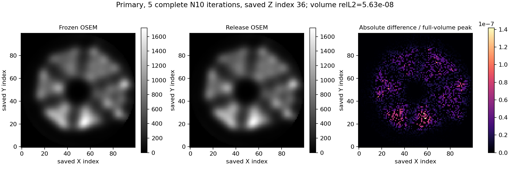

`10:1,5:1,1:1`共3次完整迭代的阶段切换运行成功。单床RDP与TV各运行10次N10完整迭代，primary有限、非负且非全零，实际清单确认β=0.3、RDP/TV启用、保存仅末次primary和Butterworth。核心耗时分别25.834、26.458秒。

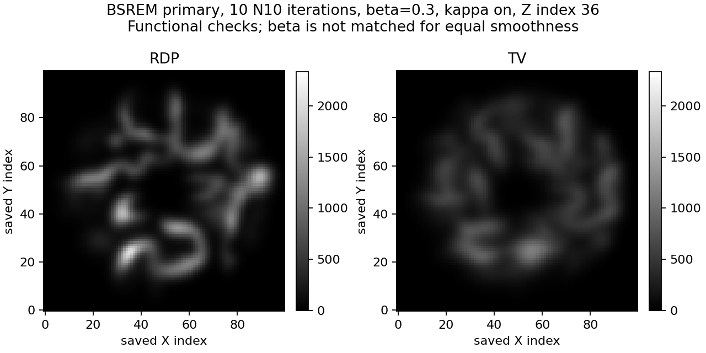

此图是功能验证，不是画质优劣判定；两种正则的β没有按等平滑强度校准，也未运行到本对象的最终画质端点。

执行记录中的`new_5bed_bsrem_*`首轮脚本错误地使用`-df`传多个路径，实际仅载入Bed1，排除于五床验收；修复为`-dfList`并按manifest断言5床，使用`new_dfList5_bsrem_*_r2`。前一次`new_dfList5_bsrem_rdp`会话中断、无完成回执，保留但不判为算法失败。

完整五床RDP、TV各完成3次N10完整迭代，清单确认5床/4147200投影值，运行使用`input=device, update=device`，100×100×290的primary与Butterworth均有限非负。核心耗时RDP 8.048秒、TV 6.506秒；这是功能记录，不是正则算法速度排名。进程峰值主存约34.7 GiB，采样GPU占用峰值最高15725 MiB；本次未减少矩阵缓存内存，也未声称GPU占用率得到优化。

## 发布产物

- [最终RC压缩包](../dist/release_candidates/SPECT_recon_rc_20260913_subsets_final.zip)，369993381字节，约352.9 MiB。
- [包内验证记录](../dist/release_candidates/SPECT_recon_rc_20260913_subsets_final/docs/release_validation.json)，[参数说明](../dist/release_candidates/SPECT_recon_rc_20260913_subsets_final/PARAMETERS_CN.md)。
- EXE SHA-256：`c85c5887f946b4efd066b8e6057a3430847386bf184ae05b2580880008e06cf3`。
- ZIP SHA-256：`7ca6fae9a2ea93b6e3e2d060daa6dffd50d72d89077e4dc29c5d3cdc99c71b86`。

实际包内TV N10启动检查通过。最终包与已运行包的EXE、CUDA DLL、生产配置按哈希一致，最终路径下的OSEM/RDP/TV合并配置逐项检查；ZIP中29个受清单保护的文件全部按解压流验证SHA-256，没有嵌套`config/config`或运行缓存。重复目录的中间包保留，交付以`_final.zip`为准。

```powershell
# 默认OSEM 50次完整迭代、10子集；仅末次primary及Butterworth
.\bin\SPECT_recon.exe -df D:\data\Bed1.bin -chunkCSRDir D:\matrix\CSRB -o output
# BSREM默认RDP；TV显式选择
.\bin\SPECT_recon.exe -df D:\data\Bed1.bin -chunkCSRDir D:\matrix\CSRB -opti bsrem -reg tv -o output_tv
# 严格晚期收敛：显式递减子集；N:i仍表示子集数:该阶段迭代次数
.\bin\SPECT_recon.exe -df D:\data\Bed1.bin -chunkCSRDir D:\matrix\CSRB -it 160 -subsets 10:80,5:30,1:50 -o output_staged
```

## Lu-177双系统矩阵协同重建：100次N1早期检查

复核48对分窗预处理标定文件逐字节一致，所有已保存投影SHA与9月9日记录一致；113+208的逐bin加和闭合通过。使用原合同的113/208各自CSRQ矩阵和12会话投影总和，所有臂100次N1更新、PSF sieve/castor 1.3 mm、无背景/CTAC、保存it50与it100。原始数据及旧运行不覆盖。

| 臂 | 核心耗时/秒 | 预测总计数偏差（208窗） | 预测总计数偏差（113窗） |
|---|---:|---:|---:|
| 208单窗 | 31.672 | +3.27% | — |
| 113单窗 | 24.925 | — | +5.65% |
| 原权重联合：0.1036,0.0617 | 62.544 | +60.67% | −24.91% |
| 合并投影配208矩阵 | 32.550 | +4.49%（合并窗） | — |
| 有效权重敏感性联合：0.1036,0.132025131625 | 62.192 | +4.86% | +4.84% |

偏差定义为Σ预测/Σ测量−1，从逐角度、探测器Z行的残差CSV重新汇总，非各行相对偏差的算术平均。数值用于同一窗口的拟合诊断，不能跨不同计数输入直接比较Poisson指标绝对值。单次耗时仅描述本次运行，不作CSRQ对CSRB或单窗对联合的性能采纳结论。

原权重联合触发原合同的|bias|>5%条件，因此追加一次敏感性臂：在原联合it100图像上令有效权重乘Σ测量/Σ预测，再将共同尺度归一到208权重0.1036不变。拟合后的113有效权重约0.132025。两个窗口的Poisson deviance/bin由26.57/19.63变为12.27/12.24。它支持“相对窗权重影响共同图像拟合”，但不能单独证明矩阵归一化错误、散射大小或真实分支比改变；这是未验证收敛的同一数据上的适配，不是独立校准验证，不自动移用到norm或老鼠数据。

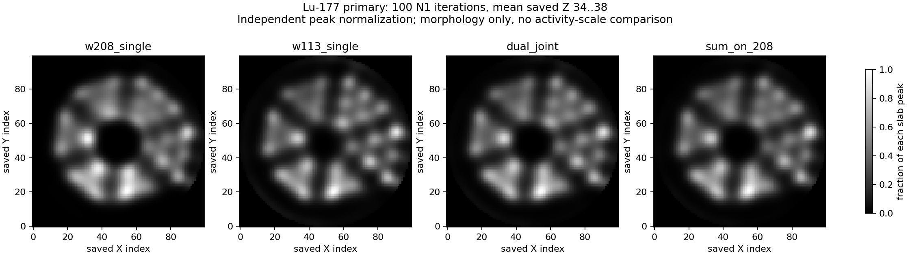

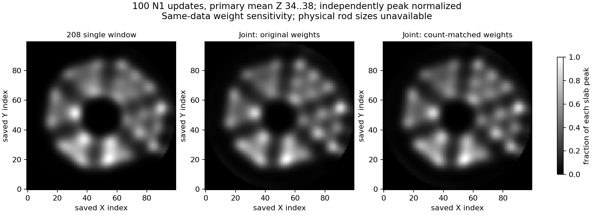

所有图均来自primary，使用同一保存Z索引34–38平均层；各臂独立峰值归一化，仅用于形态查看。用户2026-09-13确认没有模体各扇区孔径/间距/布局资料，因此本轮不输出最小可分辨孔径/间距，也不把图像峰距充当真实模体尺寸。原合同的杆分辨优越性门尚不能判定；联合路径保持实验状态，未改变CSRB生产基线或物理能窗默认权重。

## 复现与后续边界

原始命令、有效清单、日志与输出位于`recon_out/subset_release_20260913/`。脚本分别为`validate.py`（源码数值/真实输入）、`release_check.py --final`（包身份与封装）、`dual_joint.py`（四臂及预定权重敏感性对照）、`figures.py`（primary图与逐窗残差汇总）。成功回执可复用，未完成尝试保留。

后续优先正常鼠、肿瘤鼠及独立norm数据，按用户要求重点查看肾脏信号分布、肿瘤相对摄取和分割体积稳定性。已定位2026-08-27正常鼠/tumor2，以及2026-08-28的143/263 uCi命名组各3/5/10秒采集目录；其中263uci_3s只有CT目录，缺SPECT，明确排除。其余7组均有5床ENG。`data_platform1.mhd/raw`是720角度X射线投影栈，并非重建CT体（143uci_10s帧0/180/360直接检查，见`recon_out/lu177_mouse_joint_20260913/ct_input_frames.png`），不能直接作CT配准/分割。文件名中的活度不直接作为注射活度；同组时长变化不计作独立动物。

用户补充norm源为带准直器、位于轴线中心且覆盖单床FOV的圆柱；精确尺寸和活度未给出。该信息支持均匀源重建评价，但带针孔的均匀源投影不应假设各bin相等，暂不生成简单倒计数平场因子。用户记忆中的病灶位于左侧乳腺附近，双肾为主要信号，部分膀胱摄取；具体示踪剂不明。这些是定位线索，尚不是ROI真值。另记录用户对本批数据的经验：非游离态通常不显示全身轮廓，约100uCi时信号与背景差异小；不以出现鼠体轮廓作为画质改善，比较时保留背景/CNR与可比灰度，不只逐图峰值拉伸。

用户进一步明确当前以SPECT观感为主，CT只作额外核查，CT/SPECT轴向上下可能相反。当前不开展CT重建、去鼠仓/床位、配准或CTAC；后续另用已经处理和配准的CT DICOM做解剖引导与衰减校正。缺少CT不阻塞当前SPECT模态比较。

首阶段只盘点输入和按同一预处理程序拆分113/208投影，保留物理Bed编号、原始ENG和CT；逐床验证标定身份、非负性及分窗闭合。肾脏/肿瘤指标需要可核验的ROI及坐标映射；没有示踪剂、活度标定和注射记录时，输出相对摄取与阈值敏感性，不将其称为绝对代谢或真实肿瘤体积。后续联合方法画质采纳需独立数据和充分迭代的端点。当前没有据此添加新的子集缓存或GPU调度变体，也未重新引入POSEM分支。

正常鼠与tumor2已完成新双窗预处理：各4对共用标定文件逐字节一致，10床投影均为360×2304，113=dual−208非负且逐bin闭合。证据与复现脚本为`recon_out/lu177_mouse_joint_20260913/prepare.py`、`inventory.json`及各对象`identity.json`/`projections.json`，原始文件按SHA冻结。下一项描述性检查固定这两只对象、RC、PSF、无背景/CTAC条件，分别运行208单窗和原物理权重双窗N1至700，每100保存primary，以末段变化和逐窗残差检查是否稳定；700并非保证老鼠收敛的通用迭代数。单次上限仍20分钟，失败不覆盖。暂不把Derenzo拟合有效权重移用到老鼠，不作性能或质量采纳判断。

其余5组可用老鼠采集也已通过同样的分窗门，合计35床。norm首阶段限定`20260827_135310`这一既有代表会话（单床），使用相同双解码及闭合检查，预处理每模式20分钟上限；只做独立输入准备和描述性计数分布，不处理全部80会话、不从该单会话推导/部署归一化因子。该预处理可与描述性重建并行，期间的墙钟不作为正式性能比较。

| 采集目录简称 | 五床208窗计数 | 五床113窗计数 | 113/208 |
|---|---:|---:|---:|
| normal | 357767 | 637318 | 1.7814 |
| tumor2 | 99517 | 102492 | 1.0299 |
| 143uci_10s | 92741 | 124205 | 1.3393 |
| 143uci_5s | 45872 | 61935 | 1.3502 |
| 143uci_3s | 27483 | 37052 | 1.3482 |
| 263uci_10s | 99285 | 141039 | 1.4206 |
| 263uci_5s | 51187 | 72709 | 1.4205 |

计数来自完成衰变修正后的实际BIN求和，表中四舍五入为整数；各采集时间不同，不把跨采集计数比直接解释为活度/代谢比。仅从计数已可看出各动物/采集的统计条件不同，因此后续不能统一逐图峰值归一化后仅凭“看起来亮”比较质量。

norm代表会话分窗已通过：208窗15114026.25、113窗30089014.62计数，113/208=1.9908。预处理诊断另显示正常鼠74/96探测器采用动态双峰A_DUAL，tumor2为96/96静态C_LUT，norm为92/96 A_DUAL；这属于已有生产标定分级，并非本次新改算法。不同采集的有效窗选择不能假设完全同质。norm的背景估计器标记`unreliable_high_rate_pileup`，因此该背景估计不用于校正；本轮各臂均未应用背景投影。证据`preprocessing_diagnostics.json`，不将分窗闭合门当作能量标定准确性或图像质量证明。

老鼠图中的joint指113/208独立投影、各自CSRQ矩阵、同一未知图像的联合MLEM，权重顺序208/113=0.1036/0.0617。显示时joint乘0.1036，与208单窗使用同一数值色标；这只统一显示尺度，不改变保存的primary，也不对两窗单独重建后相加。两臂同N1、同PSF、无正则/CTAC/背景。正常鼠it100早期MIP的joint周边散点较少、热点较集中，属于视觉观察，尚不能替代晚期稳定性、切片内部结构与逐窗拟合检查。

用户进一步指出joint弱摄取更连续、背景散点更少。为核对相对当前合并窗方法的优势，在相同两只对象追加`sum208_700`：113+208合并投影配208矩阵，同PSF/无正则/700次N1/每100保存/20分钟上限。它与joint使用完全相同的总计数，能帮助区分增加计数与分窗建模的影响；其结果不覆盖单208对照。显示时合并窗图像乘本采集Σ208/Σdual，固定转换到208计数量级；这是显示归一，不是活度标定。各臂保存原始primary不变。

另提供统一全体积总量的形态图，排除整体增亮这一显示因素；正常鼠700次在此处理后joint仍显示较少分散亮点。原始primary沿用既有多床输出合同，包含拼接与自动床间增益拟合，后者是数据依赖的：例如tumor2床5相对床1的输出拟合增益，单208为1.2449、joint为0.8236。各臂算法配置/输出方法相同，但拟合数值不同，所以本轮是完整输出流程的观感比较，不将其全部归因于某个内部算子；相邻检查点relL2也是prepared primary变化，不能当作未处理的求解器状态变化。具体增益写入各manifest及汇总。

## 老鼠三臂结果（700次N1，2026-09-13完成）

六臂均退出成功，42个primary检查点有限、非负、非全零。清单逐项比较确认算法/PSF、执行后端、矩阵几何、床位映射/拼接方式、输出几何及过滤配置一致；刻意变化为能窗输入和矩阵模型，床间拟合增益按原流程随数据变化。所有8个预处理对象的原始数据和工具身份复核通过，共18934个唯一文件SHA-256未变。证据为`recon_out/lu177_mouse_joint_20260913/comparison_validation.json`和`analysis.json`。

| 对象/臂 | 核心耗时/秒 | 600→700 primary相对变化 | 208窗计数偏差 | 113窗计数偏差 |
|---|---:|---:|---:|---:|
| normal，208单窗 | 318.538 | 3.52% | +1.17% | — |
| normal，joint | 626.140 | 3.38% | +48.86% | −25.57% |
| normal，双窗合并配208 | 464.299 | 3.48% | +1.20%（合并窗） | — |
| tumor2，208单窗 | 241.198 | 3.13% | +1.11% | — |
| tumor2，joint | 461.623 | 3.53% | +7.78% | −5.38% |
| tumor2，双窗合并配208 | 271.580 | 3.21% | +1.11%（合并窗） | — |

以上耗时为单次描述性记录，部分阶段同时进行CPU预处理/输入核查，不能作为正式重复性能签收。各臂达到700次均不等于已经达到该动物的最佳观感或收敛；后期无正则图像较100次明显碎裂、散点增多，Derenzo的迭代经验不能直接作为低计数老鼠的默认显示终点。

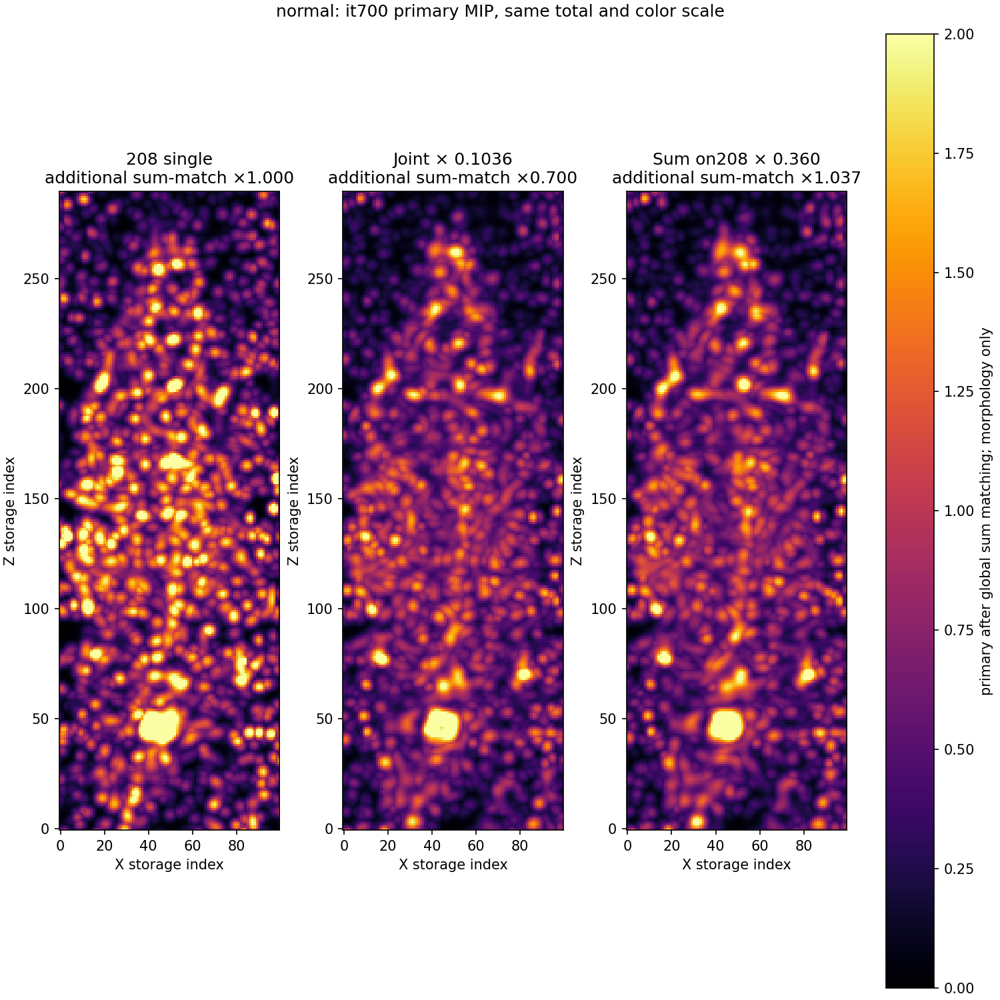

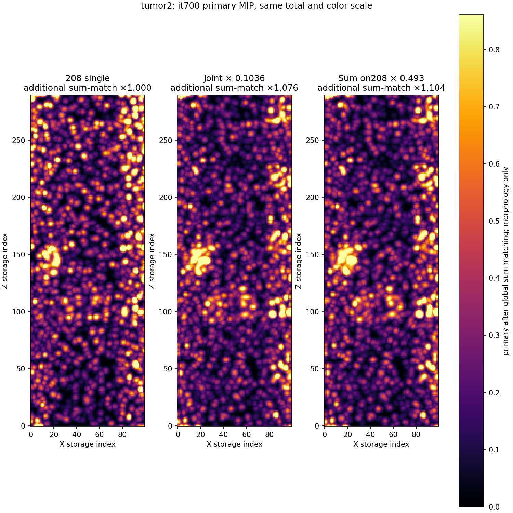

补充图：[正常鼠100/300/700](assets/subset-release-20260913/lu177_mouse_normal_primary.png)、[正常鼠固定Y=50切片](assets/subset-release-20260913/lu177_mouse_normal_slice.png)、[tumor2的100/300/700](assets/subset-release-20260913/lu177_mouse_tumor2_primary.png)、[tumor2固定Y=50切片](assets/subset-release-20260913/lu177_mouse_tumor2_slice.png)。均为primary，无额外CT处理、输出Gaussian或Butterworth比较。坐标是保存数组索引，未标为确定的解剖左右。

本轮最强结论：相对仅208窗，增加113窗后可见主信号更连续、分散亮点较少；同计数合并窗对照也出现大部分改善，因此不能把最初两列图的全部收益归于双矩阵。joint与合并窗在这两组数据的整体观感相近，但并非数值等价：全体积各自归一至单位总量后，joint对合并窗的relL2分别为0.1776、0.2027；这是形状差异指标，不是误差率或优劣分数。局部结构仍有差异，缺少据此确认双矩阵全面更优的证据。

joint仍保留为实验路径。下一项已观察到的实际缺口是两窗相对响应：正常鼠偏差明显大于tumor2，不能统一套用Derenzo同数据拟合的113有效权重。当前不修改物理分支权重、不部署norm因子、不输出肿瘤绝对活度或真实体积。后续优先核对能窗标定/响应及独立norm，再在SPECT图像上检验停止位置和正则化；CT引导/衰减校正按用户要求延后。

复现：`python recon_out/lu177_mouse_joint_20260913/prepare.py <case>`；`python recon_out/lu177_mouse_joint_20260913/reconstruct.py`复用成功回执；`python recon_out/lu177_mouse_joint_20260913/figures.py`重新汇总绘图。保护现有输入身份和成功结果，身份变化或失败目录会明确停止，不覆盖重跑。

## Mouse/tumor正则化实测与实用配置（2026-09-13）

本轮按用户要求选择可用的mouse/tumor组合，不寻求全局最优参数。**当前优先弱RDP，TV保留为替代；不把强正则或更长迭代当作默认更好。** 正常鼠、tumor2和两组IQ共23臂已完成，83个primary检查点及配置/输入身份复核通过。下列配置是当前动物数据支持的实用预设；IQ尚不足以确认物理最优参数。

### 可直接使用的配置

| 路径 | 优先组合 | BSREM步长 | TV替代 | 已有动物证据 |
|---|---|---|---|---|
| 真正joint：113/208独立投影、两套CSRQ矩阵 | 300次N1，RDP β=0.03 | α₀=1，步长γ=0.005 | `-reg tv,0.01,0.01` | normal、tumor2 |
| 当前sum208 CSRB快速路径：合并双窗投影配208矩阵 | 100次N10，RDP β=0.1 | α₀=1，步长γ=0.05 | `-reg tv,0.03,0.01` | tumor2 |

配置文件：[joint RDP](../multipinhole/config/algo_bsrem_mouse_joint.conf)、[sum208 N10 RDP](../multipinhole/config/algo_bsrem_mouse_sum208_n10.conf)。显式使用`-opti bsrem -algoConf <配置文件绝对路径>`，同时提供该模型原有的投影和矩阵参数；不要同时保留覆盖它的旧`-it`、`-reg`或`-bsrem`参数。joint仍使用208/113权重0.1036/0.0617，该阶段冻结RC的joint仅支持N1；后续独立joint N10候选见文末。**第二行不是双系统矩阵joint，也没有在单208窗上验证，不能跨模型直接套用β。**

共同设置：κ图开启、曲率分母关闭、RDP边缘γ=0、δ=0.01；TV沿用有效配置中的ε=1e-6。这里的RDP γ与BSREM步长γ是两个参数。维持生产PSF sieve/castor 1.3 mm。配置默认仅保存末次，额外Gaussian关闭，沿用单独Butterworth输出（5 cycles/cm、8阶）；本次判读始终使用primary。primary仍包含原有PSF输出处理、床间增益拟合、拼接和裁剪，不能称为未经处理的求解器状态。

两个新配置已通过实际EXE的`-dumpConf`合并检查：数值配置与对应已完成重建相同，仅保存间隔改为0。证据为`recon_out/lu177_mouse_joint_20260913/regularization/preset_validation.json`。这是显式选择的补充预设，未修改通用默认配置，也未重建或重新封装冻结的RC。

### 固定对照与判读规则

固定最终RC、预处理输入、各模型矩阵、PSF、原始窗权重及输出流程；无CTAC、解剖引导、新norm因子或背景投影。每组包含同样步长衰减的BSREM无惩罚对照，因此不会把步长衰减本身的作用归于RDP/TV。sum208和IQ另保留OSEM。运行串行、单臂上限1200秒，本轮约90分钟GPU核心计算预算，准备/保存/逐窗残差所占墙钟另计；单次耗时不用于正式速度排名。

| 数据/模型 | 完整迭代×子集 | 实测组合 |
|---|---|---|
| tumor2 joint | 300×1 | 无惩罚；RDP 0.03、0.3；TV 0.01、0.03、0.3 |
| normal joint | 300×1 | 无惩罚；RDP 0.03；TV 0.01 |
| tumor2 sum208 | 100×10 | OSEM；BSREM无惩罚；RDP 0.1、0.3；TV 0.03、0.1 |
| Tc99m IQ resolution / uniformity，各一组 | 100×10 | OSEM；BSREM无惩罚；RDP 0.3；TV 0.1 |

先检查同色标MIP、固定切片和不饱和热点局部图，再解释指标。所有模型的ROI分别由该对象原有MLEM100冻结：在XY半径40体素、Z两端各去20体素的支持区内，σ=2体素平滑图的三个相距至少15体素的高点，各取半径6体素球为H1–H3；低信号区为同一支持区中低于平滑参照P99的15%的体素。阈值范围计数采用该模型BSREM无惩罚末次H区P95的40%，对其他候选固定不变。ROI文件及参照SHA写入各`*_analysis.json`。

H1–H3是图像区域，未确认为肿瘤、肾脏或膀胱。P99描述低信号区亮点上端，不是已知空气噪声；CV是区内标准差/均值，也包含真实空间变化；固定阈值体素数只是表观范围检查，不是真实体积。图像轴为保存数组索引，不据此推断解剖左右。没有注射/活度/示踪剂标定，本轮不输出代谢、绝对摄取或肿瘤真实体积。

### 老鼠结果

| 对象/模型/末次配置 | 低信号P99 | H1 P95 | H1固定阈值体素数 |
|---|---:|---:|---:|
| tumor2 joint，无惩罚 | 0.40091 | 11.7695 | 597 |
| tumor2 joint，RDP 0.03 | **0.31620** | 9.3178 | 546 |
| tumor2 joint，TV 0.01 | 0.34607 | 9.3332 | 573 |
| tumor2 sum208，BSREM无惩罚 | 0.10631 | 2.7524 | 566 |
| tumor2 sum208，RDP 0.1 | **0.08641** | 2.2610 | 557 |
| tumor2 sum208，TV 0.03 | 0.09556 | 2.2392 | 557 |

在相近H1高值保留水平下，弱RDP的低信号亮点比这两个TV候选少，因此作为当前首选。代价需要同时保留：joint RDP相对匹配无惩罚对照，低信号P99下降21.1%，H1 P95也下降20.8%；sum208 RDP分别下降18.7%、17.9%。joint低信号均值仅从0.05139降至0.05087，说明主要改变亮点分布，不能说已经校正了背景计数。

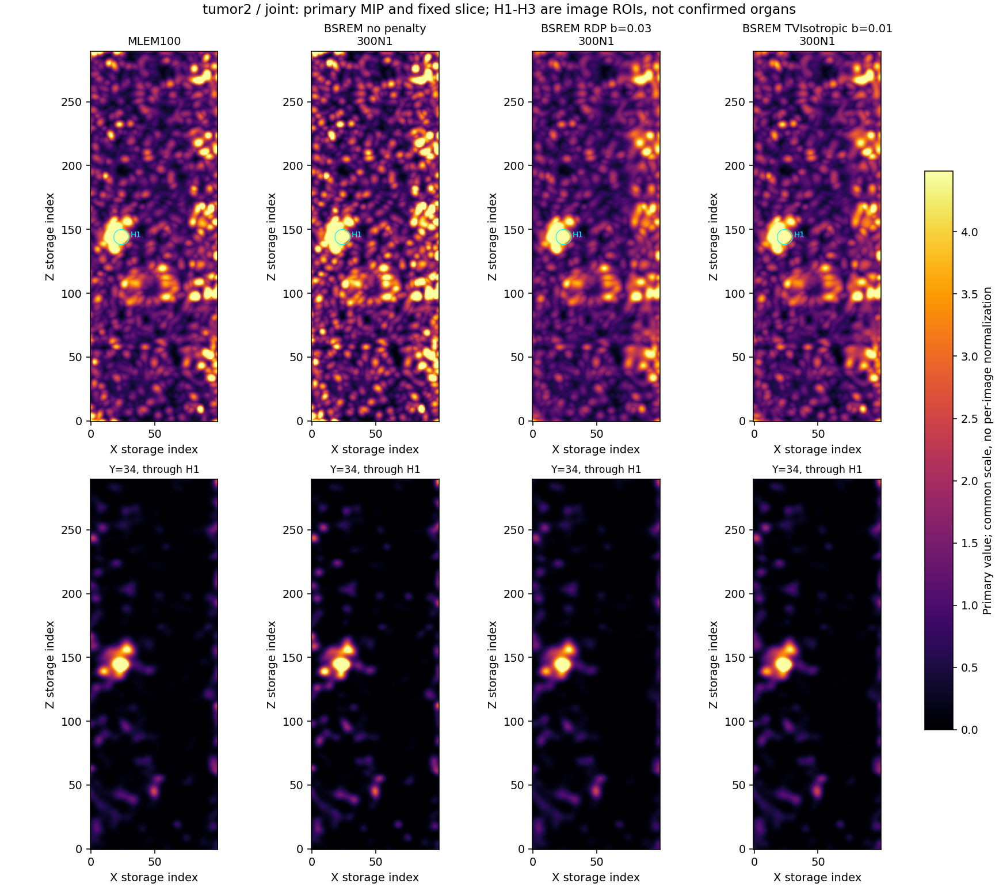

[tumor2 joint不饱和热点局部图](assets/subset-release-20260913/lu177_reg_tumor2_joint_selected_detail.png)；[sum208 N10同色标对照](assets/subset-release-20260913/lu177_reg_tumor2_sum208_selected.png)及[热点局部图](assets/subset-release-20260913/lu177_reg_tumor2_sum208_selected_detail.png)。全候选图和逐检查点数据保留在同一assets目录及各模型分析JSON中。

normal提供第二组支持：RDP 0.03使低信号P99从1.6008降至1.3386（−16.4%），H1 P95从42.151升至42.753；两个双侧热点H2/H3的CV从0.4327/0.4051降至0.3544/0.3115。其P95亦下降约15.6%，不能把更平滑解释为无损。H2/H3固定阈值体素数为641→637、666→705，表观范围没有像强正则那样大幅缩小；这仍不是器官体积准确性验证。TV 0.01低信号P99为1.3758，H1 P95为38.49，相比之下本组弱RDP对H1峰值保留较好。

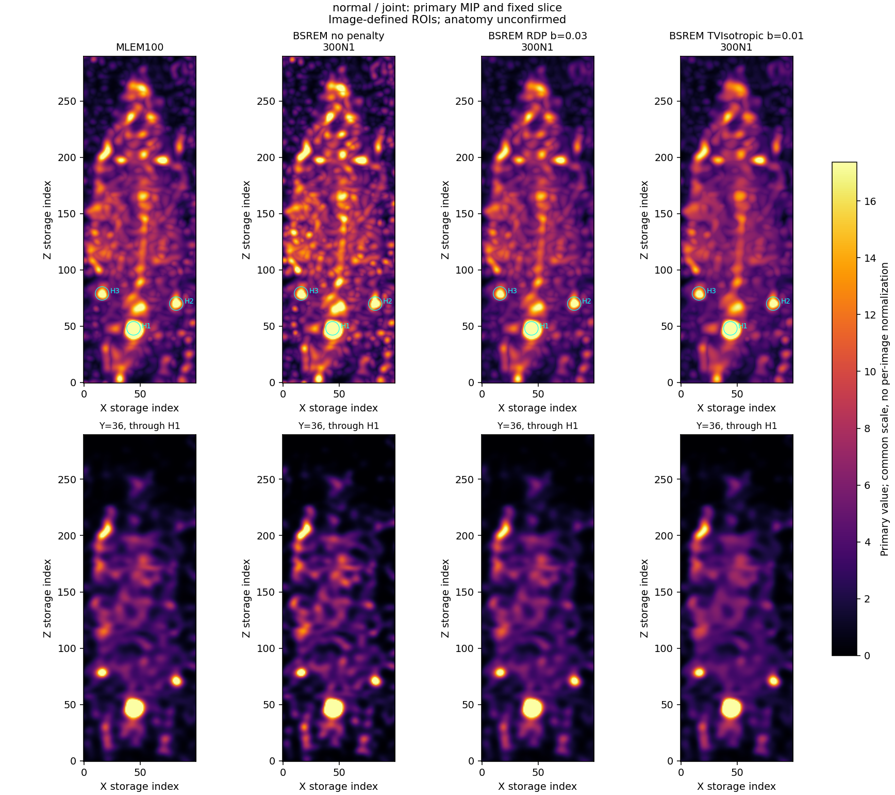

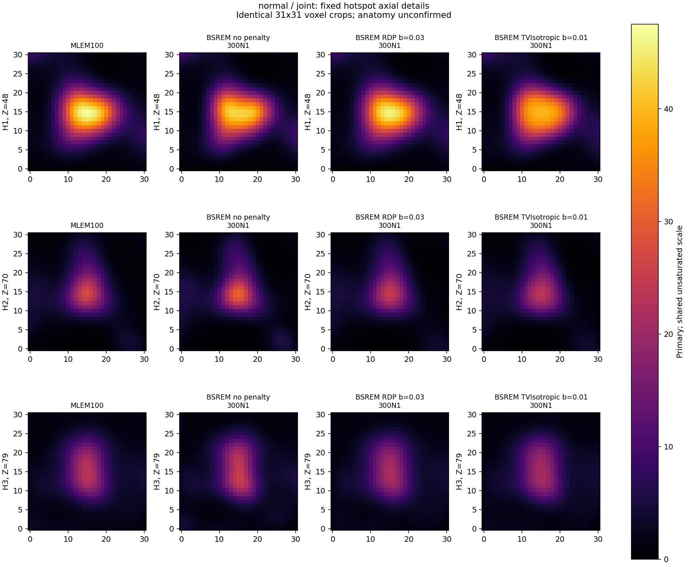

较强参数不作为这套日常预设：joint RDP 0.3的H1 P95降至5.912，且200→300 primary变化仍达32.1%；sum208 RDP 0.3的H1 P95较匹配对照下降37.1%、固定阈值范围下降20.8%。强TV也明显压低热点。上述判断只针对本输入、步长和有限迭代预算，不能据此否定算法或所有较大β。

**早停仍是有效对照。** tumor2 joint原MLEM100的低信号P99=0.31984、H1 P95=10.443，与RDP300的0.31620、9.318相比仍有竞争力；本轮没有证明正则化全面胜过早停。弱RDP的200→300变化为tumor2 4.50%、normal 2.71%；sum208弱RDP的75→100变化为1.63%。这些是输出检查点稳定程度，不是到达精确最优解的证明。

正则化也没有解决既有逐窗响应差异：normal在弱RDP下208/113总计数拟合偏差仍为+48.54%/−25.78%，tumor2为+7.04%/−6.09%。相应偏差和deviance保留在分析JSON；本轮推荐的是有明确适用范围的SPECT观感配置，不将更平滑的图像解释为窗响应已校准。

### IQ证据的适用范围

找到的两组IQ为2026-08-28 **Tc99m**，分别是`iq_resolution_tc_130337`和`iq_uniformity_tc_145707`；使用当前141 keV、120×120×220 Tc CSRB矩阵，未使用Lu矩阵或旧108×108×80矩阵。原BIN头/维度、有限非负计数及预处理Tc99m标识已经核查，矩阵身份写入每臂清单。这些机器检查不能替代实体模体几何和系统响应核验。

分辨率数据的实际轴向图呈环状/团块，尚无可核验的孔径、孔位、冷热区尺寸或活度比。图中自动标出的9对图像峰仅用于观察纹理变化，**不是已确认孔位，不能换算最小可分辨孔径**。RDP 0.3和TV 0.1均减少局部峰谷，同时改变结构宽度；这支持检查过度平滑的必要性，不能直接验证Lu老鼠最优β。

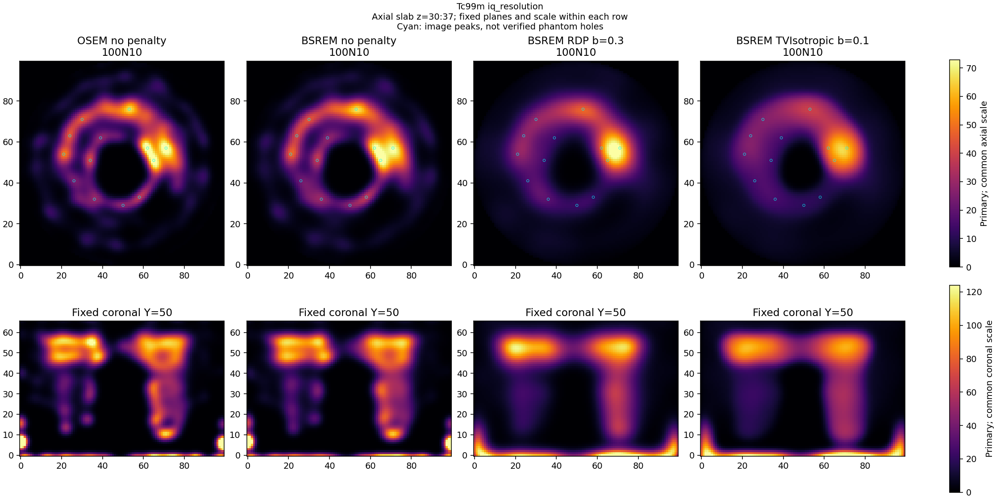

均匀性数据的无正则切片已有环带、中央低信号区及大块空间变化，旧自动阈值加10体素腐蚀的均匀ROI为空，因此没有沿用其“均匀性”输出，也没有调低阈值直到得到有利分数。改为固定几何环区：XY中心49.5、半径15至35体素、Z=20…45；该区域只描述信号离散度，不假设它是真实均匀填充腔。所有方法使用同一个ROI，图中青色边界可核对。

| IQ uniformity，100次N10 | 固定环区CV | 环区均值 | 环区P1 / P99 | 75→100 primary变化 |
|---|---:|---:|---:|---:|
| OSEM | 0.5501 | 56.324 | 2.565 / 115.554 | 5.52% |
| BSREM无惩罚 | 0.5192 | 57.051 | 3.806 / 105.253 | 3.47% |
| RDP 0.3 | 0.4425 | 59.857 | 9.823 / 98.357 | 6.65% |
| TV 0.1 | 0.3879 | 61.353 | 14.917 / 96.397 | 2.07% |

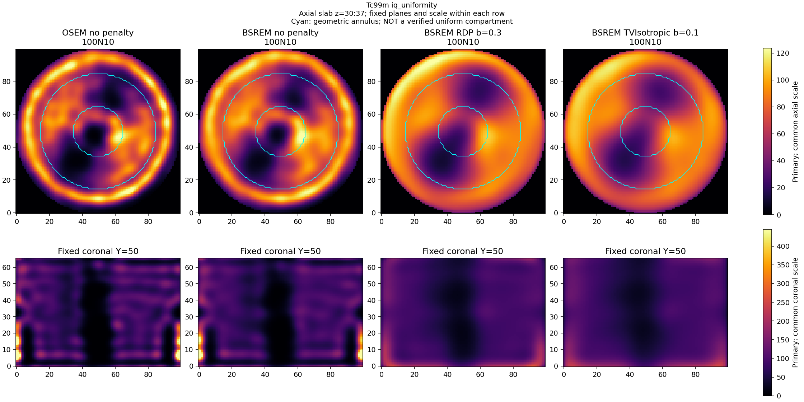

两种正则减少区内起伏，但大尺度不均匀仍在，也会使结构变宽；TV的较低CV不能单独作为画质更好或最佳β的证据。当前环带/空间不均匀的物理来源尚未确认，不能仅凭矩阵加载成功排除几何、响应或模体布局问题。最小后续缺口是确认实际填充区域/结构及其系统几何对应，再在那个已知区域评价均匀度和细节恢复，而不是继续盲扫β或提前处理CT。本轮已完成IQ描述性对照，物理均匀性/分辨率及最优参数验证仍未成立。

### 复现与完整性

本轮脚本为`recon_out/lu177_mouse_joint_20260913/regularize.py`，绘图为同目录`regularization_figures.py`。每臂目录保留`command.json`、`identity.json`、`recon_manifest.json`、日志、结果回执、全部primary及逐窗残差；矩阵metadata按SHA冻结，块文件按大小/修改时间清单核查，未宣称本轮重新逐字节哈希全部矩阵。

示例（在项目根目录运行，已有成功结果会核对身份后复用）：

```powershell
python recon_out/lu177_mouse_joint_20260913/regularize.py tumor2 joint rdp 0.03 --iterations 300 --subsets 1 --gamma 0.005
python recon_out/lu177_mouse_joint_20260913/regularize.py normal joint rdp 0.03 --iterations 300 --subsets 1 --gamma 0.005 --attempt fivebed
python recon_out/lu177_mouse_joint_20260913/regularize.py tumor2 sum208 rdp 0.1 --iterations 100 --subsets 10 --gamma 0.05
python recon_out/lu177_mouse_joint_20260913/regularization_figures.py tumor2 joint selected
```

三个不纳入结论的尝试保留并标记：不支持的`-opti osem`在计算前被拒绝，正确OSEM调用为`-opti mlem -it 100:10`；实验驱动曾将normal误判为norm而仅加载一床，其无惩罚结果和被中止的RDP尝试已排除。驱动已改为从实际分窗清单读取床号，并独立检查normal/tumor2均为5床、输出100×100×290；有效normal目录均以`_fivebed`结尾。没有用错误一床结果支撑上述比较。

最终复核`regularization/validation.json`为PASS：23个有效运行、83个primary均有限/非负/非全零，全部重新计算输出SHA；床数/尺寸、投影文件对应、joint两窗权重、每组矩阵/PSF/过滤配置一致，有效RDP/TV及BSREM步长、κ/曲率开关逐项核查。Windows路径分隔符造成的校验脚本分组计数问题已在汇总入口修复，并完整重跑通过；未改变任何重建结果。

有效23臂合计核心计算约75.18分钟、逐臂进程墙钟合计111.14分钟，不含被排除尝试；保存检查点、矩阵准备及残差分析占据额外时间。硬件为RTX 4070 Ti SUPER，本轮不据此外推其他设备速度。冻结ZIP的SHA仍为`7ca6fae9a2ea93b6e3e2d060daa6dffd50d72d89077e4dc29c5d3cdc99c71b86`，两个补充预设未加入或替换该冻结包。所有本轮重建已结束，没有待自动启动的扫描。

## 综合推荐：Derenzo分辨率、EP管均匀性、mouse组织（2026-09-13）

用户要求结合[历史MLEM1000/BSREM报告](2026-08-19-mlem1000-baseline-bsrem-recipes.md)、[OSEM/POSEM子集对照](2026-09-10-osem-posem-convergence-vs-mlem1000.md)与本轮动物实测给出配置。本节是现有证据的综合选择，没有新增重建或把不同采集拼成同条件实验。历史原始体积目录已不在原路径，报告及配对图仍在；历史数值按报告引用，未重新计算。所有“最佳”均限定为这些已测试组合中的任务选择，不是全局最优或跨系统保证。

| 目标 | 首选方法 | 子集数与完整迭代数 | α₀ / 步长γ | 证据与适用范围 |
|---|---|---|---|---|
| 最高Derenzo细节 | BSREM，无正则 | N1，1000次 | 1.5 / 0 | 历史杆分离0.746，MLEM1000为0.705；只需接近MLEM700任务端点则用450次 |
| 允许一定细节损失、改善均匀性 | BSREM，无正则，提前停止 | **N1，350次；本轮N10验证见下节** | 1.5 / 0 | 历史曲线支持的探索性折中；杆分离约0.60（约为0.746的80%），EP轴向CV约0.179；不是旧严格双门通过 |
| 仅以EP均匀性为首要目标 | BSREM＋RDP β=0.3 | N1，100次（历史50–100已近平台） | 1 / 0.05 | EP的CV约0.129，但明显损失Derenzo分离，不能代替上一行 |
| 当前Lu mouse/tumor joint | BSREM＋RDP β=0.03 | **N1，300次** | 1 / 0.005 | normal和tumor2本轮实测；独立113/208投影和双矩阵、原权重 |
| 当前Lu mouse快速sum208路径 | BSREM＋RDP β=0.1 | **N10，100次** | 1 / 0.05 | 本轮tumor2实测；合并双窗配208矩阵，不是真正joint |
| 单矩阵高效逼近MLEM1000参照 | OSEM，无正则 | **N10×80次→N5×30次→N1×50次**，共160次 | 不适用 | 子集对照终点relL2=0.000306；这是参照接近度，不是最高物理分辨率证明 |
| 单矩阵较快常规结果 | OSEM，无正则 | N10，100次 | 不适用 | 子集对照终点relL2=0.003715；较宽松距离下可能比递减调度更省时 |

“一定分辨率退化”未给数值，本节暂用旧报告已经采用的杆分离指标保留约80%作为**解释性尺度**，不是新批准的硬性验收门，更不是毫米分辨率只退化20%。350次是历史50次采样网格附近的实用停止点，非精确最优。相比α=1.5跑满1000次的EP CV=0.234，350次的0.179下降约23.5%；但仍高于RDP的约0.129。旧报告要求同时满足杆分离≥0.597且EP CV≤0.140，没有组合通过；本节不改变这个历史结论。若坚持该双门，则“兼顾两者的最佳配置”仍未确定，不能给RDP/TV强行授予该称号。

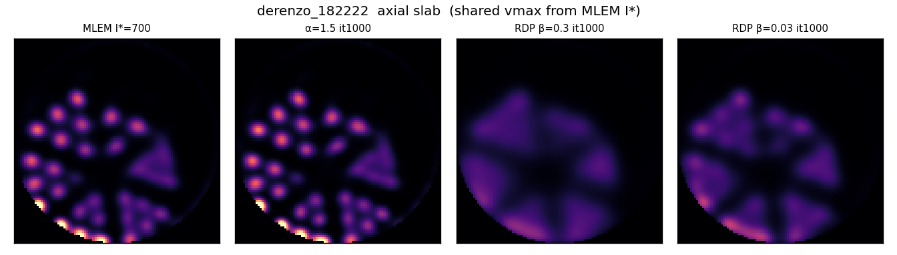

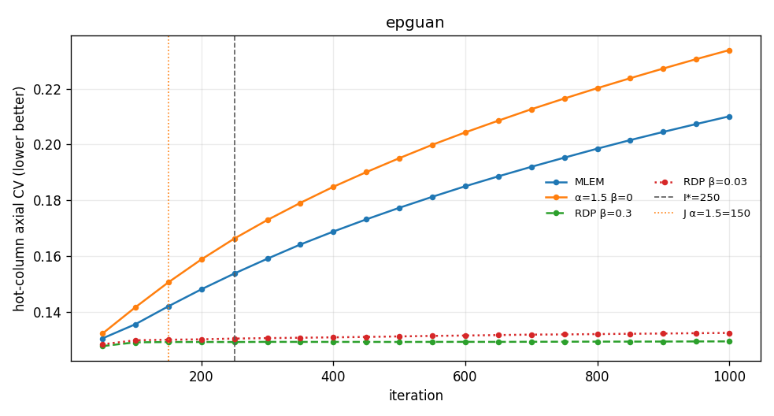

RDP/TV的选择：当前mouse首选弱RDP；joint的TV替代为β=0.01、300N1、步长γ=0.005，sum208的TV替代为β=0.03、100N10、步长γ=0.05，其余不变。本轮相近热点高值保留水平下RDP的低信号P99更低；没有足够Derenzo＋EP配对证据把某个TV参数列为最高分辨率或有分辨率约束的均匀性赢家。历史mouse_ch6o6p2的RDP0.03、N1、步长γ=0.05约200次任务平台可作旧对象专用停止建议，不能与当前joint的γ=0.005混用。

当前实现不是任意算法与正则的笛卡尔积：compact路径的RDP/TV要求`-opti bsrem`，直接OSEM加正则会被拒绝；BSREM使用与OSEM相同的角度子集划分，但更新公式不同。POSEM仅保留历史对照意义：原像素变体N10、100次、无正则的轨迹距离0.001788，但原pixel正式计时只有一次合格重复；pixels2d两次约496.5–500.2秒到0.002，慢于OSEM递减调度约380.4–406.7秒，不能据此推荐为默认。POSEM＋RDP/TV没有本组三类对象长程质量证据，且当前RC已移除pixel分支，不提供貌似可运行的发布版命令。

当前CLI示例，需保留各模型正确的输入、矩阵与共同生产配置：

```text
# 最高细节；若选折中，把1000:1改为350:1
-opti bsrem -reg none -bsrem 1.5,0 -it 1000:1 -save-every 0
# 仅EP均匀性优先
-opti bsrem -reg rdp,0.3,0,0.01 -bsrem 1,0.05 -it 100:1 -save-every 0
# 高效OSEM，阶段顺序保持；-subsets仍是子集数:该阶段迭代数
-opti mlem -reg none -it 160 -subsets 10:80,5:30,1:50 -save-every 0
# 当前joint鼠；仍需双投影/双矩阵及原能窗权重
-opti bsrem -reg rdp,0.03,0,0.01 -bsrem 1,0.005 -it 300:1 -save-every 0
# 当前sum208快速鼠
-opti bsrem -reg rdp,0.1,0,0.01 -bsrem 1,0.05 -it 100:10 -save-every 0
```

默认保留原PSF1.3 mm和primary输出合同，Gaussian关闭、Butterworth仅作独立副本；上述质量结论没有针对Butterworth再调参。RDP沿用κ开启、曲率关闭、边缘γ=0、δ=0.01；TV有效ε=1e-6。历史N1迭代数不能仅凭除以10视为已验证的N10配方；下节新增实测仅支持本轮无正则35N10近似复现350N1，不延伸到其他端点或RDP组合。

核验：已回读历史报告及Derenzo/EP配对图，核对当前CLI与正则化入口；上述最高细节、350次折中、EP、固定/递减OSEM及TV替代的参数均通过冻结RC的`-dumpConf`解析检查，既有两份mouse预设另有前节有效配置核验。该检查证明参数能够表达，不代表旧对象质量已在新RC重新实测。另按旧子集报告§8.4原始表格，更正其“调度每个阈值均最快”的叙述：0.005处固定N10更快，0.002处递减调度更快；原计时结果不变。

## N10约40次的再验证（2026-09-13，已完成）

用户授权检验N10。问题限定为：在同一Tc Derenzo 182222及四床EP投影、当前141keV CSRB矩阵和冻结RC下，BSREM α=1.5、γ=0、无正则的40次N10能否达到350次N1的折中效果，及之后是否稳定。原预处理BIN仍在F盘，形状360×2304，五床文件实际求和均与各自预处理摘要精确相等；不是用新IQ数据代替旧Derenzo/EP。由于历史结果目录已删除，本轮重建当前同配置N1对照，不把新体积直接与旧报告数值视为严格同条件复测。

首轮两对象各三臂：350次N1 BSREM（每50保存），80次N10 BSREM（每10保存），80次N10 OSEM（每10保存）。固定PSF/屏蔽/床步长/输出方式，不引入正则、norm、背景或CT；primary为保护终点。先从N1参照冻结可见杆对/EP热柱及轴向区域，检查ROI叠图后评分；没有物理孔径资料，不把图像峰间隔标成物理分辨率。只读历史图用于核对结构，不从候选反向挑ROI。

解释性阶段规则沿用已有尺度：primary参照relL2≤0.02、固定杆对分离度不低于N1的95%、EP轴向CV不高于N1加0.02；这是检查“近似同端点”的暂定规则，不是物理质量硬门。40之后两个相邻10次检查点变化≤0.02才支持该尺度下的局部稳定，不能把到达参照或暂时停止变化等同于全局收敛。检查所有后续检查点，若数值/局部结构有明显分歧，优先解释而非追加盲扫。质量相近时最多补四臂（两对象N1/N10各一次、顺序反转）配对计时；否则不为无效端点重复测速。

预算：首轮6臂及至多4个必要重复，单臂1200秒，合计核心计算上限约75分钟；串行CUDA，外部计算污染单独记录不入测速。输入身份变化、非有限/负值或进程失败即停止并保留输出。脚本与命令/配置/身份/资源/结果在`recon_out/n10_revalidation_20260913/`，不覆盖既有23臂、不修改冻结包、不实现joint-N10或恢复POSEM。完成首轮质量判断和必要计时后结束本轮。

首轮Derenzo的N10在30/40次分别距N1参照0.03333/0.02666，固定峰对分离度则由低于参照转为高于参照。10次保存网格跨过了350次N1对应的近似位置，因此允许在上述四个补充臂额度内，对每对象各补一次40N10、每5保存的`n10_fine`，直接核查35次，不修改0.02规则、不将采样门失败认作质量失败。其40次与原80次运行的40次检查点另做数值复核；保存频率不同的墙钟不构成严格配对速度验收。Derenzo旧Z37:64落在当前裁剪输出的尾部，已按本轮N1参照中央60%有效轴向范围冻结为Z9:28，指标不冒充旧报告的同定义复算。

### 结果与停止点

**当前Tc输入和冻结RC下，BSREM α=1.5、γ=0、无正则的35次N10，在Derenzo与EP两组数据上均复现了350次N1的近似折中效果；OSEM需要约50次N10达到同一参照。** 这为上一节350次N1配方补上了实际N10验证。40次也在该效果附近，但已略过350次N1参照；不能称为“40次完全收敛”。

| 方法与停止点 | Derenzo距N1/350的relL2 | Derenzo固定峰对分离度↑ | EP距N1/350的relL2 | EP轴向CV↓ | 两对象近似同端点规则 |
|---|---:|---:|---:|---:|---|
| BSREM N1，350次参照 | 0 | 0.51551 | 0 | 0.15688 | 参照 |
| **BSREM N10，35次** | **0.693%** | **0.51587** | **1.580%** | **0.15742** | **均通过** |
| BSREM N10，40次 | 2.666% | 0.53792 | 2.069% | 0.16471 | 距离略超2% |
| BSREM N10，80次 | 14.328% | 0.63071 | 8.615% | 0.20993 | 更晚端点，非原折中 |
| **OSEM N10，50次** | **0.813%** | **0.51059** | **1.138%** | **0.15496** | **均通过** |

relL2是整个primary体积与本轮同对象BSREM N1/350的相对L2距离，不是相对真实活度的误差。Derenzo分离度来自参照冻结的15对图像峰，数值越高表示这些峰谷更清晰；没有已知孔径，不能转换为毫米分辨率。EP轴向CV是在固定管内XY位置、Z15:219范围计算各柱的标准差/均值后取平均，包含真实空间不均匀，不能全部解释成噪声。所有图使用固定切面和共同色标，没有逐图归一化。ROI与定义见[两组分析数据](../recon_out/n10_revalidation_20260913/)及[Derenzo ROI](assets/subset-release-20260913/n10_recheck_derenzo_roi.png)、[EP ROI](assets/subset-release-20260913/n10_recheck_epguan_roi.png)。

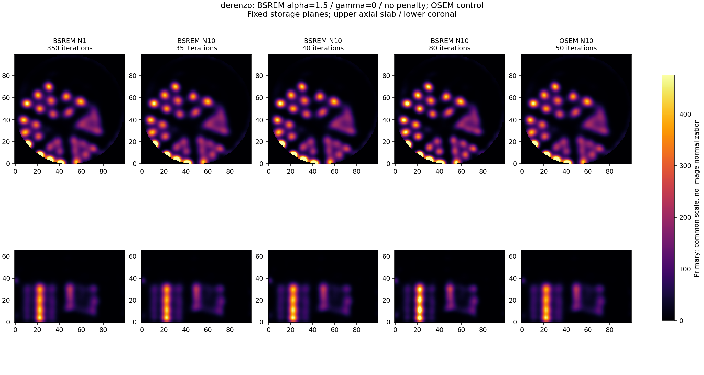

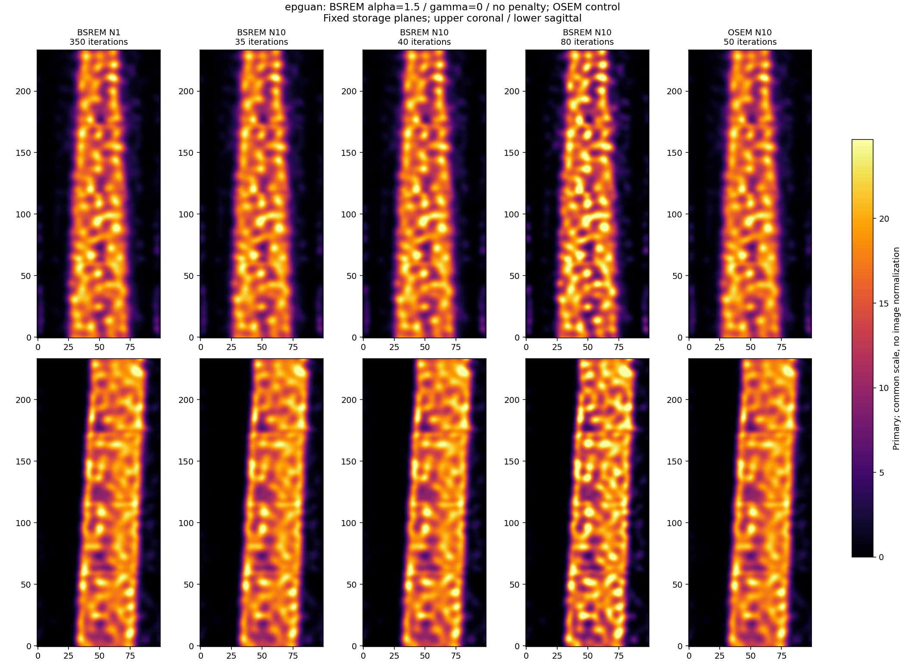

35次N10的Derenzo峰对分离度与参照相差约0.07%，EP CV相差约0.34%，配对切片也保留相近结构。继续到80次使Derenzo分离度增至0.63071，同时EP轴向CV升至0.20993，因此更晚停止不是无代价的提升。这里验证的是到达指定折中端点；到该参照的距离随后上升，不等于算法开始发散。

BSREM N10的40→50次primary变化仍为Derenzo **4.14%**、EP **2.13%**，未通过预先定义的40后连续两个10次间隔≤2%的局部稳定规则；N1参照自身300→350也分别变化3.23%和1.37%。因此350N1及35–40N10均应称为实用早停选择。BSREM与OSEM本轮更新公式和步长不同（前者α=1.5），50与35的差别不能单独归因于子集划分；两者使用同一角度划分。

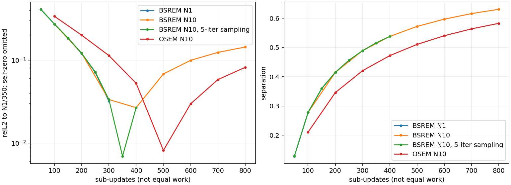

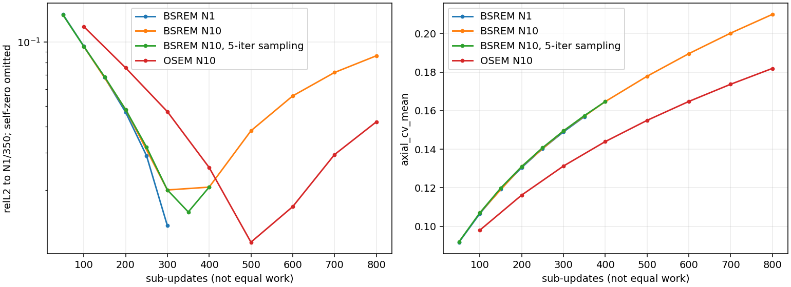

曲线横轴为子更新次数，不代表相等运算量或相等墙钟；N1参照与自身的零距离未画在对数纵轴上。35×10=350在这里得到近似同效果的实测支持，但不是可任意迁移到其他子集数、步长、正则项或对象的等价公式。

### 当前可用配置与耗时范围

保留本轮输入、141keV矩阵、PSF与输出配置，复现350N1折中效果可用：

```text
# 首选：BSREM，35次完整迭代，每次10个角度子集
-opti bsrem -reg none -bsrem 1.5,0 -it 35:10 -save-every 0
# OSEM替代：约50次完整迭代，每次10个角度子集
-opti mlem -reg none -it 50:10 -save-every 0
```

这是**Tc Derenzo/EP、无正则**配方，不替换前节Lu mouse的RDP配置，也不证明真正双窗双矩阵joint已经支持N10。没有重新验证1000N1的最高细节端点对应多少N10，不能据本轮直接宣称100N10与1000N1严格等效。

从进程启动到目标primary写出的单次实测时间：Derenzo N1/350为362.5秒、BSREM N10/35为107.0秒、OSEM N10/50为142.6秒；四床EP分别为763.9、112.0、149.9秒。这些包含准备及此前检查点输出，支持本机本次运行耗时明显缩短的观察；N1未重复且保存频率不同，本轮**没有完成正式配对测速，不发布稳定加速倍数**。补充运行用于解决35次质量端点的采样缺口，未继续消耗预算扩大测速。

### 最终核验与复现

8个有效运行、62个primary帧全部通过[validation.json](../recon_out/n10_revalidation_20260913/validation.json)：退出码0；输入/配置SHA、矩阵metadata SHA和块大小/修改时间一致；同对象床数与输出尺寸正确；有效PSF、滤波、无正则及BSREM步长一致；输出全部有限、非负、非全零，重新计算SHA。细采样与原N10运行在10/20/30/40次的相对L2差异最大为 **1.75×10⁻⁷**，低于预设1×10⁻⁵，未发现改变保存频率导致重建轨迹改变。资源采样未记录到外部重建进程干扰。

一次Derenzo补测在进程退出与RSS采样之间发生监控竞争，未记录可靠退出码，已标记排除并保留；驱动在公共采样循环处理`NoSuchProcess`并等待进程退出，随后在`n10_fine_r2`完整重跑通过。未用被排除尝试支撑结论。有效运行核心计算合计约31.6分钟，在原预算内。

运行与分析入口（成功结果按身份核对后复用）：

```powershell
python recon_out/n10_revalidation_20260913/run.py
python recon_out/n10_revalidation_20260913/run.py derenzo n10 _fine_r2
python recon_out/n10_revalidation_20260913/run.py epguan n10 _fine
python recon_out/n10_revalidation_20260913/analyze.py derenzo
python recon_out/n10_revalidation_20260913/analyze.py epguan
python recon_out/n10_revalidation_20260913/analyze.py verify
```

每臂保留命令、身份、有效配置、资源记录、重建清单、结果回执与primary；各对象`roi.json`/`roi.npz`冻结参照与ROI，`analysis.json`保留全部检查点评分。冻结EXE SHA为`c85c5887f946b4efd066b8e6057a3430847386bf184ae05b2580880008e06cf3`，冻结ZIP保持不变。所有本轮重建结束，无后续自动扫描。

## N10任务配方与DICOM交付（2026-09-13，完成）

本轮完成20个新增运行、80个primary检查点，并重新核验6个既有tumor2运行、24个检查点。最终交付4套显式配置、8组primary DICOM及对应MHD/RAW。这里的“最佳”限定为本轮有限候选与任务取舍，不是物理分辨率或全局最优β认证。

| 用途 | 可直接使用的配置 | 完整迭代×子集 | BSREM α₀ / 步长γ | 验证范围与主要取舍 |
|---|---|---:|---|---|
| 本轮细节优先 | [BSREM，无正则](../recon_out/n10_recipes_20260913/delivery/presets/01_detail_bsrem100.conf) | **100×10** | 1.5 / 0 | Tc Derenzo峰对分离度最高；EP颗粒和轴向变化也最大 |
| 均匀性优先候选 | [BSREM＋TV，β=0.0003](../recon_out/n10_recipes_20260913/delivery/presets/02_uniform_tv75.conf) | **75×10** | 1 / 0.05 | Tc EP更平滑，Derenzo细节有所退化；相对匹配无正则早停的额外收益很小 |
| Mouse日常首选 | [BSREM＋RDP，β=0.1](../recon_out/n10_recipes_20260913/delivery/presets/03_mouse_rdp100.conf) | **100×10** | 1 / 0.05 | Lu normal/tumor2的sum208模型；低信号和热点颗粒减少，部分热点高值降低 |
| 标准OSEM折中 | [OSEM，无正则](../recon_out/n10_recipes_20260913/delivery/presets/04_standard_osem50.conf) | **50×10** | 不适用 | Tc Derenzo/EP接近既有350N1折中；无需选择正则强度 |

OSEM通过`-opti mlem`配合N10调用，当前RC不提供OSEM＋RDP/TV；正则化使用BSREM和同一角度子集。若希望接近第四套的图像折中并优先缩短时间，前节已经验证的无正则BSREM `-bsrem 1.5,0 -it 35:10`仍是可用替代；没有把其单次计时当成稳定加速倍数。

用户继续要求3–4套N10重建配置，覆盖分辨率、允许部分细节损失的均匀性、mouse观感，并提供验证报告和最终DICOM。本轮以已有Derenzo/EP的N1及N10无正则、tumor2的N10 RDP/TV为控制，保护primary结构与共同色标观感；原始投影、矩阵、冻结RC、PSF/床序/输出合同不变。OSEM为无正则对照，正则化通过BSREM实现；不把该冻结RC不支持的OSEM＋正则或joint N10写成可用配方。

新增16臂串行CUDA：Derenzo/EP各6臂，100N10、每25保存，分别为无正则α1.5/步长γ0、匹配步长无正则α1/γ0.05、同一步长RDP β0.1/0.3、TV β0.03/0.1；正常鼠增加同模型sum208的OSEM、BSREM无正则、RDP0.1、TV0.03共4臂，均100N10，与已有tumor2结果配对。复用原固定Derenzo/EP ROI；mouse ROI从同模型既有MLEM100冻结。β是已有证据附近的有限候选，不为取得好分数移动ROI或跨模型混用。

选择规则为探索性任务选择：分辨率优先检查峰谷、细节连续性与晚期变化；均匀性以原350N1峰对分离度至少保留约80%作为解释性尺度，结合EP CV和配对切片选择，不作为毫米分辨率硬门；mouse同时检查低信号P99、热点P95/CV、固定阈值范围与局部图，明确热点未解剖确认。无单一指标硬性拒绝，若候选均不能兼顾，保留已验证35N10早停折中。每臂1200秒、总核心预算90分钟；数据/配置不一致、非有限、错误床数或进程失败则停并保留。完成有限候选评分、3–4套范围明确的配置和选定primary的DICOM回读核验后停止；不自动扩展全局β搜索、CT、joint N10实现或重打release包。

证据目录`recon_out/n10_recipes_20260913/`，复用`regularize.py`运行器，仅增加显式Tc输入列表、输出目录与α参数，默认旧调用不变。DICOM使用已有`export_recon_volume.py`及本机转换器，记录导出参数和源SHA，回读核对尺寸、间距、层序、UID及数值量化；不猜CT配准或绝对活度。

首轮修正方向：Derenzo的RDP0.1到100N10分离度仅0.02664（匹配步长无正则0.45156），共同色标切片显示杆群融合；TV0.03的25次检查点亦出现明显平滑。这些参数不能直接从mouse移到模体。预算内仅增加一次弱强度修正：RDP0.001和TV0.0003，各在Derenzo/EP运行100N10，其余相同，新增4臂、总计20臂；不移动ROI或放宽约80%分离度解释尺度。若没有更好的细节/均匀性取舍则保留原早停折中，不继续扩展β搜索。正式队列完成后以`run_recipes.py --repair`串行补测。

### Mouse：同一N10参数在normal与tumor2上的表现

本轮mouse模型为**合并113+208投影，使用208 keV CSRB矩阵（sum208）**，不是双系统矩阵joint。normal新增4个运行，tumor2复用同版本、同模型的6个有效运行。以下BSREM均为α₀=1、步长γ=0.05、100次N10；OSEM100作为独立算法对照，其参数和图像进展不与BSREM机械等同。

| 数据与配置 | 低信号P99↓ | H1 P95 | H2 CV↓ | H3 CV↓ | 75→100次primary变化 |
|---|---:|---:|---:|---:|---:|
| normal，无正则BSREM | 0.40757 | 8.7938 | 0.5018 | 0.4708 | 3.35% |
| **normal，RDP 0.1** | **0.32227** | **9.1807** | **0.3907** | **0.3466** | **1.09%** |
| normal，TV 0.03 | 0.33987 | 8.3353 | 0.4009 | 0.3617 | 1.70% |
| tumor2，无正则BSREM | 0.10631 | 2.7524 | 0.2900 | 0.7248 | 4.31% |
| **tumor2，RDP 0.1** | **0.08641** | **2.2610** | **0.2207** | **0.5797** | **1.63%** |
| tumor2，TV 0.03 | 0.09556 | 2.2392 | 0.1902 | 0.6076 | 2.37% |

**本轮mouse首选仍为弱RDP 0.1、100N10。** normal相对匹配无正则的低信号P99下降20.9%，H2/H3 CV下降22.1%/26.4%，对应P95下降14.5%/16.6%；热点位置和总体结构仍保留，局部颗粒感减少。tumor2低信号P99下降18.7%，H1 P95下降17.9%。在接近的热点高值保留水平下，RDP的低信号P99比TV低约5.2%（normal）和9.6%（tumor2）；这是两对象共同支持的实用选择，不是所有ROI、所有指标均占优。TV对normal H1及tumor2 H2的CV更低，允许按局部任务取舍。

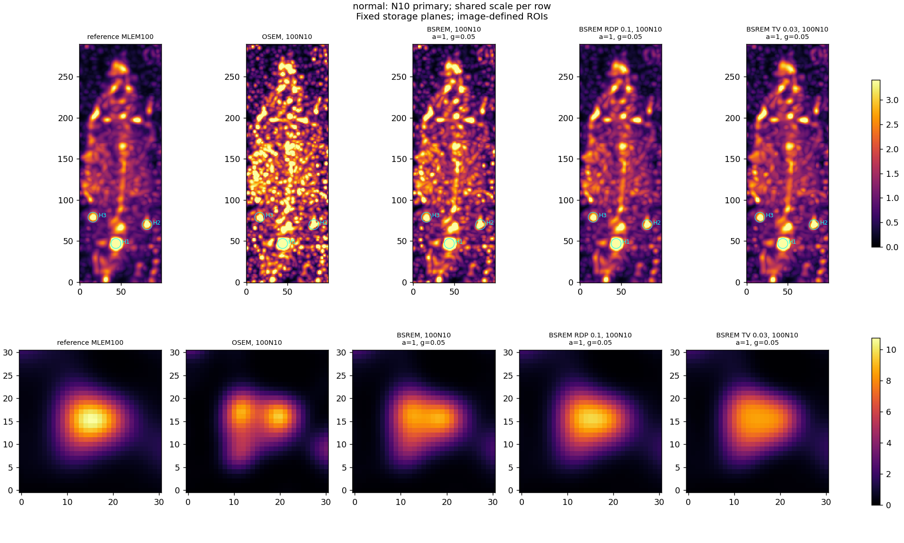

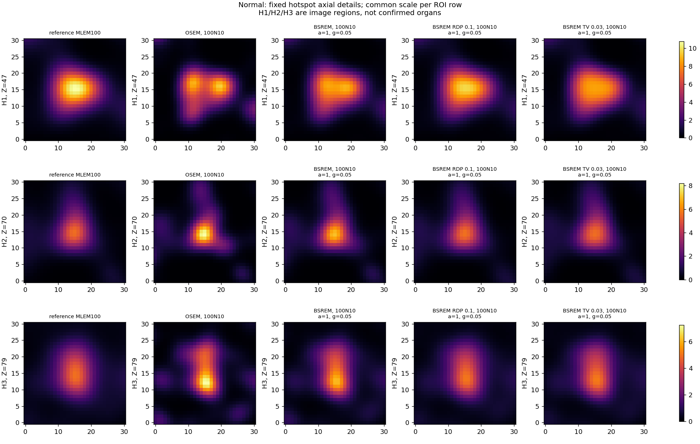

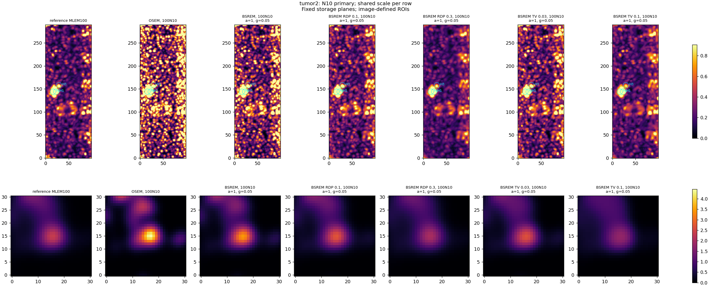

normal的OSEM100低信号P99为0.57066、H2/H3 CV为0.6011/0.6103，后25次仍变化6.53%；tumor2 OSEM100低信号P99为0.14825，后25次变化4.94%。这些结果不支持把100次OSEM作为两鼠的统一观感默认值。更强的tumor2 RDP0.3/TV0.1虽使低信号P99降至0.06405/0.07309，但H1 P95也降至1.7320/1.5991，主热点抑制更明显，未选为日常配置。

H1/H2/H3均为参照图像中冻结的区域，未确认器官；normal的双侧区域与用户关注的双肾相关性仍需解剖核对。低信号区域也可能含真实摄取，不等同于纯背景。本轮范围指标固定为同模型MLEM100区域P95的40%阈值：例如tumor2 H1体素数由无正则784变为RDP831、TV822，normal H1为894→914/920；只能描述图像范围，不能据此认定肿瘤真实体积或活度。该阈值参照与前节使用无正则BSREM终点的定义不同，体素数不直接跨节比较。多床primary包含既有自适应床增益与拼接，最终增益向量保存在源运行清单，不能将全部变化单独归因于正则梯度。

### Derenzo与EP：细节和均匀性共同选择

Derenzo沿用350N1参照冻结的15对图像峰，取Z9:28平均层，指标为`mean(1 - 中点值 / 两峰均值)`；越高表示这些固定峰对之间的谷越深。EP沿用固定1285个XY位置，取Z15:219的每列轴向CV再求平均，越低表示这些列的轴向波动越小，包含真实不均匀和床拼接影响。没有孔径/间距真值，前者不能换算成毫米分辨率；后者也不是单纯统计噪声。

| 同一配方在两个Tc对象上的结果 | N10迭代数 | Derenzo峰对分离度↑ | EP轴向CV↓ |
|---|---:|---:|---:|
| 既有无正则BSREM 350N1参照 | — | 0.51551 | 0.15688 |
| **细节优先：无正则，α₀1.5/γ0** | **100** | **0.65222** | **0.22733** |
| 匹配步长无正则，α₀1/γ0.05 | 75 | 0.42616 | 0.13285 |
| 弱RDP β0.001，α₀1/γ0.05 | 75 | 0.41361 | 0.13248 |
| **均匀性候选：弱TV β0.0003，α₀1/γ0.05** | **75** | **0.41277** | **0.13164** |
| 同一弱TV继续到100 | 100 | 0.43640 | 0.13753 |
| 匹配步长无正则，α₀1/γ0.05 | 100 | 0.45156 | 0.13891 |
| RDP β0.1，α₀1/γ0.05 | 100 | 0.02664 | 0.10988 |
| RDP β0.3，α₀1/γ0.05 | 100 | -0.07088 | 0.09207 |
| TV β0.03，α₀1/γ0.05 | 100 | 0.00182 | 0.07221 |
| TV β0.1，α₀1/γ0.05 | 100 | -0.07345 | 0.05054 |
| **标准OSEM，无正则** | **50** | **0.51059** | **0.15496** |

强RDP/TV的EP数值更低，但Derenzo固定峰对已经融合，不能称为“保证一定分辨率的最佳均匀性”。负分离度表示冻结的中点高于两峰均值，并非图像存在负数。弱TV75在约80%参照分离度的解释尺度内得到较低EP CV：参照分离度保留**80.07%**、EP CV降低**16.09%**。它只略高于该解释尺度，不能宣称通过稳健的物理分辨率门槛；相对本轮最锐利的100N10配方，其分离度保留约63.3%。

更关键的是，与**同一步长、同75次**无正则相比，弱TV仅使EP CV再降低**0.91%**，同时分离度降低**3.14%**。因此第二套是允许细节退化时的有限选择，绝大部分平滑取舍不能归功于TV；无正则α₀1/γ0.05、75N10是同样合理且更简单的替代。弱RDP的额外EP改善更小，本轮没有证据支持继续增加模体正则化复杂度。停止于这次有限修正，后续需要IQ实物结构对应和独立采集才能确定更稳健参数。

第一套100N10是本轮细节指标最高的端点，但75→100次primary仍变化Derenzo **3.91%**、EP **3.33%**。推荐的是任务停止点，不是宣称完全收敛；更不能由100×10的子更新数推出与1000N1严格等效。原“约35–40次N10接近350N1”的结论只对前述无正则与步长配置成立，不能直接套在这些RDP/TV配方上。

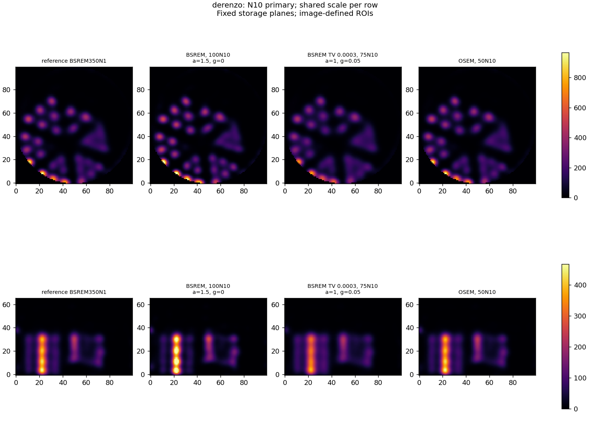

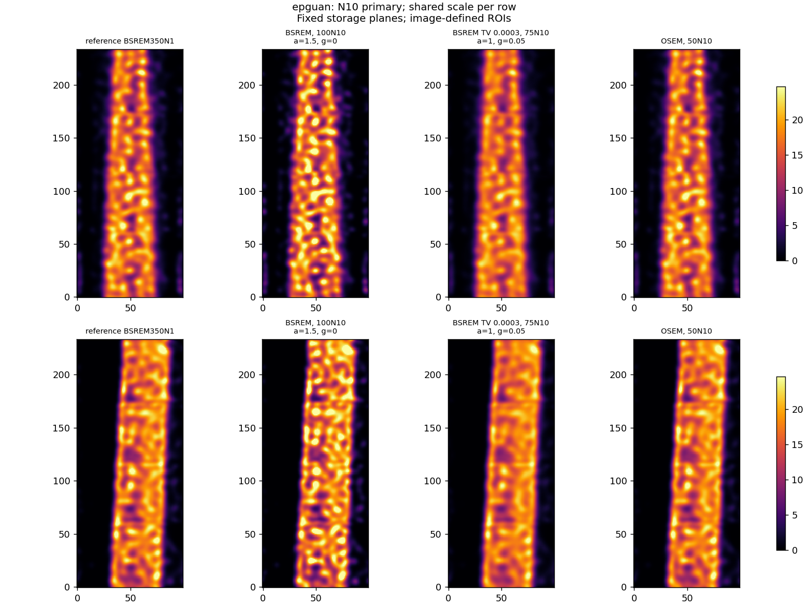

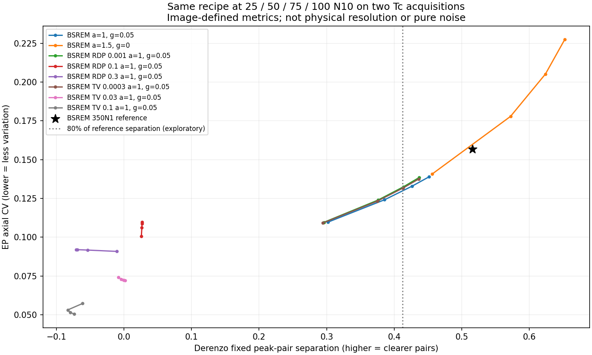

### 有效配置、验证边界与复现

四套预设都显式设置N10、仅输出最终迭代、关闭输出Gaussian smooth，保留独立Butterworth输出（5 cycles/cm、8阶）。本报告评分和交付DICOM均来自`recon_itN` primary，未叠加Butterworth；它们仍包含既有sieve/castor 1.3 mm PSF保存处理、床增益及拼接，不是裸求解器数组。BSREM统一κ开启、curvature分母关闭；RDP的边缘γ=0、δ=0.01，TV有效ε=1e-6。表中的γ是BSREM步长衰减参数，与RDP边缘γ不是同一个参数。

Tc使用原Derenzo单床、EP四床投影和141 keV CSRB矩阵；mouse使用normal/tumor2各五床合并双窗投影和208 keV CSRB矩阵。新旧同对象输入SHA、矩阵metadata SHA与块大小/修改时间、PSF、床序、输出配置均核对一致；本轮未对全部多GB矩阵块重新做内容SHA。没有使用norm factor、背景投影或CTAC，mouse也没有启用第二系统矩阵。**本轮推荐只针对当前N10可用的sum208模型，该轮冻结RC的真正双窗＋双矩阵joint仍为N1路径**，不由这些结果改变原joint推荐或实现状态。

[独立核验记录](../recon_out/n10_recipes_20260913/validation.json)为PASS：20个新增运行全部退出码0，80帧有限、非负、非全零，正确床数/尺寸，输入和有效配置检查通过；另6个tumor2旧运行的24帧重新核对身份与SHA通过。新100N10无正则运行与旧N10运行在50次的相对L2差异为Derenzo **7.90×10⁻⁸**、EP **1.43×10⁻⁷**，低于预先使用的1×10⁻⁵轨迹容差。新增核心计算总计**67.68分钟**，在90分钟预算内；这是执行统计，不是重复配对测速。冻结RC版本`20260913+00d5edb-dirty`，EXE SHA为`c85c5887f946b4efd066b8e6057a3430847386bf184ae05b2580880008e06cf3`；本轮没有改动或重打RC。

每个运行保留`command.json`、`identity.json`、`effective_config.txt`、`result.json`与重建清单；四个`analysis_*.json`和`roi_*.json/npz`保存全部检查点与冻结区域。[预设解析核验及完整复现argv](../recon_out/n10_recipes_20260913/delivery/preset_validation.json)对8个对象/配方组合均为PASS。请使用预设或完整argv；仅传`-opti bsrem`会继承RC中的另一组默认参数。

```powershell
# 本实验运行入口：已有成功结果按身份核对后复用
python recon_out/n10_recipes_20260913/run_recipes.py
python recon_out/n10_recipes_20260913/run_recipes.py --repair
python recon_out/n10_recipes_20260913/analyze_recipes.py verify
python recon_out/n10_recipes_20260913/analyze_recipes.py derenzo selected
python recon_out/n10_recipes_20260913/analyze_recipes.py epguan selected
python recon_out/n10_recipes_20260913/analyze_recipes.py normal
python recon_out/n10_recipes_20260913/analyze_recipes.py tumor2
python recon_out/n10_recipes_20260913/analyze_recipes.py tradeoff
python recon_out/n10_recipes_20260913/deliver.py
```

### 最终DICOM交付

[交付目录与使用说明](../recon_out/n10_recipes_20260913/delivery/README.md)包含4个配方目录：三个Tc配方各有Derenzo/EP两组，mouse配方有normal/tumor2两组，总计**8组、1480张DICOM**，并保留每组原始精度MHD/RAW、源清单、转换核验JSON和四个`.conf`预设。每组只交付所选迭代的primary；未额外滤波、裁剪、翻转或处理CT。

复用现有`spect_to_dicom`转换器后生成独立UID并准确标记来源。这些是**PT兼容的16位派生显示序列**，Units为PCNT，数值为每个源体最大值归一化后的百分数；不是绝对活度定量NM数据。原始MHD/RAW才用于跨配置数值评估。为防止各自自动拉伸掩盖差异，同一对象的多个配方设置相同原始强度范围对应的窗宽窗位；查看器若自动重置窗口，需手动恢复DICOM提供的窗口。

[DICOM回读核验](../recon_out/n10_recipes_20260913/delivery/validation.json)为PASS：8组层数分别为Derenzo66、EP234、mouse290；像素间距与层距均0.3 mm，层序、尺寸、UID唯一性和文件元信息一致。逐体源数组与回读数组的最大量化误差小于**0.500001 LSB**，百分数最大误差**0.000767个百分点**。存储Z递增、局部原点和单位方向矩阵保持一致，尚未验证其解剖上下方向或与CT的关系。所选75次TV来自100次运行的中间检查点，附带清单明确标为“原运行结束清单”，不把100次拟合床增益冒充75次增益。

全部新增重建和导出已经结束，不自动继续β搜索。推荐没有替代后续IQ物理结构验证，也没有将Tc模体参数直接当作Lu mouse参数。

## Joint双窗N10实验（2026-09-13，独立候选验证完成）

用户授权继续实现并验证真正双窗＋双矩阵的子集加速。保护冻结RC、joint N1及CSRB旧结果；允许修改CSRQ按角度选行、对应双窗子集调度及必要测试，独立构建，不改原始输入/矩阵格式/全局默认/已交付包。两窗复用相同compact角度子集，分别计算加权敏感度与分子后合并，保持同一图像状态；正则与步长沿用现有BSREM子更新规则。

先用小矩阵检验两窗加权、子集覆盖、逐体素灵敏度求和和resident/streamed路径对独立解码CSRB参考（relL2≤1e-5）；N1真实输入对冻结RC及CSRB回归≤1e-5。通过后以normal/tumor2五床、原双窗权重/PSF/primary及冻结ROI比较N1 RDP0.03/300与N10检查点10/20/30/40/60；步长衰减按子更新进展设候选γ0.05（N1为0.005），不认定30N10必然等效300N1。图像参照距离、热点/低信号指标和配对切片为探索性证据，不把单一暂定阈值当质量否决门。若候选到达可比端点，进行至少两次配对计时，统一保存与残差诊断策略，分开核心和完整时间。正式GPU实验预算60分钟核心、每臂1200秒；身份不一致、非有限或数值门失败则先最小修复，再决定是否继续。完成实现、数值检查和有限两对象质量/效率结论后停止，不自动部署或扩大CT/标定/β搜索。

数值门校准：首次新N1 RDP100对旧检查点relL2为0.001152，未满足1e-5；随后冻结EXE同命令重放对旧检查点亦为0.001002，新对重放为0.000969。新旧独立计算的全灵敏度差异仅2.34e-8。该对照表明晚期RDP本身已有约1e-3重复波动，不能单凭此否定新选行代码。严格1e-5门改在两对象RDP前5次、tumor2无正则20次及CSRB回归使用；另保留晚期重复性记录，不宣称晚期RDP精确等价。将旧灵敏度缓存逐字节复制到独立实验目录并固定身份，避免在新旧比较中同时改变这一数值输入；新子集缓存写入该独立目录，不修改冻结RC缓存。


### 实现与数值验证

独立候选已接通CSRQ角度子集与joint调用链：两窗都取compact角度`m,m+N,...`，本系统90个compact角度在N10下每组9个，访问顺序仍为`0,5,2,7,1,6,3,8,4,9`。每个子更新使用同一当前图像计算208和113 keV两项，合并后只更新一次图像；下一子集使用该更新结果。两窗权重仍为0.1036和0.0617，未合并投影或替换成单208矩阵。

子集灵敏度为两窗加权反投影之和`S_m = Σ_e w_e A_e,mᵀ1`（实际保留已有mask、PSF和多床处理）；分子同样合并各窗Poisson比值反投影。OSEM用`x·q_m/S_m`；BSREM沿用全局S预条件、`N·(q_m−S_m)`数据项及每个子更新上的一次RDP/TV梯度。正则梯度不额外乘N。步长仍按完整迭代计算，N10的同一轮10个子更新共用α，因此γ0.05仅近似对应N1的γ0.005进展，不是逐子更新完全相同的步长序列。

CSRQ矩阵文件和物理行偏移保持原样；resident矩阵的CUDA核只枚举所选角度行。streamed矩阵沿用两槽和锁页主存，上传所选角度的run/value区间，无CPU重新拼接；小型行指针/rowMax仍整块上传。槽容量未缩小，不能据此声称显存节省。CSRQ子集与CTAC的组合仍明确报错，本轮不覆盖衰减校正。已冻结RC仍是原来的joint N1能力；新实现仅位于独立候选构建。

[完整测试记录](../recon_out/joint_n10_20260913/tests.xml)：305项中301通过、4项既有跳过、0失败。新增两矩阵/两床的独立解码CSRB参考测试覆盖N10/N5/N2/N1、resident及强制streamed、不同chunk边界、空行/空子集chunk、加权灵敏度和第二窗背景项；逐体素`Σ_m S_m`、分子对参考均满足relL2≤1e-5。

[严格真实输入回归](../recon_out/joint_n10_20260913/parity.json)全部通过：tumor2/normal joint RDP5的新旧primary差异分别为5.465e-8/3.923e-8，tumor2无正则20次为8.158e-8，normal五床CSRB MLEM50为7.332e-8。CSRB原先RDP25的晚期比较差异8.221e-5保留为诊断，未冒充严格通过；改用无正则MLEM50核对共同路径。晚期RDP旧/旧重复性及共享灵敏度对照见[数值门校准记录](../recon_out/joint_n10_20260913/late_rdp_repeatability.json)。

### 两只鼠的N10停止点探索

两只鼠各60N10已完成，保存10/20/30/40/50/60检查点。比较使用已有joint RDP0.03/300N1、冻结H1/H2/H3及低信号区域，primary保存处理保持一致；没有追加Gaussian或用Butterworth评分。H1/H2/H3是图像区域，不能将其数值冒充已确认的肿瘤/肾脏真值或真实体积。

| 对象 | 20N10距300N1的relL2 | 30N10 | 40N10 | 60N10 | 30N10低信号P99相对参照 |
|---|---:|---:|---:|---:|---:|
| normal | 3.49% | 2.08% | 2.30% | 3.20% | +1.70% |
| tumor2 | 8.93% | 6.99% | 6.89% | 7.22% | +6.78% |

30N10的三个热点P95相对参照变化：normal为+0.50%/+0.13%/−0.30%，tumor2为+3.09%/+3.28%/−1.42%。共同色标的原生切面保持主要形态，normal双侧H2/H3 CV为0.3525/0.3131，对照0.3544/0.3115。tumor2 H1固定阈值范围为568体素、对照546（+4.03%）；这是固定图像阈值范围，不是肿瘤真实体积。

据这些探索性观察，在正式计时前冻结30N10为共同候选：normal距参照最小的已测点是30次；tumor2从30到40次的全局距离改善很小，同时低信号P99继续上升。60次没有更接近该参照。这个选择表示当前两鼠观感和热点指标接近原推荐停止点，不表示严格相等、真正收敛或普遍最优；未验证毫米分辨率和绝对活度。

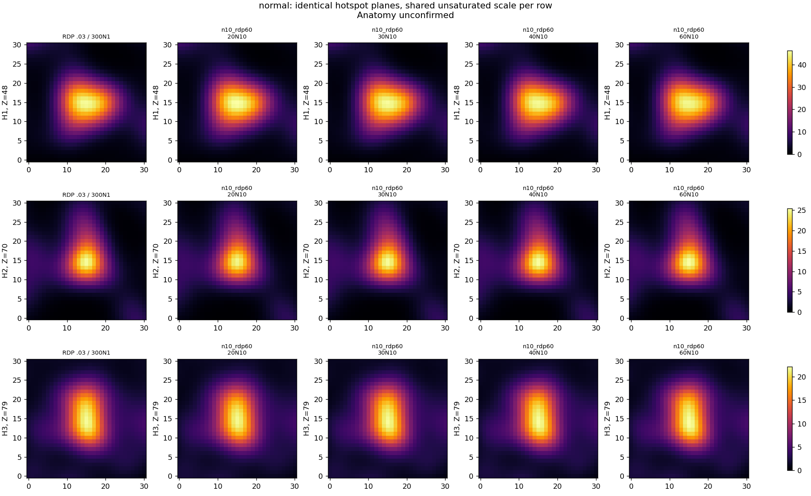

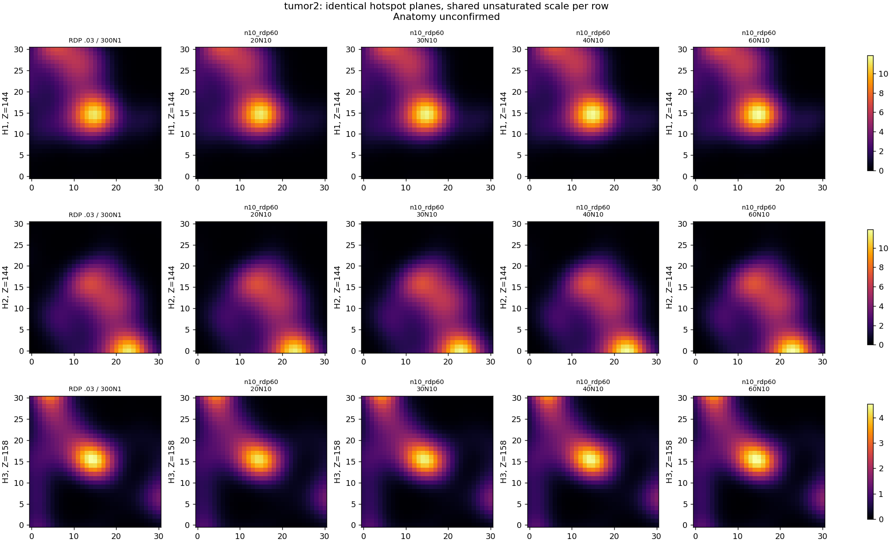

[MIP及局部对照 normal](assets/subset-release-20260913/joint_n10_normal.png) · [tumor2](assets/subset-release-20260913/joint_n10_tumor2.png)；完整冻结指标见[normal](../recon_out/joint_n10_20260913/normal/analysis.json)、[tumor2](../recon_out/joint_n10_20260913/tumor2/analysis.json)。


### 效率的来源与内存边界

这次16 GiB RTX4070 Ti SUPER上的计划为：208矩阵约9191 MiB驻留显存，113矩阵约6295 MiB放在锁页主存，经两个1072 MiB槽传输；两个完整矩阵不能同时驻留。N10上传当前所选角度的run/value区间，完成10个子集后这些有效载荷合起来才覆盖一遍完整矩阵，并不是每个子集都重新读整份矩阵文件。驻留矩阵只在CUDA核中选行；streamed矩阵复用已加载的锁页主存。磁盘冷读和灵敏度缓存准备属于启动成本。

以第一组tumor2配对日志为描述性分解：300N1→30N10的`cuda.csrq_fwd`计时135.287→16.158秒（前投影与Poisson比值），`cuda.csrq_bwd`45.163→21.556秒（反投影并含整幅图像的对称变换）。两种运行都发生18000次前向调用及72000次已记录反向调用；矩阵行数减少，调用数和整幅图像操作没有同比减少。正则化、图像变换与调度仍有成本，实际加速不会简单等于10。日志`cuda.compact_matrix_upload`在这条路径只记录初始化的两个矩阵调用，不能拿其约15秒当作整次迭代PCIe总耗时。

N10增加了子集灵敏度缓存，现有矩阵槽也仍按完整chunk容量分配。运行中设备整体GPU利用率采样接近100%，这不是单个CUDA核占用率测量，也不能据此推断计算已达硬件最优。这里只证明当前数据和显存容量可运行；尚未做更低显存设备门或降低矩阵槽容量的优化。


### 重复配对计时与最终候选

同一RTX4070 Ti SUPER（16376 MiB，驱动616.92）、同对象原始投影与两个矩阵、同PSF/权重/RDPβ及输出设置，每对象按`N1_r1 → N10_r1 → N10_r2 → N1_r2`串行运行。N1使用冻结RC、300次、步长γ0.005；N10使用新候选、30次、γ0.05。两者只保存最终primary和独立Butterworth，关闭额外Gaussian及projection residual诊断；均命中原全灵敏度缓存，N10另命中已准备好的10份子集缓存。采样未发现其他重建进程。下表给出两次均值，括号为两次实际范围；完整时间取程序内部`full_command_s`，包含准备及最终保存，不包含Python监控器最多数秒的退出轮询延迟。

| 对象 | 300N1核心，秒 | 30N10核心，秒 | 核心加速 | 300N1完整，秒 | 30N10完整，秒 | 完整加速 |
|---|---:|---:|---:|---:|---:|---:|
| tumor2 | 207.74（207.66–207.82） | 49.94（49.91–49.96） | 4.16× | 224.33（224.33–224.33） | 67.65（67.61–67.70） | 3.32× |
| normal | 272.12（271.15–273.10） | 53.85（53.84–53.87） | 5.05× | 288.59（287.81–289.37） | 71.83（71.78–71.88） | 4.02× |

这是**原推荐300N1与新30N10近似观感停止点的实测比较**，不是相同算法轨迹的严格等效加速。正式配对primary距离仍为tumor2约7.00%、normal约2.08%，与探索选择一致。N1自身两次重复差异分别0.0713%/0.0234%，N10为0.0393%/0.0166%，明显小于上述算法间差异。两次重复足以显示本机这两对象的稳定收益，但不足以形成跨设备、跨采集的总体置信结论。

首次tumor2 N10探索的准备阶段135.736秒、60次核心99.462秒、完整238.125秒；后续配对准备约15–16秒。该首次运行同时受矩阵冷加载与新子集灵敏度准备影响，没有进行两算法重复冷启动控制，因此不把缓存命中加速比外推为首次冷启动加速比。

配对运行峰值设备内存：N1约13848–13873 MiB，N10约15038–15067 MiB；进程RSS峰值约6.74→7.92 GiB。N10的10份双精度全局子集灵敏度约1.18 GiB，与当前驻留增加量同量级。设备内存是整卡采样、RSS不是全部系统内存占用。当前候选实现了速度收益，**未实现显存或主存占用下降**。

本轮建议继续使用的显式实验配置为：

```text
-opti bsrem -it 30:10 -bsrem 1,0.05 -reg rdp,0.03,0,0.01 -save-every 0
```

同时保持本轮208/113独立投影、各自CSRQ矩阵和`-energyWeights 0.1036,0.0617`，PSF sieve/castor 1.3 mm、κ开启、曲率分母关闭，关闭额外Gaussian、独立输出Butterworth。不要将这个β或强度尺度套到合并窗单208矩阵模型。配置是当前两只mouse的有限候选，不是Derenzo/IQ分辨率最优配方，也不是严格收敛判定。

可直接加载[实验N10预设](../recon_out/joint_n10_20260913/algo_bsrem_mouse_joint_n10.conf)。两对象的[完整复现argv及预设解析核验](../recon_out/joint_n10_20260913/preset_validation.json)已PASS，除独立输出目录之外，其有效配置与正式计时完全一致；使用预设时移除会覆盖它的旧`-it/-reg/-bsrem`参数。预设中的矩阵、投影和主配置仍需按完整argv提供，不会由算法配置自动选择。

候选程序为`build/joint-n10-20260913/bin/Release/SPECT_recon.exe`，SHA256为`3e8f25c2f5c7a93c97f2fb97d50023211e0e8f62db2590e85139645f83c77ff4`。两组所选输出保存在[tumor2 30N10 primary](../recon_out/joint_n10_20260913/tumor2/timing_n10_r1/recon_it30.mhd)和[normal 30N10 primary](../recon_out/joint_n10_20260913/normal/timing_n10_r1/recon_it30.mhd)，各目录保留RAW、独立Butterworth、运行清单及完整命令。未改动已交付的DICOM包，原包仍对应其原配方。

### 最终核验与边界

[独立核验记录](../recon_out/joint_n10_20260913/validation.json)PASS：24个重建运行均退出码0，34个primary体数据的尺寸、有限性、非负性及SHA核对通过；输入SHA、配置、两矩阵metadata SHA/块大小/修改时间与冻结记录一致。实际五床全局网格逐体素`Σ_m S_m`对全灵敏度的relL2为**1.18646e-7**，低于1e-5，补充了运行日志中仅比较总和的检查。总核心计算**31.03分钟**，在60分钟预算内。

joint OSEM无正则与BSREM+TV β0.01的两次完整N10短程运行也通过，确认调用链和数值有效；**TV仅是接通检查，没有验证其30N10画质或推荐参数**。本轮长程选择与配对测速只支持上述RDP候选。

执行完成、科学证据为当前两对象的探索性候选、生产采纳仍未执行。冻结RC EXE及ZIP的SHA复核未变，源码未提交。新增实现相对原有脏工作区的[独立补丁](../recon_out/joint_n10_20260913/implementation_delta.patch)和[构建/源码身份](../recon_out/joint_n10_20260913/provenance.json)已保存。没有拓展到POSEM、CTAC、norm/背景拟合或新的β扫描；更低显存设备与跨采集画质验证不在本轮证据范围。

```powershell
# 已成功运行按身份核对后复用，不覆盖历史输出
python -X utf8 recon_out/joint_n10_20260913/run.py gates
python -X utf8 recon_out/joint_n10_20260913/run.py explore
python -X utf8 recon_out/joint_n10_20260913/analyze.py tumor2
python -X utf8 recon_out/joint_n10_20260913/analyze.py normal
python -X utf8 recon_out/joint_n10_20260913/run.py timing
python -X utf8 recon_out/joint_n10_20260913/run.py smoke
python -X utf8 recon_out/joint_n10_20260913/run.py preset
python -X utf8 recon_out/joint_n10_20260913/analyze.py verify
```


## 配置与部署wrapper兼容调整（2026-09-14，完成）

用户已批准实施两层配置、矩阵ID自动定位和denom复用，明确保留默认外部调用接口/方式，在内部适配。总配置统一PSF默认开启、现有Mask、仅输出Butterworth/关闭Gaussian；四个配方保留原已验证模型与参数，joint配方独立。保护9月13日冻结RC和原始输入，备份260903部署脚本/重建EXE/配置后再更新用户指定部署点；预处理数值及已有BedN.bin格式不变，不自动开启背景/norm或参数扫描。

验收：三种调用方式×两种覆盖策略，完整配方章节、矩阵ID/显式路径及单/双窗契约；旧wrapper接口测试，完整argv的dump与实际调用一致；独立构建和全套已有测试，固定输入新旧有效配置及短程primary relL2≤1e-5，预处理已有输出字节不变。仅做功能/兼容回归，不作新性能或画质推荐。真实GPU回归预算15分钟核心，单次最多20分钟，失败保留证据并最小修复。完成代码、部署点、配置文档和验证后停止。


### 配置接口和模型绑定

正式方案放在 `multipinhole/config/profiles/`，全局 `spect_config.ini` 只选择默认方案并提供公共参数。源配置采用 CLI 优先；用户指定的 260903 部署点保留 `recon_sections_override_cli=true`，保护所选方案与全局合并后实际填写的重建字段。输入、输出、设备、日志仍由调用方指定。

| 文件 | 核素与观测模型 | 算法／正则 | 完整迭代×子集 | α₀／步长 γ |
|---|---|---|---:|---:|
| `01_detail_bsrem100.conf` | Tc99m 单窗、141 keV SCALE2 CSRB | BSREM／无 | 100×10 | 1.5／0 |
| `02_uniform_tv75.conf` | 同上 | BSREM／TV β0.0003 | 75×10 | 1／0.05 |
| `03_mouse_rdp100.conf` | Lu177 合并窗、单208 keV CSRB | BSREM／RDP β0.1 | 100×10 | 1／0.05 |
| `04_standard_osem50.conf` | Tc99m 单窗、141 keV SCALE2 CSRB；Tc默认 | OSEM／无 | 50×10 | — |
| `05_mouse_joint_rdp30.conf` | Lu177 独立208/113窗、两份CSRQ；Lu默认 | BSREM／RDP β0.03 | 30×10 | 1／0.05 |

前四份保持原配方的模型和参数，第五份来自本报告已有joint实验，没有把β0.1移植到joint。Tc配方依据原 `command.json` 绑定 `matrix_PSC_PIN26x28x25_SCALE2_141keV_120x120x220`；不能替换成旧部署模板的 `260601` 占位目录。当前部署矩阵根目录为 EXE 旁的 `matrix/`，通过稳定ID在根下或核素目录下唯一定位；不存在或有歧义时明确失败。

三种调用方式均覆盖：简约调用自动选核素默认；仅传配置继承公共默认；配置加部分CLI参数依照优先级开关处理。`-algoConf` 读取完整重建章节，显式方案替换默认方案；`-opti` 不再偷偷换另一份方案。EXE的 `-config`、wrapper的 `--config` 若直接传完整方案，均作内部适配，公共调用方式不变。wrapper可在 `--` 后接 `-it 40:10` 等覆盖参数。

PSF保持sieve/castor 1.3 mm，Mask保持原单/多床位规则；默认只保存最终迭代，额外Gaussian关闭、Butterworth只生成输出副本。primary、PSF模型和迭代内正则不被输出滤波替代。

### Lu177权重、norm与预处理

208/113窗口顺序固定，原模型权重保持 `0.1036,0.0617`。208的这个标量更大，但不能据此给图像再乘一次经验权重，也不能将其解释为固定的信息量占比；矩阵灵敏度、采集计数及背景也决定各窗贡献。

norm与上述标量分开。Tc单窗用 `[Normalization] factor_file`；joint使用 `factor_file` 与 `factor_file2`，分别匹配208/113的校正因子c，且必须同时指定或同时关闭。灵敏度使用各窗各自的 `1/c`，共同的坏探测器/边缘mask继续生效。第二窗norm数值进入denom身份，不能误用第一窗缓存；β、迭代数和输出滤波不新增缓存身份。当前校正接口只支持无背景项输入。

**本轮未生成新的标定文件，所有推荐方案的norm均留空。** 用户描述的圆柱norm采集还不等于已验证的分窗校正因子；不得继承Tc norm或把Lu合并窗norm复制给两窗。以后启用真实norm后，需重新检查强度尺度与正则参数，不把本次功能接通当成标定或画质验证。

Lu默认预处理保留原 `BedN.bin`，另存 `BedN_208.bin`、`BedN_113.bin`，并在summary标记能窗。208辅助解码共用同一固定标定和相同原始包，仅关闭113；113由合并减208并检查非负与计数守恒。这会增加一次固定标定解码的预处理成本，未声称预处理提速。旧合并BIN缺少可信分窗身份时，不会自动充当joint输入。`--use-background-projections`仍显式启用，合并背景不能传给joint两窗。

旧预处理 isotope JSON 作为资源清单保留并注明legacy作用域；实际重建矩阵/norm由EXE所选方案解析，wrapper不另实现一套重建参数优先级。

### 2026-09-14回归证据

- 独立CUDA构建，完整测试307项：303通过、4个原有数据依赖测试跳过。包括三种调用×两种优先级、完整章节继承、矩阵ID/核素错配/歧义、独立解码CSRB参考下的不同窗口灵敏度权重与N10/N5/N2/N1一致性。
- 两个wrapper契约检查、packet cleanup补偿检查通过。真实Lu177单包比较，旧合并BIN与新输出SHA完全相同：`599d830de026c2b55ba552dd3c8cf12915105ecbcb770467bcf52cb054889287`；新增208与113计数分别96与208，满足逐bin计数守恒。这里只证明接口与该输入的数值保持，不是全采集质量结论。
- 五床joint RDP前5次，候选EXE对原参照primary relL2=`4.33179e-8`；部署wrapper实际调用后为`9.14219e-8`。配置`5:1`正确覆盖测试CLI的`1:10`。
- 部署wrapper joint OSEM `2:10` 对原参照primary relL2=`5.96213e-8`；原CSRB MLEM50路径对原参照为`9.63011e-8`，均满足事先的`1e-5`门槛。正式配方推荐仍来自前文原实验，这些短程检查没有产生新的速度或画质推荐。

证据入口：[全部测试日志](../recon_out/config_profiles_20260914/tests.log)、[预处理字节与分窗检查](../recon_out/config_profiles_20260914/preprocess_validation.json)、[部署wrapper检查](../recon_out/config_profiles_20260914/deployed_validation.json)、[CSRB回归](../recon_out/config_profiles_20260914/csrb_validation.json)。完整脚本、argv、有效配置、manifest及primary留在同一验证目录。


### 部署完成状态

已更新用户指定的 `E:/Xiang_Project/SPECT/6Module/release/SPECT_6Module_260903`：两个wrapper、重建EXE/依赖、全局配置及五份方案。两种核素默认调用和五份显式方案共7个部署检查均通过，见[配置检查记录](../recon_out/config_profiles_20260914/profile_validation.json)。四套准确矩阵资源共72.24 GiB，逐文件复制后SHA-256复核通过。旧Tc `260601` 只是占位目录，旧isotope清单也已改为本批实际141 keV SCALE2矩阵ID。

部署EXE SHA-256：`bb05b8112ab977c5fb30b87a4b5705c05fc6a780ae1303d6cefbb5853c0ab058`。此次为用户指定目录的可回滚更新；原9月13日冻结RC EXE已复核SHA不变，未重打或改写其ZIP，未更改原始投影/矩阵或已交付DICOM。源配置优先级为false，部署配置保留true，二者差异有意保留。

[部署文件清单及备份](../recon_out/config_profiles_20260914/deployment_overlay.json)包含修改前备份位置、最终SHA和矩阵身份；部署端 `docs/config_overlay_20260914.json` 保留同一清单。调用说明在部署端 `docs/CONFIG_PROFILES_20260914.md`，源码的完整参数说明见 [PARAMETERS_CN.template.md](../multipinhole/doc/PARAMETERS_CN.template.md)。代码未提交，原脏工作区未回退。本轮完成的是配置/部署功能与数值兼容，实际norm标定和扩展画质验证仍未执行。
