# Lu-177 肿瘤鼠时间序列：原始 singles 与预处理投影

日期：2026-09-23。三组病例按名义时间 2h、4h、24h、48h、72h、96h、120h、144h 排列。

问题：这些时间点的采集是否完整，24h 及其他时间点的计数是否偏离 Lu-177 物理衰变。

## 数据与处理

原始目录：

| 病例 | 路径 |
|---|---|
| 1032 µCi | `F:\DATA\SUPER_PSC_1_0\NORMAL\SPECT\SPECTCT_tumor_1032uci` |
| 189 µCi | `F:\DATA\SUPER_PSC_1_0\NORMAL\SPECT\SPECTCT_tumor_189uci` |
| 300 µCi | `F:\DATA\SUPER_PSC_1_0\NORMAL\SPECT\SPECTCT_tumor_300uci` |

原始 SPECT 是 `Bed*/Angle*/dataN.eng.zst`。预处理直接读压缩包，没有另做手工解压。

预处理使用 `E:\Xiang_Project\SPECT\6Module\release\SPECT_6Module_260921` 的 Lu-177 默认配置：逐角识峰、采集级共享阈值、PW-COG、113/208 双窗、按 `time.txt` 做床内衰变校正（半衰期 159.6 h）。调用为 `--isotope Lu177 --jobs auto --max-jobs 8 --intermediate-format sp6proj`，未启用 `--clean-eng`。三组均退出码 0。

投影输出：

- `F:\DATA\predata\SUPER_PSC_1_0\tumor_1032uci_260921`
- `F:\DATA\predata\SUPER_PSC_1_0\tumor_189uci_260921`
- `F:\DATA\predata\SUPER_PSC_1_0\tumor_300uci_260921`

衰变对照以各病例自己的 2h 总计数为起点，期望值 = 2h 计数 × 2^(-(t−2)/159.6)。比值 1.0 表示相对 2h 只发生物理衰变。这不是器官摄取模型。

正常采集的共同形态：5 床 × 60 角 × 每角 5 个包 = 1500 个包；每角停留时间中位数约 5.03 s；空包为 0；本底估计 `reliability=ok`；识峰在已统计的 1032 µCi 上全部为 `FIXED_LUT`。

## 三组对照

189 µCi 与 300 µCi 在 24h 明显高于纯衰变，48h 又掉到 0.5 以下。1032 µCi 没有这个尖峰：它从 4h 到 24h 下降，120h 的原始 singles 再回到衰变曲线附近。图中五条线是：1032 µCi 原始 singles，189 µCi 原始 singles，189 µCi 能窗投影，300 µCi 原始 singles，300 µCi 能窗投影。1032 µCi 这条图只画了原始 singles。

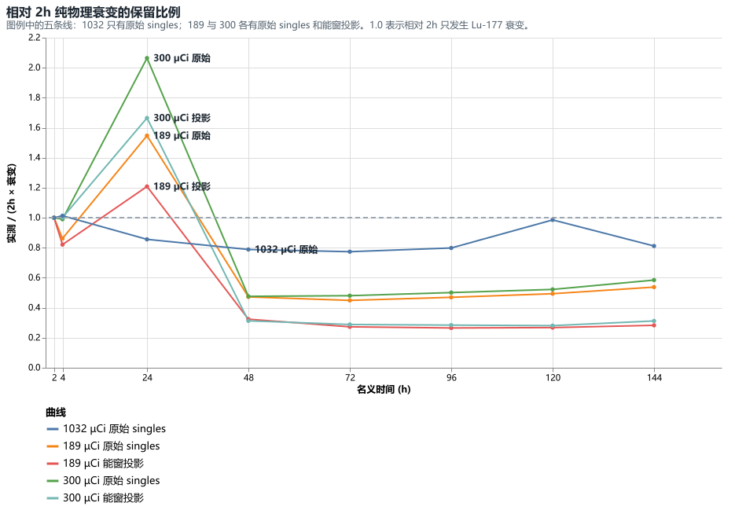

能窗接收比例（合并窗投影 / 原始 singles）三组都随时间下降。24h 没有单独塌成一个接收比例空洞。

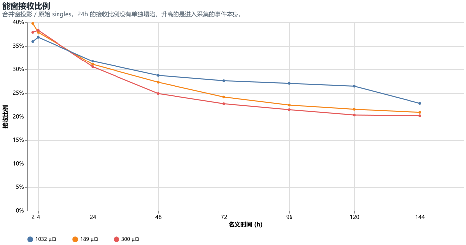

## 1032 µCi

1032 µCi 的扫描报告全程为小鼠。8 个时间点都是 1500 包、0 空包。SPECT 床中心在 115.3–118.3 mm，漂移小于 16.8 mm 床间距。

| 时间 | 原始 singles | 相对纯衰变 | 合并窗投影 | 接收比例 | 113/208 |
|---:|---:|---:|---:|---:|---:|
| 2h | 697,246 | 1.00 | 250,541 | 35.9% | 1.59 |
| 4h | 700,512 | 1.01 | 258,039 | 36.8% | 1.63 |
| 24h | 542,469 | 0.86 | 172,148 | 31.7% | 1.51 |
| 48h | 450,180 | 0.79 | 129,259 | 28.7% | 1.36 |
| 72h | 398,008 | 0.77 | 109,799 | 27.6% | 1.33 |
| 96h | 370,129 | 0.80 | 100,042 | 27.0% | 1.28 |
| 120h | 411,647 | 0.99 | 108,817 | 26.4% | 1.12 |
| 144h | 305,416 | 0.81 | 69,672 | 22.8% | 1.04 |

24h 的原始计数低于纯衰变（0.86），下降集中在 Bed2，其次是 Bed3；Bed4 与 Bed5 仍接近衰变线。Bed2 的 60 个角度是整圈按比例变低，没有某一段归零。有效事件和定位成功都紧贴原始 singles，计数主要留在能窗外。

120h 的原始 singles 高于 96h，衰变校正后回到 0.99。回升来自 Bed1、Bed4、Bed5；Bed2 与 Bed3 仍低于各自 2h 的衰变期望。能窗投影的回升小于原始 singles。

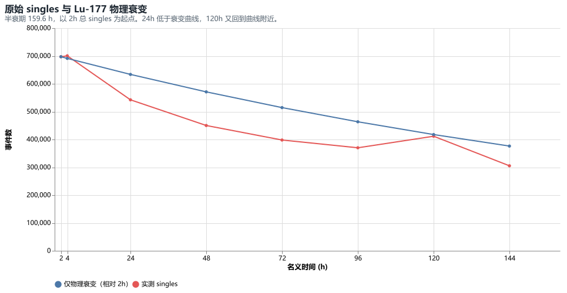

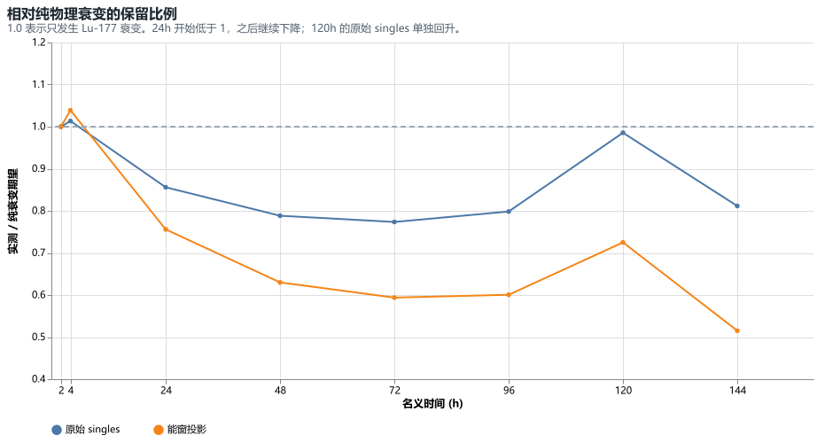

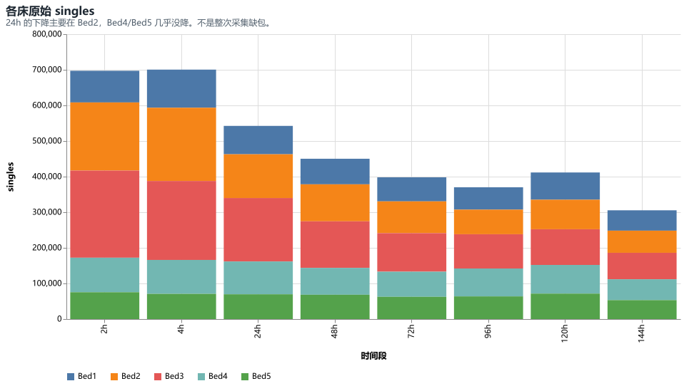

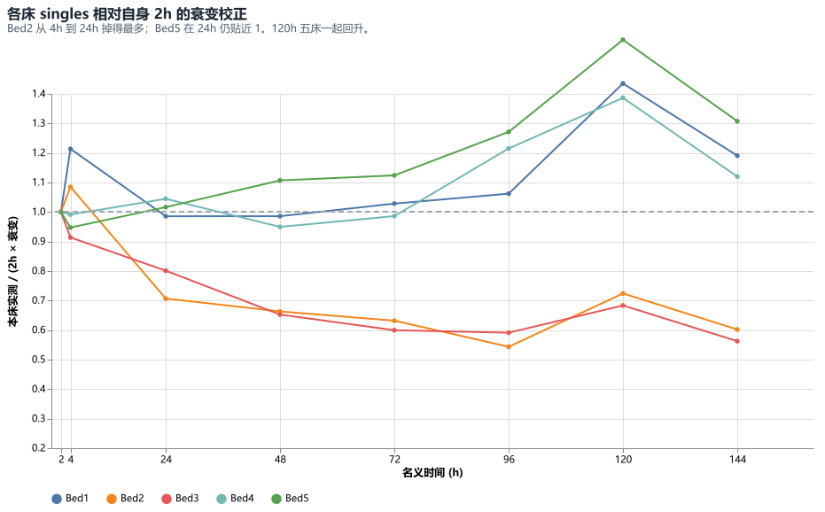

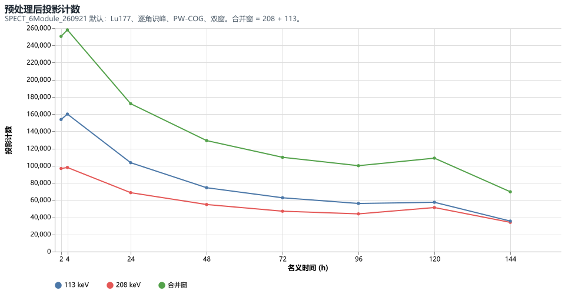

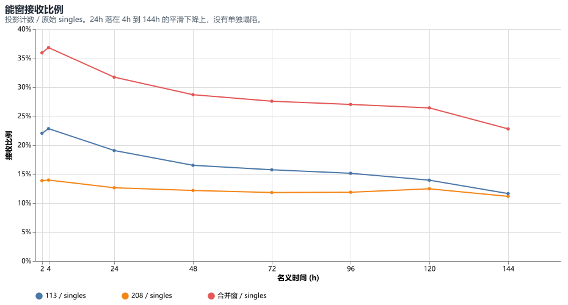

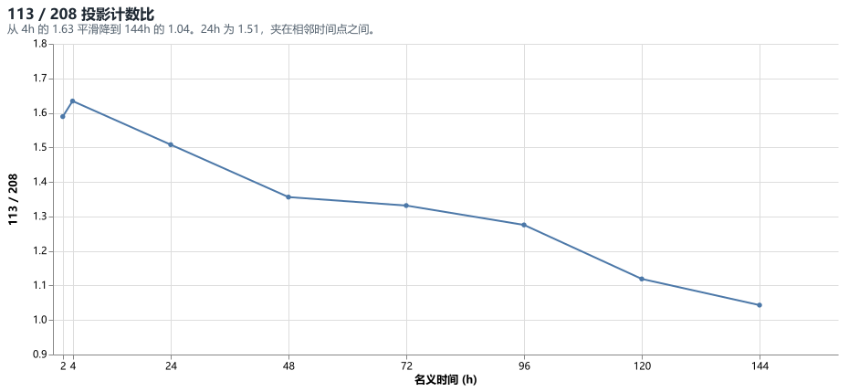

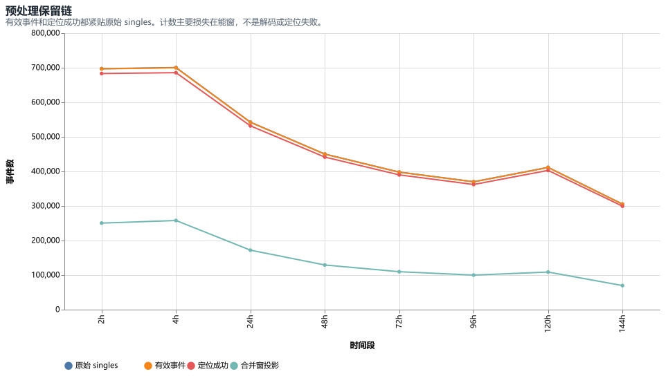

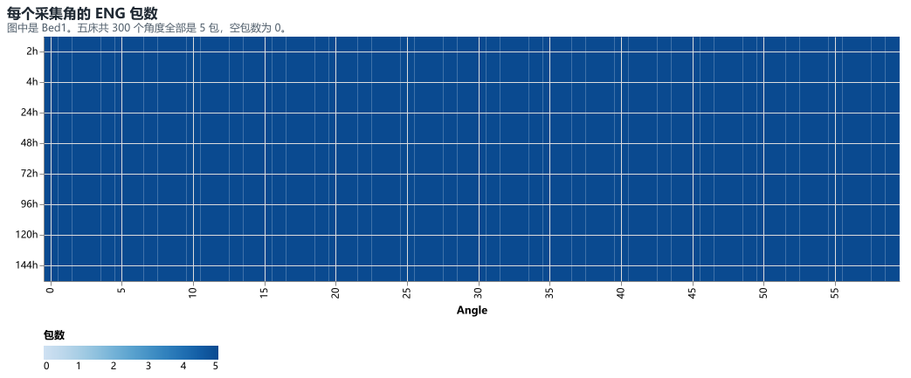

图中热力是 Bed1。五床 300 个角度的包数都是 5。

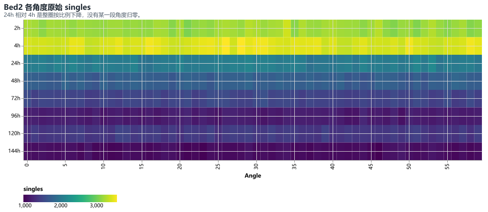

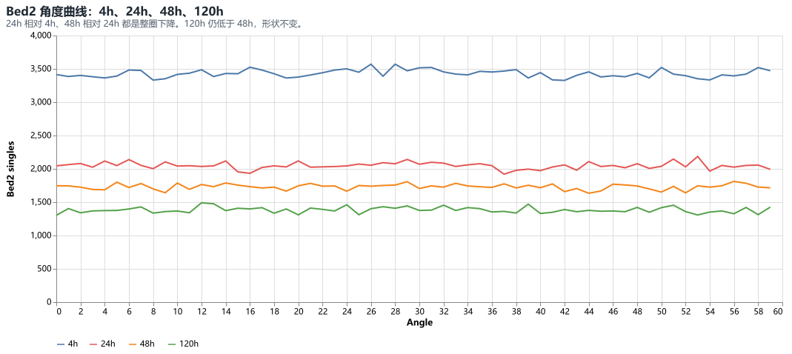

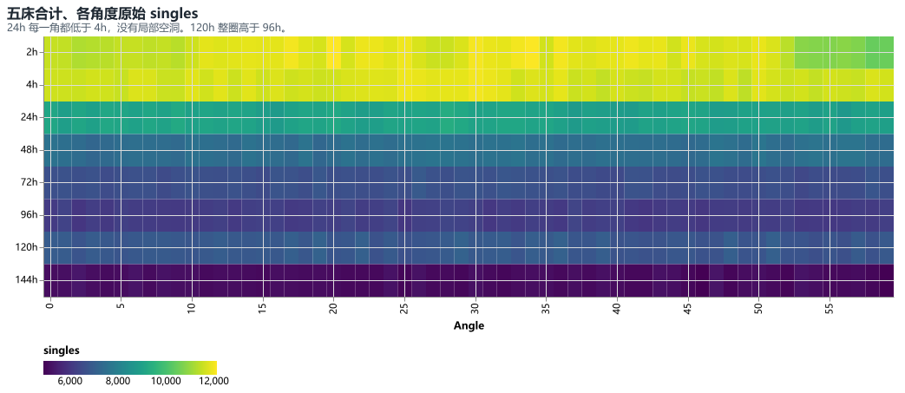

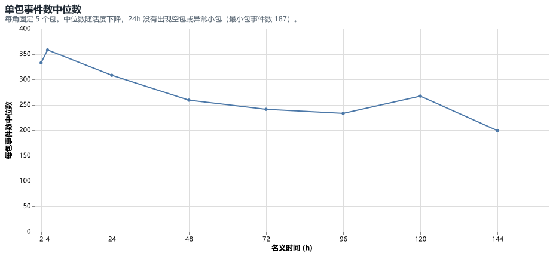

## 189 µCi 与 300 µCi

这两组的异常是同一个形状：24h 整圈升高，48h 整圈落到低平台，之后缓慢变化。每角停留时间仍约 5.03 s，不是把两次扫描叠进同一组文件。

| 时间 | 189 原始 | 189 原始/衰变 | 189 投影/衰变 | 189 113/208 | 300 原始 | 300 原始/衰变 | 300 投影/衰变 | 300 113/208 |
|---:|---:|---:|---:|---:|---:|---:|---:|---:|
| 2h | 920,764 | 1.00 | 1.00 | 1.71 | 850,970 | 1.00 | 1.00 | 1.67 |
| 4h | 786,835 | 0.86 | 0.82 | 1.63 | 834,918 | 0.99 | 1.00 | 1.63 |
| 24h | 1,294,733 | 1.55 | 1.21 | 1.00 | 1,596,497 | 2.06 | 1.67 | 0.94 |
| 48h | 356,100 | 0.47 | 0.32 | 1.27 | 331,820 | 0.48 | 0.31 | 1.18 |
| 72h | 305,175 | 0.45 | 0.27 | 1.13 | 301,679 | 0.48 | 0.29 | 1.09 |
| 96h | 287,485 | 0.47 | 0.27 | 1.03 | 283,540 | 0.50 | 0.28 | 0.99 |
| 120h | 272,272 | 0.49 | 0.27 | 0.97 | 266,231 | 0.52 | 0.28 | 0.95 |
| 144h | 267,201 | 0.54 | 0.28 | 0.94 | 268,526 | 0.58 | 0.31 | 0.91 |

24h 的合并窗、208 和 113 同时升高，所以尖峰留在能窗内。接收比例约 31%，低于 2h/4h 的约 38%，但仍落在随后继续下降的曲线上。24h 的 113/208 降到约 1.0，两侧时间点约 1.6–1.7。

五床一起升高，Bed4 与 Bed5 升得更多。300 µCi 的 Bed5 从 4h 的 81,249 增到 24h 的 299,573。角度曲线是整圈抬高。

189 µCi 的扫描报告并不全程是同一动物类型：2h 与 24h 为大鼠，4h 以及 48h–144h 为小鼠。因此 189 µCi 里小鼠时间点相对 2h 的衰变比值混合了两份记录。24h 对 2h 仍是大鼠对大鼠，原始计数仍是纯衰变期望的 1.55 倍。300 µCi 全程为小鼠，24h 尖峰和 48h 下跌同样存在。

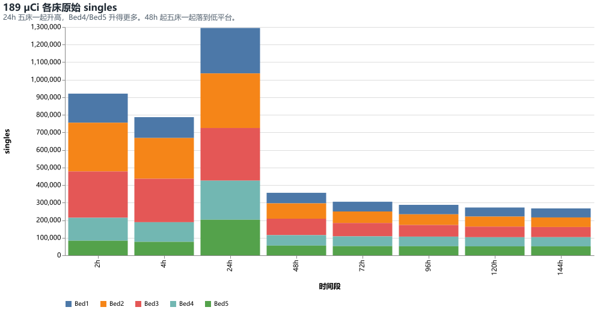

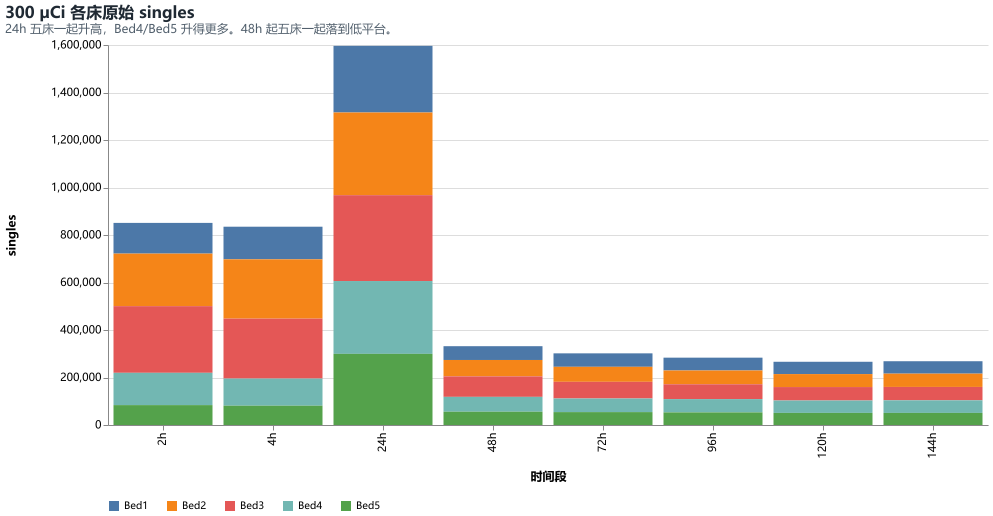

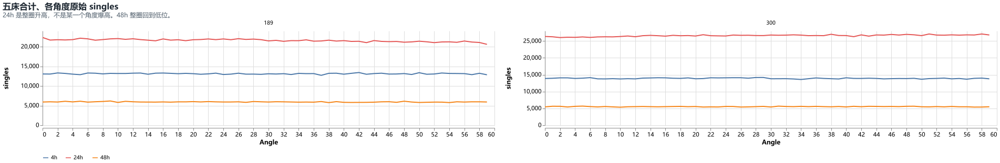

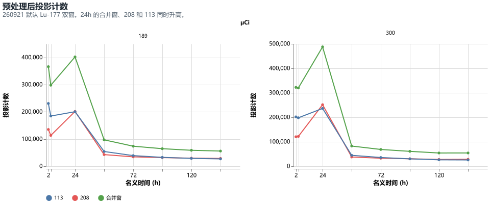

## 采集完整性附注

这些条目不构成 24h 尖峰：

- 189 µCi 的 120h、144h 各有一个早几分钟的空目录。`20260920_105529` 与 `20260921_104834` 的 CT 为空、没有 SPECT。实际采集是后一个时间戳 `20260920_110021` 与 `20260921_105208`，各 1500 个包。本报告使用后者。
- 300 µCi 的 72h 只缺 `Bed5/Angle57/data5.eng.zst`，该角剩 `data1`–`data4` 四个包。总包数 1499，空包仍为 0。

## 结论

1032 µCi 的文件是完整的。24h 低于纯衰变，主要少在 Bed2/Bed3，而且每个角度都按比例变低。120h 的原始 singles 相对 96h 回升，回升在外侧床。

189 µCi 与 300 µCi 的 24h 是整圈计数升高，48h 是整圈落到低平台。包数和每角时长正常。能窗投影保留了这个尖峰，同时 113/208 在 24h 降到约 1。189 µCi 还有大鼠/小鼠记录混用；300 µCi 没有这个记录差异，计数形态仍然相同。

本报告只比较计数、包完整性和能窗接收。没有把尖峰或下跌解释成注射活度、污染或体内再分布中的某一种。

## 证据

- 1032 µCi 汇总：`reports/assets/tumor-1032uci-20260922/series.csv`、`beds.csv`、`angles.csv`
- 189/300 µCi 汇总：`reports/assets/tumor-189-300uci-20260923/series.csv`
- 预处理批日志：`F:\DATA\predata\SUPER_PSC_1_0\tumor_189_300_batch.log`；1032 µCi 为同目录 `tumor_1032uci_260921\batch.log`
